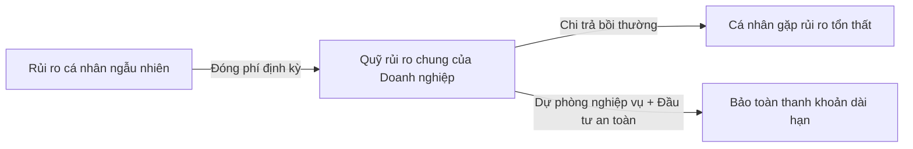
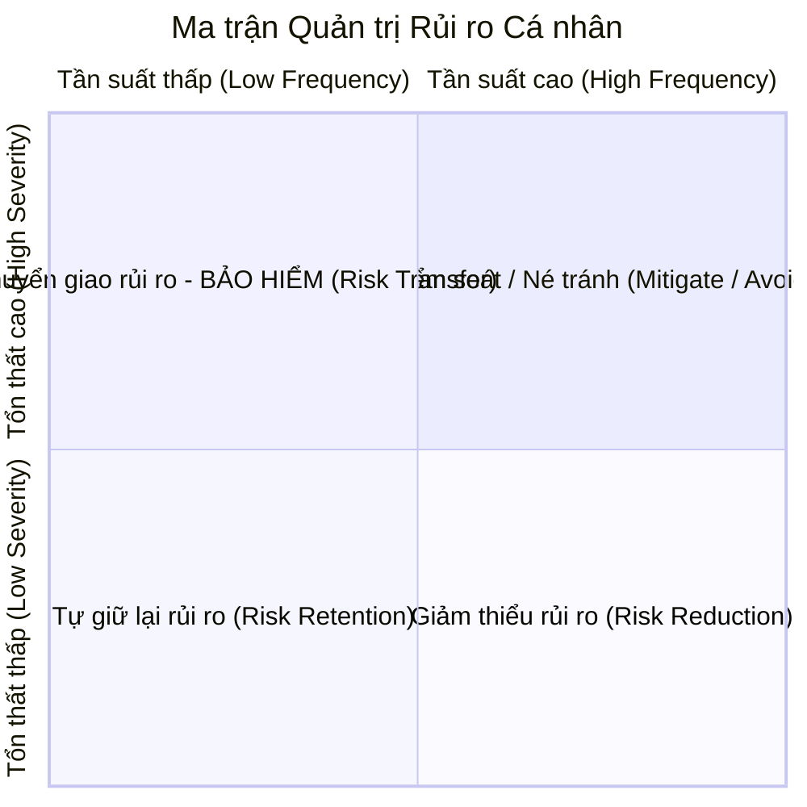
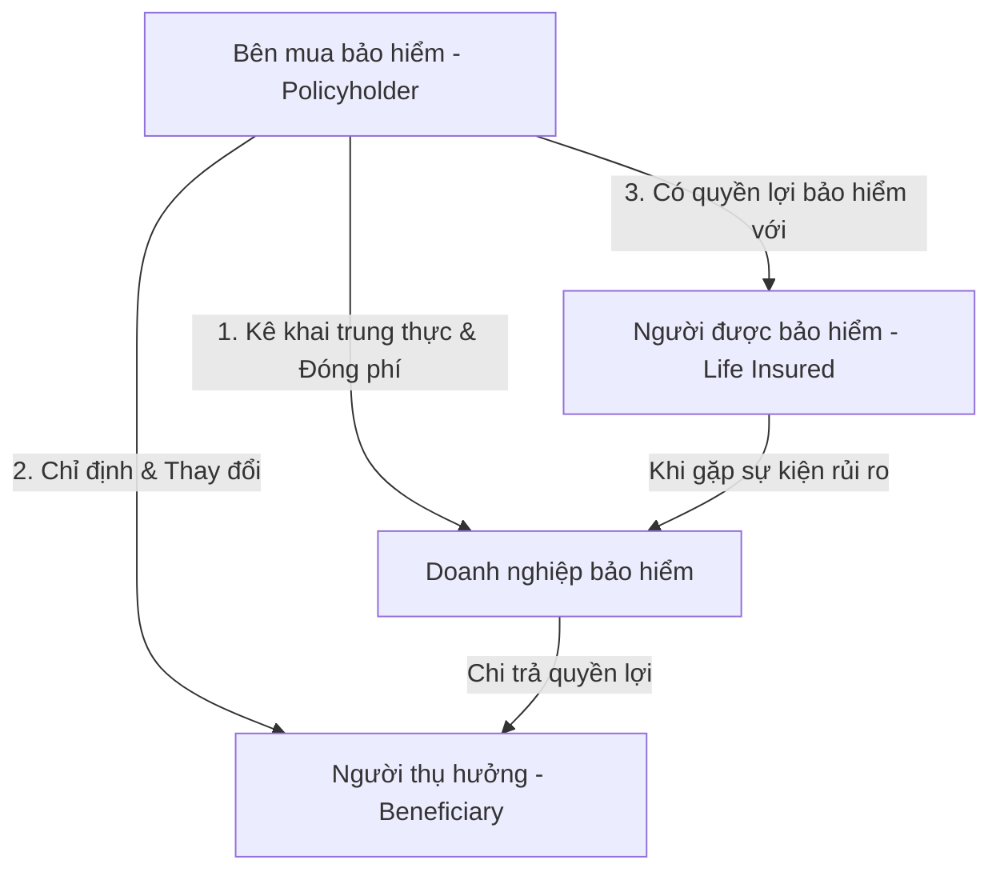
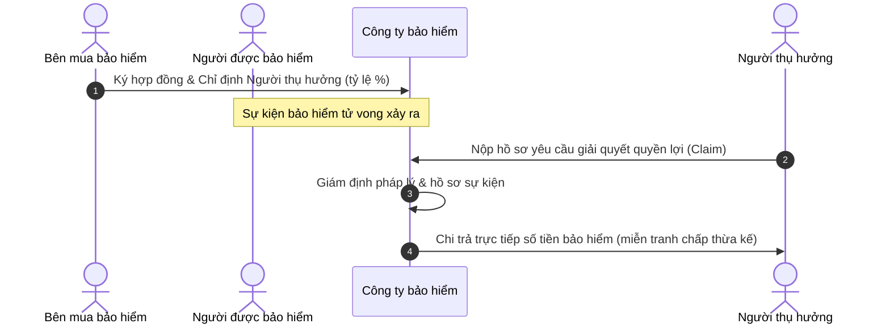
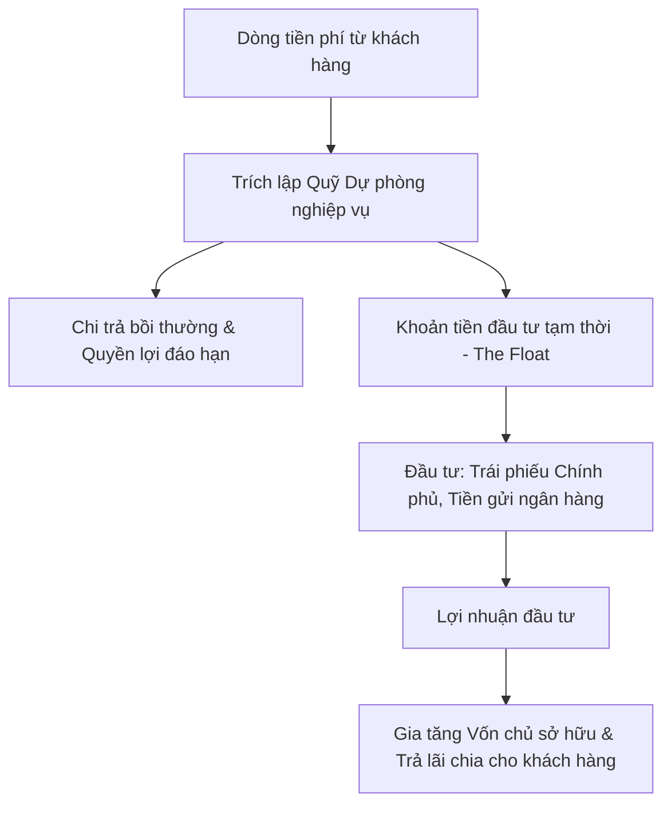

# Nguyên Lý Nền Tảng Và Cơ Chế Hoạt Động Của Bảo Hiểm

Bảo hiểm là trụ cột phòng thủ tối quan trọng trong cấu trúc tài chính cá nhân toàn diện, hoạt động như một tấm lưới an toàn bảo vệ tài sản và nguồn thu nhập trước các biến cố khốc liệt bất ngờ. Tài liệu này phân tích chi tiết bản chất kinh tế, lý thuyết gộp rủi ro, cơ chế chuyển dịch tổn thất và mối quan hệ pháp lý ràng buộc giữa các chủ thể trọng yếu trong hợp đồng bảo hiểm.

> **Các câu hỏi cốt lõi:**
> 1. Tại sao quy luật số lớn (Law of Large Numbers) lại biến rủi ro ngẫu nhiên khó lường của cá nhân thành xác suất tổn thất xác định của tổ chức bảo hiểm?
> 2. Sự khác biệt căn bản giữa việc tự gánh chịu tổn thất (Risk Retention) và chuyển dịch tổn thất (Risk Transfer) là gì?
> 3. Quyền và nghĩa vụ pháp lý giữa Bên mua bảo hiểm (Policyholder), Người thụ hưởng (Beneficiary) và Doanh nghiệp bảo hiểm (Insurer) được quy định như thế nào để ngăn chặn trục lợi bảo hiểm?

---

## 1. Insurance (Bảo hiểm)

### 1. Là gì?
- **Định nghĩa hình thức:** Bảo hiểm là một thỏa thuận pháp lý và tài chính mà theo đó một bên (Người được bảo hiểm/Bên mua) chấp nhận trả một khoản chi phí nhỏ xác định trước (Phí bảo hiểm - Premium) cho một tổ chức tài chính (Doanh nghiệp bảo hiểm) để đổi lấy cam kết bồi thường hoặc chi trả tài chính khi xảy ra một rủi ro cụ thể được thỏa thuận trong hợp đồng.
- **Giải thích đơn giản:** Bảo hiểm là việc bạn bỏ ra một số tiền nhỏ, cố định để mua sự bảo đảm rằng nếu có tai họa ập đến làm mất mát cả trăm triệu hay hàng tỷ đồng, bạn sẽ không bị phá sản vì đã có một công ty lớn đứng ra chi trả thay.
- **Nếu chỉ nhớ một điều:** Bảo hiểm không phải là kênh đầu tư sinh lời; bảo hiểm là công cụ chuyển đổi một tổn thất tiềm năng khổng lồ, ngẫu nhiên thành một khoản chi phí nhỏ, chắc chắn và chịu đựng được.

### 2. Hoạt động thế nào?
- **Chủ thể ra quyết định:** Người tham gia bảo hiểm (tìm kiếm sự bảo đảm tài chính) và Doanh nghiệp bảo hiểm (cung cấp sự bảo đảm để nhận phí).
- **Mục tiêu tối ưu hóa:** Người tham gia tối đa hóa tính ổn định của giá trị tài sản ròng và dòng tiền ($\max U(W)$); công ty bảo hiểm tối đa hóa lợi nhuận kỳ vọng từ phí bảo hiểm thuần và lợi nhuận đầu tư quỹ dự phòng.
- **Ràng buộc:** Rủi ro phải có tính chất đo lường được bằng tiền, mang tính ngẫu nhiên (không cố ý), có thể định lượng được xác suất tổn thất và tổn thất không được mang tính thảm họa hủy diệt toàn bộ số đông người tham gia cùng một lúc.
- **Cơ chế tác động:**


### 3. Công thức & Mô hình
Theo Lý thuyết Độ thỏa dụng kỳ vọng của von Neumann-Morgenstern (Expected Utility Theory), một cá nhân e ngại rủi ro (Risk-averse) có hàm thỏa dụng lõm $U''(W) < 0$. Nếu đối mặt với xác suất $p$ mất khoản tổn thất $L$ từ tài sản ban đầu $W_0$:
$$E[U] = (1 - p) U(W_0) + p U(W_0 - L)$$
Mức phí bảo hiểm tối đa cá nhân sẵn sàng trả ($P_{\max}$) để hoàn toàn xóa bỏ rủi ro thỏa mãn:
$$U(W_0 - P_{\max}) = E[U]$$
Khoản chênh lệch $P_{\max} - p L$ chính là phần bù rủi ro (Risk Premium). Công ty bảo hiểm định phí $P$ sao cho:
$$p L (1 + \lambda) \le P \le P_{\max}$$
Trong đó:
- $p L$: Tổn thất kỳ vọng thuần (Pure Expected Loss).
- $\lambda$: Hệ số chi phí vận hành, dự phòng rủi ro và biên lợi nhuận của nhà bảo hiểm (Loading factor).

### 4. Ví dụ
- **Ví dụ định lượng:** Một cá nhân có tài sản 1.000.000.000 VND. Xác suất gặp hỏa hoạn nhà cửa là $p = 0,1\%$ ($0,001$) mỗi năm với tổn thất ước tính $L = 500.000.000$ VND.
  - Tổn thất kỳ vọng thuần: $E[L] = 0,001 \times 500.000.000 = 500.000$ VND/năm.
  - Công ty bảo hiểm tính thêm chi phí quản lý $40\%$ ($\lambda = 0,4$). Phí bảo hiểm thường niên là:
    $$P = 500.000 \times (1 + 0,4) = 700.000 \text{ VND/năm}$$
  - Cá nhân chỉ cần bỏ ra 700.000 VND mỗi năm để triệt tiêu hoàn toàn rủi ro mất trắng nửa tỷ đồng.
- **Ví dụ thực tế:** Tại Việt Nam, Luật Kinh doanh bảo hiểm số 08/2022/QH15 quy định bảo hiểm thành 3 nhóm lớn: Bảo hiểm nhân thọ, Bảo hiểm phi nhân thọ và Bảo hiểm sức khỏe, tạo hành lang pháp lý bảo vệ quyền lợi người tham gia khi các công ty như Bảo Việt, Prudential hay Dai-ichi Life thực hiện cam kết tài chính.
- **Phản ví dụ (Counterfactual):** Một người từ chối mua bảo hiểm sức khỏe và tự tin giữ lại tiền phí 5 triệu/năm. Khi mắc bệnh hiểm nghèo cần 300 triệu tiền phẫu thuật, toàn bộ quỹ khẩn cấp tích lũy 5 năm (50 triệu) bị quét sạch ngay lập tức và người đó buộc phải bán tháo tài sản sinh lời hoặc vay mượn với lãi suất cao.

### 5. Ứng dụng & Tranh luận
- **Ứng dụng thực tiễn:** Xây dựng hàng rào bảo vệ các cột trụ tài sản cá nhân: bảo hiểm nhân thọ bảo vệ giá trị vốn con người; bảo hiểm sức khỏe bảo vệ quỹ tiết kiệm; bảo hiểm tài sản bảo vệ bất động sản và xe cộ.
- **Ưu và nhược điểm:**
  - *Ưu điểm:* Mang lại sự an tâm tuyệt đối (Peace of mind), phòng chống phá sản trước các sự kiện thiên nga đen.
  - *Nhược điểm:* Phí bảo hiểm là chi phí chìm (sunk cost) nếu không có sự kiện bảo hiểm xảy ra; hợp đồng thường dài dòng, phức tạp.
- **Sai lầm phổ biến:** Nhầm lẫn bảo hiểm với đầu tư sinh lời; hủy hợp đồng giữa chừng khi thấy nhiều năm không gặp sự cố, dẫn đến mất trắng khoản phí đã đóng mà mất luôn quyền bảo vệ.

### 6. Liên kết
- Cùng chủ đề: [02_Contract_Terms_Costs_and_Claims.md](file:///Users/ductri0981/Documents/Studying/Studying-Economic/04_Personal_Finance_and_Wealth_Management/07_Insurance_and_Personal_Risk_Protection/02_Contract_Terms_Costs_and_Claims.md)
- Liên kết chéo: [04_Saving_and_Emergency_Funds/02_Emergency_Rainy_Day_and_Sinking_Funds.md](file:///Users/ductri0981/Documents/Studying/Studying-Economic/04_Personal_Finance_and_Wealth_Management/04_Saving_and_Emergency_Funds/02_Emergency_Rainy_Day_and_Sinking_Funds.md)

---

## 2. Risk Pooling (Gộp chung rủi ro)

### 1. Là gì?
- **Định nghĩa hình thức:** Risk Pooling là nguyên lý bảo hiểm dựa trên việc tập hợp một số lượng rất lớn các cá nhân chịu những rủi ro đồng nhất độc lập vào một nhóm chung (pool), qua đó phân tán tổn thất của một số ít cá nhân không may mắn ra toàn bộ cộng đồng tham gia.
- **Giải thích đơn giản:** Giống như 10.000 người cùng bỏ vào một chiếc thùng mỗi người 100.000 đồng để tạo thành quỹ 1 tỷ đồng. Nếu trong năm có 2 người không may bị cháy nhà mất 500 triệu, quỹ này sẽ rút ra đền bù đủ cho họ mà không ai trong số 10.000 người bị kiệt quệ tài chính.
- **Nếu chỉ nhớ một điều:** Gộp rủi ro dựa trên Quy luật số lớn (Law of Large Numbers) để biến sự bất định cá nhân thành sự chắc chắn tập thể.

### 2. Hoạt động thế nào?
- **Chủ thể ra quyết định:** Chuyên gia định phí bảo hiểm (Actuary) thiết kế quy mô pool và phân loại rủi ro.
- **Mục tiêu tối ưu hóa:** Thu nhỏ độ lệch chuẩn của tổn thất trung bình về gần bằng 0 để ổn định tài chính cho quỹ.
- **Ràng buộc:** Rủi ro của các thành viên trong pool phải độc lập với nhau (uncorrelated risks). Nếu các rủi ro xảy ra đồng thời (tương quan dương cao như động đất, chiến tranh, đại dịch toàn cầu), nguyên lý gộp rủi ro sẽ bị phá vỡ.
- **Cơ chế tác động:**
```mermaid
graph TD
    P1[Cá nhân 1: Rủi ro độc lập $p$] --> Pool[Quỹ rủi ro chung - Risk Pool]
    P2[Cá nhân 2: Rủi ro độc lập $p$] --> Pool
    Pn[Cá nhân N: Rủi ro độc lập $p$] --> Pool
    Pool -->|Quy luật số lớn| Law[Sai số tổn thất bình quân $\sigma / \sqrt{N} \to 0$]
    Law --> Compensation[Chi trả tập trung cho cá nhân gặp sự cố]
```

### 3. Công thức & Mô hình
Giả sử $N$ cá nhân độc lập có biến ngẫu nhiên tổn thất $X_i$ với cùng kỳ vọng $E[X_i] = \mu$ và phương sai $\mathrm{Var}(X_i) = \sigma^2$. Tổn thất trung bình trên mỗi cá nhân trong pool là:
$$\bar{X}_N = \frac{1}{N} \sum_{i=1}^N X_i$$
Kỳ vọng và phương sai của tổn thất bình quân:
$$E[\bar{X}_N] = \mu$$
$$\mathrm{Var}(\bar{X}_N) = \frac{\sigma^2}{N} \implies \sigma(\bar{X}_N) = \frac{\sigma}{\sqrt{N}}$$
Theo Định lý Giới hạn Trung tâm (Central Limit Theorem):
Khi $N \to \infty$, độ lệch chuẩn của tổn thất bình quân tiến dần về 0 ($\frac{\sigma}{\sqrt{N}} \to 0$), giúp công ty bảo hiểm dự báo chính xác gần như tuyệt đối số tiền cần chi trả bồi thường hàng năm.

### 4. Ví dụ
- **Ví dụ định lượng:** Một nhóm rủi ro có độ lệch chuẩn tổn thất cá nhân là $\sigma = 50.000.000$ VND.
  - Nếu chỉ có $N = 100$ người tham gia: $\sigma(\bar{X}) = \frac{50.000.000}{\sqrt{100}} = 5.000.000$ VND (độ biến động còn rất cao, rủi ro vỡ quỹ lớn).
  - Nếu công ty bảo hiểm mở rộng pool lên $N = 1.000.000$ người:
    $$\sigma(\bar{X}) = \frac{50.000.000}{\sqrt{1.000.000}} = \frac{50.000.000}{1.000} = 50.000 \text{ VND}$$
  - Mức độ bất định về chi phí bồi thường bình quân chỉ còn vỏn vẹn 50.000 VND/người, cho phép định phí bảo hiểm cực kỳ chính xác.
- **Ví dụ thực tế:** Hệ thống Bảo hiểm Y tế toàn dân tại Việt Nam do BHXH Việt Nam vận hành là một ví dụ quy mô quốc gia về Risk Pooling. Hàng chục triệu người khỏe mạnh đóng BHYT hàng tháng để chi trả chi phí điều trị đắt đỏ cho các bệnh nhân ung thư, chạy thận nhân tạo.
- **Phản ví dụ (Counterfactual):** Một nhóm 10 người hàng xóm cùng lập quỹ tương hỗ xe máy. Tháng đầu tiên, 2 người bị tai nạn cùng lúc với chi phí sửa chữa vượt xa tổng số tiền quỹ gom được. Do quy mô pool quá nhỏ ($N=10$), quỹ lập tức vỡ nợ và sụp đổ.

### 5. Ứng dụng & Tranh luận
- **Ứng dụng thực tiễn:** Giúp các công ty bảo hiểm mở rộng tệp khách hàng để hạ giá thành sản phẩm; bảo hiểm xã hội duy trì an sinh cộng đồng.
- **Ưu và nhược điểm:**
  - *Ưu điểm:* Xóa tan sự bất định tài chính, tạo khả năng tiếp cận dịch vụ bảo vệ giá rẻ cho người có thu nhập thấp.
  - *Nhược điểm:* Nguy cơ Lựa chọn đối nghịch (Adverse Selection) khi người có rủi ro cao đổ xô vào pool nhiều hơn người khỏe mạnh, dẫn đến việc tăng phí và làm người khỏe mạnh rời bỏ pool (Death spiral).
- **Sai lầm phổ biến:** Nghĩ rằng bảo hiểm là "tiền mình đóng vào thì phải thuộc về mình", từ đó tìm cách gian lận hoặc yêu cầu bồi thường vô căn cứ để "gỡ vốn".

### 6. Liên kết
- Cùng chủ đề: [06_Liability_and_Risk_Transfer.md](file:///Users/ductri0981/Documents/Studying/Studying-Economic/04_Personal_Finance_and_Wealth_Management/07_Insurance_and_Personal_Risk_Protection/06_Liability_and_Risk_Transfer.md)
- Liên kết chéo: [01_Personal_Finance_Foundations/01_Literacy_Planning_and_Management.md](file:///Users/ductri0981/Documents/Studying/Studying-Economic/04_Personal_Finance_and_Wealth_Management/01_Personal_Finance_Foundations/01_Literacy_Planning_and_Management.md)

---

## 3. Risk Transfer (Chuyển giao rủi ro)

### 1. Là gì?
- **Định nghĩa hình thức:** Chuyển giao rủi ro là một chiến lược quản trị rủi ro mà theo đó gánh nặng tài chính phát sinh từ một tổn thất tiềm tàng được chuyển dịch theo hợp đồng từ một chủ thể (cá nhân hoặc doanh nghiệp) sang một chủ thể khác (thường là công ty bảo hiểm) có năng lực tài chính và khả năng hấp thụ rủi ro tốt hơn.
- **Giải thích đơn giản:** Thay vì tự mình gánh chịu hậu quả sập nhà, hư xe hay mắc bệnh nan y, bạn trả tiền để "bán" trách nhiệm gánh chịu hậu quả đó cho công ty bảo hiểm.
- **Nếu chỉ nhớ một điều:** Chuyển giao rủi ro không làm biến mất hiểm họa trong thực tế (bạn vẫn có thể ốm hoặc gặp tai nạn), nó chỉ chuyển dịch tổn thất tài chính đi kèm hiểm họa đó sang túi tiền của người khác.

### 2. Hoạt động thế nào?
- **Chủ thể ra quyết định:** Cá nhân/hộ gia đình phân loại ma trận rủi ro (Risk Matrix: Tần suất và Mức độ nghiêm trọng) để quyết định chuyển giao hay tự giữ lại.
- **Mục tiêu tối ưu hóa:** Bảo vệ sự tồn tại liên tục của bảng cân đối tài sản cá nhân trước các thảm họa tài chính có xác suất thấp nhưng mức độ tổn thất cực đại (Low frequency, High severity).
- **Ràng buộc:** Chi phí chuyển giao (phí bảo hiểm) phải hợp lý so với năng lực thu nhập của người chuyển giao; hợp đồng phải tuân thủ nguyên tắc trung thực tuyệt đối.
- **Cơ chế tác động:**


### 3. Công thức & Mô hình
Giá trị tài sản ròng kỳ vọng khi cá nhân giữ lại rủi ro (Retention) so với chuyển giao rủi ro (Transfer):
- Khi tự giữ lại rủi ro ($W_{\text{retain}}$):
  $$W_{\text{retain}} = W_0 - \tilde{L}, \quad \text{với } \tilde{L} = \begin{cases} L & \text{với xác suất } p \\ 0 & \text{với xác suất } 1 - p \end{cases}$$
- Khi chuyển giao rủi ro qua bảo hiểm ($W_{\text{transfer}}$):
  $$W_{\text{transfer}} = W_0 - P$$
Cá nhân chọn chuyển giao rủi ro khi:
$$U(W_{\text{transfer}}) > E[U(W_{\text{retain}})] \iff U(W_0 - P) > (1-p)U(W_0) + pU(W_0 - L)$$

### 4. Ví dụ
- **Ví dụ định lượng:** Một tài xế sở hữu ô tô trị giá 800.000.000 VND. Nguy cơ gây tai nạn cho người khác dẫn đến trách nhiệm bồi thường lên tới 2.000.000.000 VND có xác suất $p = 0,05\%$/năm.
  - Nếu tự giữ rủi ro: Nếu biến cố xảy ra, người này phá sản với tài sản ròng âm.
  - Nếu chuyển giao: Mua bảo hiểm trách nhiệm dân sự mở rộng với phí $2.500.000$ VND/năm. Hạn mức chi trả chuyển sang công ty bảo hiểm tối đa 2 tỷ VND. Rủi ro khổng lồ được khóa chặt ở mức chi phí cố định 2,5 triệu đồng.
- **Ví dụ thực tế:** Các doanh nhân hoặc chuyên gia y tế tại Việt Nam mua bảo hiểm Trách nhiệm nghề nghiệp (Professional Indemnity Insurance) để chuyển giao rủi ro bị khách hàng hoặc bệnh nhân kiện tụng đòi bồi thường thiệt hại hàng tỷ đồng khi có sai sót chuyên môn.
- **Phản ví dụ (Counterfactual):** Một chủ cửa hàng ăn uống không mua bảo hiểm cháy nổ bắt buộc (tự giữ rủi ro). Chập điện ban đêm thiêu rụi toàn bộ cơ sở kinh doanh và lan sang nhà lân cận, gây thiệt hại 4 tỷ VND. Toàn bộ tiền tích lũy cả đời bị tịch thu để bồi thường thiệt hại dân sự.

### 5. Ứng dụng & Tranh luận
- **Ứng dụng thực tiễn:** Ứng dụng chiến lược cho rủi ro góc phần tư thứ 2: Chết sớm của trụ cột gia đình (Bảo hiểm nhân thọ), Mắc ung thư hiểm nghèo (Bảo hiểm bệnh hiểm nghèo), Mất nhà do thiên tai (Bảo hiểm hỏa hoạn).
- **Ưu và nhược điểm:**
  - *Ưu điểm:* Cắt đuôi tổn thất xấu nhất (tail risk truncation), đảm bảo sự an toàn vĩnh viễn cho mục tiêu tài chính dài hạn.
  - *Nhược điểm:* Có thể sinh ra Tâm lý ỷ lại (Moral Hazard) – người tham gia trở nên bất cẩn hơn vì biết có bảo hiểm bồi thường.
- **Sai lầm phổ biến:** Chuyển giao những rủi ro vụn vặt có tần suất cao tổn thất thấp (như trầy xước điện thoại, mất ô dù) bằng các gói bảo hiểm đắt đỏ thay vì tự chi trả bằng quỹ khẩn cấp.

### 6. Liên kết
- Cùng chủ đề: [07_Risk_Assessment_Coverage_Gaps_and_Fraud.md](file:///Users/ductri0981/Documents/Studying/Studying-Economic/04_Personal_Finance_and_Wealth_Management/07_Insurance_and_Personal_Risk_Protection/07_Risk_Assessment_Coverage_Gaps_and_Fraud.md)
- Liên kết chéo: [05_Debt_and_Credit_Management/06_Distress_Default_and_Predatory_Risks.md](file:///Users/ductri0981/Documents/Studying/Studying-Economic/04_Personal_Finance_and_Wealth_Management/05_Debt_and_Credit_Management/06_Distress_Default_and_Predatory_Risks.md)

---

## 4. Policyholder (Bên mua bảo hiểm)

### 1. Là gì?
- **Định nghĩa hình thức:** Bên mua bảo hiểm là tổ chức hoặc cá nhân giao kết hợp đồng bảo hiểm với doanh nghiệp bảo hiểm và có nghĩa vụ đóng phí bảo hiểm theo đúng thỏa thuận ghi trong hợp đồng.
- **Giải thích đơn giản:** Bên mua bảo hiểm là người đứng tên ký hợp đồng, trả tiền phí bảo hiểm và nắm quyền quyết định lớn nhất đối với hợp đồng đó (như chỉ định người thụ hưởng, vay tiền trên hợp đồng, hoặc hủy hợp đồng).
- **Nếu chỉ nhớ một điều:** Bên mua bảo hiểm là chủ thể pháp lý sở hữu hợp đồng; họ có thể đồng thời là Người được bảo hiểm hoặc mua cho người thân có mối quan hệ quyền lợi bảo hiểm được pháp luật công nhận.

### 2. Hoạt động thế nào?
- **Chủ thể ra quyết định:** Cá nhân trưởng thành có đầy đủ năng lực hành vi dân sự hoặc pháp nhân được thành lập hợp pháp.
- **Mục tiêu tối ưu hóa:** Thiết lập phạm vi bảo vệ tài chính tối ưu cho bản thân hoặc người phụ thuộc với mức phí phù hợp với ngân sách thu nhập.
- **Ràng buộc:** Phải có Quyền lợi có thể được bảo hiểm (Insurable Interest) đối với đối tượng bảo hiểm tại thời điểm ký kết hợp đồng; phải thực hiện nghĩa vụ kê khai thông tin trung thực tuyệt đối (Utmost Good Faith).
- **Cơ chế tác động:**


### 3. Công thức & Mô hình
Mối quan hệ Quyền lợi có thể được bảo hiểm ($II$) theo Điều 34 Luật Kinh doanh bảo hiểm Việt Nam:
$$II = f(\text{Quan hệ huyết thống, Hôn nhân, Nuôi dưỡng, Nghĩa vụ tài chính})$$
Bên mua bảo hiểm chỉ có thể mua cho:
1. Bản thân.
2. Vợ hoặc chồng.
3. Cha, mẹ, con.
4. Anh, chị, em ruột hoặc người khác có quan hệ nuôi dưỡng, cấp dưỡng.
5. Người có quyền lợi về tài chính hoặc nghĩa vụ tài chính với bên mua (như chủ nợ - con nợ, đối tác góp vốn).

### 4. Ví dụ
- **Ví dụ định lượng:** Anh Nam (35 tuổi) là trụ cột gia đình, mua một hợp đồng bảo hiểm nhân thọ mệnh giá 2.000.000.000 VND. Anh là Bên mua bảo hiểm, tự mình đứng tên Người được bảo hiểm, và chỉ định vợ là Người thụ hưởng. Phí bảo hiểm 25.000.000 VND/năm (chiếm khoảng $7\%$ thu nhập 350 triệu/năm). Anh Nam hoàn thành đầy đủ nghĩa vụ đóng phí và có toàn quyền thay đổi Người thụ hưởng sang con cái khi cần.
- **Ví dụ thực tế:** Tại Việt Nam, nhiều trường hợp bố mẹ là Bên mua bảo hiểm đứng ra mua bảo hiểm sức khỏe hoặc nhân thọ tích lũy học vấn cho con cái (Người được bảo hiểm) từ khi con còn nhỏ; khi con tròn 18 tuổi, bố mẹ có quyền làm thủ tục chuyển giao quyền Bên mua bảo hiểm cho người con tiếp quản.
- **Phản ví dụ (Counterfactual):** Một cá nhân thấy hàng xóm lớn tuổi hay ốm đau liền tự ý bỏ tiền ra làm Bên mua bảo hiểm để mua bảo hiểm nhân thọ cho người hàng xóm đó hòng trục lợi khi họ qua đời. Hợp đồng này vô hiệu tuyệt đối trước pháp luật do Bên mua không có Quyền lợi có thể được bảo hiểm.

### 5. Ứng dụng & Tranh luận
- **Ứng dụng thực tiễn:** Quản lý kế hoạch thừa kế và bảo vệ gia đình; tận dụng quyền rút giá trị tài khoản hoặc thế chấp hợp đồng để vay tiền giải quyết thanh khoản khẩn cấp.
- **Ưu và nhược điểm:**
  - *Ưu điểm:* Toàn quyền định đoạt hợp đồng bảo hiểm (thay đổi người thụ hưởng, điều chỉnh mệnh giá, rút tiền).
  - *Nhược điểm:* Chịu toàn bộ trách nhiệm pháp lý về việc đóng phí đúng hạn; nếu ngừng đóng phí vi phạm thời gian ân hạn (60 ngày), hợp đồng sẽ mất hiệu lực.
- **Sai lầm phổ biến:** Nhờ đại lý bảo hiểm ký thay hoặc kê khai dối trá tiền sử bệnh án nhằm được chấp thuận hợp đồng, dẫn đến việc công ty bảo hiểm từ chối bồi thường và hủy hợp đồng khi có sự kiện phát sinh.

### 6. Liên kết
- Cùng chủ đề: [02_Contract_Terms_Costs_and_Claims.md](file:///Users/ductri0981/Documents/Studying/Studying-Economic/04_Personal_Finance_and_Wealth_Management/07_Insurance_and_Personal_Risk_Protection/02_Contract_Terms_Costs_and_Claims.md)
- Liên kết chéo: [08_Retirement_Planning/05_Estate_and_Inheritance_Planning.md](file:///Users/ductri0981/Documents/Studying/Studying-Economic/04_Personal_Finance_and_Wealth_Management/08_Retirement_Planning/05_Estate_and_Inheritance_Planning.md)

---

## 5. Beneficiary (Người thụ hưởng)

### 1. Là gì?
- **Định nghĩa hình thức:** Người thụ hưởng là tổ chức hoặc cá nhân được Bên mua bảo hiểm chỉ định trong hợp đồng bảo hiểm để nhận toàn bộ hoặc một phần số tiền bảo hiểm hoặc quyền lợi bồi thường khi sự kiện bảo hiểm xảy ra.
- **Giải thích đơn giản:** Người thụ hưởng là người nhận tiền từ công ty bảo hiểm khi có biến cố xảy ra với người được bảo hiểm (ví dụ: người vợ nhận tiền bồi thường khi chồng chẳng may qua đời).
- **Nếu chỉ nhớ một điều:** Tiền chi trả cho Người thụ hưởng được chỉ định hợp pháp không phải là di sản thừa kế của người quá cố, do đó không phải chia thừa kế theo luật và được bảo vệ tối đa khỏi các chủ nợ của người được bảo hiểm.

### 2. Hoạt động thế nào?
- **Chủ thể ra quyết định:** Do Bên mua bảo hiểm chỉ định hoặc thay đổi trong suốt thời gian hợp đồng còn hiệu lực (trừ khi có thỏa thuận khác).
- **Mục tiêu tối ưu hóa:** Đảm bảo dòng tiền cứu trợ tài chính được chuyển giao trực tiếp, nhanh chóng và chính xác cho những người phụ thuộc tài chính sau khi người trụ cột mất đi.
- **Ràng buộc:** Người thụ hưởng không được thực hiện hành vi cố ý gây ra cái chết hoặc thương tật cho Người được bảo hiểm nhằm chiếm đoạt tiền bảo hiểm; nếu có nhiều người thụ hưởng thì tỷ lệ phân chia phải được xác định rõ ràng.
- **Cơ chế tác động:**


### 3. Công thức & Mô hình
Phân bổ số tiền bảo hiểm chi trả ($S$) cho $M$ người thụ hưởng được chỉ định theo tỷ lệ phần trăm thỏa thuận $w_i$:
$$S_i = w_i \times S, \quad \text{với } \sum_{i=1}^M w_i = 100\%$$
Nếu Bên mua bảo hiểm không chỉ định Người thụ hưởng, hoặc Người thụ hưởng đã qua đời trước Người được bảo hiểm mà không có người thay thế:
$$S \to \text{Khối di sản thừa kế (Estate)} \implies S_j = \text{Chia theo Luật Thừa kế Dân sự}$$
(Lúc này số tiền bảo hiểm sẽ bị đánh thuế thừa kế nếu có, bị khấu trừ thanh toán các nghĩa vụ nợ nần của người mất trước khi chia cho thân nhân).

### 4. Ví dụ
- **Ví dụ định lượng:** Một hợp đồng bảo hiểm có mệnh giá bồi thường $S = 3.000.000.000$ VND. Bên mua bảo hiểm chỉ định 2 người thụ hưởng:
  - Vợ: $w_1 = 60\% \implies S_1 = 1.800.000.000$ VND.
  - Con trai: $w_2 = 40\% \implies S_2 = 1.200.000.000$ VND.
  - Khi sự kiện tử vong xảy ra, công ty bảo hiểm chuyển khoản trực tiếp số tiền này vào tài khoản của từng người trong vòng 15-30 ngày sau khi hoàn tất hồ sơ, không cần qua thủ tục khai nhận di sản tại phòng công chứng.
- **Ví dụ thực tế:** Tại Việt Nam, nhiều vụ tranh chấp quyền lợi bảo hiểm kéo dài chỉ vì Bên mua bảo hiểm để trống ô "Người thụ hưởng". Khi người được bảo hiểm mất, khoản tiền rơi vào hàng thừa kế thứ nhất, dẫn đến việc các đồng thừa kế (bố mẹ ruột, vợ, các con của các cuộc hôn nhân trước) kiện tụng phân chia tài sản.
- **Phản ví dụ (Counterfactual):** Một người thụ hưởng lên kế hoạch ám sát người được bảo hiểm để nhận 5 tỷ đồng tiền bảo hiểm. Theo Điều 40 Luật Kinh doanh bảo hiểm, công ty bảo hiểm từ chối bồi thường cho người này; quyền lợi bảo hiểm sẽ được chuyển cho những người thụ hưởng hợp pháp khác hoặc hàng thừa kế của người được bảo hiểm, còn kẻ phạm tội bị truy tố hình sự.

### 5. Ứng dụng & Tranh luận
- **Ứng dụng thực tiễn:** Công cụ cốt lõi trong Hoạch định di sản (Estate Planning), bảo vệ con chưa thành niên, đảm bảo nguồn sinh kế tức thời cho gia đình mà không bị phong tỏa bởi các thủ tục pháp lý tranh chấp tài sản.
- **Ưu và nhược điểm:**
  - *Ưu điểm:* Thanh khoản tức thì, bảo mật tài chính, vượt qua thủ tục tố tụng thừa kế rườm rà.
  - *Nhược điểm:* Nếu quên cập nhật sau ly hôn, số tiền bảo hiểm có thể vô tình chuyển cho người vợ/chồng cũ thay vì con cái hay gia đình hiện tại.
- **Sai lầm phổ biến:** Không ghi rõ họ tên, số căn cước công dân và tỷ lệ phần trăm phân bổ của từng người thụ hưởng, hoặc để chỉ định mặc định là "người thừa kế hợp pháp".

### 6. Liên kết
- Cùng chủ đề: [03_Life_Insurance_Structures.md](file:///Users/ductri0981/Documents/Studying/Studying-Economic/04_Personal_Finance_and_Wealth_Management/07_Insurance_and_Personal_Risk_Protection/03_Life_Insurance_Structures.md)
- Liên kết chéo: [08_Retirement_Planning/05_Estate_and_Inheritance_Planning.md](file:///Users/ductri0981/Documents/Studying/Studying-Economic/04_Personal_Finance_and_Wealth_Management/08_Retirement_Planning/05_Estate_and_Inheritance_Planning.md)

---

## 6. Insurer (Doanh nghiệp bảo hiểm / Người bảo hiểm)

### 1. Là gì?
- **Định nghĩa hình thức:** Doanh nghiệp bảo hiểm là tổ chức kinh tế được cơ quan quản lý nhà nước có thẩm quyền cấp giấy phép thành lập và hoạt động để kinh doanh bảo hiểm, tái bảo hiểm, chấp nhận rủi ro của người khác dựa trên cơ sở thu phí và cam kết bồi thường.
- **Giải thích đơn giản:** Doanh nghiệp bảo hiểm là công ty tài chính đứng ra bán hợp đồng bảo hiểm, thu tiền phí của hàng triệu khách hàng, quản lý nguồn vốn quỹ đó và đứng ra đền tiền cho những khách hàng không may gặp rủi ro.
- **Nếu chỉ nhớ một điều:** Doanh nghiệp bảo hiểm hoạt động dựa trên hai cỗ máy lợi nhuận song hành: Lợi nhuận từ hoạt động định phí/nghiệp vụ bảo hiểm (Underwriting Profit) và Lợi nhuận từ việc đem quỹ phí nhàn rỗi đi đầu tư an toàn (Investment Float).

### 2. Hoạt động thế nào?
- **Chủ thể ra quyết định:** Hội đồng quản trị, ban giám đốc điều hành, chuyên gia định phí (Actuary) và giám đốc đầu tư (CIO).
- **Mục tiêu tối ưu hóa:** Tối đa hóa lợi nhuận ròng trên vốn chủ sở hữu (ROE) trong khi phải duy trì tỷ lệ biên khả năng thanh toán (Solvency Margin) vượt chuẩn an toàn pháp định.
- **Ràng buộc:** Bị kiểm soát gắt gao bởi Bộ Tài chính (tại Việt Nam) về dự phòng nghiệp vụ, tỷ lệ vốn an toàn và danh mục đầu tư (không được phép đầu tư vào tài sản rủi ro cao như tiền mã hóa hay cổ phiếu đầu cơ).
- **Cơ chế tác động:**


### 3. Công thức & Mô hình
Lợi nhuận toàn diện của Doanh nghiệp bảo hiểm ($\Pi$):
$$\Pi = (\text{Premiums Earned} - \text{Incurred Losses} - \text{Underwriting Expenses}) + \text{Investment Income}$$
Tỷ lệ kết hợp (Combined Ratio - $CR$): Chỉ số đo lường hiệu quả nghiệp vụ bảo hiểm thuần túy:
$$CR = \frac{\text{Tổn thất phát sinh (Incurred Losses)} + \text{Chi phí nghiệp vụ (Expenses)}}{\text{Doanh thu phí thuần (Earned Premiums)}}$$
- Nếu $CR < 100\%$: Doanh nghiệp có lãi thuần từ nghiệp vụ bảo hiểm (Underwriting Profit).
- Nếu $CR > 100\%$: Doanh nghiệp lỗ nghiệp vụ bảo hiểm, buộc phải bù đắp bằng lợi nhuận từ kênh đầu tư vốn nhàn rỗi (Float).

### 4. Ví dụ
- **Ví dụ định lượng:** Một công ty bảo hiểm phi nhân thọ có doanh thu phí thuần trong năm là 1.000 tỷ VND.
  - Tổng số tiền chi trả bồi thường: 600 tỷ VND.
  - Chi phí bán hàng, hoa hồng và quản lý doanh nghiệp: 350 tỷ VND.
  - Tỷ lệ kết hợp:
    $$CR = \frac{600 + 350}{1.000} = \frac{950}{1.000} = 95\%$$
    Công ty có tỷ suất lợi nhuận nghiệp vụ thuần là $5\%$ (50 tỷ VND).
  - Đồng thời, quỹ dự phòng nhàn rỗi 2.000 tỷ VND được gửi vào trái phiếu chính phủ và tiền gửi kỳ hạn mang lại lãi suất $6\%$/năm (120 tỷ VND).
  - Tổng lợi nhuận trước thuế: $50 + 120 = 170$ tỷ VND.
- **Ví dụ thực tế:** Tập đoàn Berkshire Hathaway của tỷ phú Warren Buffett là mô hình kinh điển thế giới về việc khai thác sức mạnh của "The Float" từ các công ty bảo hiểm con như GEICO, General Re để tạo nguồn vốn đầu tư giá rẻ vô tận suốt nửa thế kỷ.
- **Phản ví dụ (Counterfactual):** Một công ty bảo hiểm hạ giá phí vô tội vạ để tranh giành thị phần, khiến tỷ lệ kết hợp vọt lên $CR = 140\%$. Khi thiên tai bão lũ xảy ra dồn dập, tiền bồi thường cạn kiệt, lợi nhuận đầu tư không bù nổi khoản lỗ khổng lồ, dẫn đến việc mất khả năng thanh toán và bị cơ quan quản lý đình chỉ hoạt động, chuyển giao bắt buộc danh mục bảo hiểm cho doanh nghiệp khác.

### 5. Ứng dụng & Tranh luận
- **Ứng dụng thực tiễn:** Lựa chọn doanh nghiệp bảo hiểm uy tín có xếp hạng tín nhiệm quốc tế (A.M. Best, S&P, Moody's từ A- trở lên) và biên khả năng thanh toán lành mạnh để đảm bảo hợp đồng 20-30 năm sau vẫn được chi trả trọn vẹn.
- **Ưu và nhược điểm:**
  - *Ưu điểm:* Tạo ra các công cụ phòng hộ rủi ro quy mô lớn cho toàn bộ nền kinh tế, huy động vốn dài hạn cho các công trình hạ tầng quốc gia.
  - *Nhược điểm:* Xung đột lợi ích tiềm tàng giữa việc tối đa hóa lợi nhuận của doanh nghiệp và việc chi trả quyền lợi nhanh chóng cho khách hàng.
- **Sai lầm phổ biến:** Chọn mua bảo hiểm chỉ vì quà tặng khuyến mãi hoặc phí rẻ nhất mà không tìm hiểu năng lực tài chính, lịch sử giải quyết bồi thường và uy tín của doanh nghiệp bảo hiểm.

### 6. Liên kết
- Cùng chủ đề: [06_Liability_and_Risk_Transfer.md](file:///Users/ductri0981/Documents/Studying/Studying-Economic/04_Personal_Finance_and_Wealth_Management/07_Insurance_and_Personal_Risk_Protection/06_Liability_and_Risk_Transfer.md)
- Liên kết chéo: [06_Wealth_Building_and_Compounding/04_Asset_Classification_and_Allocation.md](file:///Users/ductri0981/Documents/Studying/Studying-Economic/04_Personal_Finance_and_Wealth_Management/06_Wealth_Building_and_Compounding/04_Asset_Classification_and_Allocation.md)

---

## Câu hỏi tự kiểm tra
1. Phân tích nguyên lý hoạt động của Quy luật số lớn (Law of Large Numbers) trong Risk Pooling và giải thích tại sao rủi ro tương quan dương cao có thể làm sụp đổ một quỹ bảo hiểm?
2. Sự khác biệt pháp lý căn bản giữa Bên mua bảo hiểm (Policyholder) và Người thụ hưởng (Beneficiary) là gì? Ai có quyền thay đổi các điều khoản trong hợp đồng bảo hiểm?
3. Tại sao tiền bồi thường bảo hiểm nhân thọ cho một Người thụ hưởng được chỉ định rõ ràng lại không bị coi là di sản thừa kế theo Luật Dân sự Việt Nam?
4. Khái niệm "The Float" của doanh nghiệp bảo hiểm là gì và tại sao tỷ lệ kết hợp (Combined Ratio) lại là thước đo sống còn để đánh giá chất lượng hoạt động nghiệp vụ bảo hiểm?

## Ghi chú nguồn
- Luật Kinh doanh bảo hiểm số 08/2022/QH15 của Quốc hội Việt Nam.
- Bodie, Z., Kane, A., & Marcus, A. J. - *Investments* (Chương quản trị danh mục rủi ro).
- Vaughan, E. J., & Vaughan, T. - *Fundamentals of Risk and Insurance*, John Wiley & Sons.
- George E. Rejda, Michael J. McNamara - *Principles of Risk Management and Insurance*, Pearson.
