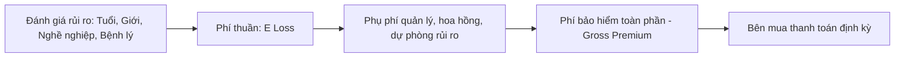
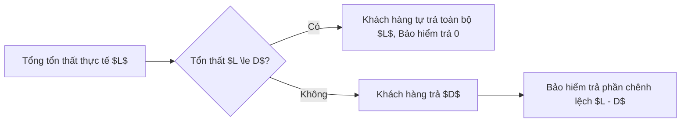
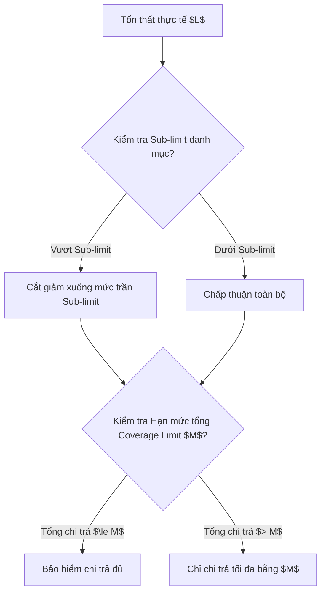
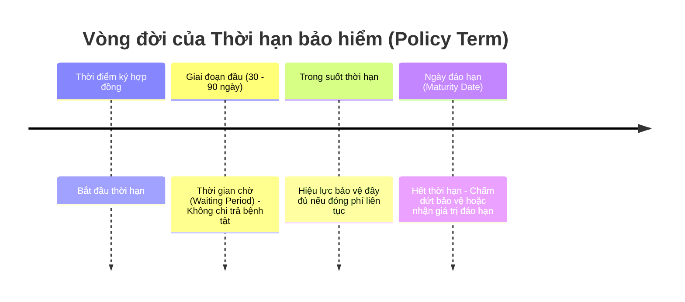
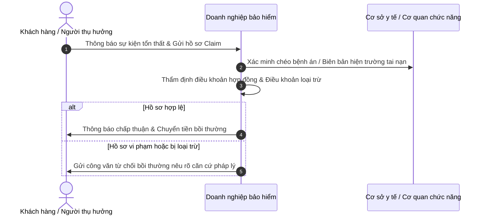
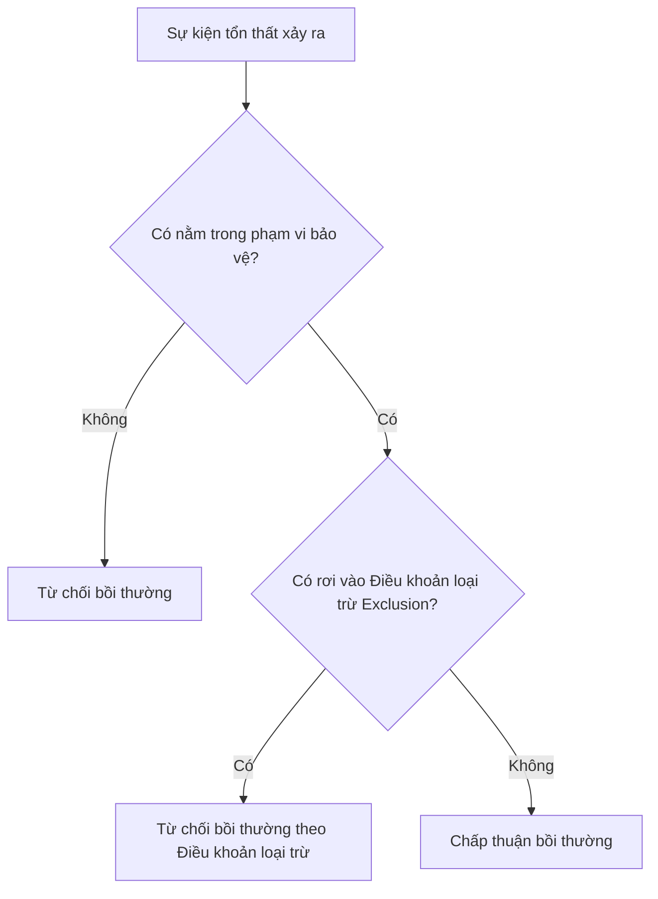

# Các Điều Khoản Hợp Đồng, Cấu Trúc Chi Phí Và Quy Trình Bồi Thường Bảo Hiểm

Để tối ưu hóa chi phí bảo vệ tài chính và tránh các tranh chấp pháp lý khi xảy ra biến cố, người tham gia bảo hiểm cần hiểu tường tận ngôn ngữ kỹ thuật của hợp đồng bảo hiểm. Tài liệu này mổ xẻ chi tiết các khái niệm chi phí cốt lõi, cơ chế chia sẻ tổn thất thông qua mức khấu trừ, đồng chi trả, các giới hạn trách nhiệm, quy trình thẩm định yêu cầu bồi thường và các điều khoản loại trừ pháp định.

> **Các câu hỏi cốt lõi:**
> 1. Mức khấu trừ (Deductible) và Đồng chi trả (Co-payment) giải quyết vấn đề tâm lý ỷ lại (Moral Hazard) và giúp hạ thấp phí bảo hiểm (Premium) như thế nào?
> 2. Công thức toán học tính toán số tiền thực tế được công ty bảo hiểm chi trả khi đồng thời áp dụng Deductible, Co-payment và Coverage Limit là gì?
> 3. Tại sao Điều khoản loại trừ (Exclusion) là phần quan trọng nhất cần đọc trước khi đặt bút ký hợp đồng bảo hiểm?

---

## 1. Premium (Phí bảo hiểm)

### 1. Là gì?
- **Định nghĩa hình thức:** Phí bảo hiểm là khoản tiền mà Bên mua bảo hiểm có nghĩa vụ phải thanh toán định kỳ hoặc một lần cho Doanh nghiệp bảo hiểm theo thời hạn và phương thức do các bên thỏa thuận trong hợp đồng bảo hiểm để duy trì hiệu lực bảo vệ.
- **Giải thích đơn giản:** Phí bảo hiểm là số tiền bạn "mua" sự bảo vệ từ công ty bảo hiểm hàng tháng hoặc hàng năm.
- **Nếu chỉ nhớ một điều:** Phí bảo hiểm được tính toán dựa trên mức độ rủi ro khách quan của đối tượng bảo hiểm, độ tuổi, giới tính, nghề nghiệp và chi phí quản lý vận hành của nhà bảo hiểm.

### 2. Hoạt động thế nào?
- **Chủ thể ra quyết định:** Chuyên gia định phí bảo hiểm (Actuary) lập bảng biểu phí; Bên mua bảo hiểm quyết định lựa chọn gói phí và phương thức đóng (thường niên, nửa năm, theo quý, theo tháng).
- **Mục tiêu tối ưu hóa:** Doanh nghiệp bảo hiểm đảm bảo tổng thu phí đủ bù đắp chi phí bồi thường tương lai và sinh lời; người mua tối ưu hóa tỷ lệ giá trị bảo vệ trên số phí phải trả ($\text{Coverage} / \text{Premium}$).
- **Ràng buộc:** Nếu không đóng phí đúng hạn sau thời gian ân hạn đóng phí (thường là 60 ngày), hợp đồng sẽ mất hiệu lực (Lapse).
- **Cơ chế tác động:**


### 3. Công thức & Mô hình
Phí bảo hiểm toàn phần (Gross Premium - $G$):
$$G = \frac{P_{\text{pure}} + C_{\text{fixed}}}{1 - c_{\text{var}} - \pi}$$
Trong đó:
- $P_{\text{pure}} = p \times L$: Phí bảo hiểm thuần (Net/Pure Premium) bằng xác suất rủi ro $p$ nhân với tổn thất kỳ vọng $L$.
- $C_{\text{fixed}}$: Chi phí cố định bình quân trên một hợp đồng (quản lý, hồ sơ).
- $c_{\text{var}}$: Tỷ lệ chi phí biến đổi (hoa hồng đại lý, tiếp thị).
- $\pi$: Tỷ suất lợi nhuận mục tiêu của doanh nghiệp bảo hiểm.

### 4. Ví dụ
- **Ví dụ định lượng:** Một người đàn ông 30 tuổi mua bảo hiểm tử kỳ mệnh giá $L = 1.000.000.000$ VND trong 1 năm. Bảng tỷ lệ tử vong (Mortality Table) cho thấy xác suất tử vong ở tuổi 30 là $p = 0,15\%$ ($0,0015$).
  - Phí thuần: $P_{\text{pure}} = 0,0015 \times 1.000.000.000 = 1.500.000$ VND.
  - Chi phí biến đổi và hoa hồng $c_{\text{var}} = 20\%$, lợi nhuận mục tiêu $\pi = 5\%$, chi phí cố định $C_{\text{fixed}} = 300.000$ VND.
  - Phí bảo hiểm toàn phần:
    $$G = \frac{1.500.000 + 300.000}{1 - 0,20 - 0,05} = \frac{1.800.000}{0,75} = 2.400.000 \text{ VND/năm}$$
- **Ví dụ thực tế:** Tại Việt Nam, đóng phí bảo hiểm nhân thọ định kỳ thường niên được chiết khấu rẻ hơn khoảng $4\% - 6\%$ so với chia nhỏ ra đóng theo quý hoặc theo tháng do giảm bớt chi phí thu hộ và chi phí quản lý dòng tiền của công ty.
- **Phản ví dụ (Counterfactual):** Một khách hàng quên đóng phí năm thứ 3 và quá thời gian ân hạn 60 ngày. Trong tháng tiếp theo, tai nạn xảy ra. Vì hợp đồng đã mất hiệu lực do nợ phí, công ty bảo hiểm hoàn toàn từ chối bồi thường 1 tỷ đồng theo đúng luật.

### 5. Ứng dụng & Tranh luận
- **Ứng dụng thực tiễn:** Lập ngân sách bảo hiểm cá nhân trong khoảng $5\% - 10\%$ tổng thu nhập hàng năm để đảm bảo khả năng đóng phí bền vững trong suốt 10-20 năm.
- **Ưu và nhược điểm:**
  - *Ưu điểm:* Mua được sự an tâm và bảo vệ tài chính với mức chi trả định kỳ đều đặn.
  - *Nhược điểm:* Cam kết dài hạn; nếu thu nhập bị gián đoạn dẫn đến mất khả năng đóng phí sẽ gây thiệt hại lớn cho người mua.
- **Sai lầm phổ biến:** Mua hợp đồng có phí quá cao so với thu nhập (chiếm $25\% - 30\%$), sau 2-3 năm rơi vào kiệt quệ tài chính và buộc phải bỏ cuộc giữa chừng.

### 6. Liên kết
- Cùng chủ đề: [01_Insurance_Fundamentals_and_Mechanics.md](file:///Users/ductri0981/Documents/Studying/Studying-Economic/04_Personal_Finance_and_Wealth_Management/07_Insurance_and_Personal_Risk_Protection/01_Insurance_Fundamentals_and_Mechanics.md)
- Liên kết chéo: [03_Budgeting_and_Expense_Management/03_Expense_Classification_and_Structure.md](file:///Users/ductri0981/Documents/Studying/Studying-Economic/04_Personal_Finance_and_Wealth_Management/03_Budgeting_and_Expense_Management/03_Expense_Classification_and_Structure.md)

---

## 2. Deductible (Mức khấu trừ / Miễn thường có khấu trừ)

### 1. Là gì?
- **Định nghĩa hình thức:** Mức khấu trừ là số tiền tổn thất ban đầu mà Bên mua bảo hiểm/Người được bảo hiểm phải tự mình chi trả trước khi Doanh nghiệp bảo hiểm bắt đầu thanh toán các chi phí bồi thường phát sinh thuộc phạm vi bảo hiểm.
- **Giải thích đơn giản:** Nếu hợp đồng bảo hiểm xe máy có mức khấu trừ 1 triệu đồng, thì khi xe bị hỏng sửa hết 5 triệu, bạn tự bỏ 1 triệu đầu tiên, công ty bảo hiểm trả 4 triệu còn lại. Nếu sửa dưới 1 triệu, bạn tự trả toàn bộ.
- **Nếu chỉ nhớ một điều:** Mức khấu trừ càng cao thì phí bảo hiểm định kỳ càng rẻ, vì nó loại bỏ các yêu cầu bồi thường vụn vặt và buộc người mua phải có trách nhiệm giữ gìn tài sản.

### 2. Hoạt động thế nào?
- **Chủ thể ra quyết định:** Khách hàng chủ động lựa chọn mức khấu trừ khi tham gia hợp đồng dựa trên khả năng chấp nhận rủi ro và quy mô quỹ khẩn cấp của mình.
- **Mục tiêu tối ưu hóa:** Giảm thiểu chi phí mua bảo hiểm định kỳ và triệt tiêu vấn đề Tâm lý ỷ lại (Moral Hazard).
- **Ràng buộc:** Mức khấu trừ áp dụng trên mỗi sự kiện bảo hiểm (per incident) hoặc lũy kế theo năm (annual deductible).
- **Cơ chế tác động:**


### 3. Công thức & Mô hình
Số tiền bảo hiểm chi trả sau khấu trừ ($C$):
$$C = \max(0, \min(L - D, M))$$
Trong đó:
- $L$: Tổn thất thực tế được bảo hiểm chấp thuận.
- $D$: Mức khấu trừ (Deductible).
- $M$: Hạn mức trách nhiệm tối đa (Coverage Limit).

### 4. Ví dụ
- **Ví dụ định lượng:** Anh Bình mua bảo hiểm sức khỏe quốc tế có mức khấu trừ thường niên là $D = 20.000.000$ VND/năm, hạn mức $M = 1.000.000.000$ VND. Nhờ chọn mức khấu trừ này, phí bảo hiểm hàng năm của anh giảm $40\%$ từ 15 triệu xuống còn 9 triệu VND.
  - Lần 1: Nhập viện điều trị sốt xuất huyết hết $L_1 = 12.000.000$ VND. Vì $12 < 20$ triệu, anh Bình tự trả toàn bộ 12 triệu. Mức khấu trừ còn lại trong năm: $20 - 12 = 8$ triệu.
  - Lần 2: Trong cùng năm đó, anh phẫu thuật ruột thừa hết $L_2 = 40.000.000$ VND. Anh Bình trả nốt 8 triệu còn lại của mức khấu trừ; công ty bảo hiểm chi trả:
    $$C_2 = 40.000.000 - 8.000.000 = 32.000.000 \text{ VND}$$
  - Từ lần điều trị thứ 3 trở đi trong năm, do đã trừ hết 20 triệu khấu trừ, bảo hiểm chi trả $100\%$ trong hạn mức.
- **Ví dụ thực tế:** Trong bảo hiểm vật chất xe ô tô tại Việt Nam, quy định mức khấu trừ bắt buộc tối thiểu là 500.000 VND/vụ tổn thất theo Thông tư của Bộ Tài chính nhằm ngăn chặn tình trạng lái xe làm hồ sơ bồi thường cho từng vết xước nhỏ.
- **Phản ví dụ (Counterfactual):** Một người chọn mức khấu trừ quá lớn ($D = 50.000.000$ VND) để phí bảo hiểm cực rẻ, nhưng trong tài khoản tiết kiệm không có nổi 10 triệu đồng. Khi gặp sự cố cần 30 triệu tiền điều trị, người này không đủ tiền nộp mức khấu trừ tại bệnh viện và lâm vào bế tắc tài chính.

### 5. Ứng dụng & Tranh luận
- **Ứng dụng thực tiễn:** Kết hợp mức khấu trừ cao với Quỹ khẩn cấp (Emergency Fund) dồi dào: dùng quỹ khẩn cấp để hấp thụ các tổn thất nhỏ dưới mức khấu trừ, tiết kiệm hàng triệu đồng tiền phí bảo hiểm mỗi năm.
- **Ưu và nhược điểm:**
  - *Ưu điểm:* Tiết kiệm chi phí phí bảo hiểm đáng kể, xử lý bồi thường nhanh hơn.
  - *Nhược điểm:* Tạo gánh nặng chi tiền túi ngay tại thời điểm biến cố xảy ra.
- **Sai lầm phổ biến:** Chọn mức khấu trừ cao nhất để phí rẻ nhất mà không chuẩn bị sẵn nguồn tiền mặt tương ứng để thanh toán khi có sự cố.

### 6. Liên kết
- Cùng chủ đề: [04_Health_and_Living_Benefit_Insurances.md](file:///Users/ductri0981/Documents/Studying/Studying-Economic/04_Personal_Finance_and_Wealth_Management/07_Insurance_and_Personal_Risk_Protection/04_Health_and_Living_Benefit_Insurances.md)
- Liên kết chéo: [04_Saving_and_Emergency_Funds/04_Liquidity_and_Cash_Reserve_Management.md](file:///Users/ductri0981/Documents/Studying/Studying-Economic/04_Personal_Finance_and_Wealth_Management/04_Saving_and_Emergency_Funds/04_Liquidity_and_Cash_Reserve_Management.md)

---

## 3. Co-payment (Đồng chi trả / Đồng thanh toán)

### 1. Là gì?
- **Định nghĩa hình thức:** Đồng chi trả (Co-payment hoặc Co-insurance) là điều khoản hợp đồng quy định việc phân chia chi phí tổn thất y tế hoặc bồi thường giữa doanh nghiệp bảo hiểm và người được bảo hiểm theo một tỷ lệ phần trăm nhất định (ví dụ 80/20) hoặc một khoản tiền cố định cho mỗi lần sử dụng dịch vụ sau khi đã trừ mức khấu trừ.
- **Giải thích đơn giản:** Là hai bên cùng "góp tiền" thanh toán hóa đơn viện phí. Ví dụ tỷ lệ 80/20 nghĩa là bảo hiểm trả $80\%$, bạn tự trả $20\%$.
- **Nếu chỉ nhớ một điều:** Đồng chi trả duy trì mối liên hệ tài chính của người bệnh đối với mỗi đồng viện phí phát sinh, nhằm ngăn chặn việc lạm dụng xét nghiệm hay dịch vụ y tế xa xỉ không cần thiết.

### 2. Hoạt động thế nào?
- **Chủ thể ra quyết định:** Doanh nghiệp bảo hiểm thiết kế tỷ lệ đồng chi trả theo từng phân nhóm đối tượng, cơ sở khám chữa bệnh (đúng tuyến hay trái tuyến) hoặc áp dụng cho trẻ em dưới một độ tuổi nhất định.
- **Mục tiêu tối ưu hóa:** Kiểm soát chi phí bồi thường và nâng cao ý thức tiêu dùng y tế của khách hàng.
- **Ràng buộc:** Tỷ lệ đồng chi trả chỉ áp dụng đối với các chi phí y tế hợp lý và thực tế thuộc danh mục được bảo hiểm thanh toán.
- **Cơ chế tác động:**
```mermaid
flowchart TD
    TotalBill[Tổng viện phí hợp lệ] --> Deduct[Trừ mức khấu trừ Deductible]
    Deduct --> NetBill[Chi phí còn lại]
    NetBill --> Split{Phân bổ theo tỷ lệ Co-payment}
    Split -->|Tỷ lệ $\alpha$| InsurerPart[Công ty bảo hiểm trả $\alpha \times \text{NetBill}$]
    Split -->|Tỷ lệ $1 - \alpha$| PatientPart[Bệnh nhân tự trả $(1 - \alpha) \times \text{NetBill}$]
```

### 3. Công thức & Mô hình
Số tiền công ty bảo hiểm chi trả ($C_{\text{ins}}$) và số tiền bệnh nhân tự trả ($C_{\text{patient}}$) khi có cả Deductible ($D$) và tỷ lệ đồng chi trả bảo hiểm ($\alpha \in (0, 1)$):
$$C_{\text{ins}} = \alpha \times \max(0, L - D)$$
$$C_{\text{patient}} = \min(L, D) + (1 - \alpha) \times \max(0, L - D)$$
Tổng cộng: $C_{\text{ins}} + C_{\text{patient}} = L$ (trong phạm vi hạn mức bảo hiểm).

### 4. Ví dụ
- **Ví dụ định lượng:** Hợp đồng bảo hiểm sức khỏe có mức khấu trừ $D = 2.000.000$ VND và tỷ lệ đồng chi trả 80/20 ($\alpha = 80\%$). Bệnh nhân nằm viện điều trị với tổng chi phí thuộc phạm vi bảo hiểm $L = 22.000.000$ VND.
  - Phần chi phí sau khi trừ mức khấu trừ:
    $$L - D = 22.000.000 - 2.000.000 = 20.000.000 \text{ VND}$$
  - Công ty bảo hiểm thanh toán $80\%$:
    $$C_{\text{ins}} = 80\% \times 20.000.000 = 16.000.000 \text{ VND}$$
  - Bệnh nhân tự thanh toán:
    $$C_{\text{patient}} = 2.000.000 + (20\% \times 20.000.000) = 2.000.000 + 4.000.000 = 6.000.000 \text{ VND}$$
- **Ví dụ thực tế:** Tại Việt Nam, thẻ Bảo hiểm Y tế (BHYT) nhà nước áp dụng mức đồng chi trả $80/20$ cho người lao động bình thường khi đi khám đúng tuyến (Quỹ BHYT chi trả $80\%$, người bệnh đồng chi trả $20\%$). Đối với người nghèo hoặc người có công, mức đồng chi trả là 100/0 hoặc 95/5.
- **Phản ví dụ (Counterfactual):** Một gói bảo hiểm y tế chi trả $100\%$ không áp dụng đồng chi trả và không khấu trừ. Bệnh nhân yêu cầu bác sĩ cho truyền dịch vô tội vạ, kê hàng loạt loại thuốc bổ đắt tiền và nằm phòng dịch vụ VIP kéo dài ngày. Hậu quả là tỷ lệ bồi thường của công ty vượt $150\%$, buộc công ty phải tăng gấp đôi phí bảo hiểm vào năm sau hoặc ngừng bán sản phẩm.

### 5. Ứng dụng & Tranh luận
- **Ứng dụng thực tiễn:** Là yếu tố quan trọng cần so sánh khi mua bảo hiểm sức khỏe cho trẻ sơ sinh và trẻ nhỏ (thường bị áp dụng mức đồng chi trả 70/30 hoặc 80/20 do tần suất ốm vặt cao).
- **Ưu và nhược điểm:**
  - *Ưu điểm:* Giúp hạ giá phí bảo hiểm đầu vào, hạn chế lạm dụng dịch vụ y tế.
  - *Nhược điểm:* Với các ca phẫu thuật chi phí khổng lồ, phần $20\%$ bệnh nhân tự trả vẫn có thể là một số tiền rất lớn gây áp lực tài chính.
- **Sai lầm phổ biến:** Nhầm tưởng "có bảo hiểm sức khỏe là viện phí được miễn phí $100\%$", dẫn đến bất ngờ và bức xúc khi bệnh viện yêu cầu thanh toán khoản đồng chi trả khi xuất viện.

### 6. Liên kết
- Cùng chủ đề: [04_Health_and_Living_Benefit_Insurances.md](file:///Users/ductri0981/Documents/Studying/Studying-Economic/04_Personal_Finance_and_Wealth_Management/07_Insurance_and_Personal_Risk_Protection/04_Health_and_Living_Benefit_Insurances.md)
- Liên kết chéo: [03_Budgeting_and_Expense_Management/04_Discretionary_Essential_and_Lifestyle_Expenses.md](file:///Users/ductri0981/Documents/Studying/Studying-Economic/04_Personal_Finance_and_Wealth_Management/03_Budgeting_and_Expense_Management/04_Discretionary_Essential_and_Lifestyle_Expenses.md)

---

## 4. Coverage Limit (Hạn mức bồi thường / Giới hạn trách nhiệm)

### 1. Là gì?
- **Định nghĩa hình thức:** Hạn mức bồi thường là số tiền tối đa mà Doanh nghiệp bảo hiểm có trách nhiệm chi trả cho một sự kiện bảo hiểm cụ thể hoặc cho toàn bộ thời hạn của hợp đồng bảo hiểm theo thỏa thuận pháp lý.
- **Giải thích đơn giản:** Hạn mức bồi thường là "trần" số tiền cao nhất mà công ty bảo hiểm sẽ đền cho bạn. Vượt quá mức trần này, bạn phải tự bỏ tiền túi.
- **Nếu chỉ nhớ một điều:** Mọi chi phí vượt quá hạn mức bồi thường sẽ quay trở lại trở thành rủi ro tài chính của chính bạn (tự giữ lại rủi ro).

### 2. Hoạt động thế nào?
- **Chủ thể ra quyết định:** Bên mua bảo hiểm chọn hạn mức bảo hiểm khi ký hợp đồng; doanh nghiệp bảo hiểm thiết lập khung hạn mức tối đa cho phép dựa trên năng lực tài chính và thẩm định rủi ro.
- **Mục tiêu tối ưu hóa:** Thiết lập hạn mức đủ lớn để bảo vệ trọn vẹn giá trị tài sản hoặc nhu cầu chi phí chữa bệnh dự phòng trong tình huống xấu nhất.
- **Ràng buộc:** Hạn mức có thể chia thành: Hạn mức trên mỗi vụ/sự kiện (Per-occurrence limit), Hạn mức danh mục con (Sub-limit: ví dụ trần tiền giường/ngày, trần tiền phẫu thuật), và Hạn mức tổng thường niên (Annual aggregate limit).
- **Cơ chế tác động:**


### 3. Công thức & Mô hình
Số tiền bồi thường thực tế ($C$) được khống chế bởi Hạn mức ($M$):
$$C = \min(L_{\text{eligible}}, M)$$
Trong đó:
$$L_{\text{eligible}} = \sum_{j=1}^K \min(l_j, m_j) - D$$
Với $l_j$ là chi phí hạng mục $j$, $m_j$ là trần phụ (sub-limit) của hạng mục $j$, và $D$ là mức khấu trừ.

### 4. Ví dụ
- **Ví dụ định lượng:** Hợp đồng bảo hiểm sức khỏe có hạn mức năm $M = 300.000.000$ VND, nhưng có quy định trần phụ (sub-limit) tiền giường phòng dịch vụ là $m_{\text{bed}} = 2.000.000$ VND/ngày và tối đa 30 ngày/năm.
  - Bệnh nhân nằm viện phòng VIP giá $3.500.000$ VND/ngày trong 10 ngày. Tiền viện phí khác (phẫu thuật, thuốc men) là 50 triệu.
  - Tiền phòng thực tế: $10 \times 3.500.000 = 35.000.000$ VND.
  - Số tiền bảo hiểm chấp thuận cho tiền phòng: $10 \times 2.000.000 = 20.000.000$ VND.
  - Người bệnh phải tự chi trả tiền phòng vượt hạn mức phụ: $35.000.000 - 20.000.000 = 15.000.000$ VND.
  - Bảo hiểm thanh toán: $20.000.000 + 50.000.000 = 70.000.000$ VND (nằm trong hạn mức tổng 300 triệu).
- **Ví dụ thực tế:** Bảo hiểm trách nhiệm dân sự bắt buộc của chủ xe cơ giới đối với bên thứ ba tại Việt Nam (theo Nghị định 67/2023/NĐ-CP) có hạn mức bồi thường về sức khỏe, tính mạng là 150 triệu đồng/người/vụ và hạn mức thiệt hại về tài sản là 50 triệu đồng/vụ (xe máy) hoặc 100 triệu đồng/vụ (ô tô).
- **Phản ví dụ (Counterfactual):** Một chủ xe tải gây tai nạn đâm nát chiếc siêu xe Ferrari trị giá 20 tỷ đồng. Do chỉ mua bảo hiểm trách nhiệm dân sự với hạn mức tài sản 100 triệu đồng, sau khi công ty bảo hiểm đền tối đa 100 triệu, người tài xế phải đối mặt với khoản nợ dân sự hơn 19,9 tỷ đồng và nguy cơ phá sản cả đời.

### 5. Ứng dụng & Tranh luận
- **Ứng dụng thực tiễn:** Phải luôn kiểm tra kỹ các "hạn mức phụ" (Sub-limits) ẩn sâu trong hợp đồng bảo hiểm sức khỏe (tiền giường, tiền vật tư y tế tiêu hao, thuốc ngoài danh mục) để chọn bệnh viện phù hợp.
- **Ưu và nhược điểm:**
  - *Ưu điểm:* Giúp doanh nghiệp bảo hiểm quản trị rủi ro thanh khoản, duy trì mức phí hợp lý cho số đông.
  - *Nhược điểm:* Dễ khiến người mua hiểu lầm rằng toàn bộ hóa đơn viện phí sẽ được thanh toán nếu tổng tiền chưa vượt hạn mức tổng.
- **Sai lầm phổ biến:** Chỉ nhìn vào con số hạn mức tổng cực lớn (ví dụ 1 tỷ đồng/năm) mà bỏ qua các hạn mức phụ khắt khe của từng ngày nằm viện hay từng ca mổ.

### 6. Liên kết
- Cùng chủ đề: [06_Liability_and_Institutional_Mechanisms.md](file:///Users/ductri0981/Documents/Studying/Studying-Economic/04_Personal_Finance_and_Wealth_Management/07_Insurance_and_Personal_Risk_Protection/06_Liability_and_Institutional_Mechanisms.md)
- Liên kết chéo: [01_Personal_Finance_Foundations/06_Financial_Goals_and_Time_Horizons.md](file:///Users/ductri0981/Documents/Studying/Studying-Economic/04_Personal_Finance_and_Wealth_Management/01_Personal_Finance_Foundations/06_Financial_Goals_and_Time_Horizons.md)

---

## 5. Policy Term (Thời hạn hợp đồng / Thời hạn bảo hiểm)

### 1. Là gì?
- **Định nghĩa hình thức:** Thời hạn bảo hiểm là khoảng thời gian có hiệu lực được ghi rõ trong hợp đồng bảo hiểm, bắt đầu từ ngày hợp đồng có hiệu lực cho đến ngày chấm dứt hiệu lực, trong đó doanh nghiệp bảo hiểm cam kết bảo đảm chi trả khi có sự kiện bảo hiểm phát sinh.
- **Giải thích đơn giản:** Là khoảng thời gian hợp đồng bảo hiểm "sống". Chỉ những sự cố xảy ra trong khung thời gian này mới được công ty bảo hiểm bồi thường.
- **Nếu chỉ nhớ một điều:** Sự kiện bảo hiểm xảy ra trước thời điểm bắt đầu hiệu lực (hoặc trong thời gian chờ) hay sau ngày kết thúc hợp đồng đều không được chi trả một xu nào.

### 2. Hoạt động thế nào?
- **Chủ thể ra quyết định:** Bên mua bảo hiểm thỏa thuận lựa chọn thời hạn phù hợp với mục tiêu bảo vệ (1 năm, 10 năm, 20 năm, hoặc trọn đời đến 99 tuổi).
- **Mục tiêu tối ưu hóa:** Khóa chặt phạm vi bảo vệ trùng khớp với giai đoạn dễ bị tổn thương nhất về mặt tài chính (ví dụ giai đoạn con còn nhỏ, giai đoạn đang gánh nợ vay mua nhà).
- **Ràng buộc:** Chịu sự chi phối của Thời gian chờ (Waiting Period - ví dụ 30 ngày cho bệnh thông thường, 90 ngày cho bệnh hiểm nghèo, 270-365 ngày cho thai sản) trong giai đoạn đầu của thời hạn.
- **Cơ chế tác động:**


### 3. Công thức & Mô hình
Xác suất sự kiện tử vong hoặc bệnh tật xảy ra trong Thời hạn bảo hiểm $T$ năm kể từ tuổi $x$:
$$_T q_x = 1 - {}_T p_x = 1 - \prod_{t=0}^{T-1} (1 - q_{x+t})$$
Trong đó:
- $q_{x+t}$: Xác suất tử vong ở độ tuổi $x+t$.
- $_T p_x$: Xác suất một người tuổi $x$ sống sót thêm ít nhất $T$ năm.
Thời hạn $T$ càng dài, $_T q_x$ càng tăng tiệm cận về 1, khiến chi phí bảo vệ thuần $P_{\text{pure}}$ tăng lũy tiến.

### 4. Ví dụ
- **Ví dụ định lượng:** Anh Hùng (30 tuổi) vay ngân hàng mua nhà trả góp trong thời hạn 15 năm. Anh mua một hợp đồng bảo hiểm nhân thọ tử kỳ có Policy Term đúng bằng 15 năm (đến khi anh 45 tuổi) với mệnh giá bằng khoản vay 1,5 tỷ VND.
  - Trong suốt 15 năm, nếu anh Hùng mất, bảo hiểm trả 1,5 tỷ để xóa nợ nhà.
  - Hết 15 năm, nợ nhà đã trả xong, con cái đã lớn, hợp đồng kết thúc và không hoàn lại tiền, hoàn thành trọn vẹn sứ mệnh bảo vệ với mức phí cực kỳ tiết kiệm (chỉ 4 triệu VND/năm thay vì 25 triệu nếu mua hợp đồng trọn đời).
- **Ví dụ thực tế:** Hầu hết các hợp đồng bảo hiểm sức khỏe phi nhân thọ tại Việt Nam có thời hạn đúng 1 năm (tái tục từng năm). Mỗi năm, doanh nghiệp bảo hiểm có quyền đánh giá lại lịch sử bồi thường của năm cũ để quyết định có tái tục cho năm tiếp theo hay không và có tăng phí hay không.
- **Phản ví dụ (Counterfactual):** Một người mua bảo hiểm thai sản khi đã mang thai được 2 tháng. Hợp đồng có thời hạn 1 năm nhưng quy định Thời gian chờ thai sản là 270 ngày (9 tháng). Khi người này sinh con sau đó 7 tháng, toàn bộ chi phí sinh nở bị từ chối bồi thường vì sự kiện sinh con rơi vào Thời gian chờ nằm trong thời hạn bảo hiểm.

### 5. Ứng dụng & Tranh luận
- **Ứng dụng thực tiễn:** Căn chỉnh thời hạn bảo hiểm nhân thọ khớp chính xác với mốc thời gian người con út tốt nghiệp đại học tự lập tài chính hoặc mốc hoàn thành khoản vay nợ dài hạn.
- **Ưu và nhược điểm:**
  - *Ưu điểm:* Thời hạn ngắn/xác định giúp tiết kiệm tối đa chi phí đóng phí so với bảo hiểm trọn đời.
  - *Nhược điểm:* Khi hết thời hạn, nếu muốn mua tiếp ở độ tuổi già hơn, phí bảo hiểm sẽ tăng vọt hoặc bị từ chối do có bệnh nền phát sinh.
- **Sai lầm phổ biến:** Mua bảo hiểm thời hạn quá ngắn khi con còn quá nhỏ, để rồi khi hợp đồng hết hạn ở tuổi trung niên lại không thể mua lại vì sức khỏe đã suy giảm.

### 6. Liên kết
- Cùng chủ đề: [03_Life_Insurance_Structures.md](file:///Users/ductri0981/Documents/Studying/Studying-Economic/04_Personal_Finance_and_Wealth_Management/07_Insurance_and_Personal_Risk_Protection/03_Life_Insurance_Structures.md)
- Liên kết chéo: [01_Personal_Finance_Foundations/06_Financial_Goals_and_Time_Horizons.md](file:///Users/ductri0981/Documents/Studying/Studying-Economic/04_Personal_Finance_and_Wealth_Management/01_Personal_Finance_Foundations/06_Financial_Goals_and_Time_Horizons.md)

---

## 6. Claim (Yêu cầu bồi thường / Đòi bồi thường)

### 1. Là gì?
- **Định nghĩa hình thức:** Claim là yêu cầu chính thức bằng văn bản hoặc hồ sơ điện tử do Bên mua bảo hiểm, Người được bảo hiểm hoặc Người thụ hưởng gửi đến Doanh nghiệp bảo hiểm đề nghị chi trả quyền lợi bảo hiểm hoặc bồi thường tổn thất khi có sự kiện bảo hiểm xảy ra theo đúng hợp đồng.
- **Giải thích đơn giản:** Là việc bạn nộp giấy tờ, hóa đơn, bệnh án cho công ty bảo hiểm để xin lấy lại tiền bồi thường.
- **Nếu chỉ nhớ một điều:** "Hồ sơ bồi thường hoàn hảo" phải phản ánh tính trung thực, sự kiện tổn thất thuộc phạm vi bảo hiểm, không vi phạm loại trừ và nộp đúng thời hạn quy định.

### 2. Hoạt động thế nào?
- **Chủ thể ra quyết định:** Người yêu cầu bồi thường (nộp hồ sơ) và Bộ phận Giám định bồi thường (Claims Adjuster) của doanh nghiệp bảo hiểm (thẩm định và ra quyết định chi trả hoặc từ chối).
- **Mục tiêu tối ưu hóa:** Khách hàng muốn nhận bồi thường nhanh và đầy đủ nhất; công ty bảo hiểm muốn kiểm soát chi trả đúng người, đúng bệnh, phòng chống gian lận trục lợi.
- **Ràng buộc:** Thời hiệu yêu cầu trả tiền bảo hiểm thường là 01 năm kể từ ngày xảy ra sự kiện bảo hiểm (theo Điều 30 Luật Kinh doanh bảo hiểm Việt Nam); doanh nghiệp phải bồi thường trong thời hạn cam kết (thường không quá 30 ngày).
- **Cơ chế tác động:**


### 3. Công thức & Mô hình
Thời gian giải quyết bồi thường theo luật định:
$$T_{\text{claim}} \le T_{\text{contractual}} \le 30 \text{ ngày}$$
Nếu doanh nghiệp bảo hiểm chậm thanh toán bồi thường do lỗi của mình, doanh nghiệp phải trả thêm tiền lãi trên số tiền chậm trả:
$$I_{\text{penalty}} = C_{\text{claim}} \times r_{\text{overdue}} \times \frac{t_{\text{delayed}}}{365}$$
Trong đó $r_{\text{overdue}}$ là lãi suất nợ quá hạn do Ngân hàng Nhà nước hoặc thỏa thuận quy định.

### 4. Ví dụ
- **Ví dụ định lượng:** Chị Lan nhập viện mổ nội soi ruột thừa. Tổng chi phí viện phí 25.000.000 VND. Sau khi xuất viện, chị thu thập đầy đủ: Giấy ra viện, Trích sao bệnh án, Bảng kê chi tiết viện phí và Hóa đơn giá trị gia tăng điện tử. Chị nộp qua ứng dụng trực tuyến của công ty bảo hiểm.
  - Trong vòng 3 ngày làm việc, hệ thống giám định tự động đối soát hồ sơ.
  - Công ty gửi tin nhắn chấp thuận bồi thường 25.000.000 VND và chuyển khoản thẳng vào tài khoản ngân hàng của chị Lan.
- **Ví dụ thực tế:** Tại Việt Nam, nhiều trường hợp bồi thường bảo hiểm tử vong do tai nạn giao thông bị kéo dài hàng tháng vì người nhà không thể thu thập được "Kết luận điều tra tai nạn giao thông" hoặc "Biên bản khám nghiệm hiện trường" từ cơ quan Cảnh sát giao thông.
- **Phản ví dụ (Counterfactual):** Một khách hàng đi khám chữa bệnh tại phòng khám tư nhân nhưng chỉ mang về "Biên lai thu tiền viết tay" mà không có hóa đơn điện tử hợp pháp và bảng kê chi tiết viện phí. Công ty bảo hiểm ra thông báo từ chối thanh toán hồ sơ bồi thường do thiếu chứng từ tài chính hợp lệ theo quy định của Bộ Tài chính.

### 5. Ứng dụng & Tranh luận
- **Ứng dụng thực tiễn:** Sử dụng dịch vụ Bảo lãnh viện phí (Direct Billing / Cashless Service): xuất trình thẻ bảo hiểm tại các bệnh viện liên kết để được bảo hiểm thanh toán trực tiếp, không cần tự bỏ tiền mặt ra trước rồi nộp hồ sơ claim sau.
- **Ưu và nhược điểm:**
  - *Ưu điểm:* Quy trình claim hiện đại hóa qua app di động giúp nhận tiền bồi thường chỉ trong vài giờ hoặc vài ngày.
  - *Nhược điểm:* Khách hàng thiếu hiểu biết dễ bị ức chế vì thủ tục giấy tờ hành chính phức tạp.
- **Sai lầm phổ biến:** Vứt bỏ các hóa đơn lẻ, đơn thuốc hoặc bảng kê chi tiết; nộp hồ sơ muộn quá thời hiệu 1 năm quy định trong luật.

### 6. Liên kết
- Cùng chủ đề: [07_Risk_Assessment_Coverage_Gaps_and_Fraud.md](file:///Users/ductri0981/Documents/Studying/Studying-Economic/04_Personal_Finance_and_Wealth_Management/07_Insurance_and_Personal_Risk_Protection/07_Risk_Assessment_Coverage_Gaps_and_Fraud.md)
- Liên kết chéo: [04_Saving_and_Emergency_Funds/04_Liquidity_and_Cash_Reserve_Management.md](file:///Users/ductri0981/Documents/Studying/Studying-Economic/04_Personal_Finance_and_Wealth_Management/04_Saving_and_Emergency_Funds/04_Liquidity_and_Cash_Reserve_Management.md)

---

## 7. Exclusion (Điều khoản loại trừ)

### 1. Là gì?
- **Định nghĩa hình thức:** Điều khoản loại trừ trách nhiệm bảo hiểm là các quy định cụ thể trong hợp đồng bảo hiểm liệt kê những trường hợp, nguyên nhân, rủi ro hoặc tổn thất mà doanh nghiệp bảo hiểm hoàn toàn không phải bồi thường hoặc không phải trả tiền bảo hiểm nếu sự kiện xảy ra.
- **Giải thích đơn giản:** Điều khoản loại trừ là danh sách "những việc xảy ra mà bảo hiểm sẽ KHÔNG trả tiền".
- **Nếu chỉ nhớ một điều:** Giá trị của một hợp đồng bảo hiểm không nằm ở những gì nó cam kết chi trả, mà nằm ở danh sách những gì nó LOẠI TRỪ.

### 2. Hoạt động thế nào?
- **Chủ thể ra quyết định:** Doanh nghiệp bảo hiểm xây dựng danh mục loại trừ tuân thủ Luật Kinh doanh bảo hiểm và được Bộ Tài chính phê duyệt; đại lý bảo hiểm có nghĩa vụ giải thích rõ ràng cho khách hàng.
- **Mục tiêu tối ưu hóa:** Loại trừ các rủi ro thảm họa không thể định phí (chiến tranh, hạt nhân), rủi ro đạo đức (cố ý tự sát, tự gây thương tích) và các rủi ro vi phạm pháp luật hình sự.
- **Ràng buộc:** Theo Điều 19 Luật Kinh doanh bảo hiểm Việt Nam số 08/2022/QH15, điều khoản loại trừ phải được in đậm hoặc ghi rõ ràng trong hợp đồng; doanh nghiệp phải giải thích rõ cho bên mua, nếu không điều khoản loại trừ đó sẽ vô hiệu.
- **Cơ chế tác động:**


### 3. Công thức & Mô hình
Số tiền bồi thường thực tế ($C$) với biến chỉ thị điều kiện loại trừ ($I_{\text{exclusion}} \in \{0, 1\}$):
$$C = L \times (1 - I_{\text{exclusion}})$$
Trong đó:
- $I_{\text{exclusion}} = 1$: Nếu sự kiện tổn thất thuộc bất kỳ điểm nào trong danh mục loại trừ $\mathcal{E} = \{e_1, e_2, \dots, e_K\}$ (ví dụ: tự tử trong vòng 2 năm đầu, có nồng độ cồn vượt mức quy định khi lái xe, bệnh có sẵn không kê khai). Khi đó $C = 0$.
- $I_{\text{exclusion}} = 0$: Không vi phạm điều khoản loại trừ; bồi thường theo thỏa thuận.

### 4. Ví dụ
- **Ví dụ định lượng:** Một hợp đồng bảo hiểm nhân thọ mệnh giá 2.000.000.000 VND có điều khoản loại trừ tử vong do tự tử trong vòng 24 tháng (2 năm) kể từ ngày ký.
  - Tình huống A: Người được bảo hiểm tự tử sau 14 tháng. $I_{\text{exclusion}} = 1 \implies C = 0$ VND (công ty chỉ hoàn lại giá trị tài khoản hoặc phí đã đóng sau khi trừ chi phí).
  - Tình huống B: Người được bảo hiểm tự tử sau 36 tháng (3 năm). Vì đã vượt qua mốc 24 tháng, điều khoản loại trừ tự tử hết hiệu lực ($I_{\text{exclusion}} = 0$), công ty bắt buộc phải bồi thường trọn vẹn 2.000.000.000 VND cho người thụ hưởng.
- **Ví dụ thực tế:** Trong bảo hiểm vật chất xe cơ giới tại Việt Nam, hầu hết các hợp đồng đều loại trừ tuyệt đối mọi thiệt hại nếu người điều khiển xe có nồng độ cồn hoặc chất kích thích trong máu/hơi thở tại thời điểm xảy ra tai nạn.
- **Phản ví dụ (Counterfactual):** Một người mua bảo hiểm sức khỏe cá nhân nhưng giấu tiền sử bệnh viêm gan B mãn tính đã được chẩn đoán cách đó 3 năm. Sau đó 1 năm, người này nhập viện điều trị xơ gan. Công ty bảo hiểm từ chối bồi thường toàn bộ tiền viện phí và hủy hợp đồng dựa trên điều khoản loại trừ "Bệnh có sẵn không trung thực kê khai" (Pre-existing Condition Exclusion).

### 5. Ứng dụng & Tranh luận
- **Ứng dụng thực tiễn:** Đọc kỹ 100% danh mục loại trừ trong Quy tắc và Điều khoản hợp đồng (Policy Wording) trước khi kết thúc 21 ngày cân nhắc dùng thử.
- **Ưu và nhược điểm:**
  - *Ưu điểm:* Giữ cho quỹ bảo hiểm không bị sụp đổ bởi các hành vi trục lợi hoặc các rủi ro bất khả kháng mang tính diệt vong.
  - *Nhược điểm:* Nguồn gốc chủ yếu gây ra tranh chấp, khiếu kiện giữa khách hàng và các hãng bảo hiểm.
- **Sai lầm phổ biến:** Chỉ nghe lời hứa hẹn miệng của đại lý tư vấn mà không đọc phần Điều khoản loại trừ in trong cuốn hợp đồng chính thức.

### 6. Liên kết
- Cùng chủ đề: [01_Insurance_Fundamentals_and_Mechanics.md](file:///Users/ductri0981/Documents/Studying/Studying-Economic/04_Personal_Finance_and_Wealth_Management/07_Insurance_and_Personal_Risk_Protection/01_Insurance_Fundamentals_and_Mechanics.md)
- Liên kết chéo: [07_Risk_Assessment_Coverage_Gaps_and_Fraud.md](file:///Users/ductri0981/Documents/Studying/Studying-Economic/04_Personal_Finance_and_Wealth_Management/07_Insurance_and_Personal_Risk_Protection/07_Risk_Assessment_Coverage_Gaps_and_Fraud.md)

---

## Câu hỏi tự kiểm tra
1. Hãy phân biệt rõ sự khác nhau giữa Mức khấu trừ (Deductible) và Đồng chi trả (Co-payment). Trong trường hợp nào việc tăng Deductible là một chiến lược quản trị tài chính thông minh?
2. Giả sử hóa đơn viện phí là 60.000.000 VND, hợp đồng bảo hiểm có Deductible 10.000.000 VND, tỷ lệ Đồng chi trả là 80/20 và Hạn mức chi trả tối đa là 40.000.000 VND. Hãy tính chính xác số tiền bảo hiểm chi trả và số tiền người bệnh phải tự nộp.
3. Tại sao luật bảo hiểm quy định điều khoản loại trừ đối với hành vi tự tử trong 24 tháng đầu tiên của hợp đồng bảo hiểm nhân thọ? Cơ sở kinh tế và tâm lý học hành vi của quy định này là gì?
4. Trình bày các hậu quả pháp lý đối với yêu cầu bồi thường (Claim) nếu Bên mua bảo hiểm vi phạm nghĩa vụ kê khai bệnh có sẵn (Pre-existing conditions).

## Ghi chú nguồn
- Luật Kinh doanh bảo hiểm số 08/2022/QH15.
- Nghị định số 46/2023/NĐ-CP của Chính phủ quy định chi tiết thi hành một số điều của Luật Kinh doanh bảo hiểm.
- Kenneth Black Jr. & Harold D. Skipper - *Life and Health Insurance*, Pearson.
- Emmett J. Vaughan - *Essentials of Insurance: A Risk Management Perspective*, Wiley.
