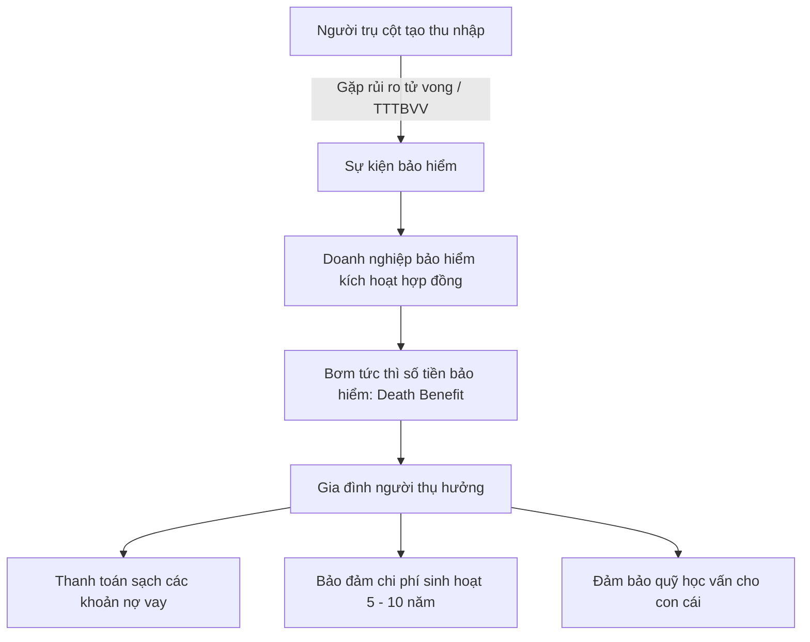
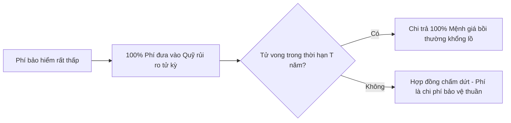
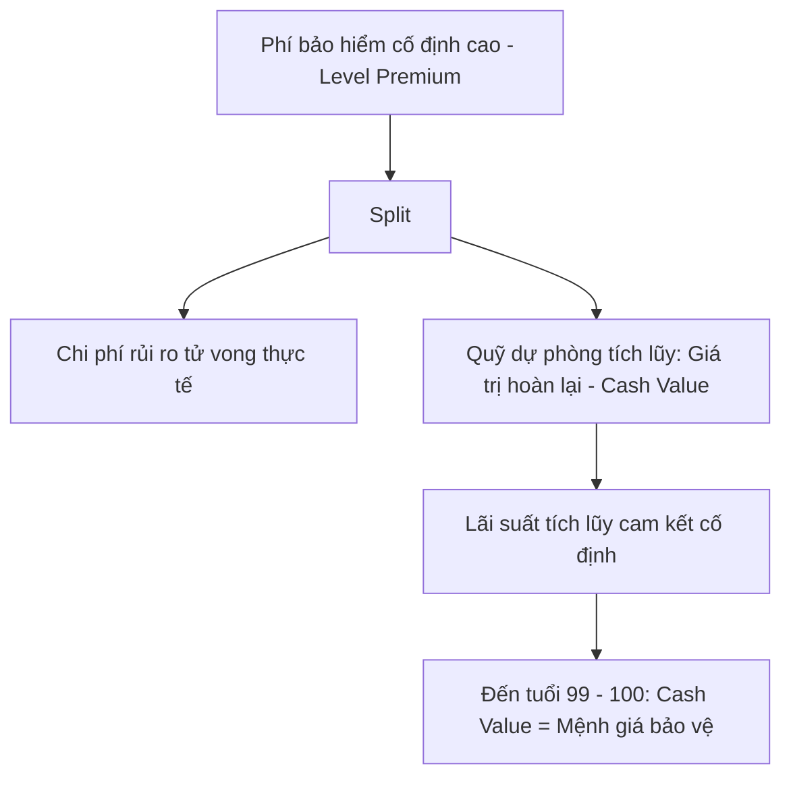
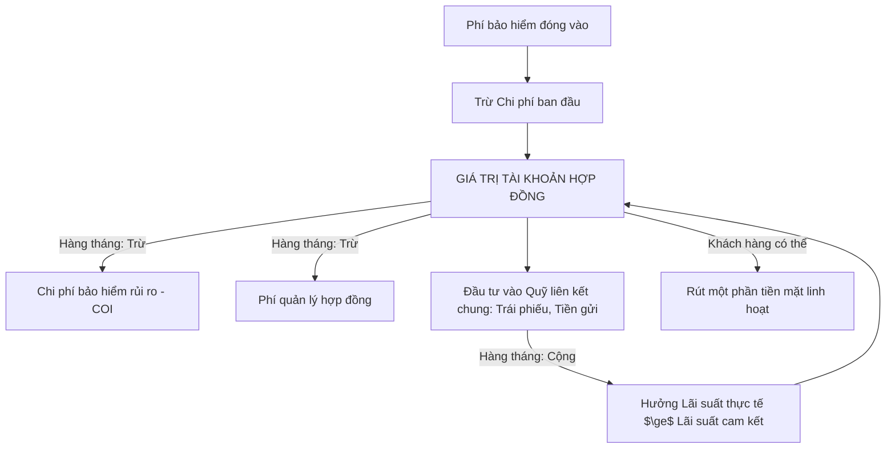

# Các Cấu Trúc Sản Phẩm Bảo Hiểm Nhân Thọ

Bảo hiểm nhân thọ là công cụ tài chính duy nhất có khả năng ngay lập tức tạo ra một khối di sản tiền mặt khổng lồ để bảo vệ những người phụ thuộc khi người tạo ra thu nhập đột ngột qua đời. Tài liệu này phân tích cấu trúc kinh tế, cơ chế tích lũy giá trị hoàn lại, kỹ thuật định phí bảo hiểm và sự khác biệt căn bản giữa ba dòng sản phẩm kinh điển: Bảo hiểm tử kỳ (Term Life), Bảo hiểm trọn đời (Whole Life) và Bảo hiểm liên kết chung (Universal Life).

> **Các câu hỏi cốt lõi:**
> 1. Tại sao triết lý tài chính "Mua tử kỳ và đem phần chênh lệch đi đầu tư" (Buy Term and Invest the Difference - BTID) lại được các nhà hoạch định tài chính độc lập khuyến nghị áp đảo?
> 2. Giá trị hoàn lại (Cash Value) trong bảo hiểm trọn đời hình thành từ đâu và tại sao nó lại làm cho mức phí đóng hàng năm cao gấp nhiều lần bảo hiểm tử kỳ?
> 3. Cơ chế tách bạch minh bạch giữa Phí rủi ro, Phí quản lý và Quỹ liên kết chung trong sản phẩm Universal Life hoạt động như thế nào?

---

## 1. Life Insurance (Bảo hiểm nhân thọ)

### 1. Là gì?
- **Định nghĩa hình thức:** Bảo hiểm nhân thọ là loại hình bảo hiểm cho trường hợp người được bảo hiểm sống hoặc chết, theo đó doanh nghiệp bảo hiểm cam kết chi trả một số tiền bảo hiểm xác định cho người thụ hưởng khi người được bảo hiểm qua đời hoặc đạt đến một độ tuổi nhất định quy định trong hợp đồng.
- **Giải thích đơn giản:** Bảo hiểm nhân thọ là bản hợp đồng đảm bảo rằng: nếu chẳng may bạn ra đi sớm, gia đình bạn sẽ nhận được một số tiền lớn bằng nhiều năm thu nhập của bạn để tiếp tục duy trì cuộc sống, trả nợ và nuôi dạy con cái ăn học đàng hoàng.
- **Nếu chỉ nhớ một điều:** Bảo hiểm nhân thọ sinh ra không phải vì ai đó sẽ chết đi, mà vì những người thân yêu của họ vẫn phải tiếp tục sống.

### 2. Hoạt động thế nào?
- **Chủ thể ra quyết định:** Trụ cột gia đình hoặc người có trách nhiệm tài chính quyết định tham gia để bảo vệ dòng thu nhập tương lai (Human Life Value).
- **Mục tiêu tối ưu hóa:** Bù đắp khoảng trống tài chính (Financial Gap) nếu nguồn thu nhập chính của gia đình bị cắt đứt đột ngột.
- **Ràng buộc:** Phải vượt qua quy trình thẩm định y khoa và nghề nghiệp (Medical & Financial Underwriting); hợp đồng có thể bị hủy nếu kê khai gian dối hoặc vi phạm thời gian ân hạn.
- **Cơ chế tác động:**

### 3. Công thức & Mô hình
Xác định mệnh giá bảo hiểm nhân thọ theo Phương pháp Giá trị sinh mạng con người (Human Life Value - HLV) của Solomon S. Huebner:
$$\text{HLV} = \sum_{t=1}^{T} \frac{E_t - C_t}{(1 + r)^t}$$
Trong đó:
- $E_t$: Thu nhập dự kiến người trụ cột tạo ra ở năm thứ $t$.
- $C_t$: Chi phí tiêu dùng cá nhân của chính người trụ cột ở năm thứ $t$.
- $E_t - C_t$: Phần thu nhập thực tế người trụ cột dành nuôi dưỡng gia đình và người phụ thuộc.
- $r$: Lãi suất chiết khấu (thường là lãi suất thực tế sau lạm phát).
- $T$: Số năm làm việc còn lại cho đến tuổi nghỉ hưu dự kiến.

### 4. Ví dụ
- **Ví dụ định lượng:** Anh Cường (35 tuổi), thu nhập ròng 30.000.000 VND/tháng (360 triệu/năm). Anh tiêu cho bản thân 10 triệu/tháng (120 triệu/năm), còn lại 240 triệu/năm dành chăm lo cho vợ và hai con nhỏ. Anh dự kiến làm việc 25 năm nữa (nghỉ hưu ở tuổi 60). Giả sử lãi suất chiết khấu sau lạm phát $r = 4\%$/năm.
  - Giá trị sinh mạng con người của anh Cường:
    $$\text{HLV} = 240.000.000 \times \left[ \frac{1 - (1 + 0,04)^{-25}}{0,04} \right] = 240.000.000 \times 15,622 = 3.749.280.000 \text{ VND}$$
  - Mệnh giá bảo hiểm nhân thọ cần thiết để bảo vệ trọn vẹn gia đình anh Cường là khoảng 3,75 tỷ đồng.
- **Ví dụ thực tế:** Tại Việt Nam, nhiều gia đình lâm vào cảnh khánh kiệt, con cái phải bỏ học đại học khi người cha hoặc người mẹ trụ cột đột ngột qua đời vì tai nạn hoặc bạo bệnh mà không có bảo hiểm nhân thọ bảo vệ nguồn thu nhập.
- **Phản ví dụ (Counterfactual):** Một người mua bảo hiểm nhân thọ mệnh giá chỉ 100 triệu đồng cho bản thân trong khi chi phí sinh hoạt gia đình là 20 triệu/tháng. Khi rủi ro tử vong xảy ra, số tiền 100 triệu bồi thường chỉ đủ trang trải cuộc sống cho vợ con trong vòng 5 tháng, hoàn toàn không giải quyết được vấn đề an sinh dài hạn.

### 5. Ứng dụng & Tranh luận
- **Ứng dụng thực tiễn:** Tạo lập ngay lập tức tài sản thừa kế bằng tiền mặt cho con cái; bảo hiểm nhân thọ liên kết kinh doanh (Key Person Insurance) bảo vệ doanh nghiệp trước sự mất mát của nhân sự chủ chốt.
- **Ưu và nhược điểm:**
  - *Ưu điểm:* Tạo ra thanh khoản tiền mặt lớn ngay trong thời điểm gia đình bế tắc nhất; số tiền bồi thường được miễn thuế TNCN tại Việt Nam (theo Điều 4 Luật Thuế TNCN).
  - *Nhược điểm:* Đòi hỏi tính kỷ luật và cam kết dòng tiền đều đặn trong nhiều năm.
- **Sai lầm phổ biến:** Mua bảo hiểm nhân thọ cho con cái trước tiên thay vì mua bảo hiểm bảo vệ người trụ cột trực tiếp làm ra tiền trong gia đình.

### 6. Liên kết
- Cùng chủ đề: [01_Insurance_Fundamentals_and_Mechanics.md](file:///Users/ductri0981/Documents/Studying/Studying-Economic/04_Personal_Finance_and_Wealth_Management/07_Insurance_and_Personal_Risk_Protection/01_Insurance_Fundamentals_and_Mechanics.md)
- Liên kết chéo: [01_Personal_Finance_Foundations/02_Personal_Balance_Sheet_and_Net_Worth.md](file:///Users/ductri0981/Documents/Studying/Studying-Economic/04_Personal_Finance_and_Wealth_Management/01_Personal_Finance_Foundations/02_Personal_Balance_Sheet_and_Net_Worth.md)

---

## 2. Term Life Insurance (Bảo hiểm nhân thọ có thời hạn / Bảo hiểm tử kỳ)

### 1. Là gì?
- **Định nghĩa hình thức:** Bảo hiểm tử kỳ là loại hình bảo hiểm nhân thọ thuần túy bảo vệ, trong đó doanh nghiệp bảo hiểm chỉ chi trả số tiền bảo hiểm nếu người được bảo hiểm tử vong (hoặc thương tật toàn bộ vĩnh viễn) trong một khoảng thời hạn xác định (ví dụ 10, 20, 30 năm). Nếu hết thời hạn mà người được bảo hiểm vẫn còn sống, hợp đồng chấm dứt và không có giá trị hoàn lại.
- **Giải thích đơn giản:** Bảo hiểm tử kỳ giống hệt như bảo hiểm hỏa hoạn nhà cửa hay bảo hiểm vật chất xe máy: bạn đóng một khoản phí rất nhỏ mỗi năm, nếu bình an vô sự thì không lấy lại tiền; nếu có biến cố, bảo hiểm đền trọn vẹn số tiền khổng lồ.
- **Nếu chỉ nhớ một điều:** Bảo hiểm tử kỳ là sản phẩm mang lại tỷ lệ đòn bẩy bảo vệ tài chính (Mệnh giá bảo hiểm / Phí đóng) cao nhất trong mọi dòng sản phẩm bảo hiểm nhân thọ.

### 2. Hoạt động thế nào?
- **Chủ thể ra quyết định:** Khách hàng muốn bảo vệ tối đa dòng thu nhập trong giai đoạn trách nhiệm tài chính cao nhất (nuôi con nhỏ, trả nợ vay) với chi phí rẻ nhất.
- **Mục tiêu tối ưu hóa:** Cực đại hóa số tiền bảo vệ trên mỗi đồng chi phí bỏ ra mà không bị pha loãng bởi cấu phần tích lũy tiết kiệm.
- **Ràng buộc:** Hợp đồng không tích lũy giá trị hoàn lại (Zero Cash Value); phí bảo hiểm thường tăng vọt nếu tái tục ở độ tuổi cao hơn.
- **Cơ chế tác động:**

### 3. Công thức & Mô hình
Phí bảo hiểm tử kỳ thuần niên kim đều đặn ($P_{\text{term}}$) cho thời hạn $n$ năm ở tuổi $x$ với mệnh giá $S = 1$:
$$P_{\text{term}} = \frac{A^1_{x:\overline{n}|}}{\ddot{a}_{x:\overline{n}|}}$$
Trong đó:
- $A^1_{x:\overline{n}|} = \sum_{t=0}^{n-1} v^{t+1} \cdot {}_t p_x \cdot q_{x+t}$: Giá trị hiện tại tính toán của quyền lợi tử vong $n$ năm.
- $\ddot{a}_{x:\overline{n}|} = \sum_{t=0}^{n-1} v^t \cdot {}_t p_x$: Giá trị hiện tại của chuỗi đóng phí đầu kỳ.
- $v = (1 + i)^{-1}$: Hệ số chiết khấu dòng tiền với lãi suất kỹ thuật $i$.

### 4. Ví dụ
- **Ví dụ định lượng:** Nam giới 30 tuổi mua bảo hiểm tử kỳ thời hạn 20 năm (bảo vệ đến 50 tuổi) mệnh giá $S = 2.000.000.000$ VND.
  - Mức phí bảo hiểm tử kỳ cố định chỉ khoảng $4.500.000$ VND/năm.
  - Tổng số phí đóng trong 20 năm nếu sống khỏe mạnh: $20 \times 4.500.000 = 90.000.000$ VND.
  - Đòn bẩy bảo vệ: $\frac{2.000.000.000}{4.500.000} \approx 444$ lần phí thường niên!
  - Nếu tử vong ở năm thứ 5, người thụ hưởng nhận ngay 2 tỷ đồng dù tổng phí mới đóng là 22,5 triệu đồng. Nếu sống qua tuổi 50, hợp đồng kết thúc hoàn hảo vì lúc này con cái đã tốt nghiệp đại học và tự lập tài chính.
- **Ví dụ thực tế:** Phong trào quản trị tài chính cá nhân toàn cầu khuyến khích chiến lược **BTID (Buy Term and Invest the Difference)**: Thay vì đóng 30 triệu/năm mua bảo hiểm trọn đời, người mua chỉ bỏ ra 5 triệu mua bảo hiểm tử kỳ 2 tỷ, và đem 25 triệu chênh lệch hàng năm đầu tư định kỳ vào chứng chỉ quỹ ETF cổ phiếu tăng trưởng. Sau 20 năm, quỹ đầu tư có thể đạt 1,5 - 2 tỷ đồng tiền mặt tự do.
- **Phản ví dụ (Counterfactual):** Một người thu nhập 15 triệu/tháng muốn bảo vệ con nhỏ nhưng vì tiếc "tiền mất đi không lấy lại được" nên từ chối mua bảo hiểm tử kỳ 4 triệu/năm, mà lại ráng mua bảo hiểm tích lũy trọn đời 20 triệu/năm. Sau 2 năm cạn kiệt ngân sách sinh hoạt, người này buộc phải hủy hợp đồng, mất trắng tiền phí đã đóng và mất luôn sự bảo vệ cho gia đình.

### 5. Ứng dụng & Tranh luận
- **Ứng dụng thực tiễn:** Công cụ hoàn hảo bảo hiểm khoản nợ thế chấp nhà ở; bảo vệ gia đình trẻ trong giai đoạn tích lũy tài sản ban đầu khi vốn tự có còn eo hẹp.
- **Ưu và nhược điểm:**
  - *Ưu điểm:* Phí bảo hiểm cực kỳ rẻ, phạm vi bảo vệ cao, giải phóng dòng tiền nhàn rỗi để tự do đầu tư sinh lời.
  - *Nhược điểm:* Không có tiền hoàn lại khi hết hạn; khó tái tục khi đã cao tuổi hoặc xuất hiện bệnh nền.
- **Sai lầm phổ biến:** Tâm lý ác cảm cho rằng bảo hiểm tử kỳ là "mất tiền oan" nếu sống thọ, không hiểu rằng chi phí đó chính là giá của sự an tâm cho gia đình suốt 20 năm.

### 6. Liên kết
- Cùng chủ đề: [02_Contract_Terms_Costs_and_Claims.md](file:///Users/ductri0981/Documents/Studying/Studying-Economic/04_Personal_Finance_and_Wealth_Management/07_Insurance_and_Personal_Risk_Protection/02_Contract_Terms_Costs_and_Claims.md)
- Liên kết chéo: [06_Wealth_Building_and_Compounding/01_Mathematics_of_Compounding_and_Interest.md](file:///Users/ductri0981/Documents/Studying/Studying-Economic/04_Personal_Finance_and_Wealth_Management/06_Wealth_Building_and_Compounding/01_Mathematics_of_Compounding_and_Interest.md)

---

## 3. Whole Life Insurance (Bảo hiểm nhân thọ trọn đời)

### 1. Là gì?
- **Định nghĩa hình thức:** Bảo hiểm trọn đời là loại hình bảo hiểm nhân thọ bảo vệ người được bảo hiểm đến hết cuộc đời (thường quy ước là 99 hoặc 100 tuổi), kết hợp giữa quyền lợi bảo hiểm khi tử vong (Death Benefit) với cấu phần tích lũy giá trị tiền mặt (Cash Value) được cam kết tăng trưởng với lãi suất cố định.
- **Giải thích đơn giản:** Là gói bảo hiểm "chắc chắn sẽ trả tiền", vì ai rồi cũng phải qua đời. Bạn đóng phí cố định suốt đời (hoặc đóng trong 10-20 năm), tiền phí này vừa mua quyền bảo vệ vừa được công ty tích cóp sinh lãi đảm bảo để bạn rút ra lúc về già hoặc để lại cho con cháu.
- **Nếu chỉ nhớ một điều:** Phí bảo hiểm trọn đời cao hơn từ 5 đến 10 lần so với bảo hiểm tử kỳ có cùng mệnh giá vì doanh nghiệp bảo hiểm biết chắc chắn $100\%$ rằng họ sẽ phải chi trả quyền lợi vào một thời điểm nào đó trong tương lai.

### 2. Hoạt động thế nào?
- **Chủ thể ra quyết định:** Khách hàng có thu nhập cao muốn bảo đảm một khoản thừa kế chắc chắn cho thế hệ sau hoặc muốn tích lũy hưu trí an toàn tuyệt đối.
- **Mục tiêu tối ưu hóa:** Bảo vệ tài chính vĩnh viễn không phụ thuộc vào thời hạn, kết hợp tạo lập tài sản giá trị tiền mặt có thể vay mượn linh hoạt.
- **Ràng buộc:** Mức phí đóng cố định rất cao; nếu hủy hợp đồng trong 3-5 năm đầu, giá trị hoàn lại gần như bằng 0 do phải gánh chi phí ban đầu rất lớn.
- **Cơ chế tác động:**

### 3. Công thức & Mô hình
Nguyên lý Phí đóng cố định cân bằng (Level Premium System):
Ở tuổi trẻ ($x$), rủi ro tử vong $q_x$ rất thấp, phí cố định $P_{\text{whole}}$ cao hơn nhiều so với chi phí rủi ro thuần ($P_{\text{whole}} > p_x \cdot S$). Phần thặng dư phí được đưa vào tích lũy dự phòng toán học. Khi về già ($x + t$), rủi ro $q_{x+t}$ tăng vọt, phần chi phí rủi ro thuần vượt xa phí đóng ($p_{x+t} \cdot S > P_{\text{whole}}$), lúc này quỹ giá trị hoàn lại tích lũy từ thời trẻ sẽ bù đắp vào phần thiếu hụt:
$$_t V_x = A_{x+t} - P_{\text{whole}} \cdot \ddot{a}_{x+t}$$
Trong đó:
- $_t V_x$: Giá trị hoàn lại (Dự phòng toán học) ở năm thứ $t$.
- $A_{x+t}$: Giá trị hiện tại của nghĩa vụ bồi thường tương lai ở tuổi $x+t$.
- $P_{\text{whole}} \cdot \ddot{a}_{x+t}$: Giá trị hiện tại của các kỳ phí đóng tương lai.
Khi $x+t = 100$, $_t V_x = S$ (Giá trị hoàn lại bằng đúng Mệnh giá bảo vệ).

### 4. Ví dụ
- **Ví dụ định lượng:** Nam 30 tuổi mua hợp đồng Whole Life mệnh giá $S = 2.000.000.000$ VND.
  - Phí đóng cố định: $35.000.000$ VND/năm (gấp gần 8 lần mức 4,5 triệu của sản phẩm tử kỳ Term Life).
  - Năm thứ 1 - 3: Giá trị hoàn lại (Cash Value) rất thấp ($0 - 15$ triệu đồng) do trừ phí ban đầu.
  - Năm thứ 20 (tuổi 50): Tổng phí đã đóng 700 triệu VND; Giá trị hoàn lại đạt khoảng 850 triệu VND (lãi suất cam kết tích lũy khoảng $3\% - 4\%$/năm). Khách hàng có thể thế chấp hợp đồng vay tối đa $80\%$ giá trị hoàn lại (680 triệu) để kinh doanh mà hợp đồng bảo hiểm vẫn giữ nguyên hiệu lực.
  - Đến khi tử vong ở tuổi 85: Gia đình nhận trọn vẹn 2.000.000.000 VND tiền mặt miễn thuế thừa kế.
- **Ví dụ thực tế:** Tại Mỹ và các quốc gia phát triển, giới thượng lưu sử dụng hợp đồng Whole Life thông qua các ủy thác bảo hiểm nhân thọ bất khả thu hồi (ILIT - Irrevocable Life Insurance Trust) để chi trả thuế di sản khổng lồ (Estate Tax lên tới $40\%$) mà không phải bán tháo bất động sản hay cổ phiếu công ty gia đình.
- **Phản ví dụ (Counterfactual):** Một người trẻ có thu nhập trung bình mua Whole Life vì muốn "vừa bảo vệ vừa tiết kiệm lấy lại tiền". Sau 3 năm, do kết hôn và sinh con cần tiền, người này không gánh nổi phí 35 triệu/năm và xin hủy hợp đồng. Tổng phí đã đóng 105 triệu nhưng chỉ nhận lại giá trị hoàn lại 15 triệu, chịu lỗ nặng nề 90 triệu đồng.

### 5. Ứng dụng & Tranh luận
- **Ứng dụng thực tiễn:** Công cụ chuyển giao tài sản thừa kế chắc chắn cho thế hệ sau; lập quỹ hưu trí bảo toàn vốn an toàn tuyệt đối trước mọi khủng hoảng thị trường tài chính.
- **Ưu và nhược điểm:**
  - *Ưu điểm:* Bảo vệ vĩnh viễn đến trọn đời; giá trị tiền mặt tăng trưởng đều đặn không phụ thuộc thị trường chứng khoán; có thể vay tiền linh hoạt từ hợp đồng.
  - *Nhược điểm:* Phí đóng cực kỳ đắt đỏ; lãi suất tích lũy của giá trị hoàn lại khá thấp ($3\% - 4\%$), dễ bị xói mòn sức mua bởi lạm phát dài hạn.
- **Sai lầm phổ biến:** Xem Whole Life là kênh đầu tư làm giàu thay vì nhận thức đây là công cụ bảo toàn tài sản và chuyển giao thế hệ.

### 6. Liên kết
- Cùng chủ đề: [01_Insurance_Fundamentals_and_Mechanics.md](file:///Users/ductri0981/Documents/Studying/Studying-Economic/04_Personal_Finance_and_Wealth_Management/07_Insurance_and_Personal_Risk_Protection/01_Insurance_Fundamentals_and_Mechanics.md)
- Liên kết chéo: [06_Wealth_Building_and_Compounding/06_Wealth_Lifecycle_and_Generational_Transfer.md](file:///Users/ductri0981/Documents/Studying/Studying-Economic/04_Personal_Finance_and_Wealth_Management/06_Wealth_Building_and_Compounding/06_Wealth_Lifecycle_and_Generational_Transfer.md)

---

## 4. Universal Life Insurance (Bảo hiểm liên kết chung)

### 1. Là gì?
- **Định nghĩa hình thức:** Bảo hiểm liên kết chung là sản phẩm bảo hiểm nhân thọ thuộc nhóm bảo hiểm liên kết đầu tư, có cấu trúc tách bạch rõ ràng giữa phần bảo vệ rủi ro và phần đầu tư tích lũy, cho phép Bên mua bảo hiểm linh hoạt thay đổi mức phí đóng, số tiền bảo hiểm và rút tiền từ Giá trị tài khoản hợp đồng theo nhu cầu tài chính từng giai đoạn.
- **Giải thích đơn giản:** Giống như bạn mở một tài khoản tiết kiệm tại công ty bảo hiểm: Hàng tháng/năm bạn nộp tiền vào tài khoản này, công ty sẽ trừ đi một khoản phí bảo hiểm rủi ro nhỏ và phí quản lý, phần tiền còn lại được đem đi đầu tư vào các tài sản an toàn (trái phiếu chính phủ, tiền gửi) và trả lãi thực tế vào tài khoản của bạn kèm mức cam kết lãi suất sàn.
- **Nếu chỉ nhớ một điều:** Universal Life mang lại tính linh hoạt tuyệt đối: khi dư dả bạn có thể đóng thêm phí để sinh lãi, khi khó khăn bạn có thể tạm ngưng đóng phí mà hợp đồng vẫn được duy trì bằng cách tự trích tiền từ Giá trị tài khoản.

### 2. Hoạt động thế nào?
- **Chủ thể ra quyết định:** Khách hàng chủ động điều chỉnh mức phí, số tiền bảo hiểm và linh hoạt rút tiền hoặc đóng thêm phí bảo hiểm theo biến động cuộc sống.
- **Mục tiêu tối ưu hóa:** Kết hợp bảo vệ dòng tiền với việc tích lũy sinh lời linh hoạt, hưởng lãi suất đầu tư theo sát biến động thị trường nhưng có phao cứu sinh là lãi suất cam kết tối thiểu.
- **Ràng buộc:** Giá trị tài khoản hợp đồng phụ thuộc vào kết quả đầu tư thực tế của Quỹ liên kết chung; nếu giá trị tài khoản giảm về 0 và khách hàng không đóng thêm phí, hợp đồng sẽ mất hiệu lực.
- **Cơ chế tác động:**

### 3. Công thức & Mô hình
Phương trình biến động Giá trị tài khoản hợp đồng ở cuối tháng thứ $t$ ($AV_t$):
$$AV_t = \left( AV_{t-1} + P_t - C_{\text{init}, t} - \text{COI}_t - C_{\text{admin}, t} - W_t \right) \times (1 + i_t)$$
Trong đó:
- $AV_{t-1}$: Giá trị tài khoản đầu kỳ.
- $P_t$: Phí bảo hiểm đóng thêm trong tháng $t$.
- $C_{\text{init}, t}$: Chi phí ban đầu (tỷ lệ khấu trừ cao trong 1-3 năm đầu, giảm về $0\%$ ở các năm sau).
- $\text{COI}_t$: Chi phí bảo hiểm rủi ro (Cost of Insurance) khấu trừ hàng tháng dựa trên độ tuổi thực tế và số tiền bảo hiểm rủi ro thuần ($S - AV_{t-1}$).
- $C_{\text{admin}, t}$: Phí quản lý hợp đồng định kỳ.
- $W_t$: Số tiền rút ra từ giá trị tài khoản.
- $i_t$: Lãi suất công bố tháng $t$, với ràng buộc $i_t \ge i_{\text{guaranteed}}$ (lãi suất cam kết tối thiểu).

### 4. Ví dụ
- **Ví dụ định lượng:** Chị Mai mua hợp đồng Universal Life đóng phí 20.000.000 VND/năm, mệnh giá bảo vệ 1.000.000.000 VND. Lãi suất cam kết tối thiểu $2\%$/năm, lãi suất công bố thực tế của quỹ là $5\%$/năm.
  - Năm thứ 1: Phí đóng 20 triệu. Chi phí ban đầu bị trừ $60\%$ (12 triệu). Số tiền vào tài khoản: 8 triệu. Chi phí bảo hiểm rủi ro (COI) và phí quản lý cả năm: 2 triệu. Giá trị tài khoản cuối năm 1: khoảng $(8 - 2) \times 1,05 = 6,3$ triệu VND.
  - Năm thứ 10: Chi phí ban đầu giảm về $0\%$. Toàn bộ 20 triệu đóng vào được chuyển vào giá trị tài khoản sau khi trừ phí COI. Giá trị tài khoản đã tích lũy lên tới 250 triệu VND.
  - Năm thứ 11: Chị Mai sinh con nghỉ việc 1 năm, chị tạm ngưng đóng phí. Công ty bảo hiểm tự động trích từ tài khoản 250 triệu ra khoảng 3 triệu để thanh toán phí rủi ro và quản lý. Hợp đồng bảo vệ 1 tỷ đồng của chị vẫn duy trì hiệu lực bình thường.
- **Ví dụ thực tế:** Tại Việt Nam, dòng sản phẩm Universal Life (bảo hiểm liên kết chung) chiếm tỷ trọng doanh thu phí bảo hiểm nhân thọ lớn nhất trong hơn một thập kỷ qua của các công ty bảo hiểm như Prudential (Pru-Chủ Động Cuộc Sống), Manulife, Bảo Việt Nhân Thọ (An Phát Trọn Đời).
- **Phản ví dụ (Counterfactual):** Một khách hàng mua Universal Life năm 40 tuổi và ngừng đóng phí sau 5 năm khi giá trị tài khoản mới có 40 triệu đồng. Khi người này bước sang tuổi 60, chi phí rủi ro COI tăng vọt lên 15 triệu/năm do tuổi cao. Chỉ sau 3 năm, toàn bộ giá trị tài khoản bị trừ sạch về 0. Khách hàng không nhận được thư thông báo đóng thêm phí, hợp đồng mất hiệu lực và quyền lợi bảo vệ 1 tỷ đồng bốc hơi ngay trước giai đoạn bệnh tật của tuổi già.

### 5. Ứng dụng & Tranh luận
- **Ứng dụng thực tiễn:** Thích hợp cho người có thu nhập biến động theo chu kỳ kinh doanh (người làm nghề tự do, kinh doanh tự do) cần sự linh hoạt về đóng phí và rút tiền.
- **Ưu và nhược điểm:**
  - *Ưu điểm:* Cực kỳ linh hoạt trong việc thay đổi phí đóng, rút tiền, minh bạch rõ ràng chi phí; có lãi suất cam kết bảo hộ an toàn.
  - *Nhược điểm:* Khi về già, chi phí rủi ro tử vong (COI) tăng theo cấp số nhân; nếu lãi suất thị trường giảm sâu kéo dài, giá trị tài khoản có nguy cơ bị "ăn mòn" nhanh chóng.
- **Sai lầm phổ biến:** Kỳ vọng lãi suất thực tế sẽ duy trì mãi ở mức cao như bảng minh họa giả định (ví dụ minh họa $7\% - 8\%$), để rồi thất vọng khi lãi suất thị trường hạ nhiệt xuống chỉ còn $3\% - 4\%$.

### 6. Liên kết
- Cùng chủ đề: [02_Contract_Terms_Costs_and_Claims.md](file:///Users/ductri0981/Documents/Studying/Studying-Economic/04_Personal_Finance_and_Wealth_Management/07_Insurance_and_Personal_Risk_Protection/02_Contract_Terms_Costs_and_Claims.md)
- Liên kết chéo: [06_Wealth_Building_and_Compounding/02_Time_Value_of_Money_and_Valuation.md](file:///Users/ductri0981/Documents/Studying/Studying-Economic/04_Personal_Finance_and_Wealth_Management/06_Wealth_Building_and_Compounding/02_Time_Value_of_Money_and_Valuation.md)

---

## Câu hỏi tự kiểm tra
1. So sánh sự khác nhau căn bản giữa triết lý của Bảo hiểm tử kỳ (Term Life) và Bảo hiểm trọn đời (Whole Life). Trong hoàn cảnh tài chính nào thì chiến lược "Buy Term and Invest the Difference" phát huy tối đa hiệu quả?
2. Phương pháp Giá trị sinh mạng con người (Human Life Value) tính toán mệnh giá bảo hiểm nhân thọ dựa trên những biến số kinh tế nào?
3. Tại sao trong sản phẩm Universal Life, chi phí bảo hiểm rủi ro (Cost of Insurance - COI) lại tăng dần theo thời gian khi người được bảo hiểm lớn tuổi? Cơ chế tự động trích phí từ Giá trị tài khoản hoạt động thế nào?
4. Nếu Bên mua bảo hiểm hủy hợp đồng Whole Life hoặc Universal Life trong 2 năm đầu tiên thì quyền lợi tài chính nhận lại sẽ như thế nào? Giải thích lý do kinh tế đằng sau việc trừ chi phí ban đầu rất cao trong những năm đầu.

## Ghi chú nguồn
- Huebner, S. S. - *The Economics of Life Insurance*, Appleton-Century-Crofts.
- Society of Actuaries (SOA) - *Actuarial Mathematics for Life Contingent Risks*.
- Luật Kinh doanh bảo hiểm số 08/2022/QH15.
- Thông tư số 67/2023/TT-BTC hướng dẫn một số điều của Luật Kinh doanh bảo hiểm đối với sản phẩm bảo hiểm liên kết đầu tư.
