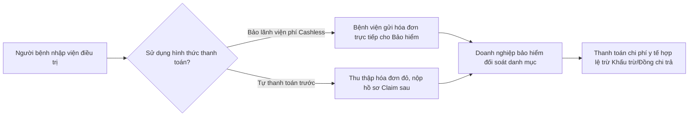
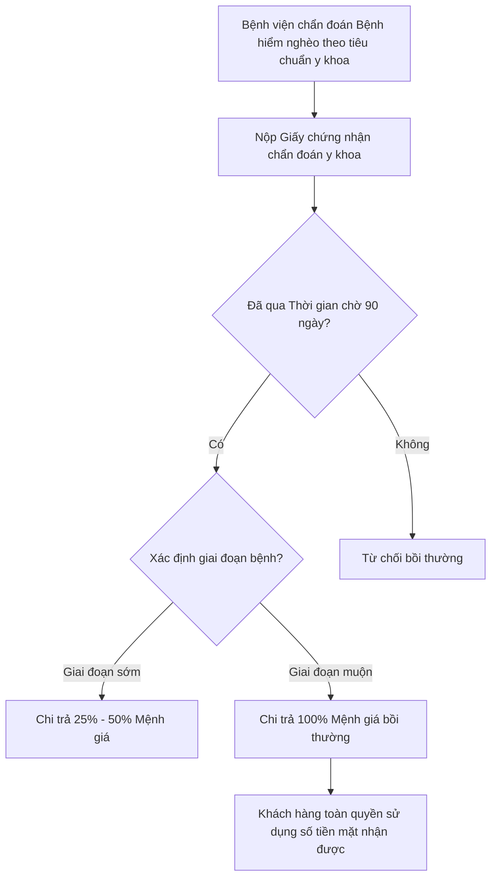
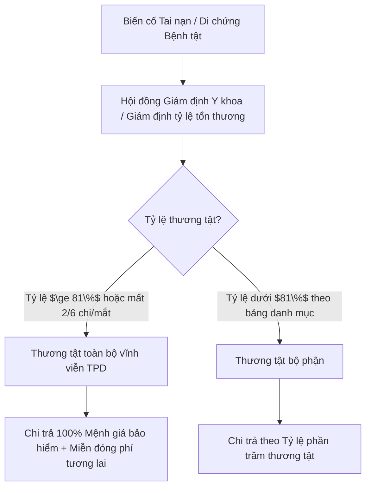
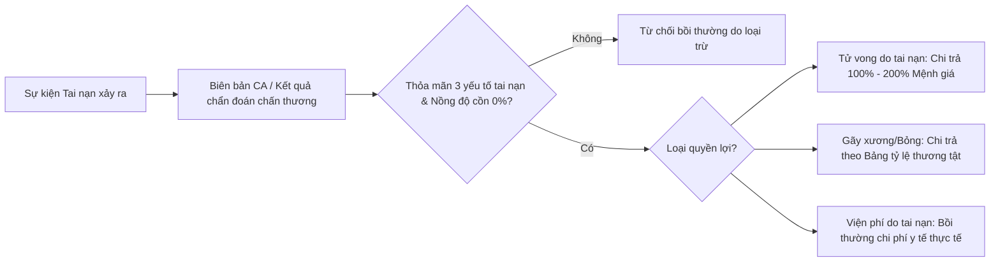

# Bảo Hiểm Sức Khỏe Và Các Quyền Lợi Sống

Trong cấu trúc phòng thủ rủi ro tài chính cá nhân, rủi ro mất đi khả năng tạo thu nhập khi còn đang sống (Living Benefits) do ốm đau bệnh tật, tai nạn hay tàn tật thường gây ra gánh nặng tài chính khốc liệt hơn cả cái chết. Tài liệu này cung cấp bức tranh toàn diện và chuyên sâu về cơ chế vận hành, cấu trúc bồi thường và ứng dụng chiến lược của bốn dòng sản phẩm bảo vệ sức khỏe và quyền lợi sống: Bảo hiểm sức khỏe, Bảo hiểm bệnh hiểm nghèo, Bảo hiểm thương tật và Bảo hiểm tai nạn con người.

> **Các câu hỏi cốt lõi:**
> 1. Tại sao bảo hiểm bệnh hiểm nghèo (Critical Illness) lại chi trả một cục (Lump-sum) ngay khi có kết quả chẩn đoán thay vì thanh toán theo hóa đơn viện phí thực tế như bảo hiểm sức khỏe (Health Insurance)?
> 2. Khái niệm Thương tật toàn bộ và vĩnh viễn (Total and Permanent Disability - TPD) được định nghĩa và kiểm định y khoa khắt khe như thế nào?
> 3. Bảng tỷ lệ thương tật theo tỷ lệ phần trăm (Scale of Indemnity) trong bảo hiểm tai nạn (AD&D) hoạt động ra sao?

---

## 1. Health Insurance (Bảo hiểm sức khỏe)

### 1. Là gì?
- **Định nghĩa hình thức:** Bảo hiểm sức khỏe là loại hình bảo hiểm bồi thường hoặc chi trả chi phí y tế phát sinh khi người được bảo hiểm bị ốm đau, bệnh tật, thai sản hoặc phải phẫu thuật điều trị nội trú, ngoại trú, nha khoa theo chỉ định hợp pháp của bác sĩ tại các cơ sở y tế.
- **Giải thích đơn giản:** Bảo hiểm sức khỏe là chiếc thẻ giúp bạn thanh toán viện phí, tiền giường bệnh, tiền thuốc men và chi phí phẫu thuật khi phải đi bệnh viện, giúp bạn được điều trị tại các bệnh viện tư nhân hoặc quốc tế chất lượng cao mà không lo "thủng ví".
- **Nếu chỉ nhớ một điều:** Bảo hiểm sức khỏe hoạt động theo Nguyên tắc bồi thường thiệt hại thực tế (Principle of Indemnity) – bạn chỉ được thanh toán tối đa bằng số tiền viện phí thực tế hợp lệ đã phát sinh, không thể kiếm lời từ bảo hiểm sức khỏe.

### 2. Hoạt động thế nào?
- **Chủ thể ra quyết định:** Người tham gia lựa chọn chương trình bảo hiểm (Cơ bản, Nâng cao, VIP) và lựa chọn bệnh viện khám chữa bệnh.
- **Mục tiêu tối ưu hóa:** Bảo vệ quỹ tiết kiệm và quỹ khẩn cấp không bị bào mòn bởi các đợt ốm đau nằm viện bất ngờ.
- **Ràng buộc:** Giới hạn bởi danh mục bảo vệ (Nội trú là quyền lợi chính bắt buộc; Ngoại trú, Thai sản, Nha khoa là quyền lợi bổ trợ tùy chọn); áp dụng thời gian chờ y tế (30 ngày đối với bệnh thông thường, 1 năm đối với bệnh đặc biệt).
- **Cơ chế tác động:**

### 3. Công thức & Mô hình
Số tiền bồi thường bảo hiểm y tế thực tế ($H_{\text{payout}}$):
$$H_{\text{payout}} = \min \left( \sum_{k=1}^m \min(e_k, s_k) - D, M_{\text{health}} \right)$$
Trong đó:
- $e_k$: Chi phí y tế thực tế phát sinh của danh mục thứ $k$ (tiền giường, tiền mổ, thuốc điều trị).
- $s_k$: Giới hạn chi trả tối đa của danh mục thứ $k$ (sub-limit).
- $D$: Mức khấu trừ hàng năm hoặc trên mỗi đợt điều trị.
- $M_{\text{health}}$: Hạn mức bảo hiểm tối đa toàn diện trong năm.

### 4. Ví dụ
- **Ví dụ định lượng:** Chị Hân mua thẻ bảo hiểm sức khỏe hạn mức 500.000.000 VND/năm với phí 6.000.000 VND/năm. Chị phải mổ nội soi dây chằng khớp gối tại bệnh viện đa khoa quốc tế:
  - Chi phí phẫu thuật và thủ thuật y tế: 45.000.000 VND (hạn mức phụ mổ: 60 triệu $\implies$ duyệt đủ).
  - Tiền phòng dịch vụ 4 ngày: $4 \times 2.500.000 = 10.000.000$ VND (hạn mức phụ tiền giường: 3 triệu/ngày $\implies$ duyệt đủ).
  - Tiền thuốc và xét nghiệm: 15.000.000 VND.
  - Tổng hóa đơn: 70.000.000 VND.
  - Chị Hân xuất trình thẻ bảo hiểm tại quầy thu ngân, công ty bảo hiểm thực hiện bảo lãnh viện phí thanh toán trực tiếp 70 triệu cho bệnh viện. Chị chỉ thanh toán tiền đồ ăn uống phục vụ thêm 400.000 VND.
- **Ví dụ thực tế:** Tại Việt Nam, sự kết hợp giữa Bảo hiểm Y tế nhà nước (BHYT) làm nền tảng thanh toán danh mục cơ bản và Bảo hiểm sức khỏe tư nhân (Bảo Việt An Gia, Liberty, PVI Care) thanh toán phần viện phí chất lượng cao vượt tuyến đang là mô hình bảo vệ y tế tối ưu nhất cho tầng lớp trung lưu.
- **Phản ví dụ (Counterfactual):** Một người mua bảo hiểm sức khỏe ngày hôm trước, tuần sau đi mổ amidan. Yêu cầu bồi thường 15 triệu bị từ chối thẳng thừng vì bệnh viêm amidan thuộc diện bệnh thông thường có Thời gian chờ (Waiting Period) là 30 ngày kể từ ngày hợp đồng có hiệu lực.

### 5. Ứng dụng & Tranh luận
- **Ứng dụng thực tiễn:** Tiếp cận dịch vụ y tế tuyến đầu không cần chờ đợi; bảo vệ ngân sách sinh hoạt gia đình trước các rủi ro ốm đau thường nhật.
- **Ưu và nhược điểm:**
  - *Ưu điểm:* Quyền lợi bảo lãnh viện phí không dùng tiền mặt (Cashless) tại hàng trăm bệnh viện công/tư; bảo vệ thiết thực dòng tiền.
  - *Nhược điểm:* Phí bảo hiểm là phí tiêu hao hàng năm (không hoàn lại); phí tăng lũy tiến theo từng nhóm tuổi và có thể bị từ chối tái tục nếu năm trước phát sinh bồi thường bệnh nặng.
- **Sai lầm phổ biến:** Nhầm tưởng bảo hiểm sức khỏe tư nhân có thể thay thế hoàn toàn BHYT nhà nước. Trên thực tế, nếu không có BHYT nhà nước gánh bớt danh mục bệnh nặng kéo dài hàng năm, hạn mức của thẻ tư nhân sẽ cạn kiệt rất nhanh.

### 6. Liên kết
- Cùng chủ đề: [02_Contract_Terms_Costs_and_Claims.md](file:///Users/ductri0981/Documents/Studying/Studying-Economic/04_Personal_Finance_and_Wealth_Management/07_Insurance_and_Personal_Risk_Protection/02_Contract_Terms_Costs_and_Claims.md)
- Liên kết chéo: [04_Saving_and_Emergency_Funds/02_Emergency_Rainy_Day_and_Sinking_Funds.md](file:///Users/ductri0981/Documents/Studying/Studying-Economic/04_Personal_Finance_and_Wealth_Management/04_Saving_and_Emergency_Funds/02_Emergency_Rainy_Day_and_Sinking_Funds.md)

---

## 2. Critical Illness Insurance (Bảo hiểm bệnh hiểm nghèo / Bệnh nan y)

### 1. Là gì?
- **Định nghĩa hình thức:** Bảo hiểm bệnh hiểm nghèo là loại hình bảo hiểm theo sự kiện cam kết chi trả một khoản tiền bảo hiểm một lần (Lump-sum Payout) cố định cho người được bảo hiểm ngay khi có kết luận chẩn đoán xác định mắc một trong các bệnh hiểm nghèo nằm trong danh mục thỏa thuận (ung thư, đột quỵ, nhồi máu cơ tim, suy thận mãn tính,...), bất kể chi phí điều trị thực tế tại bệnh viện là bao nhiêu.
- **Giải thích đơn giản:** Nếu bác sĩ chẩn đoán bạn mắc bệnh ung thư hoặc suy thận, công ty bảo hiểm sẽ chuyển khoản ngay cho bạn một số tiền lớn (ví dụ 1 tỷ đồng) mà không cần quan tâm bạn dùng số tiền đó để nằm viện, sang Singapore chữa bệnh, hay để ở nhà sinh sống dưỡng bệnh.
- **Nếu chỉ nhớ một điều:** Bảo hiểm bệnh hiểm nghèo không phải để trả tiền viện phí, mà là công cụ thay thế nguồn thu nhập bị mất (Income Replacement) trong 3 đến 5 năm điều trị kiên trì.

### 2. Hoạt động thế nào?
- **Chủ thể ra quyết định:** Khách hàng chủ động tính toán số tiền bảo hiểm tương đương 3-5 năm chi phí sinh hoạt gia đình để mua gói bảo vệ.
- **Mục tiêu tối ưu hóa:** Đảm bảo kinh tế gia đình không sụp đổ khi người trụ cột phải ngừng làm việc hoàn toàn để chữa trị bệnh mãn tính hiểm nghèo.
- **Ràng buộc:** Phải đáp ứng định nghĩa y khoa chính xác của từng bệnh theo bảng quy tắc; áp dụng thời gian chờ (Waiting period - thường là 90 ngày) và Thời gian sống sót (Survival period - thường sống sót sau chẩn đoán từ 14 đến 30 ngày đối với một số sản phẩm).
- **Cơ chế tác động:**

### 3. Công thức & Mô hình
Mức bảo vệ khuyến nghị cho Bảo hiểm Bệnh hiểm nghèo ($\text{CI}_{\text{coverage}}$):
$$\text{CI}_{\text{coverage}} = \text{LivingExpenses}_{\text{annual}} \times T_{\text{recovery}} + C_{\text{non-covered y tế}}$$
Trong đó:
- $\text{LivingExpenses}_{\text{annual}}$: Chi phí sinh hoạt tối thiểu của cả gia đình trong 1 năm.
- $T_{\text{recovery}}$: Thời gian hồi phục trung bình của bệnh nan y (khuyến nghị chuẩn: $3 - 5$ năm).
- $C_{\text{non-covered y tế}}$: Dự trù các chi phí thuốc đích, tế bào gốc hoặc phương pháp điều trị tiên tiến ngoài danh mục chi trả của bảo hiểm y tế.

### 4. Ví dụ
- **Ví dụ định lượng:** Chi phí sinh hoạt tối thiểu của gia đình anh Thắng là 25.000.000 VND/tháng (300 triệu/năm). Anh mua bảo hiểm bệnh hiểm nghèo đa giai đoạn mệnh giá $S = 1.500.000.000$ VND.
  - Năm 42 tuổi, anh phát hiện ung thư biểu mô tuyến giáp giai đoạn sớm. Công ty chi trả ngay $25\% \times 1,5 \text{ tỷ} = 375.000.000$ VND tiền mặt. Hợp đồng tiếp tục có hiệu lực mà không phải đóng thêm phí (miễn đóng phí bệnh hiểm nghèo).
  - Năm 46 tuổi, bệnh tái phát di căn gan (giai đoạn cuối). Công ty chi trả nốt $100\%$ mệnh giá còn lại là 1.500.000.000 VND.
  - Số tiền 1,5 tỷ này giúp gia đình anh chi trả các phác đồ thuốc đích ngoài danh mục BHYT và đảm bảo tiền sinh hoạt, tiền học cho các con trong suốt 5 năm anh nằm viện điều trị.
- **Ví dụ thực tế:** Các doanh nghiệp bảo hiểm lớn tại Việt Nam (Manulife, AIA, FWD, Dai-ichi) hiện đều cung cấp danh mục bảo vệ từ 80 đến trên 100 bệnh hiểm nghèo, chia làm 3 giai đoạn (Sớm, Giữa, Muộn) kèm điều khoản chi trả nhiều lần (Multi-claim Critical Illness).
- **Phản ví dụ (Counterfactual):** Một người mua bảo hiểm bệnh hiểm nghèo ngày 1/1. Ngày 15/2 (sau 45 ngày), người này đi khám phát hiện ung thư phổi giai đoạn 2. Toàn bộ yêu cầu bồi thường 1 tỷ đồng bị từ chối vì sự kiện phát sinh trong Thời gian chờ 90 ngày của hợp đồng.

### 5. Ứng dụng & Tranh luận
- **Ứng dụng thực tiễn:** Tạo nguồn ngân quỹ tự do để thuê người chăm sóc tại nhà, tiếp cận liệu pháp y học tiên tiến ở nước ngoài hoặc trả nợ ngân hàng ngay lập tức.
- **Ưu và nhược điểm:**
  - *Ưu điểm:* Nhận tiền mặt một lần, toàn quyền sử dụng, thủ tục chi trả chỉ cần giấy tờ chẩn đoán của bệnh viện tuyến trung ương.
  - *Nhược điểm:* Định nghĩa bệnh trong hợp đồng bảo hiểm rất khắt khe về mặt y khoa (ví dụ: nhồi máu cơ tim phải có biến đổi điện tâm đồ điển hình kèm tăng men tim men troponin); bệnh nhân mắc bệnh chưa đủ mức độ định nghĩa có thể bị từ chối.
- **Sai lầm phổ biến:** Nghĩ rằng chỉ cần có bảo hiểm y tế là đủ, không nhận ra rằng khi bị ung thư nằm liệt giường thì không còn khả năng kiếm ra tiền để chi trả tiền thuê nhà, tiền ăn, tiền học cho con cái.

### 6. Liên kết
- Cùng chủ đề: [03_Life_Insurance_Structures.md](file:///Users/ductri0981/Documents/Studying/Studying-Economic/04_Personal_Finance_and_Wealth_Management/07_Insurance_and_Personal_Risk_Protection/03_Life_Insurance_Structures.md)
- Liên kết chéo: [01_Personal_Finance_Foundations/03_Cash_Flow_and_Income_Metrics.md](file:///Users/ductri0981/Documents/Studying/Studying-Economic/04_Personal_Finance_and_Wealth_Management/01_Personal_Finance_Foundations/03_Cash_Flow_and_Income_Metrics.md)

---

## 3. Disability Insurance (Bảo hiểm thương tật / Tàn tật)

### 1. Là gì?
- **Định nghĩa hình thức:** Bảo hiểm thương tật là loại hình bảo hiểm bảo vệ người được bảo hiểm trước tổn thất thu nhập phát sinh do bị mất một phần hoặc mất hoàn toàn khả năng lao động, thể lực hoặc trí lực do hậu quả của tai nạn hoặc bệnh tật.
- **Giải thích đơn giản:** Nếu một biến cố khiến bạn bị liệt, mù mắt hoặc mất trí nhớ không thể tiếp tục đi làm kiếm tiền được nữa, bảo hiểm thương tật sẽ đứng ra trả tiền trợ cấp thay cho tiền lương của bạn.
- **Nếu chỉ nhớ một điều:** Bị thương tật toàn bộ thường gây tổn thất kinh tế lớn hơn tử vong, vì người bệnh vừa không làm ra tiền, vừa phải tiêu tốn chi phí y tế và chăm sóc đặc biệt suốt phần đời còn lại.

### 2. Hoạt động thế nào?
- **Chủ thể ra quyết định:** Người lao động tham gia bảo hiểm độc lập hoặc mua kèm điều khoản Thương tật toàn bộ và vĩnh viễn (TPD - Total and Permanent Disability) trong hợp đồng nhân thọ.
- **Mục tiêu tối ưu hóa:** Thay thế dòng tiền thu nhập thường xuyên định kỳ để nuôi sống bản thân người khuyết tật và gia đình.
- **Ràng buộc:** Phải có chứng nhận giám định y khoa về tỷ lệ tổn thương cơ thể (thường từ $81\%$ trở lên đối với thương tật toàn bộ) hoặc mất hoàn toàn công năng của 2 trong 6 bộ phận chính (2 mắt, 2 tay, 2 chân).
- **Cơ chế tác động:**

### 3. Công thức & Mô hình
Định nghĩa hai chuẩn mực Thương tật trong hợp đồng quốc tế:
1. **Own-Occupation Disability:** Không thể thực hiện các công việc chuyên môn của *chính nghề nghiệp hiện tại* (chuẩn mực cao cấp nhất, ví dụ: bác sĩ phẫu thuật bị đứt gân ngón tay không thể mổ được nữa, dù vẫn có thể làm giảng viên y khoa).
2. **Any-Occupation Disability:** Không thể thực hiện *bất kỳ công việc nào* phù hợp với trình độ học vấn, kinh nghiệm và năng lực (chuẩn mực khắt khe, phổ biến trong các hợp đồng tại Việt Nam).
Mức chi trả bồi thường thương tật bộ phận ($C_{\text{disability}}$):
$$C_{\text{disability}} = \text{Scale Percentage } (\beta) \times S$$
Với $\beta$ là tỷ lệ thương tật được quy định trong Bảng tỷ lệ trả tiền bảo hiểm thương tật.

### 4. Ví dụ
- **Ví dụ định lượng:** Hợp đồng bảo hiểm bổ trợ có quyền lợi thương tật do tai nạn mệnh giá $S = 500.000.000$ VND.
  - Bảng tỷ lệ thương tật quy định: Cụt một bàn tay nhận $50\%$; mù một mắt nhận $50\%$; mất một ngón tay cái nhận $15\%$.
  - Khách hàng không may gặp tai nạn lao động bị cụt một ngón tay cái bên thuận.
  - Số tiền bảo hiểm chi trả:
    $$C_{\text{disability}} = 15\% \times 500.000.000 = 75.000.000 \text{ VND}$$
  - Hợp đồng vẫn tiếp tục duy trì hiệu lực với hạn mức còn lại cho các sự kiện sau.
- **Ví dụ thực tế:** Theo Luật Bảo hiểm xã hội tại Việt Nam, người lao động tham gia BHXH bắt buộc bị suy giảm khả năng lao động từ $81\%$ trở lên được hưởng trợ cấp tuất hàng tháng hoặc chế độ hưu trí sớm khi bị tai nạn lao động, bệnh nghề nghiệp.
- **Phản ví dụ (Counterfactual):** Một lập trình viên bị tai nạn giao thông chấn thương cột sống liệt hai chân, mất hoàn toàn khả năng lao động nhưng không có bảo hiểm thương tật. Gia đình không những mất nguồn thu nhập 40 triệu/tháng của anh mà mỗi tháng còn phải gánh thêm 15 triệu chi phí thuê điều dưỡng chăm sóc, đẩy cả nhà vào cảnh nợ nần kiệt quệ.

### 5. Ứng dụng & Tranh luận
- **Ứng dụng thực tiễn:** Điều khoản bắt buộc phải có cho các nghề nghiệp lao động kỹ thuật cao, bác sĩ phẫu thuật, kiến trúc sư, phi công hoặc lái xe chuyên nghiệp.
- **Ưu và nhược điểm:**
  - *Ưu điểm:* Giải quyết triệt để rủi ro "sống mòn" tạo gánh nặng kinh tế cho gia đình; phí đóng bổ trợ thường rất rẻ so với quyền lợi.
  - *Nhược điểm:* Định nghĩa "Mất hoàn toàn khả năng lao động" thường là tâm điểm tranh chấp pháp lý gay gắt giữa khách hàng và công ty bảo hiểm nếu chỉ áp dụng chuẩn Any-Occupation.
- **Sai lầm phổ biến:** Cho rằng chỉ cần bảo vệ rủi ro tử vong là đủ, quên mất rằng thương tật mới là biến cố tạo ra áp lực tài chính kéo dài và tốn kém nhất.

### 6. Liên kết
- Cùng chủ đề: [01_Insurance_Fundamentals_and_Mechanics.md](file:///Users/ductri0981/Documents/Studying/Studying-Economic/04_Personal_Finance_and_Wealth_Management/07_Insurance_and_Personal_Risk_Protection/01_Insurance_Fundamentals_and_Mechanics.md)
- Liên kết chéo: [02_Income_Management/06_Human_Capital_and_Career_Capital.md](file:///Users/ductri0981/Documents/Studying/Studying-Economic/04_Personal_Finance_and_Wealth_Management/02_Income_Management/06_Human_Capital_and_Career_Capital.md)

---

## 4. Accident Insurance (Bảo hiểm tai nạn con người)

### 1. Là gì?
- **Định nghĩa hình thức:** Bảo hiểm tai nạn con người là loại hình bảo hiểm chi trả bồi thường cho người được bảo hiểm trong trường hợp bị thương tật thân thể hoặc tử vong phát sinh trực tiếp và duy nhất từ một biến cố bất ngờ, ngẫu nhiên, có tác động ngoại lực độc lập từ bên ngoài lên thân thể người được bảo hiểm trong thời hạn bảo hiểm.
- **Giải thích đơn giản:** Là gói bảo hiểm bảo vệ bạn trước các cú sốc bất ngờ như tai nạn giao thông, trượt chân ngã gãy xương, điện giật, đuối nước,...
- **Nếu chỉ nhớ một điều:** Tổn thất phải thỏa mãn 3 yếu tố: Bất ngờ, Có tác động ngoại lực bên ngoài, và Hoàn toàn ngoài ý muốn (không phải do bệnh lý tiềm ẩn phát tác).

### 2. Hoạt động thế nào?
- **Chủ thể ra quyết định:** Cá nhân tự mua hoặc doanh nghiệp mua phúc lợi hàng loạt cho nhân viên lao động (Group Personal Accident).
- **Mục tiêu tối ưu hóa:** Đạt được hạn mức bảo vệ tử vong và thương tật khổng lồ trước hiểm họa tai nạn với chi phí cực kỳ thấp.
- **Ràng buộc:** Không chi trả cho các biến cố xảy ra do vi phạm pháp luật hình sự, đua xe trái phép, sử dụng ma túy, rượu bia vượt nồng độ cồn quy định, hoặc tham gia các môn thể thao mạo hiểm (leo núi, nhảy dù) trừ khi có thỏa thuận đóng thêm phụ phí.
- **Cơ chế tác động:**

### 3. Công thức & Mô hình
Quyền lợi bồi thường kép đối với tai nạn đặc biệt (Double Indemnity):
$$C_{\text{accident}} = \begin{cases} 
S & \text{nếu tai nạn sinh hoạt thông thường} \\ 
2 \times S & \text{nếu tai nạn trên phương tiện giao thông công cộng, máy bay thương mại, thang máy}
\end{cases}$$
Quyền lợi hoàn trả chi phí y tế thực tế do tai nạn (Medical Reimbursement - $R$):
$$R = \min(L_{\text{medical}}, M_{\text{accident\_med}})$$

### 4. Ví dụ
- **Ví dụ định lượng:** Anh Tuấn mua bảo hiểm tai nạn toàn diện mệnh giá $S = 500.000.000$ VND kèm quyền lợi viện phí tai nạn $M_{\text{accident\_med}} = 30.000.000$ VND/vụ, phí chỉ 1.200.000 VND/năm.
  - Khi đi xe máy trên đường, anh bị xe khác va quẹt ngã gãy xương đùi kín.
  - Anh nhập viện phẫu thuật kết hợp xương hết 22.000.000 VND. Bảo hiểm chi trả hoàn trả $100\%$ chi phí thực tế: 22 triệu.
  - Theo bảng tỷ lệ thương tật, gãy xương đùi được đền bù $15\%$ mệnh giá:
    $$C_{\text{injury}} = 15\% \times 500.000.000 = 75.000.000 \text{ VND}$$
  - Tổng số tiền anh Tuấn nhận được: $22 + 75 = 97.000.000$ VND.
- **Ví dụ thực tế:** Tại Việt Nam, gói bảo hiểm tai nạn con người 24/24 là sản phẩm phi nhân thọ phổ biến nhất trong các công trường xây dựng, nhà máy sản xuất (theo quy định bắt buộc người sử dụng lao động phải mua cho công nhân xây dựng theo Thông tư 50/2022/TT-BTC).
- **Phản ví dụ (Counterfactual):** Một người đang lái xe thì bị đột quỵ nhồi máu cơ tim, dẫn đến mất lái tông vào dải phân cách và tử vong. Khám nghiệm tử thi xác định nguyên nhân tử vong là do bệnh lý nhồi máu cơ tim cấp chứ không phải do chấn thương va chạm. Công ty bảo hiểm tai nạn từ chối chi trả bồi thường quyền lợi tử vong do tai nạn vì nguyên nhân gốc rễ là bệnh tật.

### 5. Ứng dụng & Tranh luận
- **Ứng dụng thực tiễn:** Bổ sung ngay lập tức một lớp khiên bảo vệ dày đặc với chi phí rẻ cho người thường xuyên di chuyển ngoài đường hoặc làm công việc có tính chất nguy hiểm (nhóm nghề nghiệp 3, 4).
- **Ưu và nhược điểm:**
  - *Ưu điểm:* Phí bảo hiểm siêu rẻ (chỉ khoảng 0,1% - 0,3% mệnh giá bảo vệ), phạm vi chi trả nhanh, đòn bẩy tài chính cực lớn.
  - *Nhược điểm:* Phạm vi bảo vệ hẹp – hoàn toàn không chi trả nếu người tham gia tử vong hoặc tàn tật do ốm đau bệnh tật thông thường.
- **Sai lầm phổ biến:** Chỉ mua duy nhất một hợp đồng bảo hiểm tai nạn giá rẻ rồi an tâm rằng mình đã "được bảo vệ toàn diện", đến khi mắc ung thư hoặc bệnh gan thì mới nhận ra bảo hiểm tai nạn không chi trả một đồng nào.

### 6. Liên kết
- Cùng chủ đề: [02_Contract_Terms_Costs_and_Claims.md](file:///Users/ductri0981/Documents/Studying/Studying-Economic/04_Personal_Finance_and_Wealth_Management/07_Insurance_and_Personal_Risk_Protection/02_Contract_Terms_Costs_and_Claims.md)
- Liên kết chéo: [01_Personal_Finance_Foundations/06_Financial_Goals_and_Time_Horizons.md](file:///Users/ductri0981/Documents/Studying/Studying-Economic/04_Personal_Finance_and_Wealth_Management/01_Personal_Finance_Foundations/06_Financial_Goals_and_Time_Horizons.md)

---

## Câu hỏi tự kiểm tra
1. So sánh cơ chế bồi thường của Bảo hiểm sức khỏe (Health Insurance) và Bảo hiểm bệnh hiểm nghèo (Critical Illness Insurance). Tại sao bảo hiểm bệnh hiểm nghèo lại được xem là công cụ bù đắp thu nhập chứ không phải công cụ trả viện phí?
2. Hãy phân tích sự khác nhau giữa hai định nghĩa thương tật: "Own-Occupation" và "Any-Occupation". Định nghĩa nào bảo vệ quyền lợi tốt hơn cho các chuyên gia trình độ cao?
3. Trình bày 3 yếu tố cấu thành bắt buộc để một sự kiện được công nhận là "Tai nạn" trong hợp đồng bảo hiểm tai nạn con người. Nếu một cơn đột quỵ dẫn đến tai nạn ngã xe thì công ty bảo hiểm sẽ xử lý bồi thường như thế nào?
4. Tại sao các doanh nghiệp bảo hiểm luôn áp dụng Thời gian chờ (Waiting Period) đối với bệnh tật thông thường (30 ngày) và bệnh hiểm nghèo (90 ngày)? Nếu bỏ thời gian chờ thì hiện tượng gì sẽ xảy ra?

## Ghi chú nguồn
- Luật Kinh doanh bảo hiểm số 08/2022/QH15.
- Thông tư số 50/2022/TT-BTC về chế độ bảo hiểm bắt buộc trong hoạt động đầu tư xây dựng.
- American College of Financial Services - *Living Benefits and Disability Income Planning*.
- Geneva Association - *Health and Ageing Research Papers*.
