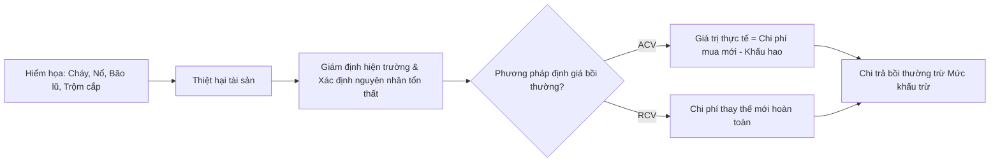
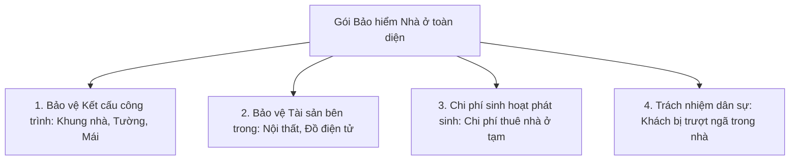
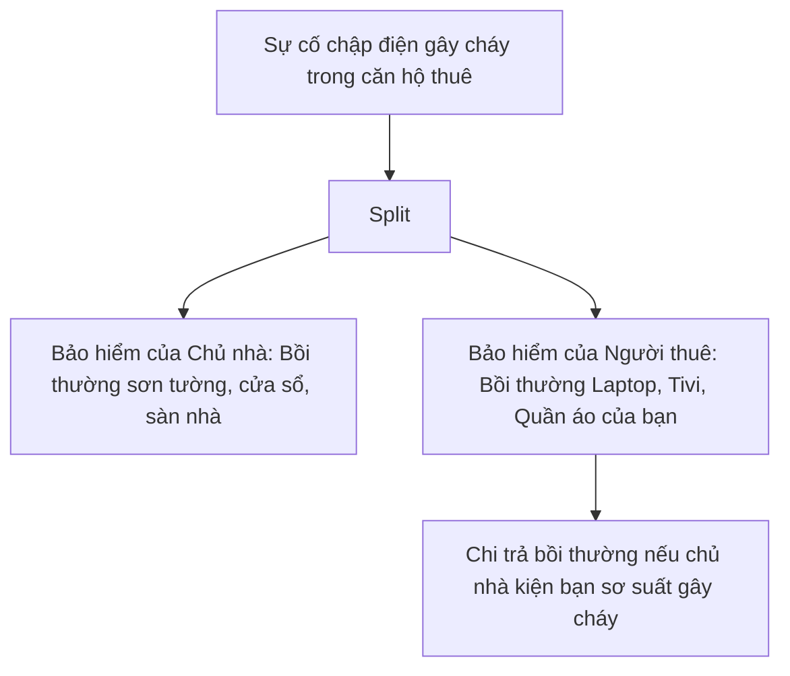
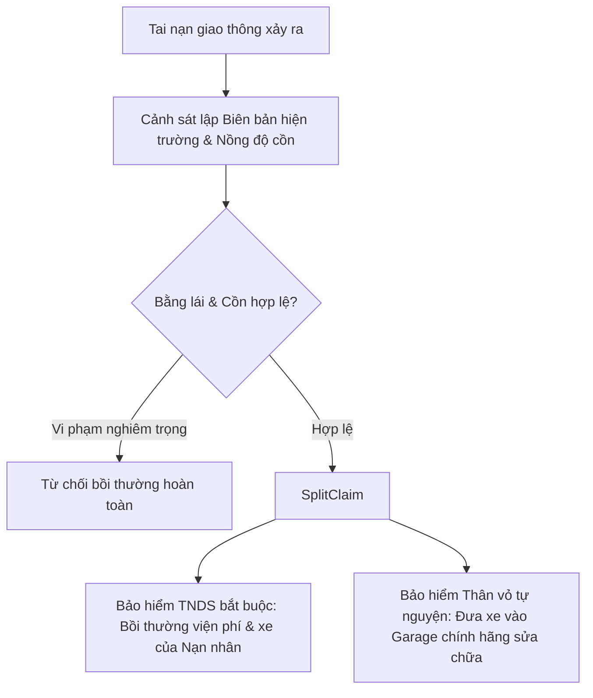
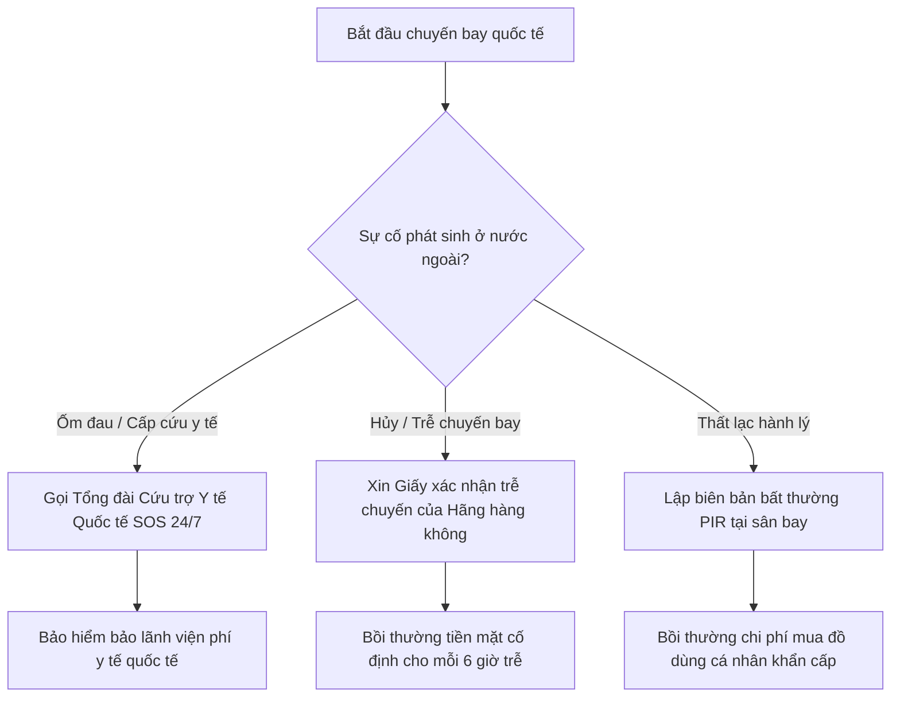

# Bảo Hiểm Tài Sản Và Thiệt Hại Phi Nhân Thọ

Bảo hiểm tài sản là lớp lá chắn quan trọng nhằm bảo vệ các tài sản tích lũy lớn nhất của đời người (bất động sản, phương tiện giao thông, tài sản cá nhân) và các chuyến hành trình quốc tế trước các rủi ro thiên tai, hỏa hoạn, trộm cắp và tai nạn bất ngờ. Tài liệu này phân tích chi tiết cơ chế định giá bồi thường tài sản (ACV so với RCV), nguyên tắc thế quyền (Subrogation), cấu trúc bảo vệ của bảo hiểm nhà ở, bảo hiểm người thuê nhà, bảo hiểm xe cơ giới và bảo hiểm du lịch.

> **Các câu hỏi cốt lõi:**
> 1. Sự khác biệt căn bản giữa Bồi thường theo Giá trị thực tế (Actual Cash Value - ACV) và Bồi thường theo Chi phí thay thế mới (Replacement Cost Value - RCV) là gì?
> 2. Tại sao Nguyên tắc thế quyền (Subrogation) lại ngăn chặn việc người tham gia bảo hiểm được bồi thường "hai lần" từ cả công ty bảo hiểm lẫn người gây tai nạn?
> 3. Cơ chế hoạt động của điều khoản Thủy kích trong bảo hiểm vật chất ô tô tại Việt Nam được định nghĩa và áp dụng khấu trừ như thế nào?

---

## 1. Property Insurance (Bảo hiểm tài sản)

### 1. Là gì?
- **Định nghĩa hình thức:** Bảo hiểm tài sản là loại hình bảo hiểm trong đó đối tượng bảo hiểm là tài sản hiện hữu, tiền, giấy tờ có giá và quyền tài sản, theo đó doanh nghiệp bảo hiểm cam kết bồi thường cho người được bảo hiểm những thiệt hại vật chất thực tế phát sinh đối với tài sản do các hiểm họa được bảo hiểm gây ra.
- **Giải thích đơn giản:** Là việc bạn mua bảo hiểm cho những đồ đạc, nhà xưởng, máy móc hoặc tài sản có giá trị của mình để nếu bị cháy nổ, trộm cắp hay hư hại, công ty bảo hiểm sẽ trả tiền cho bạn sửa lại hoặc mua mới.
- **Nếu chỉ nhớ một điều:** Bảo hiểm tài sản tuân thủ tuyệt đối Nguyên tắc Bồi thường thiệt hại (Principle of Indemnity) – người được bảo hiểm không bao giờ được bồi thường vượt quá giá trị thiệt hại thực tế để làm giàu từ tổn thất.

### 2. Hoạt động thế nào?
- **Chủ thể ra quyết định:** Chủ sở hữu hoặc người quản lý hợp pháp tài sản.
- **Mục tiêu tối ưu hóa:** Khôi phục tình trạng tài chính của tài sản về đúng trạng thái ngay trước thời điểm xảy ra tổn thất.
- **Ràng buộc:** Phải có Quyền lợi có thể được bảo hiểm đối với tài sản (phải là chủ sở hữu, người thuê hoặc bên nhận thế chấp); áp dụng quy tắc bồi thường theo tỷ lệ nếu tham gia dưới giá trị.
- **Cơ chế tác động:**

### 3. Công thức & Mô hình
Hai phương pháp định giá bồi thường tài sản:
1. **Giá trị tiền mặt thực tế (Actual Cash Value - ACV):**
$$\text{ACV} = \text{Replacement Cost} - \text{Depreciation}$$
Trong đó Khấu hao ($\text{Depreciation}$) dựa trên tuổi thọ và độ hao mòn vật lý của tài sản.
2. **Chi phí thay thế mới (Replacement Cost Value - RCV):**
$$\text{RCV} = \text{Chi phí mua mới hoặc xây dựng lại tại thời điểm tổn thất (không trừ khấu hao)}$$

Quy tắc Bồi thường theo tỷ lệ khi Tham gia Bảo hiểm dưới giá trị (Co-insurance Clause / Average Condition):
Nếu số tiền bảo hiểm tham gia ($S$) nhỏ hơn giá trị thực tế của tài sản ($V$):
$$\text{Payout} = L \times \frac{S}{c \times V}$$
Với $L$ là tổn thất thực tế và $c$ là tỷ lệ đồng bảo hiểm yêu cầu (thường là $80\%$).

### 4. Ví dụ
- **Ví dụ định lượng:** Một tòa nhà kho có giá trị thị trường $V = 10.000.000.000$ VND. Hợp đồng yêu cầu tỷ lệ bảo hiểm $c = 80\%$ (tức phải mua tối thiểu 8 tỷ VND). Nhưng chủ kho chỉ mua bảo hiểm mệnh giá $S = 4.000.000.000$ VND để tiết kiệm phí.
  - Một vụ hỏa hoạn xảy ra gây thiệt hại thực tế $L = 2.000.000.000$ VND.
  - Số tiền bồi thường thực tế:
    $$\text{Payout} = 2.000.000.000 \times \frac{4.000.000.000}{80\% \times 10.000.000.000} = 2.000.000.000 \times \frac{4.000.000.000}{8.000.000.000} = 1.000.000.000 \text{ VND}$$
  - Chủ kho bị phạt vì tham gia dưới giá trị và chỉ được nhận 1 tỷ đồng, phải tự chịu lỗ 1 tỷ đồng còn lại.
- **Ví dụ thực tế:** Sau các vụ cháy nổ tại các nhà xưởng ở Bình Dương hay Bắc Ninh, các chuyên viên giám định tổn thất độc lập (Loss Adjusters) được cử đến để tính toán mức độ khấu hao máy móc thiết bị nhằm xác định số tiền bồi thường chuẩn xác theo điều khoản hợp đồng.
- **Phản ví dụ (Counterfactual):** Một người mua bảo hiểm tài sản cho dàn máy tính cũ 5 năm tuổi theo điều khoản ACV. Khi máy bị chập điện cháy, giá máy mới trên thị trường là 20 triệu nhưng do đã khấu hao $80\%$ qua 5 năm, công ty bảo hiểm chỉ bồi thường $\text{ACV} = 20 \times (1 - 0,8) = 4$ triệu VND. Khách hàng ngỡ ngàng vì nghĩ sẽ được đền 20 triệu để mua máy mới.

### 5. Ứng dụng & Tranh luận
- **Ứng dụng thực tiễn:** Quản trị rủi ro cơ sở hạ tầng doanh nghiệp, kho bãi, máy móc công nghệ cao.
- **Ưu và nhược điểm:**
  - *Ưu điểm:* Bảo toàn toàn diện giá trị vốn đầu tư cố định của cá nhân và doanh nghiệp.
  - *Nhược điểm:* Phức tạp trong khâu định giá tài sản và xác định nguyên nhân tổn thất trực tiếp (Proximate Cause).
- **Sai lầm phổ biến:** Tiết kiệm vài triệu đồng phí bảo hiểm bằng cách khai thấp giá trị tài sản, để rồi khi xảy ra tổn thất bộ phận bị áp dụng điều khoản phạt bồi thường theo tỷ lệ.

### 6. Liên kết
- Cùng chủ đề: [02_Contract_Terms_Costs_and_Claims.md](file:///Users/ductri0981/Documents/Studying/Studying-Economic/04_Personal_Finance_and_Wealth_Management/07_Insurance_and_Personal_Risk_Protection/02_Contract_Terms_Costs_and_Claims.md)
- Liên kết chéo: [01_Personal_Finance_Foundations/02_Personal_Balance_Sheet_and_Net_Worth.md](file:///Users/ductri0981/Documents/Studying/Studying-Economic/04_Personal_Finance_and_Wealth_Management/01_Personal_Finance_Foundations/02_Personal_Balance_Sheet_and_Net_Worth.md)

---

## 2. Homeowners Insurance (Bảo hiểm nhà ở / Bảo hiểm chủ nhà)

### 1. Là gì?
- **Định nghĩa hình thức:** Bảo hiểm nhà ở là gói bảo hiểm tài sản và trách nhiệm kết hợp dành cho chủ sở hữu bất động sản nhà ở, bảo vệ kết cấu kiến trúc ngôi nhà, tài sản bên trong nhà trước các rủi ro hỏa hoạn, giông bão, trộm cắp và bồi thường trách nhiệm dân sự nếu có người khác bị tai nạn trong khuôn viên ngôi nhà.
- **Giải thích đơn giản:** Là gói bảo hiểm bảo vệ toàn diện ngôi nhà của bạn: nếu nhà bị cháy, tường sập do bão, hay có kẻ trộm đột nhập cuỗm đồ đạc, bảo hiểm sẽ trả tiền xây lại và đền bù tài sản bị mất.
- **Nếu chỉ nhớ một điều:** Bảo hiểm nhà ở chỉ bảo hiểm cho phần giá trị xây dựng của căn nhà (khung nhà và nội thất), hoàn toàn không bảo hiểm cho giá trị của mảnh đất bên dưới (vì đất không thể bị cháy hay biến mất).

### 2. Hoạt động thế nào?
- **Chủ thể ra quyết định:** Chủ sở hữu nhà ở hoặc bên đi vay thế chấp mua nhà theo yêu cầu bắt buộc của ngân hàng.
- **Mục tiêu tối ưu hóa:** Phòng chống rủi ro mất trắng tài sản lớn nhất đời người và đảm bảo khả năng trả nợ vay mua nhà.
- **Ràng buộc:** Không bảo hiểm các hao mòn tự nhiên theo thời gian, mối mọt, nứt nẻ lún móng do địa chất yếu, hoặc ngập lụt do triều cường trừ khi mua thêm điều khoản bổ sung đặc biệt.
- **Cơ chế tác động:**

### 3. Công thức & Mô hình
Xác định Số tiền bảo hiểm nhà ở chuẩn xác ($S_{\text{house}}$):
$$S_{\text{house}} = \text{Diện tích sàn xây dựng } (m^2) \times \text{Đơn giá xây dựng mới trên mỗi } m^2$$
(Không cộng giá trị chuyển nhượng quyền sử dụng đất vào số tiền bảo hiểm).
Chi phí sinh hoạt phát sinh bổ sung (Additional Living Expenses - ALE):
$$\text{ALE} = \text{Chi phí thuê nhà tạm và ăn uống thực tế khi sửa nhà} - \text{Chi phí sinh hoạt thông thường}$$

### 4. Ví dụ
- **Ví dụ định lượng:** Một căn nhà phố có diện tích sàn $200 m^2$. Đơn giá xây dựng hoàn thiện tại đô thị là 7.000.000 VND/$m^2$. Giá trị đất thị trường là 6 tỷ VND.
  - Số tiền bảo hiểm kết cấu nhà cần mua:
    $$S_{\text{structure}} = 200 \times 7.000.000 = 1.400.000.000 \text{ VND}$$
  - Chủ nhà mua thêm bảo hiểm tài sản nội thất bên trong 300.000.000 VND.
  - Phí bảo hiểm cháy nổ nhà ở chỉ khoảng $0,08\%$/năm:
    $$P = 0,08\% \times (1,4 \text{ tỷ} + 300 \text{ triệu}) = 1.360.000 \text{ VND/năm}$$
  - Chỉ với hơn 1,3 triệu đồng mỗi năm, toàn bộ khối tài sản xây dựng 1,7 tỷ được bảo vệ tuyệt đối.
- **Ví dụ thực tế:** Tại các khu đô thị chung cư cao tầng tại Hà Nội và TP.HCM, Ban quản lý tòa nhà bắt buộc phải mua Bảo hiểm cháy nổ bắt buộc cho phần sở hữu chung theo Nghị định 136/2020/NĐ-CP; đồng thời từng chủ hộ sở hữu căn hộ được khuyến khích mua bảo hiểm cháy nổ cho phần căn hộ riêng và tài sản nội thất.
- **Phản ví dụ (Counterfactual):** Một chủ nhà vay ngân hàng mua căn nhà 4 tỷ (đất 3 tỷ, nhà 1 tỷ) nhưng tính phí bảo hiểm trên toàn bộ 4 tỷ đồng. Khi nhà bị cháy toàn bộ, công ty bảo hiểm chỉ bồi thường tối đa 1 tỷ chi phí xây dựng lại căn nhà (vì mảnh đất vẫn còn nguyên vẹn). Chủ nhà đã lãng phí tiền phí đóng cho khoản ảo 3 tỷ suốt nhiều năm mà không nhận thêm được một đồng bồi thường nào.

### 5. Ứng dụng & Tranh luận
- **Ứng dụng thực tiễn:** Điều kiện tiên quyết để giải ngân các khoản vay thế chấp bất động sản tại các ngân hàng thương mại; bảo vệ an cư lạc nghiệp cho gia đình.
- **Ưu và nhược điểm:**
  - *Ưu điểm:* Phí bảo hiểm cực thấp so với giá trị tài sản bảo vệ; tích hợp cả bảo vệ tài sản lẫn trách nhiệm dân sự.
  - *Nhược điểm:* Các danh mục loại trừ liên quan đến hiện tượng ẩm mốc, rò rỉ nước ngầm hoặc thiên tai cục bộ thường gây bất đồng khi đòi bồi thường.
- **Sai lầm phổ biến:** Nhầm lẫn giá trị thị trường bất động sản (bao gồm cả đất) với chi phí tái thiết công trình xây dựng khi mua bảo hiểm nhà.

### 6. Liên kết
- Cùng chủ đề: [01_Property_Insurance.md](file:///Users/ductri0981/Documents/Studying/Studying-Economic/04_Personal_Finance_and_Wealth_Management/07_Insurance_and_Personal_Risk_Protection/01_Property_Insurance.md)
- Liên kết chéo: [05_Debt_and_Credit_Management/01_Debt_Classification_and_Nature.md](file:///Users/ductri0981/Documents/Studying/Studying-Economic/04_Personal_Finance_and_Wealth_Management/05_Debt_and_Credit_Management/01_Debt_Classification_and_Nature.md)

---

## 3. Renters Insurance (Bảo hiểm người thuê nhà)

### 1. Là gì?
- **Định nghĩa hình thức:** Bảo hiểm người thuê nhà là loại hình bảo hiểm tài sản và trách nhiệm cá nhân dành riêng cho những người đang đi thuê nhà hoặc căn hộ, bảo hiểm cho toàn bộ đồ đạc tài sản cá nhân thuộc quyền sở hữu của người thuê bên trong ngôi nhà đi thuê, đồng thời bảo hiểm trách nhiệm pháp lý nếu người thuê sơ suất gây hư hại cho căn nhà hoặc tổn hại cho người xung quanh.
- **Giải thích đơn giản:** Khi bạn đi thuê nhà, bảo hiểm của chủ nhà chỉ bảo vệ cái vỏ căn nhà của họ, còn máy tính, quần áo, tivi của bạn nếu bị cháy hay trộm thì chủ nhà không đền. Bảo hiểm người thuê nhà bảo vệ tài sản đó của bạn với giá rất rẻ.
- **Nếu chỉ nhớ một điều:** Đừng lầm tưởng bảo hiểm của chủ nhà (Landlord policy) sẽ bảo vệ tài sản cá nhân của người thuê trọ; bạn hoàn toàn phải tự bảo vệ tài sản của chính mình.

### 2. Hoạt động thế nào?
- **Chủ thể ra quyết định:** Người đi thuê căn hộ, sinh viên, người làm việc xa nhà.
- **Mục tiêu tối ưu hóa:** Bảo vệ tài sản tích lũy cá nhân với chi phí rẻ như một bữa ăn mỗi tháng.
- **Ràng buộc:** Không bảo hiểm cho kết cấu tòa nhà (vì kết cấu thuộc trách nhiệm của chủ nhà); người thuê phải chứng minh được quyền sở hữu tài sản bị mất/hư hại (hóa đơn, ảnh chụp).
- **Cơ chế tác động:**

### 3. Công thức & Mô hình
Định giá danh mục tài sản người thuê nhà để chọn hạn mức ($S_{\text{renter}}$):
$$S_{\text{renter}} = \sum_{i=1}^n \text{ItemValue}_i$$
Hạn mức trách nhiệm dân sự của người thuê nhà ($M_{\text{tenant\_liability}}$): Bảo vệ tài sản ròng của người thuê trước nguy cơ bị chủ nhà hoặc hàng xóm khởi kiện bồi thường thiệt hại do bất cẩn (cháy, ngập nước rò rỉ).

### 4. Ví dụ
- **Ví dụ định lượng:** Bạn Tuấn thuê một căn hộ chung cư mini. Tổng tài sản cá nhân của Tuấn gồm: Laptop 30 triệu, máy ảnh 25 triệu, điện thoại và đồ công nghệ 20 triệu, quần áo giày dép 25 triệu $\implies$ Tổng giá trị tài sản 100.000.000 VND.
  - Tuấn mua một gói bảo hiểm người thuê nhà với phí chỉ 500.000 VND/năm (khoảng 40.000 VND/tháng).
  - Một hôm đi làm quên tắt bàn ủi dẫn đến chập điện cháy phòng, thiêu rụi toàn bộ đồ đạc của Tuấn và làm đen hỏng trần nhà của chủ nhà (chi phí sơn sửa lại 20 triệu).
  - Bảo hiểm người thuê nhà chi trả: 100 triệu tiền đồ đạc cho Tuấn + 20 triệu tiền trách nhiệm dân sự bồi thường cho chủ nhà. Tuấn thoát khỏi một thảm họa tài chính ở tuổi đôi mươi.
- **Ví dụ thực tế:** Tại các quốc gia như Mỹ, Đức, Singapore, hầu hết các hợp đồng thuê nhà đều có điều khoản bắt buộc người thuê phải mua "Renters Insurance" trước khi nhận chìa khóa nhà. Tại Việt Nam, xu hướng này đang bắt đầu xuất hiện tại các căn hộ dịch vụ và chung cư cao cấp.
- **Phản ví dụ (Counterfactual):** Một bạn sinh viên đi thuê nhà để quên vòi nước làm tràn ngập sang căn hộ bên cạnh, làm hỏng toàn bộ sàn gỗ cao cấp trị giá 80 triệu đồng của hàng xóm. Do không có bảo hiểm người thuê nhà, sinh viên này bị khởi kiện và buộc phải bồi thường toàn bộ tiền túi.

### 5. Ứng dụng & Tranh luận
- **Ứng dụng thực tiễn:** Công cụ quản trị rủi ro lý tưởng cho thế hệ trẻ (Gen Z, Millennials) chuộng lối sống thuê nhà linh hoạt thay vì mua nhà cố định.
- **Ưu và nhược điểm:**
  - *Ưu điểm:* Chi phí rẻ nhất trong các loại bảo hiểm tài sản; bảo vệ cả đồ đạc mang theo người khi đi ra ngoài (Off-premises coverage).
  - *Nhược điểm:* Nhiều người thuê nhà có tâm lý chủ quan coi thường giá trị đồ đạc cá nhân nên tỷ lệ tham gia còn thấp.
- **Sai lầm phổ biến:** Nghĩ rằng đồ đạc cá nhân của mình "chẳng đáng bao nhiêu", cho đến khi phải bỏ tiền túi ra sắm lại toàn bộ tủ quần áo, máy tính, thiết bị gia dụng cùng một lúc.

### 6. Liên kết
- Cùng chủ đề: [02_Homeowners_Insurance.md](file:///Users/ductri0981/Documents/Studying/Studying-Economic/04_Personal_Finance_and_Wealth_Management/07_Insurance_and_Personal_Risk_Protection/02_Homeowners_Insurance.md)
- Liên kết chéo: [03_Budgeting_and_Expense_Management/07_Mindful_Spending_and_Consumption_Control.md](file:///Users/ductri0981/Documents/Studying/Studying-Economic/04_Personal_Finance_and_Wealth_Management/03_Budgeting_and_Expense_Management/07_Mindful_Spending_and_Consumption_Control.md)

---

## 4. Motor Insurance (Bảo hiểm xe cơ giới)

### 1. Là gì?
- **Định nghĩa hình thức:** Bảo hiểm xe cơ giới là nhóm sản phẩm bảo hiểm dành cho các phương tiện giao thông đường bộ (ô tô, mô tô, xe máy), bao gồm Bảo hiểm trách nhiệm dân sự bắt buộc của chủ xe cơ giới đối với bên thứ ba và Bảo hiểm vật chất xe cơ giới tự nguyện (bảo hiểm thân vỏ/hai chiều).
- **Giải thích đơn giản:** Là bảo hiểm cho chiếc xe của bạn và trách nhiệm của bạn khi lái xe: nếu bạn đâm vào xe người khác, bảo hiểm đền cho người ta; nếu xe bạn bị móp méo, trầy xước, ngập nước thủy kích hay mất cắp, bảo hiểm đền tiền sửa cho bạn.
- **Nếu chỉ nhớ một điều:** Bảo hiểm bắt buộc TNDS bảo vệ cho túi tiền và sinh mạng của NGƯỜI KHÁC; muốn bảo vệ chiếc xe của CHÍNH MÌNH thì bắt buộc phải mua thêm bảo hiểm vật chất thân vỏ tự nguyện.

### 2. Hoạt động thế nào?
- **Chủ thể ra quyết định:** Chủ xe cơ giới bắt buộc phải mua TNDS theo pháp luật và tự nguyện mua thêm vật chất xe.
- **Mục tiêu tối ưu hóa:** Tuân thủ pháp luật giao thông, bảo vệ tài sản xe hơi và ngăn ngừa trách nhiệm bồi thường bồi hoàn không giới hạn khi gây tai nạn.
- **Ràng buộc:** Mức bồi thường vật chất bị giảm trừ nếu chủ xe tự ý sửa chữa không thông báo cho bảo hiểm hoặc không có xác nhận của công an; loại trừ nếu lái xe uống rượu bia hoặc không có bằng lái hợp lệ.
- **Cơ chế tác động:**

### 3. Công thức & Mô hình
Số tiền bồi thường sửa chữa vật chất xe ($C_{\text{motor}}$) khi có mức khấu trừ ($D$) và giảm trừ do lỗi kê khai chậm ($\gamma$):
$$C_{\text{motor}} = (\text{Chi phí sửa chữa hợp lý} - D) \times (1 - \gamma)$$
Điều khoản bồi thường xe bị ngập nước (Hiện tượng Thủy kích - Hydrostatic Lock):
Khách hàng khởi động lại máy khi xe đã bị ngập nước chết máy dẫn đến gãy tay biên, vỡ lốc máy thường chịu mức khấu trừ chia sẻ tổn thất riêng rất cao (thường là $20\% - 30\%$ chi phí sửa chữa hoặc tối thiểu 3.000.000 VND/vụ).

### 4. Ví dụ
- **Ví dụ định lượng:** Anh Nam sở hữu xe ô tô trị giá 800.000.000 VND. Anh mua bảo hiểm vật chất thân vỏ với mức khấu trừ $D = 500.000$ VND/vụ, phí bảo hiểm $1,3\% \times 800 \text{ triệu} = 10.400.000$ VND/năm.
  - Trên đường cao tốc, xe bị mất lái đâm vào dải phân cách. Chi phí sửa chữa, thay cản trước, đèn pha và sơn lại tại xưởng chính hãng là 35.000.000 VND.
  - Anh Nam gọi ngay hotline bảo hiểm, giữ nguyên hiện trường chụp ảnh và được hướng dẫn đưa xe về gara đối tác.
  - Số tiền bảo hiểm chi trả cho gara:
    $$C_{\text{motor}} = 35.000.000 - 500.000 = 34.500.000 \text{ VND}$$
  - Anh Nam chỉ phải trả 500.000 VND tiền khấu trừ tại chỗ.
- **Ví dụ thực tế:** Tại Việt Nam, vào mùa mưa bão lớn ngập đường phố Hà Nội và TP.HCM, hàng trăm xe ô tô bị chết máy ngập nước. Những chủ xe có mua thêm "Điều khoản bổ sung bảo hiểm thiệt hại động cơ do hiện tượng thủy kích" được bảo hiểm chi trả hàng trăm triệu đồng tiền thay lốc máy mới.
- **Phản ví dụ (Counterfactual):** Một tài x xe ô tô gây tai nạn tông liên hoàn vào 3 xe máy dừng đèn đỏ. Kiểm tra nồng độ cồn cho thấy tài xế có nồng độ cồn vượt mức 0 mg/lít khí thở. Công ty bảo hiểm từ chối bồi thường toàn bộ thiệt hại vật chất của chiếc ô tô (trị giá 200 triệu), đồng thời theo luật định công ty bảo hiểm TNDS sau khi bồi thường cho các nạn nhân sẽ có quyền đòi lại (truy đòi) toàn bộ số tiền đó từ chính tài xế vi phạm.

### 5. Ứng dụng & Tranh luận
- **Ứng dụng thực tiễn:** Bảo vệ chiếc xe ô tô - tài sản tiêu sản giá trị cao dễ bị va quẹt nhất trong điều kiện giao thông đô thị phức tạp.
- **Ưu và nhược điểm:**
  - *Ưu điểm:* Quy trình liên kết gara chính hãng thanh toán trực tiếp; cứu hộ giao thông 24/7 miễn phí.
  - *Nhược điểm:* Tỷ lệ tranh chấp cao về việc xác định mức độ khấu hao phụ tùng thay mới và chế tài phạt giảm trừ bồi thường do chậm thông báo tổn thất.
- **Sai lầm phổ biến:** Đề máy nổ lại khi xe vừa bị ngập nước chết máy giữa đường ngập, khiến động cơ bị thủy kích nặng và bị bảo hiểm từ chối hoặc phạt chế tài nặng nề.

### 6. Liên kết
- Cùng chủ đề: [06_Liability_and_Institutional_Mechanisms.md](file:///Users/ductri0981/Documents/Studying/Studying-Economic/04_Personal_Finance_and_Wealth_Management/07_Insurance_and_Personal_Risk_Protection/06_Liability_and_Institutional_Mechanisms.md)
- Liên kết chéo: [06_Wealth_Building_and_Compounding/04_Asset_Classification_and_Allocation.md](file:///Users/ductri0981/Documents/Studying/Studying-Economic/04_Personal_Finance_and_Wealth_Management/06_Wealth_Building_and_Compounding/04_Asset_Classification_and_Allocation.md)

---

## 5. Travel Insurance (Bảo hiểm du lịch)

### 1. Là gì?
- **Định nghĩa hình thức:** Bảo hiểm du lịch là gói bảo hiểm ngắn hạn bảo vệ cá nhân hoặc gia đình trước các rủi ro tài chính phát sinh trong suốt chuyến đi trong nước hoặc quốc tế, bao gồm: chi phí y tế khẩn cấp, tai nạn cá nhân, hủy hoặc hoãn chuyến bay, thất lạc hành lý và dịch vụ cứu trợ hồi hương thi hài khẩn cấp.
- **Giải thích đơn giản:** Là chiếc khiên bảo vệ bạn khi đi xa nhà hoặc đi nước ngoài: nếu chẳng may bị ốm đau cấp tính ở nước ngoài viện phí đắt đỏ, bị mất vali, hay chuyến bay bị hủy làm lỡ khách sạn, bảo hiểm sẽ đền bù toàn bộ thiệt hại cho bạn.
- **Nếu chỉ nhớ một điều:** Chi phí y tế tại các quốc gia phát triển (như Mỹ, Nhật, Châu Âu) có thể lên tới hàng chục nghìn USD cho một ca cấp cứu đơn giản; không có bảo hiểm du lịch quốc tế là một canh bạc liều lĩnh đối với túi tiền của bạn.

### 2. Hoạt động thế nào?
- **Chủ thể ra quyết định:** Khách du lịch, doanh nhân đi công tác quốc tế hoặc du học sinh.
- **Mục tiêu tối ưu hóa:** Khóa chặt các rủi ro phát sinh bất khả kháng trong hành trình di chuyển và đáp ứng điều kiện xin thị thực (Visa Schengen, v.v.).
- **Ràng buộc:** Hợp đồng phải được mua trước khi chuyến đi khởi hành từ nước xuất phát; loại trừ các bệnh có sẵn từ trước chuyến đi trừ khi mua gói đặc biệt.
- **Cơ chế tác động:**

### 3. Công thức & Mô hình
Bồi thường chậm trễ chuyến bay (Flight Delay Benefit):
$$C_{\text{delay}} = \min \left( \left\lfloor \frac{t_{\text{delay}}}{t_{\text{threshold}}} \right\rfloor \times B_{\text{unit}}, M_{\text{delay\_max}} \right)$$
Trong đó:
- $t_{\text{delay}}$: Số giờ chuyến bay bị hoãn liên tục.
- $t_{\text{threshold}}$: Ngưỡng kích hoạt bồi thường (thường là mỗi 6 giờ trễ liên tục).
- $B_{\text{unit}}$: Số tiền bồi thường cho mỗi chu kỳ trễ (ví dụ 1.500.000 VND / mỗi 6 giờ).
- $M_{\text{delay\_max}}$: Hạn mức tối đa cho quyền lợi trễ chuyến.

### 4. Ví dụ
- **Ví dụ định lượng:** Chị Nga mua bảo hiểm du lịch quốc tế đi châu Âu trong 15 ngày với phí 650.000 VND, hạn mức y tế $50.000$ USD (đáp ứng chuẩn Visa Schengen).
  - Tại Paris, chị bị ngộ độc thực phẩm nặng kèm mất nước phải gọi xe cấp cứu vào bệnh viện địa phương nằm theo dõi 1 đêm. Hóa đơn cấp cứu và thuốc men là $3.200$ EUR (khoảng 85.000.000 VND).
  - Chị liên hệ tổng đài hỗ trợ quốc tế ghi trên thẻ bảo hiểm. Công ty bảo hiểm phát hành thư bảo lãnh thanh toán trực tiếp cho bệnh viện tại Pháp.
  - Khi về nước, chuyến bay nối chuyến bị hoãn 12 tiếng do bão tuyết. Chị nộp xác nhận hoãn chuyến của hãng bay và được bồi thường thêm 3.000.000 VND tiền trễ chuyến.
- **Ví dụ thực tế:** 27 quốc gia trong khối thị thực Schengen (Châu Âu) bắt buộc người xin visa phải có hợp đồng bảo hiểm du lịch quốc tế có hiệu lực trong toàn bộ thời gian lưu trú với hạn mức trách nhiệm bồi thường y tế tối thiểu là $30.000$ EUR (tương đương khoảng 800 triệu VND).
- **Phản ví dụ (Counterfactual):** Một du khách Việt Nam đi du lịch tự túc tại Mỹ không mua bảo hiểm du lịch để tiết kiệm 1 triệu đồng. Không may anh bị viêm ruột thừa cấp vỡ mủ phải phẫu thuật khẩn cấp tại bang California. Hóa đơn bệnh viện sau 3 ngày xuất viện là $45.000$ USD (hơn 1,1 tỷ VND). Gia đình ở quê nhà phải khẩn cấp rao bán mảnh đất để gửi tiền sang trả viện phí.

### 5. Ứng dụng & Tranh luận
- **Ứng dụng thực tiễn:** Điều kiện pháp lý bắt buộc khi xin thị thực nhiều quốc gia; bảo vệ tài chính thiết yếu cho các chuyến du lịch, du học và công tác xa.
- **Ưu và nhược điểm:**
  - *Ưu điểm:* Chi phí cực kỳ rẻ so với quy mô quyền lợi và mức hỗ trợ cứu hộ khẩn cấp toàn cầu 24/7.
  - *Nhược điểm:* Các rủi ro do khủng bố, dịch bệnh bùng phát hoặc thể thao cảm giác mạnh thường bị loại trừ nếu không mua thêm điều khoản riêng.
- **Sai lầm phổ biến:** Đợi đến khi ra đến sân bay hoặc đã nhập cảnh vào nước bạn mới nhớ ra để mua bảo hiểm, lúc đó hợp đồng sẽ không còn hiệu lực bảo vệ cho chuyến đi đó.

### 6. Liên kết
- Cùng chủ đề: [04_Health_and_Living_Benefit_Insurances.md](file:///Users/ductri0981/Documents/Studying/Studying-Economic/04_Personal_Finance_and_Wealth_Management/07_Insurance_and_Personal_Risk_Protection/04_Health_and_Living_Benefit_Insurances.md)
- Liên kết chéo: [03_Budgeting_and_Expense_Management/04_Discretionary_Essential_and_Lifestyle_Expenses.md](file:///Users/ductri0981/Documents/Studying/Studying-Economic/04_Personal_Finance_and_Wealth_Management/03_Budgeting_and_Expense_Management/04_Discretionary_Essential_and_Lifestyle_Expenses.md)

---

## Câu hỏi tự kiểm tra
1. Hãy so sánh sự khác nhau căn bản giữa phương pháp bồi thường theo Giá trị tiền mặt thực tế (ACV) và Chi phí thay thế mới (RCV) trong bảo hiểm tài sản.
2. Tại sao khi mua bảo hiểm nhà ở, người tham gia bảo hiểm tuyệt đối không được cộng giá trị của mảnh đất vào số tiền bảo hiểm? Nếu cộng vào thì hậu quả kinh tế là gì?
3. Trình bày sự khác biệt giữa Bảo hiểm trách nhiệm dân sự bắt buộc của chủ xe cơ giới và Bảo hiểm vật chất thân vỏ xe ô tô. Khi xảy ra va chạm giao thông, dòng tiền bồi thường của hai loại hình này chảy về túi ai?
4. Điều khoản Thủy kích trong bảo hiểm ô tô là gì? Tại sao các công ty bảo hiểm thường áp dụng tỷ lệ chia sẻ tổn thất khấu trừ cao đối với các trường hợp xe bị thủy kích?

## Ghi chú nguồn
- Luật Kinh doanh bảo hiểm số 08/2022/QH15.
- Nghị định số 67/2023/NĐ-CP về bảo hiểm bắt buộc trách nhiệm dân sự của chủ xe cơ giới, bảo hiểm cháy, nổ bắt buộc.
- C. Arthur Williams, Jr. - *Property and Liability Insurance*, McGraw-Hill.
- George E. Rejda - *Principles of Risk Management and Insurance*, Pearson.
