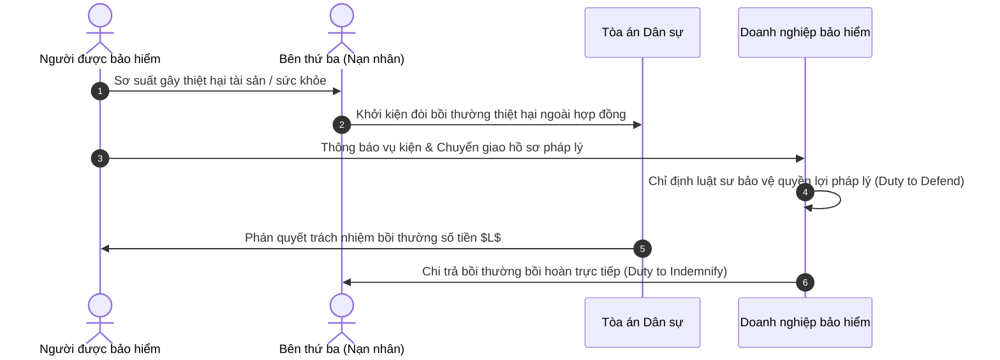
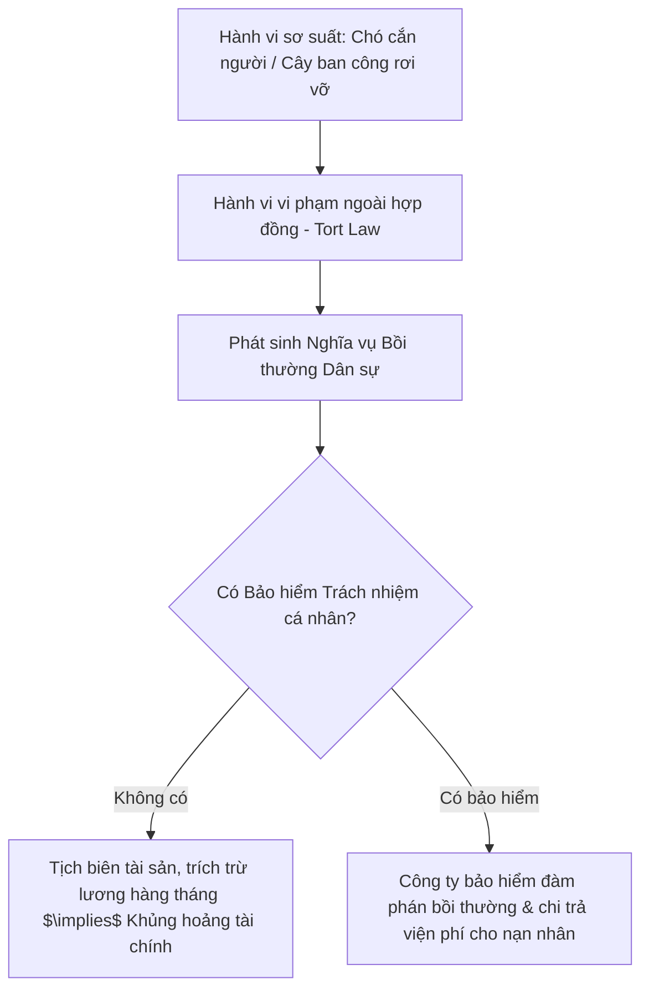
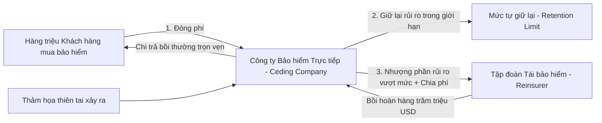
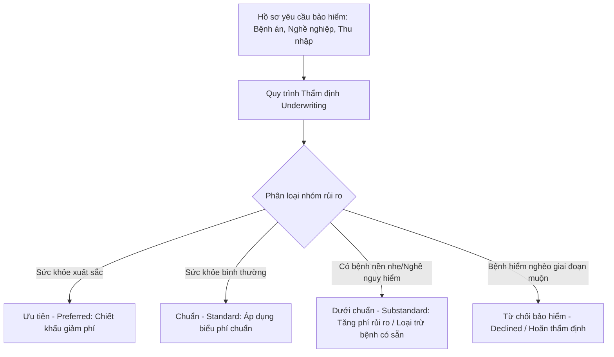

# Bảo Hiểm Trách Nhiệm Dân Sự Và Cơ Chế Thẩm Định - Tái Bảo Hiểm Định Chế

Bên cạnh những tổn thất vật chất hữu hình đối với thân thể và tài sản của chính mình, các cá nhân và doanh nghiệp luôn phải đối mặt với một mối đe dọa tài chính vô hình nhưng có sức hủy diệt vô hạn: Trách nhiệm bồi thường thiệt hại ngoài hợp đồng do sơ suất gây ra cho bên thứ ba. Đồng thời, để bảo đảm toàn bộ hệ thống tài chính bảo hiểm không bị sụp đổ trước các thảm họa quy mô lớn, các cơ chế thể chế chuyên sâu như Thẩm định bảo hiểm (Underwriting) và Tái bảo hiểm (Reinsurance) đóng vai trò là xương sống vận hành. Tài liệu này mổ xẻ chi tiết 4 khái niệm nền tảng trên.

> **Các câu hỏi cốt lõi:**
> 1. Tại sao rủi ro Trách nhiệm pháp lý cá nhân (Personal Liability) lại có thể dẫn đến việc tịch biên toàn bộ tài sản tích lũy và thu nhập tương lai của một người nếu không có bảo hiểm trách nhiệm che chắn?
> 2. Quy trình Thẩm định bảo hiểm (Underwriting) phân loại khách hàng thành các nhóm rủi ro (Standard, Preferred, Substandard, Declined) dựa trên các tiêu chí toán học và y khoa nào?
> 3. Tái bảo hiểm (Reinsurance) hoạt động như "bảo hiểm cho các công ty bảo hiểm" để bảo vệ tính thanh khoản của hệ thống tài chính quốc gia ra sao?

---

## 1. Liability Insurance (Bảo hiểm trách nhiệm)

### 1. Là gì?
- **Định nghĩa hình thức:** Bảo hiểm trách nhiệm là loại hình bảo hiểm theo đó doanh nghiệp bảo hiểm cam kết bồi thường thay cho người được bảo hiểm số tiền mà người được bảo hiểm có nghĩa vụ pháp lý phải bồi thường cho bên thứ ba do hành vi vô ý hoặc bất cẩn gây thiệt hại về tính mạng, sức khỏe hoặc tài sản của bên thứ ba, bao gồm cả các chi phí pháp lý và án phí liên quan.
- **Giải thích đơn giản:** Nếu bạn vô tình làm tổn thương người khác hoặc làm hỏng đồ của họ và bị kiện ra tòa, bảo hiểm trách nhiệm sẽ trả tiền bồi thường cho nạn nhân và thuê luật sư bào chữa cho bạn.
- **Nếu chỉ nhớ một điều:** Trong bảo hiểm trách nhiệm, số tiền bồi thường không bao giờ trả cho bạn, mà được chuyển thẳng cho Nạn nhân (Bên thứ ba) để giải phóng nghĩa vụ pháp lý cho bạn.

### 2. Hoạt động thế nào?
- **Chủ thể ra quyết định:** Cá nhân, chủ doanh nghiệp, hoặc chuyên gia hành nghề độc lập (bác sĩ, kỹ sư, kế toán).
- **Mục tiêu tối ưu hóa:** Bảo vệ toàn bộ giá trị tài sản ròng và danh tiếng cá nhân trước các phán quyết bồi thường dân sự khổng lồ từ tòa án.
- **Ràng buộc:** Chỉ bảo vệ các hành vi sơ suất, bất cẩn hoặc vô ý (Negligence); loại trừ tuyệt đối mọi hành vi cố ý gây thiệt hại (Intentional acts) hoặc vi phạm pháp luật hình sự.
- **Cơ chế tác động:**

### 3. Công thức & Mô hình
Số tiền bảo hiểm chi trả cho nghĩa vụ trách nhiệm pháp lý ($C_{\text{liability}}$):
$$C_{\text{liability}} = \min(J + C_{\text{legal}}, M_{\text{liability}})$$
Trong đó:
- $J$: Số tiền bồi thường theo phán quyết của tòa án hoặc thỏa thuận hòa giải được chấp thuận (Judgment / Settlement).
- $C_{\text{legal}}$: Toàn bộ chi phí thuê luật sư, án phí và giám định pháp lý (Legal Defense Costs - nhiều hợp đồng chi trả khoản này nằm ngoài hạn mức).
- $M_{\text{liability}}$: Giới hạn trách nhiệm tối đa ghi trong hợp đồng (Coverage Limit).

### 4. Ví dụ
- **Ví dụ định lượng:** Một chủ phòng khám thú y mua bảo hiểm trách nhiệm công cộng với hạn mức $M = 2.000.000.000$ VND.
  - Sàn nhà vừa lau bị trơn trượt không đặt biển cảnh báo. Một khách hàng vào khám thú cưng bị trượt ngã đập đầu xuống sàn gây chấn thương sọ não.
  - Tòa án phán quyết phòng khám có lỗi bất cẩn và buộc bồi thường tổn hại sức khỏe, mất thu nhập cho nạn nhân $J = 800.000.000$ VND. Chi phí thuê luật sư bảo vệ vụ kiện là $C_{\text{legal}} = 80.000.000$ VND.
  - Công ty bảo hiểm chi trả toàn bộ $880.000.000$ VND. Chủ phòng khám không bị phá sản hay phải đóng cửa kinh doanh.
- **Ví dụ thực tế:** Tại Việt Nam, Bảo hiểm Trách nhiệm nghề nghiệp của Công chứng viên là bắt buộc theo Điều 37 Luật Công chứng 2014; nếu công chứng viên sơ suất công chứng giấy tờ giả gây thiệt hại cho khách hàng, công ty bảo hiểm sẽ đứng ra bồi thường.
- **Phản ví dụ (Counterfactual):** Một chủ cơ sở mầm non tư thục vì tức giận đã cố ý đánh học sinh gây thương tích nặng. Tòa án tuyên phạt bồi thường 200 triệu đồng. Công ty bảo hiểm từ chối bồi thường vì hành vi cố ý vi phạm pháp luật hình sự bị loại trừ tuyệt đối trong mọi hợp đồng bảo hiểm trách nhiệm.

### 5. Ứng dụng & Tranh luận
- **Ứng dụng thực tiễn:** Bảo hiểm Trách nhiệm sản phẩm (Product Liability), Trách nhiệm nghề nghiệp (E&O - Errors and Omissions), Trách nhiệm giám đốc và người điều hành (D&O Insurance).
- **Ưu và nhược điểm:**
  - *Ưu điểm:* Bao gồm cả "Nghĩa vụ bào chữa" (Duty to Defend) – công ty bảo hiểm phải chi tiền thuê những luật sư giỏi nhất để bảo vệ bạn trước tòa.
  - *Nhược điểm:* Thời gian giải quyết tranh chấp bồi thường thường kéo dài theo tiến độ xét xử của tòa án dân sự.
- **Sai lầm phổ biến:** Nghĩ rằng chỉ người giàu mới cần bảo hiểm trách nhiệm, trong khi một phán quyết bồi thường tai nạn có thể khiến một người có thu nhập trung bình rơi vào cảnh nợ nần không bao giờ ngóc đầu lên được.

### 6. Liên kết
- Cùng chủ đề: [05_Property_and_Casualty_Insurances.md](file:///Users/ductri0981/Documents/Studying/Studying-Economic/04_Personal_Finance_and_Wealth_Management/07_Insurance_and_Personal_Risk_Protection/05_Property_and_Casualty_Insurances.md)
- Liên kết chéo: [05_Debt_and_Credit_Management/06_Distress_Default_and_Predatory_Risks.md](file:///Users/ductri0981/Documents/Studying/Studying-Economic/04_Personal_Finance_and_Wealth_Management/05_Debt_and_Credit_Management/06_Distress_Default_and_Predatory_Risks.md)

---

## 2. Personal Liability (Trách nhiệm pháp lý cá nhân)

### 1. Là gì?
- **Định nghĩa hình thức:** Trách nhiệm pháp lý cá nhân là nghĩa vụ tài chính và bồi thường thiệt hại ngoài hợp đồng mà một cá nhân phải gánh chịu theo quy định của pháp luật dân sự khi hành vi bất cẩn, sơ suất hoặc hành vi của những đối tượng thuộc phạm vi quản lý của cá nhân đó (con chưa thành niên, vật nuôi) gây thiệt hại cho người khác.
- **Giải thích đơn giản:** Là trách nhiệm "đền tiền" khi bạn hoặc con bạn, chó cưng của bạn vô tình làm hại người khác (ví dụ: chó nhà bạn cắn hàng xóm, con bạn đá bóng vỡ kính ô tô đắt tiền, hoặc bạn vô ý làm đổ chậu cây từ ban công trúng người đi đường).
- **Nếu chỉ nhớ một điều:** Trách nhiệm pháp lý cá nhân là loại rủi ro duy nhất có thể vượt quá toàn bộ tổng tài sản bạn đang có và "ăn lạm" vào cả thu nhập tương lai của bạn trong suốt 10-20 năm tới.

### 2. Hoạt động thế nào?
- **Chủ thể ra quyết định:** Cá nhân công dân trong đời sống sinh hoạt dân sự hàng ngày.
- **Mục tiêu tối ưu hóa:** Phòng hộ trước các vụ kiện bồi thường dân sự bằng việc mua bảo hiểm Trách nhiệm cá nhân hoặc Hợp đồng bảo hiểm trách nhiệm bảo trợ vượt mức (Umbrella Policy).
- **Ràng buộc:** Căn cứ theo Bộ luật Dân sự về Bồi thường thiệt hại ngoài hợp đồng: phải có hành vi trái pháp luật do lỗi cố ý hoặc vô ý, có thiệt hại thực tế xảy ra và có mối quan hệ nhân quả trực tiếp giữa hành vi và thiệt hại.
- **Cơ chế tác động:**

### 3. Công thức & Mô hình
Theo Luật bồi thường thiệt hại ngoài hợp đồng (Tort Law / Điều 584 - 590 Bộ luật Dân sự Việt Nam), Tổng nghĩa vụ bồi thường ($TL$):
$$TL = C_{\text{y tế}} + C_{\text{thu nhập mất đi}} + C_{\text{chăm sóc}} + M_{\text{tổn thất tinh thần}}$$
Trong đó:
- $C_{\text{y tế}}$: Toàn bộ chi phí cứu chữa, phục hồi chức năng của nạn nhân.
- $C_{\text{thu nhập mất đi}}$: Thu nhập thực tế bị mất hoặc bị giảm sút của nạn nhân trong thời gian điều trị.
- $C_{\text{chăm sóc}}$: Chi phí hợp lý cho người chăm sóc nạn nhân.
- $M_{\text{tổn thất tinh thần}}$: Mức bù đắp tổn thất về tinh thần (tối đa theo thỏa thuận hoặc theo luật định bằng hàng chục lần mức lương cơ sở).

### 4. Ví dụ
- **Ví dụ định lượng:** Chú chó becgie của một gia đình tại khu đô thị bị tuột xích chạy ra đường cắn một người đi tập thể dục gây rách bắp chân và gân gót.
  - Chi phí phẫu thuật nối gân và tiêm phòng dại: 35.000.000 VND.
  - Thu nhập nạn nhân bị mất trong 2 tháng nghỉ việc: $2 \times 20.000.000 = 40.000.000$ VND.
  - Tiền bồi thường tổn thất tinh thần: 25.000.000 VND.
  - Tổng trách nhiệm dân sự: $35 + 40 + 25 = 100.000.000$ VND.
  - Nếu gia đình có mua gói bảo hiểm trách nhiệm cá nhân (thường tích hợp sẵn trong bảo hiểm nhà ở với phí chỉ vài trăm ngàn đồng), công ty bảo hiểm sẽ thanh toán toàn bộ 100 triệu này cho nạn nhân.
- **Ví dụ thực tế:** Tại các quốc gia phát triển, khái niệm **Umbrella Insurance** (Bảo hiểm trách nhiệm bảo trợ) rất phổ biến: cung cấp hạn mức bảo vệ trách nhiệm cá nhân từ 1 triệu đến 5 triệu USD vượt lên trên hạn mức của bảo hiểm nhà và xe, giúp bảo vệ gia đình trung lưu trước các phán quyết kiện tụng hàng triệu đô la.
- **Phản ví dụ (Counterfactual):** Một người thuê nhà bất cẩn hút thuốc làm cháy lan sang 4 căn nhà liền kề trong ngõ nhỏ, gây thiệt hại ước tính 5 tỷ đồng. Vì không có bảo hiểm trách nhiệm cá nhân, người này bị tòa án phong tỏa mọi tài khoản ngân hàng và trích trừ $30\%$ tiền lương hàng tháng trong suốt quãng đời còn lại để thi hành án bồi thường.

### 5. Ứng dụng & Tranh luận
- **Ứng dụng thực tiễn:** Mua điều khoản trách nhiệm cá nhân mở rộng gắn liền với hợp đồng bảo hiểm nhà ở hoặc bảo hiểm chủ xe cơ giới để tạo lớp giáp an toàn cho tài sản ròng.
- **Ưu và nhược điểm:**
  - *Ưu điểm:* Phí bảo hiểm cực kỳ rẻ (chỉ khoảng vài trăm ngàn đến 1-2 triệu đồng/năm) nhưng đem lại hạn mức bảo vệ lên đến hàng tỷ đồng.
  - *Nhược điểm:* Đa số người dân tại các nước đang phát triển chưa nhận thức được rủi ro pháp lý này cho đến khi bị đưa ra tòa xét xử.
- **Sai lầm phổ biến:** Nghĩ rằng "mình sống hiền lành, cẩn thận thì không bao giờ bị ai kiện", bỏ qua các rủi ro bất khả kháng từ vật nuôi, trẻ nhỏ hoặc tai nạn ngẫu nhiên.

### 6. Liên kết
- Cùng chủ đề: [01_Liability_Insurance.md](file:///Users/ductri0981/Documents/Studying/Studying-Economic/04_Personal_Finance_and_Wealth_Management/07_Insurance_and_Personal_Risk_Protection/01_Liability_Insurance.md)
- Liên kết chéo: [01_Personal_Finance_Foundations/02_Personal_Balance_Sheet_and_Net_Worth.md](file:///Users/ductri0981/Documents/Studying/Studying-Economic/04_Personal_Finance_and_Wealth_Management/01_Personal_Finance_Foundations/02_Personal_Balance_Sheet_and_Net_Worth.md)

---

## 3. Reinsurance (Tái bảo hiểm)

### 1. Là gì?
- **Định nghĩa hình thức:** Tái bảo hiểm là hoạt động kinh doanh mà theo đó một doanh nghiệp bảo hiểm (công ty nhượng tái bảo hiểm - Ceding Company) chuyển giao một phần trách nhiệm bảo hiểm đã nhận của mình cho một hoặc nhiều doanh nghiệp tái bảo hiểm khác (công ty nhận tái bảo hiểm - Reinsurer) để đổi lại việc chia sẻ một phần phí bảo hiểm tương ứng.
- **Giải thích đơn giản:** Tái bảo hiểm chính là "bảo hiểm dành cho các công ty bảo hiểm". Khi nhận một rủi ro quá lớn (ví dụ bảo hiểm cho một chiếc máy bay 200 triệu USD), công ty bảo hiểm không dám ôm một mình mà phải "bán lại" một phần rủi ro đó cho các tập đoàn tái bảo hiểm quốc tế để chia sẻ gánh nặng.
- **Nếu chỉ nhớ một điều:** Không có thị trường tái bảo hiểm, các công ty bảo hiểm trực tiếp sẽ phá sản ngay lập tức sau mỗi trận bão lớn, động đất hoặc tai nạn hàng không quy mô lớn.

### 2. Hoạt động thế nào?
- **Chủ thể ra quyết định:** Ban quản trị rủi ro của doanh nghiệp bảo hiểm trực tiếp và các tập đoàn tái bảo hiểm toàn cầu (như Munich Re, Swiss Re, Hannover Re, hoặc Vinare tại Việt Nam).
- **Mục tiêu tối ưu hóa:** Ổn định kết quả kinh doanh hàng năm, tăng năng lực nhận bảo hiểm (Underwriting Capacity) và bảo vệ biên khả năng thanh toán trước các tổn thất thảm họa (Catastrophe Protection).
- **Ràng buộc:** Công ty bảo hiểm trực tiếp vẫn chịu trách nhiệm pháp lý duy nhất trước khách hàng; dù công ty tái bảo hiểm có trả tiền hay không thì công ty trực tiếp vẫn phải bồi thường đủ cho người mua bảo hiểm.
- **Cơ chế tác động:**

### 3. Công thức & Mô hình
Cơ chế Tái bảo hiểm vượt mức bồi thường (Excess of Loss Reinsurance - XOL):
Công ty bảo hiểm trực tiếp chỉ chịu trách nhiệm tổn thất tối đa bằng Mức tự giữ lại ($R$). Mọi tổn thất vượt trên $R$ lên đến hạn mức tái bảo hiểm ($M_{\text{re}}$) sẽ do công ty tái bảo hiểm chi trả:
$$C_{\text{ceding}} = \min(L, R)$$
$$C_{\text{reinsurer}} = \min(\max(0, L - R), M_{\text{re}})$$
Trong đó:
- $L$: Tổng tổn thất thực tế phát sinh từ một sự kiện thảm họa.
- $R$: Mức tự giữ lại của công ty bảo hiểm gốc.
- $M_{\text{re}}$: Hạn mức bồi thường của hợp đồng tái bảo hiểm.

### 4. Ví dụ
- **Ví dụ định lượng:** Một công ty bảo hiểm phi nhân thọ tại Việt Nam bảo hiểm cho một tòa tháp thương mại với giá trị 4.000 tỷ VND. Mức tự giữ lại tối đa của công ty theo quy định an toàn vốn là $R = 200$ tỷ VND.
  - Công ty thu xếp hợp đồng Tái bảo hiểm với tập đoàn Munich Re để nhượng lại phần trách nhiệm vượt mức $3.800$ tỷ VND.
  - Một vụ hỏa hoạn nghiêm trọng thiêu rụi tòa nhà gây tổn thất $L = 1.000$ tỷ VND.
  - Công ty trực tiếp chỉ phải chi tiền túi:
    $$C_{\text{ceding}} = \min(1.000, 200) = 200 \text{ tỷ VND}$$
  - Tập đoàn tái bảo hiểm Munich Re chuyển tiền chi trả:
    $$C_{\text{reinsurer}} = 1.000 - 200 = 800 \text{ tỷ VND}$$
  - Nhờ có tái bảo hiểm, công ty bảo hiểm gốc chi trả đầy đủ 1.000 tỷ cho khách hàng mà không bị thâm hụt vốn hay mất thanh khoản.
- **Ví dụ thực tế:** Sau siêu bão Yagi (Bão số 3) càn quét miền Bắc Việt Nam năm 2024 gây thiệt hại hàng ngàn tỷ đồng cho các nhà máy và kho bãi, các doanh nghiệp bảo hiểm lớn như Bảo Việt, PVI đã kích hoạt các hợp đồng Tái bảo hiểm quốc tế để huy động hàng trăm triệu USD từ thị trường tái bảo hiểm thế giới về chi trả bồi thường cho các doanh nghiệp Việt Nam.
- **Phản ví dụ (Counterfactual):** Một công ty bảo hiểm nhỏ vì tham lam giữ lại toàn bộ phí nên không mua tái bảo hiểm cho một danh mục tàu biển. Khi gặp bão lớn làm đắm 3 con tàu cùng lúc, nghĩa vụ bồi thường vượt gấp 3 lần tổng vốn điều lệ của công ty, khiến công ty lập tức rơi vào tình trạng vỡ nợ phá sản.

### 5. Ứng dụng & Tranh luận
- **Ứng dụng thực tiễn:** Công cụ phân tán rủi ro toàn cầu cho các dự án thủy điện, vệ tinh viễn thông, giàn khoan dầu khí, máy bay hàng không dân dụng và rủi ro thiên tai quốc gia.
- **Ưu và nhược điểm:**
  - *Ưu điểm:* Cung cấp năng lực đệm tài chính vô tận, đa dạng hóa rủi ro ra toàn thế giới.
  - *Nhược điểm:* Phí tái bảo hiểm quốc tế có tính chu kỳ rất cao (chu kỳ thị trường cứng/mềm); sau các thảm họa lớn trên thế giới, phí tái bảo hiểm tăng vọt làm tăng giá bảo hiểm bán lẻ trong nước.
- **Sai lầm phổ biến:** Nghĩ rằng tái bảo hiểm là chuyện xa vời của các tập đoàn, không biết rằng tính bền vững của chính hợp đồng bảo hiểm nhân thọ hay xe cộ của mình phụ thuộc trực tiếp vào uy tín của các đối tác tái bảo hiểm đứng sau lưng doanh nghiệp.

### 6. Liên kết
- Cùng chủ đề: [01_Insurance_Fundamentals_and_Mechanics.md](file:///Users/ductri0981/Documents/Studying/Studying-Economic/04_Personal_Finance_and_Wealth_Management/07_Insurance_and_Personal_Risk_Protection/01_Insurance_Fundamentals_and_Mechanics.md)
- Liên kết chéo: [01_Personal_Finance_Foundations/08_Wealth_Lifecycle_Accumulation_Preservation_Transfer.md](file:///Users/ductri0981/Documents/Studying/Studying-Economic/04_Personal_Finance_and_Wealth_Management/01_Personal_Finance_Foundations/08_Wealth_Lifecycle_Accumulation_Preservation_Transfer.md)

---

## 4. Underwriting (Thẩm định bảo hiểm)

### 1. Là gì?
- **Định nghĩa hình thức:** Thẩm định bảo hiểm là quá trình doanh nghiệp bảo hiểm thu thập, đánh giá, phân tích và phân loại mức độ rủi ro của người đề nghị tham gia bảo hiểm hoặc đối tượng bảo hiểm, nhằm quyết định chấp thuận bảo hiểm, từ chối bảo hiểm, hoặc chấp thuận với các điều kiện đặc biệt (tăng phí, áp dụng điều khoản loại trừ riêng), đồng thời xác định mức phí bảo hiểm phù hợp.
- **Giải thích đơn giản:** Thẩm định bảo hiểm giống như kỳ "thi tuyển đầu vào" của công ty bảo hiểm. Họ sẽ kiểm tra lý lịch, hồ sơ sức khỏe, nghề nghiệp, tài chính của bạn xem rủi ro của bạn là cao hay thấp trước khi quyết định có bán bảo hiểm cho bạn hay không và bán với giá nào.
- **Nếu chỉ nhớ một điều:** Thẩm định bảo hiểm là phòng tuyến sống còn giúp bảo vệ quỹ bảo hiểm chung khỏi Lựa chọn đối nghịch (Adverse Selection) – ngăn chặn những người sắp gặp rủi ro hoặc đã có bệnh nặng ùa vào mua bảo hiểm.

### 2. Hoạt động thế nào?
- **Chủ thể ra quyết định:** Chuyên viên thẩm định bảo hiểm (Underwriter) phối hợp cùng bác sĩ thẩm định y khoa và chuyên gia thẩm định tài chính.
- **Mục tiêu tối ưu hóa:** Đảm bảo mức phí thu vào phản ánh chính xác xác suất rủi ro của từng nhóm khách hàng, giữ tỷ lệ bồi thường thực tế nằm trong biên độ dự báo toán học.
- **Ràng buộc:** Phải tuân thủ các quy định chống phân biệt đối xử bất công; bảo mật thông tin hồ sơ bệnh án cá nhân của khách hàng theo pháp luật.
- **Cơ chế tác động:**

### 3. Công thức & Mô hình
Định phí bảo hiểm cho nhóm rủi ro dưới chuẩn (Substandard Rating):
1. **Phương pháp tăng phí theo tỷ lệ phần trăm (Table Rating / Numerical Rating System):**
$$P_{\text{substandard}} = P_{\text{standard}} \times (1 + k_{\text{extra}})$$
Với điểm rủi ro cơ sở là 100 điểm. Mỗi bệnh lý (như gan nhiễm mỡ, huyết áp cao, hút thuốc lá) cộng thêm từ 25 đến 100 điểm ($k_{\text{extra}} = 25\% - 200\%$).
2. **Phương pháp cộng phí cố định (Flat Extra Premium):**
$$P = P_{\text{standard}} + \Delta P_{\text{flat}}$$
(Áp dụng cho các rủi ro nghề nghiệp hoặc sở thích mạo hiểm nguy hiểm, ví dụ phụ phí 2 USD trên mỗi 1.000 USD mệnh giá).

### 4. Ví dụ
- **Ví dụ định lượng:** Một người đàn ông 35 tuổi nộp hồ sơ mua bảo hiểm nhân thọ 1 tỷ đồng. Phí chuẩn là 15.000.000 VND/năm.
  - Kết quả kiểm tra y khoa: Chỉ số BMI = 32 (Béo phì độ 2) và chỉ số men gan tăng cao.
  - Chuyên viên thẩm định đánh giá hồ sơ thuộc nhóm rủi ro dưới chuẩn Bảng B (+50% rủi ro tử vong).
  - Quyết định thẩm định: Chấp thuận bảo hiểm với điều kiện Tăng phí $30\%$ trên cấu phần phí rủi ro:
    $$P_{\text{rated}} = 15.000.000 \times (1 + 0,30) = 19.500.000 \text{ VND/năm}$$
  - Kèm theo điều khoản loại trừ riêng: Không chi trả quyền lợi nội trú đối với các bệnh liên quan trực tiếp đến gan và mật trong 2 năm đầu.
- **Ví dụ thực tế:** Tại Việt Nam, nhiều khách hàng nộp hồ sơ khi đã từng có lịch sử phẫu thuật u tuyến giáp lành tính. Qua quá trình thẩm định, công ty bảo hiểm thường đưa ra quyết định: Chấp thuận bảo hiểm nhân thọ với mức phí chuẩn, nhưng phát hành thư thỏa thuận loại trừ quyền lợi bệnh hiểm nghèo đối với bệnh Ung thư tuyến giáp.
- **Phản ví dụ (Counterfactual):** Một công ty bảo hiểm mới thành lập muốn tăng trưởng doanh số thần tốc nên áp dụng chính sách "Miễn thẩm định y khoa hoàn toàn" cho mọi hợp đồng mệnh giá cao. Hàng ngàn bệnh nhân tiểu đường, suy thận, ung thư giai đoạn sớm đổ xô đi mua bảo hiểm. Sau 2 năm, số tiền chi trả bồi thường vọt lên gấp 5 lần tổng phí thu được, công ty cạn sạch quỹ dự phòng và buộc phải dừng hoạt động.

### 5. Ứng dụng & Tranh luận
- **Ứng dụng thực tiễn:** Người tham gia bảo hiểm nên chủ động tham gia bảo hiểm khi còn trẻ và sức khỏe đạt chuẩn để được bảo vệ với mức phí rẻ nhất mà không bị tăng phí hay loại trừ.
- **Ưu và nhược điểm:**
  - *Ưu điểm:* Đảm bảo tính công bằng xã hội: người có lối sống lành mạnh không phải trả tiền bù đắp cho người có lối sống rủi ro cao.
  - *Nhược điểm:* Có thể tốn thời gian (yêu cầu đi khám sức khỏe, xét nghiệm máu, nộp bổ sung hồ sơ bệnh án cũ) gây cảm giác phiền hà cho khách hàng.
- **Sai lầm phổ biến:** Cố tình giấu bệnh cũ trong tờ khai thẩm định với hy vọng qua mặt được chuyên viên thẩm định, để rồi khi xảy ra sự kiện bồi thường, công ty kiểm tra chéo bệnh án bảo hiểm y tế và từ chối chi trả toàn bộ.

### 6. Liên kết
- Cùng chủ đề: [02_Contract_Terms_Costs_and_Claims.md](file:///Users/ductri0981/Documents/Studying/Studying-Economic/04_Personal_Finance_and_Wealth_Management/07_Insurance_and_Personal_Risk_Protection/02_Contract_Terms_Costs_and_Claims.md)
- Liên kết chéo: [01_Personal_Finance_Foundations/01_Literacy_Planning_and_Management.md](file:///Users/ductri0981/Documents/Studying/Studying-Economic/04_Personal_Finance_and_Wealth_Management/01_Personal_Finance_Foundations/01_Literacy_Planning_and_Management.md)

---

## Câu hỏi tự kiểm tra
1. Hãy phân tích cơ chế "Nghĩa vụ bào chữa" (Duty to Defend) và "Nghĩa vụ bồi hoàn" (Duty to Indemnify) trong hợp đồng Bảo hiểm trách nhiệm (Liability Insurance).
2. Tại sao rủi ro Trách nhiệm pháp lý cá nhân (Personal Liability) lại được xem là "hố đen tài chính" có thể xóa sổ toàn bộ tài sản tích lũy của một gia đình? Hợp đồng Umbrella Policy giải quyết bài toán này như thế nào?
3. Mô tả cơ chế Tái bảo hiểm vượt mức bồi thường (Excess of Loss Reinsurance). Tại sao các tập đoàn tái bảo hiểm lại được coi là bệ đỡ cuối cùng của các công ty bảo hiểm trực tiếp sau các thảm họa bão lũ lớn?
4. Trình bày quy trình Thẩm định bảo hiểm (Underwriting) và giải thích tại sao hiện tượng Lựa chọn đối nghịch (Adverse Selection) lại là kẻ thù số một của sự an toàn tài chính trong ngành bảo hiểm.

## Ghi chú nguồn
- Luật Kinh doanh bảo hiểm số 08/2022/QH15.
- Bộ luật Dân sự Việt Nam số 91/2015/QH13 (Chương về Bồi thường thiệt hại ngoài hợp đồng).
- Kenneth Black Jr. & Harold D. Skipper - *Life and Health Insurance*, Pearson.
- Swiss Re Institute - *Sigma Research Reports on Global Reinsurance*.
