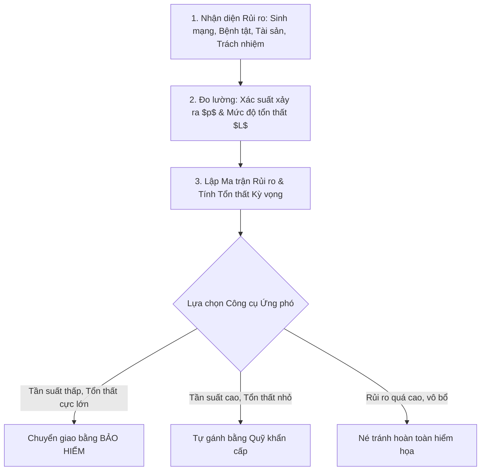
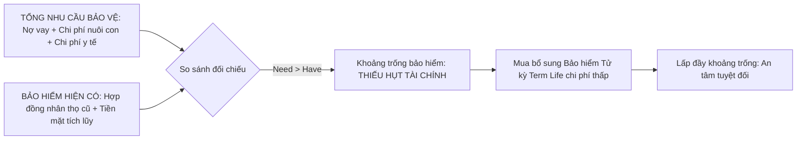
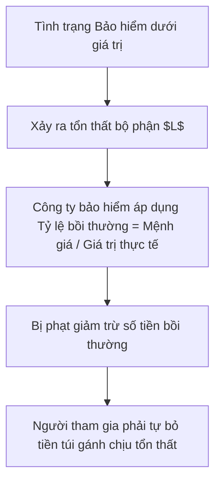
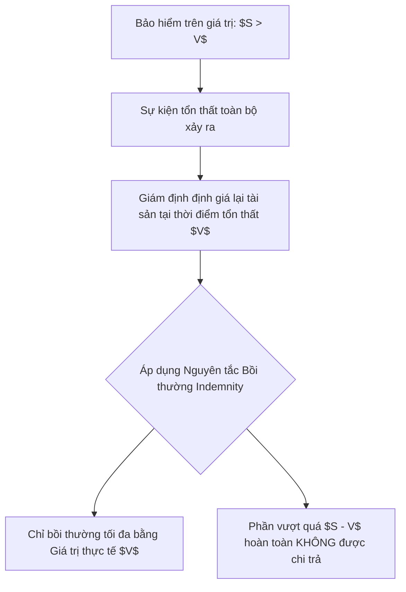
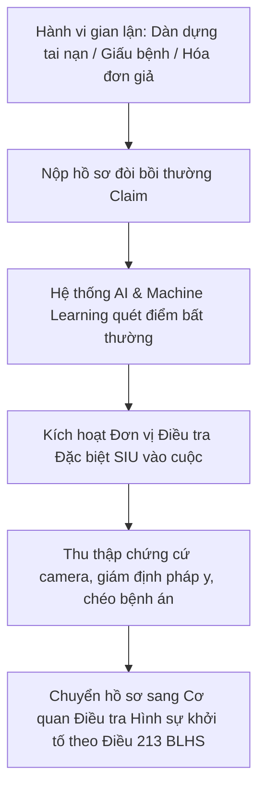

# Đánh Giá Rủi Ro, Khoảng Trống Bảo Hiểm Và Phòng Chống Trục Lợi Bảo Hiểm

Để thiết lập một danh mục bảo hiểm cá nhân tối ưu, việc đánh giá rủi ro định lượng và nhận diện chính xác các khoảng trống bảo hiểm là bước đi mang tính quyết định. Tham gia bảo hiểm quá ít dẫn đến nguy cơ sụp đổ tài chính khi biến cố xảy ra, trong khi tham gia quá nhiều lại gây lãng phí dòng tiền sinh lời. Đồng thời, gian lận và trục lợi bảo hiểm không chỉ là hành vi vi phạm pháp luật hình sự mà còn trực tiếp phá hoại quỹ rủi ro cộng đồng. Tài liệu này cung cấp khung phân tích thực hành để rà soát danh mục bảo hiểm, tối ưu hóa mức độ bảo vệ và phòng ngừa gian lận.

> **Các câu hỏi cốt lõi:**
> 1. Làm thế nào để định lượng chính xác Khoảng trống bảo hiểm (Insurance Gap) giữa nhu cầu bảo vệ thực tế và các hợp đồng bảo hiểm hiện có của một gia đình?
> 2. Sự khác biệt căn bản về mặt kinh tế và pháp lý giữa Bảo hiểm thiếu (Underinsurance) và Bảo hiểm thừa (Overinsurance) là gì?
> 3. Các thuật toán định danh gian lận hiện đại và khung pháp lý hình sự xử lý các hành vi trục lợi bảo hiểm (Insurance Fraud) ra sao?

---

## 1. Risk Assessment (Đánh giá rủi ro)

### 1. Là gì?
- **Định nghĩa hình thức:** Đánh giá rủi ro cá nhân là quy trình mang tính hệ thống nhằm nhận diện, đo lường và định lượng các hiểm họa tiềm tàng có thể đe dọa đến tính mạng, sức khỏe, thu nhập, tài sản và nghĩa vụ pháp lý của một cá nhân hoặc hộ gia đình, từ đó làm căn cứ để thiết kế chiến lược ứng phó rủi ro phù hợp.
- **Giải thích đơn giản:** Đánh giá rủi ro giống như việc bạn đi "khám sức khỏe toàn diện" cho túi tiền của mình: rà soát xem trong cuộc sống điều gì tồi tệ nhất có thể xảy ra, xác suất nó xảy ra là bao nhiêu, và nếu xảy ra thì gia đình bạn sẽ mất bao nhiêu tiền.
- **Nếu chỉ nhớ một điều:** Bạn không thể quản trị những gì bạn không đo lường được; một kế hoạch tài chính không được xây dựng trên cơ sở đánh giá rủi ro kỹ lưỡng chỉ là một lâu đài xây trên cát.

### 2. Hoạt động thế nào?
- **Chủ thể ra quyết định:** Cá nhân hoặc chuyên gia hoạch định tài chính cá nhân độc lập (CFP).
- **Mục tiêu tối ưu hóa:** Nhận diện và sắp xếp thứ tự ưu tiên các rủi ro có khả năng hủy diệt tình trạng tài chính của gia đình để phân bổ ngân sách phòng vệ hiệu quả nhất.
- **Ràng buộc:** Giới hạn ngân sách đóng phí hàng năm (thường không quá $8\% - 10\%$ tổng thu nhập ròng).
- **Cơ chế tác động:**

### 3. Công thức & Mô hình
Đo lường Tổn thất kỳ vọng thuần (Expected Loss - $EL$) và Giá trị rủi ro tối đa (Value at Risk - $VaR_{\alpha}$):
$$EL = \sum_{i=1}^m p_i \times L_i$$
Trong đó $p_i$ là xác suất biến cố thứ $i$ và $L_i$ là giá trị thiệt hại tài chính ước tính.
Ngân sách phòng thủ bảo hiểm khuyến nghị ($B_{\text{insurance}}$):
$$B_{\text{insurance}} = \alpha_{\text{risk}} \times \text{Disposable Income}, \quad \text{với } \alpha_{\text{risk}} \in [0,05; 0,10]$$

### 4. Ví dụ
- **Ví dụ định lượng:** Gia đình anh Tuấn (chồng 35 tuổi, vợ 32 tuổi, 2 con nhỏ 5 tuổi và 2 tuổi). Tổng thu nhập gia đình 500 triệu/năm. Đánh giá rủi ro tài chính:
  - Rủi ro 1: Chồng tử vong $\implies$ mất nguồn thu nhập 350 triệu/năm $\times$ 15 năm = 5,25 tỷ VND (Tổn thất cực đại).
  - Rủi ro 2: Mắc bệnh ung thư $\implies$ chi phí điều trị 1 tỷ + mất thu nhập 2 năm 700 triệu = 1,7 tỷ VND.
  - Rủi ro 3: Xe ô tô va chạm $\implies$ chi phí sửa chữa tối đa 50 triệu VND (Tổn thất nhỏ).
  - Kết luận đánh giá: Ưu tiên phân bổ $7\%$ thu nhập (35 triệu/năm) để mua bảo hiểm nhân thọ và bệnh hiểm nghèo bảo vệ cho người chồng; rủi ro va chạm xe nhỏ được chấp nhận giữ lại thông qua mức khấu trừ cao và quỹ khẩn cấp.
- **Ví dụ thực tế:** Các ứng dụng tư vấn tài chính cá nhân chuẩn mực quốc tế đều yêu cầu người dùng điền "Bảng câu hỏi phân tích hồ sơ rủi ro gia đình" (Financial Risk Profiling) bao gồm: cơ cấu nợ, số người phụ thuộc, tình trạng bệnh sử gia đình trước khi đưa ra bất kỳ khuyến nghị mua bảo hiểm nào.
- **Phản ví dụ (Counterfactual):** Một người không đánh giá rủi ro, dành toàn bộ 20 triệu/năm mua bảo hiểm tích lũy cho đứa con mới sinh (với hy vọng tiết kiệm tiền cho con vào đại học). Khi chính người cha trụ cột đột ngột qua đời, đứa trẻ chỉ nhận được số tiền bảo hiểm rất nhỏ, trong khi gia đình mất trắng nguồn thu nhập chính và rơi vào cảnh nợ nần bế tắc.

### 5. Ứng dụng & Tranh luận
- **Ứng dụng thực tiễn:** Tiến hành rà soát đánh giá rủi ro định kỳ hàng năm hoặc mỗi khi cuộc đời có biến cố lớn (kết hôn, sinh con, mua nhà trả góp, đổi việc).
- **Ưu và nhược điểm:**
  - *Ưu điểm:* Giúp chi tiền mua bảo hiểm đúng trọng tâm, không bị đại lý bảo hiểm "chèo kéo" mua các sản phẩm không cần thiết.
  - *Nhược điểm:* Đòi hỏi tính trung thực và khả năng đối diện với các kịch bản xấu nhất của cuộc đời.
- **Sai lầm phổ biến:** Đánh giá rủi ro dựa trên cảm tính hoặc sự sợ hãi nhất thời thay vì dựa trên số liệu toán học và dòng tiền thực tế.

### 6. Liên kết
- Cùng chủ đề: [01_Insurance_Fundamentals_and_Mechanics.md](file:///Users/ductri0981/Documents/Studying/Studying-Economic/04_Personal_Finance_and_Wealth_Management/07_Insurance_and_Personal_Risk_Protection/01_Insurance_Fundamentals_and_Mechanics.md)
- Liên kết chéo: [01_Personal_Finance_Foundations/06_Financial_Goals_and_Time_Horizons.md](file:///Users/ductri0981/Documents/Studying/Studying-Economic/04_Personal_Finance_and_Wealth_Management/01_Personal_Finance_Foundations/06_Financial_Goals_and_Time_Horizons.md)

---

## 2. Insurance Gap (Khoảng trống bảo hiểm)

### 1. Là gì?
- **Định nghĩa hình thức:** Khoảng trống bảo hiểm là sự chênh lệch thiếu hụt mang tính định lượng giữa tổng nhu cầu bảo vệ tài chính cần thiết của một cá nhân/gia đình trước một hiểm họa cụ thể và tổng giá trị bảo vệ thực tế mà các hợp đồng bảo hiểm hiện hữu (kèm tài sản thanh khoản sẵn có) có thể chi trả.
- **Giải thích đơn giản:** Khoảng trống bảo hiểm là số tiền bạn "bị hở sườn". Ví dụ, nếu gia đình bạn cần 3 tỷ đồng để duy trì cuộc sống khi bạn mất đi, nhưng hợp đồng bảo hiểm bạn đang có chỉ đền 500 triệu, thì bạn đang có một khoảng trống bảo hiểm khổng lồ là 2,5 tỷ đồng.
- **Nếu chỉ nhớ một điều:** Bất kỳ khoảng trống bảo hiểm nào không được lấp đầy bằng hợp đồng bảo hiểm đều sẽ tự động được lấp đầy bằng chính tài sản ròng và tương lai của con cái bạn khi rủi ro xảy ra.

### 2. Hoạt động thế nào?
- **Chủ thể ra quyết định:** Cá nhân chủ động tính toán khoảng trống bảo hiểm để điều chỉnh bổ sung quyền lợi bảo hiểm (mua thêm sản phẩm bổ trợ hoặc mua thêm hợp đồng tử kỳ).
- **Mục tiêu tối ưu hóa:** Triệt tiêu hoàn toàn khoảng trống tài chính ($\text{Insurance Gap} \to 0$) mà không làm tăng quá mức chi phí phí bảo hiểm hàng tháng.
- **Ràng buộc:** Khả năng tài chính hiện tại và khả năng được chấp thuận bảo hiểm (Underwritability) của cá nhân.
- **Cơ chế tác động:**

### 3. Công thức & Mô hình
Xác định Khoảng trống bảo hiểm nhân thọ theo Phương pháp Phân tích Nhu cầu vốn (Capital Needs Analysis):
$$\text{Insurance Gap} = \text{Total Financial Obligations} - \text{Available Liquid Assets} - \text{Existing Life Insurance}$$
Trong đó Tổng nghĩa vụ tài chính ($\text{Total Financial Obligations}$):
$$\text{Obligations} = D_{\text{debt}} + F_{\text{funeral}} + \sum_{t=1}^K \frac{E_{\text{living}, t}}{(1 + r)^t} + C_{\text{education}} - PV(\text{Spouse Income})$$
- $D_{\text{debt}}$: Toàn bộ nợ vay ngân hàng (thế chấp, tín chấp).
- $F_{\text{funeral}}$: Chi phí mai táng và y tế cuối đời.
- $E_{\text{living}, t}$: Chi phí sinh hoạt tối thiểu gia đình năm thứ $t$.
- $C_{\text{education}}$: Dự phòng chi phí đại học cho con cái.
- $PV(\text{Spouse Income})$: Giá trị hiện tại của thu nhập người phối ngẫu còn lại.

### 4. Ví dụ
- **Ví dụ định lượng:** Gia đình chị Thư có nhu cầu tài chính khi biến cố xảy ra với người chồng:
  - Trả sạch nợ vay mua nhà ngân hàng: 1.200.000.000 VND.
  - Quỹ sinh hoạt cho 2 con trong 10 năm: 1.800.000.000 VND.
  - Quỹ đại học cho 2 con: 600.000.000 VND.
  - $\implies$ Tổng nhu cầu bảo vệ: $1,2 + 1,8 + 0,6 = 3.600.000.000$ VND.
  - Tài sản hiện có: Tiền gửi tiết kiệm 300 triệu; Hợp đồng bảo hiểm nhân thọ cũ mua từ 5 năm trước mệnh giá 500 triệu VND.
  - Khoảng trống bảo hiểm của người chồng:
    $$\text{Insurance Gap} = 3.600.000.000 - 300.000.000 - 500.000.000 = 2.800.000.000 \text{ VND}$$
  - Giải pháp: Người chồng mua thêm ngay 1 hợp đồng bảo hiểm tử kỳ (Term Life) thời hạn 15 năm với mệnh giá đúng bằng 2,8 tỷ VND (phí chỉ khoảng 6 triệu VND/năm) để lấp đầy trọn vẹn khoảng trống này.
- **Ví dụ thực tế:** Tại Việt Nam, theo báo cáo của Hiệp hội Bảo hiểm Việt Nam (IAV), tỷ lệ thâm nhập bảo hiểm nhân thọ trên GDP mới đạt khoảng $1,6\% - 2\%$, và trung bình mệnh giá bảo vệ chỉ đạt khoảng 150-200 triệu đồng/hợp đồng. Điều này phản ánh một "Khoảng trống bảo hiểm nhân thọ" khổng lồ của đại bộ phận các hộ gia đình Việt Nam.
- **Phản ví dụ (Counterfactual):** Một gia đình vay nợ 2 tỷ mua nhà và tin rằng mình đã "có bảo hiểm" khi công ty mua cho gói bảo hiểm tai nạn nhân viên 100 triệu. Khi người chồng qua đời vì bạo bệnh, ngân hàng phát mại căn nhà vì số tiền bồi thường 100 triệu không thấm tháp vào đâu so với khoảng trống nợ 2 tỷ đồng còn lại.

### 5. Ứng dụng & Tranh luận
- **Ứng dụng thực tiễn:** Đo lường khoảng trống bảo hiểm sau mỗi sự kiện thay đổi cuộc sống: sinh thêm con, mua thêm bất động sản trả góp, hoặc khi hoàn thành một khoản nợ lớn.
- **Ưu và nhược điểm:**
  - *Ưu điểm:* Cung cấp con số mục tiêu chính xác bằng tiền, loại bỏ cảm giác mơ hồ và chủ quan về sự an toàn tài chính.
  - *Nhược điểm:* Nhu cầu tài chính luôn biến động; đòi hỏi phải cập nhật và tính toán lại định kỳ.
- **Sai lầm phổ biến:** Nghĩ rằng chỉ cần có 1 hợp đồng bảo hiểm bất kỳ là đã an toàn, không bao giờ đối chiếu mệnh giá hợp đồng đó với tổng số nợ và chi phí nuôi dạy con cái thực tế.

### 6. Liên kết
- Cùng chủ đề: [03_Life_Insurance_Structures.md](file:///Users/ductri0981/Documents/Studying/Studying-Economic/04_Personal_Finance_and_Wealth_Management/07_Insurance_and_Personal_Risk_Protection/03_Life_Insurance_Structures.md)
- Liên kết chéo: [01_Personal_Finance_Foundations/06_Financial_Goals_and_Time_Horizons.md](file:///Users/ductri0981/Documents/Studying/Studying-Economic/04_Personal_Finance_and_Wealth_Management/01_Personal_Finance_Foundations/06_Financial_Goals_and_Time_Horizons.md)

---

## 3. Underinsurance (Bảo hiểm dưới giá trị / Thiếu bảo hiểm)

### 1. Là gì?
- **Định nghĩa hình thức:** Bảo hiểm dưới giá trị là tình trạng mà số tiền bảo hiểm được ghi nhận trong hợp đồng bảo hiểm thấp hơn đáng kể so với giá trị thực tế của đối tượng bảo hiểm (đối với bảo hiểm tài sản) hoặc thấp hơn nhiều so với nhu cầu bù đắp tổn thất tài chính thực tế khi xảy ra sự kiện bảo hiểm (đối với bảo hiểm con người).
- **Giải thích đơn giản:** Là việc bạn mua bảo hiểm quá ít so với những gì bạn cần được bảo vệ. Ví dụ chiếc xe trị giá 1 tỷ nhưng bạn chỉ mua bảo hiểm 400 triệu để giảm phí, hoặc bạn cần bảo vệ 2 tỷ nhưng chỉ mua 200 triệu.
- **Nếu chỉ nhớ một điều:** Trong bảo hiểm tài sản, bảo hiểm dưới giá trị không chỉ khiến bạn nhận được ít tiền hơn khi tài sản bị phá hủy hoàn toàn, mà nó còn kích hoạt quy tắc bồi thường theo tỷ lệ, khiến bạn bị phạt ngay cả trong các tổn thất bộ phận nhỏ.

### 2. Hoạt động thế nào?
- **Chủ thể ra quyết định:** Người tham gia bảo hiểm cố ý chọn mệnh giá thấp để tiết kiệm phí hoặc do không cập nhật sự tăng giá của tài sản theo thời gian.
- **Mục tiêu tối ưu hóa:** Hạ thấp chi phí phí bảo hiểm ngắn hạn (nhưng phải đánh đổi bằng việc chịu rủi ro khổng lồ dài hạn).
- **Ràng buộc:** Đối mặt với Điều khoản phạt bồi thường theo tỷ lệ (Average Clause / Co-insurance Clause) theo quy định của luật kinh doanh bảo hiểm đối với tài sản.
- **Cơ chế tác động:**

### 3. Công thức & Mô hình
Tỷ lệ bồi thường trong Bảo hiểm tài sản dưới giá trị theo Điều 48 Luật Kinh doanh bảo hiểm số 08/2022/QH15:
$$C = L \times \frac{S}{V}$$
Trong đó:
- $C$: Số tiền bồi thường doanh nghiệp bảo hiểm phải trả.
- $L$: Giá trị thiệt hại thực tế phát sinh ($L < V$).
- $S$: Số tiền bảo hiểm ghi trên hợp đồng.
- $V$: Giá trị thị trường thực tế của tài sản được bảo hiểm tại thời điểm xảy ra sự kiện.
Số tiền người tham gia phải tự gánh chịu: $\Delta L = L - C = L \left(1 - \frac{S}{V}\right)$.

### 4. Ví dụ
- **Ví dụ định lượng:** Một xưởng sản xuất có giá trị tài sản thực tế $V = 4.000.000.000$ VND. Để tiết kiệm phí, chủ xưởng chỉ mua bảo hiểm tài sản với số tiền bảo hiểm $S = 2.000.000.000$ VND (tỷ lệ bảo hiểm $50\%$).
  - Một vụ chập điện làm cháy một góc nhà xưởng gây thiệt hại thực tế $L = 600.000.000$ VND.
  - Chủ xưởng nghĩ rằng mình mua bảo hiểm 2 tỷ nên thiệt hại 600 triệu chắc chắn sẽ được đền bù toàn bộ.
  - Tuy nhiên, theo công thức bồi thường dưới giá trị:
    $$C = 600.000.000 \times \frac{2.000.000.000}{4.000.000.000} = 600.000.000 \times 50\% = 300.000.000 \text{ VND}$$
  - Công ty bảo hiểm chỉ bồi thường 300 triệu đồng. Chủ xưởng phải tự bỏ tiền túi 300 triệu đồng còn lại để sửa xưởng.
- **Ví dụ thực tế:** Sau các vụ cháy nổ nhà ở kết hợp kinh doanh tại các thành phố lớn ở Việt Nam, nhiều hộ kinh doanh bàng hoàng nhận ra mình chỉ được bồi thường một phần nhỏ thiệt hại do hợp đồng bảo hiểm được ký kết từ nhiều năm trước với số tiền bảo hiểm thấp, không phản ánh sự gia tăng giá trị của kho hàng hóa và thiết bị hiện tại.
- **Phản ví dụ (Counterfactual):** Một chủ xe ô tô mua bảo hiểm thân vỏ đúng bằng $100\%$ giá trị thị trường của xe ($S = V$). Khi xe bị va quẹt hư hỏng cản trước hết 30 triệu đồng, công ty bảo hiểm bồi thường trọn vẹn $100\%$ chi phí sửa chữa 30 triệu (trừ deductible quy định), hoàn toàn không bị áp dụng tỷ lệ chia sẻ tổn thất.

### 5. Ứng dụng & Tranh luận
- **Ứng dụng thực tiễn:** Định giá lại tài sản (Revaluation) định kỳ hàng năm và cập nhật số tiền bảo hiểm để luôn đảm bảo $S \ge 80\% \times V$.
- **Ưu và nhược điểm:**
  - *Ưu điểm của việc tránh underinsurance:* Đảm bảo phục hồi tài chính trọn vẹn $100\%$ khi có sự cố.
  - *Nhược điểm:* Phí bảo hiểm hàng năm sẽ cao hơn tương ứng với giá trị thực tế của tài sản.
- **Sai lầm phổ biến:** Cố tình khai hạ giá trị tài sản để giảm tiền phí, không lường trước được rằng điều khoản bồi thường theo tỷ lệ sẽ khiến mình chịu thiệt hại kép khi có tai nạn xảy ra.

### 6. Liên kết
- Cùng chủ đề: [05_Property_and_Casualty_Insurances.md](file:///Users/ductri0981/Documents/Studying/Studying-Economic/04_Personal_Finance_and_Wealth_Management/07_Insurance_and_Personal_Risk_Protection/05_Property_and_Casualty_Insurances.md)
- Liên kết chéo: [01_Personal_Finance_Foundations/02_Personal_Balance_Sheet_and_Net_Worth.md](file:///Users/ductri0981/Documents/Studying/Studying-Economic/04_Personal_Finance_and_Wealth_Management/01_Personal_Finance_Foundations/02_Personal_Balance_Sheet_and_Net_Worth.md)

---

## 4. Overinsurance (Bảo hiểm trên giá trị / Thừa bảo hiểm)

### 1. Là gì?
- **Định nghĩa hình thức:** Bảo hiểm trên giá trị là tình trạng mà số tiền bảo hiểm được thỏa thuận trong hợp đồng bảo hiểm tài sản cao hơn giá trị thị trường thực tế của tài sản được bảo hiểm tại thời điểm giao kết hợp đồng hoặc tại thời điểm xảy ra sự kiện bảo hiểm.
- **Giải thích đơn giản:** Là việc bạn mua bảo hiểm cho một món đồ đắt hơn giá trị thật của nó. Ví dụ chiếc xe máy cũ trị giá 20 triệu nhưng bạn khai mua bảo hiểm với mức 50 triệu với hy vọng nếu xe mất sẽ được đền 50 triệu.
- **Nếu chỉ nhớ một điều:** Theo pháp luật bảo hiểm, phần số tiền bảo hiểm vượt quá giá trị thực tế của tài sản là vô hiệu; công ty bảo hiểm chỉ bồi thường tối đa bằng giá trị thiệt hại thực tế và bạn bị mất trắng số tiền phí đã đóng thừa.

### 2. Hoạt động thế nào?
- **Chủ thể ra quyết định:** Bên mua bảo hiểm (do thiếu hiểu biết hoặc cố tình trục lợi); doanh nghiệp bảo hiểm có trách nhiệm kiểm tra thẩm định giá trị tài sản.
- **Mục tiêu tối ưu hóa:** Pháp luật triệt tiêu động cơ trục lợi bảo hiểm bằng việc cấm làm giàu từ sự cố bảo hiểm (Indemnity Principle).
- **Ràng buộc:** Theo Điều 47 Luật Kinh doanh bảo hiểm số 08/2022/QH15, khi xảy ra sự kiện, doanh nghiệp chỉ bồi thường thiệt hại thực tế; nếu bên mua vô ý mua thừa thì doanh nghiệp phải hoàn trả lại phần phí bảo hiểm đã đóng tương ứng với số tiền bảo hiểm vượt quá; nếu cố ý gian lận thì hợp đồng có thể bị tuyên bố vô hiệu toàn bộ.
- **Cơ chế tác động:**

### 3. Công thức & Mô hình
Số tiền bồi thường tối đa trong trường hợp Bảo hiểm trên giá trị ($S > V$):
$$C_{\max} = \min(L, V) \le V < S$$
Hoàn trả phí bảo hiểm tương ứng với phần giá trị bảo hiểm vượt quá (nếu các bên không có hành vi gian lận):
$$\Delta P = P \times \frac{S - V}{S}$$
Trong đó:
- $S$: Số tiền bảo hiểm giao kết trên hợp đồng.
- $V$: Giá trị thực tế của tài sản tại thời điểm giao kết.
- $P$: Tổng phí bảo hiểm đã đóng.

### 4. Ví dụ
- **Ví dụ định lượng:** Một chiếc ô tô cũ có giá thị trường $V = 400.000.000$ VND. Chủ xe mua bảo hiểm vật chất khai vống lên $S = 600.000.000$ VND và nộp phí $1,5\% \times 600 \text{ triệu} = 9.000.000$ VND/năm.
  - Xe không may bị rơi xuống vực hư hỏng toàn bộ không thể phục hồi ($L = V$).
  - Cơ quan giám định độc lập định giá chiếc xe tại thời điểm tai nạn có giá trị thực tế tối đa là 400.000.000 VND.
  - Công ty bảo hiểm chỉ chi trả bồi thường:
    $$C = 400.000.000 \text{ VND}$$
  - Chủ xe hoàn toàn không được nhận 600 triệu như con số ghi trên hợp đồng. Khoản phí đóng dư cho 200 triệu vượt mức được tính toán hoàn trả lại một phần, nhưng khách hàng đã lãng phí dòng tiền và gặp phiền phức pháp lý.
- **Ví dụ thực tế:** Trong lĩnh vực bảo hiểm nhân thọ (vốn không áp dụng nguyên tắc bồi thường thiệt hại tài sản vì tính mạng con người là vô giá), khái niệm Overinsurance được quản trị thông qua "Thẩm định tài chính" (Financial Underwriting). Nếu một người thu nhập 10 triệu/tháng nộp đơn mua bảo hiểm mệnh giá 50 tỷ đồng, hồ sơ sẽ lập tức bị từ chối vì có dấu hiệu trục lợi bảo hiểm hoặc bất thường về rủi ro đạo đức.
- **Phản ví dụ (Counterfactual):** Một người mua bảo hiểm hỏa hoạn cho ngôi nhà cũ 1 tỷ với số tiền bảo hiểm 5 tỷ, sau đó tự châm lửa đốt nhà để đòi đền bù 5 tỷ. Kết quả: Công an khởi tố vụ án hình sự về tội Hủy hoại tài sản và Trục lợi bảo hiểm; công ty bảo hiểm từ chối bồi thường $100\%$ và kẻ gian lận phải ngồi tù.

### 5. Ứng dụng & Tranh luận
- **Ứng dụng thực tiễn:** Luôn đối chiếu và cập nhật giá trị thị trường của xe cộ, nhà cửa để yêu cầu công ty bảo hiểm hạ số tiền bảo hiểm và giảm phí bảo hiểm tương ứng khi tài sản đã khấu hao sâu.
- **Ưu và nhược điểm:**
  - *Ưu điểm của việc phát hiện overinsurance:* Cắt giảm ngay các khoản chi phí lãng phí không mang lại bất kỳ giá trị bảo vệ thực tế nào.
  - *Nhược điểm:* Tốn công sức thẩm định giá tài sản định kỳ.
- **Sai lầm phổ biến:** Nghĩ rằng "cứ trả nhiều tiền phí mua mệnh giá thật cao thì khi hỏng công ty bảo hiểm bắt buộc phải trả đúng con số đó", mà không biết rằng luật pháp nghiêm cấm việc kiếm lời từ tổn thất bảo hiểm tài sản.

### 6. Liên kết
- Cùng chủ đề: [05_Property_and_Casualty_Insurances.md](file:///Users/ductri0981/Documents/Studying/Studying-Economic/04_Personal_Finance_and_Wealth_Management/07_Insurance_and_Personal_Risk_Protection/05_Property_and_Casualty_Insurances.md)
- Liên kết chéo: [03_Budgeting_and_Expense_Management/06_Lifestyle_Inflation_and_Opportunity_Cost.md](file:///Users/ductri0981/Documents/Studying/Studying-Economic/04_Personal_Finance_and_Wealth_Management/03_Budgeting_and_Expense_Management/06_Lifestyle_Inflation_and_Opportunity_Cost.md)

---

## 5. Insurance Fraud (Gian lận bảo hiểm / Trục lợi bảo hiểm)

### 1. Là gì?
- **Định nghĩa hình thức:** Gian lận bảo hiểm là hành vi cố ý lừa dối, gian dối hoặc thông đồng của Bên mua bảo hiểm, Người được bảo hiểm, Người thụ hưởng hoặc đại lý bảo hiểm nhằm chiếm đoạt tiền bảo hiểm, tiền bồi thường hoặc trục lợi bất chính từ doanh nghiệp bảo hiểm trái với quy định pháp luật.
- **Giải thích đơn giản:** Trục lợi bảo hiểm là hành vi lừa đảo để "moi tiền" công ty bảo hiểm: như cố tình giấu bệnh nặng khi mua, dựng hiện trường tai nạn giả, phóng hỏa đốt nhà xưởng, hoặc tự chặt tay chân giả vờ bị tai nạn để đòi tiền đền bù.
- **Nếu chỉ nhớ một điều:** Trục lợi bảo hiểm không phải là "thủ thuật khôn lỏi" mà là tội phạm hình sự được quy định rõ trong Bộ luật Hình sự với mức án có thể lên tới 7 năm tù giam.

### 2. Hoạt động thế nào?
- **Chủ thể ra quyết định:** Kẻ gian lận (thực hiện hành vi phạm tội) và Phòng Điều tra Gian lận (Special Investigation Unit - SIU) của các doanh nghiệp bảo hiểm phối hợp với Cơ quan Cảnh sát Điều tra.
- **Mục tiêu tối ưu hóa:** Doanh nghiệp bảo hiểm bảo vệ quỹ rủi ro của hàng triệu khách hàng trung thực, ngăn chặn thất thoát vốn và giữ vững kỷ cương pháp luật.
- **Ràng buộc:** Căn cứ theo Điều 213 Bộ luật Hình sự Việt Nam số 100/2015/QH13 (sửa đổi bổ sung 2017) về "Tội gian lận trong kinh doanh bảo hiểm".
- **Cơ chế tác động:**

### 3. Công thức & Mô hình
Hai phân loại gian lận bảo hiểm kinh điển:
1. **Gian lận mềm (Soft Fraud / Opportunistic Fraud):** Thổi phồng giá trị tổn thất thực tế (ví dụ: bị trầy xước nhẹ nhưng kê khai thay mới toàn bộ phụ tùng, hoặc nằm viện thực tế 2 ngày nhưng xin giấy tờ kéo dài 5 ngày).
2. **Gian lận cứng (Hard Fraud):** Chủ động lên kế hoạch, dàn dựng hoặc cố ý tạo ra sự kiện bảo hiểm giả mạo (ví dụ: tự gây thương tích, giả chết, đốt nhà, trộm cắp giả mạo).

Khung xử phạt hình sự theo Điều 213 Bộ luật Hình sự Việt Nam:
Chiếm đoạt tiền bảo hiểm từ 20 triệu đến dưới 100 triệu VND (hoặc gây thiệt hại từ 50 - 200 triệu) $\implies$ Phạt tiền từ 30 - 100 triệu hoặc phạt cải tạo không giam giữ đến 03 năm.
Chiếm đoạt tiền bảo hiểm từ 500 triệu VND trở lên (hoặc gây thiệt hại từ 1 tỷ trở lên) $\implies$ Phạt tù từ **03 năm đến 07 năm**.

### 4. Ví dụ
- **Ví dụ định lượng:** Một đối tượng nợ nần bài bạc, mua 3 hợp đồng bảo hiểm nhân thọ và tai nạn có tổng mệnh giá 4.000.000.000 VND tại 3 công ty bảo hiểm khác nhau. Sau đó thuê người chặt một bàn tay và một bàn chân của mình rồi dựng hiện trường bị tàu hỏa cán tại ga xe lửa để yêu cầu bồi thường thương tật toàn bộ vĩnh viễn 4 tỷ đồng.
  - Đội ngũ điều tra SIU và cơ quan công an khám nghiệm hiện trường, vết cắt gãy xương quá phẳng không phù hợp với cơ chế nghiền nát của bánh xe lửa.
  - Cơ quan điều tra làm rõ hành vi tự gây thương tích trục lợi bảo hiểm. Toàn bộ yêu cầu bồi thường bị từ chối; đối tượng bị khởi tố hình sự theo Điều 213 Bộ luật Hình sự và mất vĩnh viễn tay chân trong sự ân hận tột cùng.
- **Ví dụ thực tế:** Tại Việt Nam, nhiều vụ án trục lợi bảo hiểm y tế đã bị triệt phá khi các bác sĩ và nhân viên y tế tại một số phòng khám câu kết với các đối tượng bên ngoài lập khống hàng ngàn hồ sơ bệnh án khống, kê đơn thuốc khống để rút ruột hàng tỷ đồng từ Quỹ Bảo hiểm Y tế nhà nước và các công ty bảo hiểm thương mại.
- **Phản ví dụ (Counterfactual):** Một khách hàng trung thực kê khai rõ ràng bệnh nền tăng huyết áp khi mua bảo hiểm. Dù bị áp dụng tăng phí rủi ro $20\%$, nhưng 3 năm sau khi bị tai biến mạch máu não, công ty bảo hiểm đã chi trả bồi thường trọn vẹn 1,5 tỷ đồng tiền bồi thường nhanh chóng trong vòng 5 ngày làm việc mà không gặp bất kỳ trở ngại nào.

### 5. Ứng dụng & Tranh luận
- **Ứng dụng thực tiễn:** Doanh nghiệp bảo hiểm ứng dụng các mô hình học máy (Machine Learning) và mạng lưới dữ liệu dùng chung để phân tích dữ liệu lớn (Big Data), phát hiện sớm các hồ sơ claim có chỉ số nghi vấn cao.
- **Ưu và nhược điểm:**
  - *Ưu điểm:* Bảo vệ quỹ bảo hiểm chung, giúp duy trì mức phí bảo hiểm công bằng và thấp cho toàn bộ cộng đồng người tham gia chân chính.
  - *Nhược điểm:* Quy trình kiểm tra ngăn chặn gian lận đôi khi làm chậm tiến độ giải ngân bồi thường của những khách hàng trung thực.
- **Sai lầm phổ biến:** Nghĩ rằng "công ty bảo hiểm giàu có nhiều tiền, mình kê khống thêm vài triệu viện phí chẳng ảnh hưởng tới ai", không hiểu rằng hành vi đó vừa vi phạm đạo đức vừa có thể dẫn đến việc bị truy cứu trách nhiệm hình sự.

### 6. Liên kết
- Cùng chủ đề: [02_Contract_Terms_Costs_and_Claims.md](file:///Users/ductri0981/Documents/Studying/Studying-Economic/04_Personal_Finance_and_Wealth_Management/07_Insurance_and_Personal_Risk_Protection/02_Contract_Terms_Costs_and_Claims.md)
- Liên kết chéo: [01_Personal_Finance_Foundations/01_Literacy_Planning_and_Management.md](file:///Users/ductri0981/Documents/Studying/Studying-Economic/04_Personal_Finance_and_Wealth_Management/01_Personal_Finance_Foundations/01_Literacy_Planning_and_Management.md)

---

## Câu hỏi tự kiểm tra
1. Hãy mô tả các bước thực hành để tính toán Khoảng trống bảo hiểm (Insurance Gap) cho một người trụ cột gia đình theo Phương pháp Phân tích Nhu cầu vốn (Capital Needs Analysis).
2. Sự khác biệt về mặt pháp lý và hậu quả kinh tế giữa Bảo hiểm dưới giá trị (Underinsurance) và Bảo hiểm trên giá trị (Overinsurance) trong bảo hiểm tài sản là gì?
3. Tại sao nguyên tắc bồi thường thiệt hại thực tế (Principle of Indemnity) lại là rào cản cốt lõi ngăn chặn hiện tượng Bảo hiểm trên giá trị và hành vi trục lợi bảo hiểm?
4. Trình bày các dấu hiệu nhận biết của "Gian lận cứng" (Hard Fraud) và chế tài xử lý hình sự đối với tội gian lận trong kinh doanh bảo hiểm theo Điều 213 Bộ luật Hình sự Việt Nam.

## Ghi chú nguồn
- Luật Kinh doanh bảo hiểm số 08/2022/QH15.
- Bộ luật Hình sự số 100/2015/QH13 và Luật sửa đổi, bổ sung một số điều của Bộ luật Hình sự số 12/2017/QH14 (Điều 213).
- Coalition Against Insurance Fraud (CAIF) - *Research Reports and Fraud Typologies*.
- George E. Rejda, Michael J. McNamara - *Principles of Risk Management and Insurance*, Pearson.
