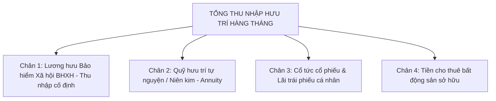
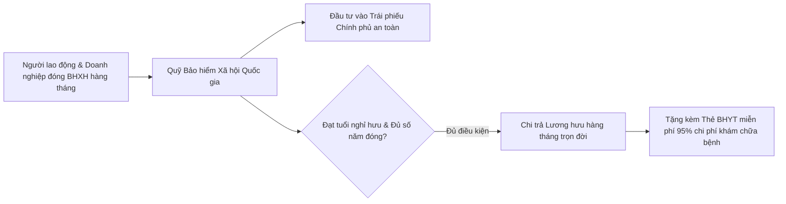
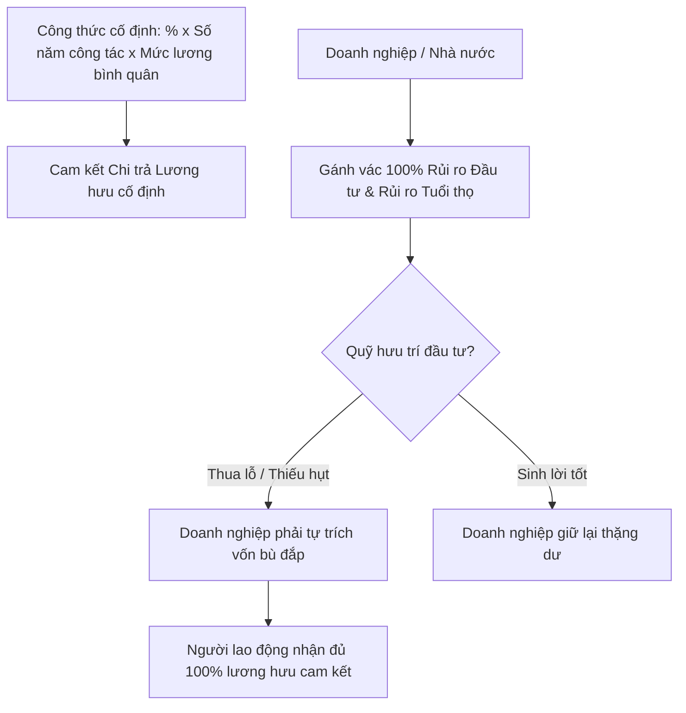
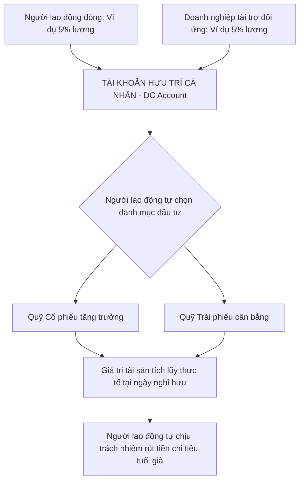

# Nền Tảng Hoạch Định Hưu Trí Và Các Mô Hình Quỹ Lương Hưu

Hoạch định hưu trí là bài toán tối ưu hóa tài chính có tầm thời gian dài nhất và quy mô dòng tiền lớn nhất trong cuộc đời một con người. Mục tiêu cốt lõi là chuyển đổi vốn con người (sức lao động) trong những năm tháng thanh xuân thành dòng thu nhập thụ động bền vững, bảo đảm phẩm giá và sự độc lập tài chính suốt những thập kỷ tuổi già. Tài liệu này mổ xẻ các nguyên lý nền tảng của hoạch định hưu trí, cấu trúc các dòng thu nhập tuổi già và cơ chế vận hành của hai trụ cột quỹ lương hưu kinh điển: Chế độ xác định quyền lợi (Defined Benefit) và Chế độ xác định mức đóng (Defined Contribution).

> **Các câu hỏi cốt lõi:**
> 1. Làm thế nào để tính toán chính xác "Quy mô Quỹ hưu trí mục tiêu" (Target Retirement Nest Egg) dựa trên Tỷ lệ thay thế thu nhập (Income Replacement Ratio)?
> 2. Sự chuyển dịch toàn cầu từ Chế độ hưu trí xác định quyền lợi (Defined Benefit) sang Chế độ xác định mức đóng (Defined Contribution) đã chuyển giao rủi ro đầu tư và rủi ro tuổi thọ sang ai?
> 3. Mô hình Ba trụ cột hưu trí của Ngân hàng Thế giới (World Bank Multi-Pillar Pension Framework) được áp dụng tại Việt Nam như thế nào?

---

## 1. Retirement Planning (Hoạch định hưu trí)

### 1. Là gì?
- **Định nghĩa hình thức:** Hoạch định hưu trí là quy trình toàn diện nhằm xác định các mục tiêu tài chính tuổi già, ước tính nhu cầu chi tiêu sinh hoạt sau khi ngừng làm việc, dự báo các nguồn thu nhập khả dụng và xây dựng chiến lược tích lũy, phân bổ tài sản đầu tư trong giai đoạn tích sản cũng như chiến lược rút vốn trong giai đoạn giải ngân tài sản.
- **Giải thích đơn giản:** Là kế hoạch chuẩn bị tiền để khi già không còn sức lao động, bạn vẫn có đủ tiền sống thoải mái, đi du lịch, chữa bệnh mà không phải phụ thuộc hay trở thành gánh nặng cho con cái.
- **Nếu chỉ nhớ một điều:** Bạn có thể vay tiền để học đại học, vay tiền để mua nhà hay mua xe, nhưng KHÔNG MỘT AI cho bạn vay tiền để nghỉ hưu; tự tích lũy hưu trí là trách nhiệm độc quyền của chính bạn.

### 2. Hoạt động thế nào?
- **Chủ thể ra quyết định:** Người lao động phối hợp cùng các nhà hoạch định tài chính cá nhân.
- **Mục tiêu tối ưu hóa:** Làm mượt mức độ thỏa dụng tiêu dùng trọn đời (Life-cycle Consumption Smoothing) theo lý thuyết của Franco Modigliani: không để mức sống bị tụt dốc thê thảm ngay sau khi rời thị trường lao động.
- **Ràng buộc:** Giới hạn về số năm lao động tích lũy còn lại, rủi ro lạm phát làm xói mòn sức mua, và sự bất định về tuổi thọ cá nhân.
- **Cơ chế tác động:**

### 3. Công thức & Mô hình
Xác định Quỹ hưu trí mục tiêu cần có tại thời điểm nghỉ hưu ($W_{\text{retire}}$):
$$W_{\text{retire}} = \frac{\text{Chi tiêu hưu trí năm đầu tiên } (E_0)}{\text{Tỷ lệ rút tiền an toàn } (\text{SWR})}$$
Trong đó Chi tiêu hưu trí năm đầu tiên được tính qua Tỷ lệ thay thế thu nhập (Income Replacement Ratio - $\text{IRR}$, thường từ $70\% - 80\%$ thu nhập trước khi nghỉ hưu):
$$E_0 = \text{Thu nhập năm cuối đi làm} \times \text{IRR} \times (1 + i)^t$$
(Với $i$ là tỷ lệ lạm phát hàng năm và $t$ là số năm còn lại đến tuổi nghỉ hưu).

### 4. Ví dụ
- **Ví dụ định lượng:** Anh Hùng (30 tuổi), dự kiến nghỉ hưu ở tuổi 60 (30 năm nữa). Chi tiêu gia đình hiện tại ở mức sống mong muốn là 20.000.000 VND/tháng (240 triệu/năm).
  - Giả sử lạm phát bình quân $4\%$/năm, chi tiêu 240 triệu hiện tại sẽ tương đương với chi tiêu ở tuổi 60:
    $$E_0 = 240.000.000 \times (1 + 0,04)^{30} = 240.000.000 \times 3,2434 = 778.416.000 \text{ VND/năm}$$
  - Giả sử nguồn lương hưu bảo hiểm xã hội dự kiến bù đắp 250 triệu/năm, anh cần tự trang trải phần chênh lệch $778 - 250 = 528.416.000$ VND/năm.
  - Áp dụng Tỷ lệ rút tiền an toàn $4\%$ ($\text{SWR} = 4\%$):
    $$W_{\text{retire}} = \frac{528.416.000}{0,04} = 13.210.400.000 \text{ VND}$$
  - Anh Hùng cần tích lũy được khối tài sản hưu trí mục tiêu khoảng 13,2 tỷ đồng ở tuổi 60.
- **Ví dụ thực tế:** Tại các nền kinh tế phát triển (như Mỹ, Úc, Singapore), hoạch định hưu trí là văn hóa tài chính ăn sâu vào tiềm thức thông qua các tài khoản hưu trí ưu đãi thuế như 401(k), IRA, Superannuation, hay CPF. Người trẻ bắt đầu trích lập hưu trí ngay từ tháng lương đầu tiên năm 22 tuổi.
- **Phản ví dụ (Counterfactual):** Một nhân viên văn phòng có thu nhập cao 50 triệu/tháng nhưng tiêu hết sạch cho các chuyến du lịch xa xỉ và xe sang, hoàn toàn không lập kế hoạch hưu trí vì nghĩ "còn lâu mới già". Đến tuổi 60 bị buộc thôi việc, người này đối mặt với việc thu nhập đột ngột rơi về 0, trong khi tiền tiết kiệm chỉ đủ sống 1 năm và lương hưu cơ bản chỉ vỏn vẹn vài triệu đồng, rơi vào khủng hoảng mức sống trầm trọng.

### 5. Ứng dụng & Tranh luận
- **Ứng dụng thực tiễn:** Khởi động lập kế hoạch hưu trí càng sớm càng tốt để tận dụng tối đa lãi kép thời gian; sử dụng quy tắc "Tuổi tác và tỷ trọng trái phiếu" để phân bổ tài sản giảm dần rủi ro theo độ tuổi.
- **Ưu và nhược điểm:**
  - *Ưu điểm:* Xóa tan nỗi sợ hãi tuổi già, mang lại sự độc lập tài chính tuyệt đối và phẩm giá cá nhân.
  - *Nhược điểm:* Đòi hỏi phải trì hoãn sự thỏa mãn ngắn hạn trong hiện tại để phục vụ một mục tiêu xa vời sau hàng chục năm.
- **Sai lầm phổ biến:** Trì hoãn việc tích lũy hưu trí đến sau tuổi 45-50 mới bắt đầu, khi đó số tiền phải tiết kiệm mỗi tháng để đạt mục tiêu sẽ tăng vọt lên gấp 5-10 lần do thời gian để lãi kép hoạt động đã bị rút ngắn quá nhiều.

### 6. Liên kết
- Cùng chủ đề: [02_Social_Security_Annuities_and_Timing.md](file:///Users/ductri0981/Documents/Studying/Studying-Economic/04_Personal_Finance_and_Wealth_Management/08_Retirement_Planning/02_Social_Security_Annuities_and_Timing.md)
- Liên kết chéo: [06_Wealth_Building_and_Compounding/01_Mathematics_of_Compounding_and_Interest.md](file:///Users/ductri0981/Documents/Studying/Studying-Economic/04_Personal_Finance_and_Wealth_Management/06_Wealth_Building_and_Compounding/01_Mathematics_of_Compounding_and_Interest.md)

---

## 2. Retirement Income (Thu nhập hưu trí)

### 1. Là gì?
- **Định nghĩa hình thức:** Thu nhập hưu trí là tổng hợp mọi dòng tiền tài chính chảy vào đều đặn hàng tháng hoặc hàng năm mà một cá nhân nhận được sau khi đã ngừng tham gia thị trường lao động chính thức, đến từ nhiều nguồn khác nhau nhằm bù đắp cho phần tiền lương đã mất.
- **Giải thích đơn giản:** Thu nhập hưu trí là "tiền lương hưu" chảy về tài khoản ngân hàng của bạn mỗi tháng khi bạn đã về già nghỉ việc, giúp bạn chi trả tiền chợ búa, điện nước và thuốc men.
- **Nếu chỉ nhớ một điều:** Một kế hoạch hưu trí vững chắc không bao giờ dựa vào một nguồn thu nhập duy nhất, mà phải đứng vững trên "Mô hình chiếc ghế 3 chân" (Three-legged Stool): Lương hưu nhà nước, Hưu trí doanh nghiệp/tư nhân, và Đầu tư cá nhân.

### 2. Hoạt động thế nào?
- **Chủ thể ra quyết định:** Người về hưu tổ chức và tái cấu trúc các dòng thu nhập từ danh mục đầu tư tích lũy.
- **Mục tiêu tối ưu hóa:** Tối đa hóa tính đều đặn, tính dự đoán được và khả năng chống chịu lạm phát của dòng tiền chi trả hàng tháng.
- **Ràng buộc:** Chịu ảnh hưởng bởi thuế thu nhập cá nhân (đối với một số quốc gia) và sự biến động của tỷ suất sinh lời thị trường tài chính.
- **Cơ chế tác động:**

### 3. Công thức & Mô hình
Tổng thu nhập hưu trí hàng năm ($RI_{\text{total}}$):
$$RI_{\text{total}} = \text{SocialSecurity} + \text{Pension}_{\text{corporate}} + \text{AnnuityPayout} + (W_{\text{portfolio}} \times \text{WithdrawalRate}) + \text{RentalIncome}$$
Chỉ số Đo lường Mức độ Vững vàng của Thu nhập Hưu trí (Guaranteed Income Ratio - $GIR$):
$$GIR = \frac{\text{Thu nhập hưu trí đảm bảo cố định (BHXH + Niên kim)}}{\text{Chi phí sinh hoạt thiết yếu tối thiểu ở tuổi già (Essential Expenses)}}$$
- Nếu $GIR \ge 100\%$: Người về hưu hoàn toàn an tâm vì các nhu cầu ăn ở, thuốc men cơ bản đã được bảo đảm bất kể thị trường chứng khoán lên hay xuống.

### 4. Ví dụ
- **Ví dụ định lượng:** Ông Bình (62 tuổi) về hưu với nhu cầu chi tiêu thiết yếu 15.000.000 VND/tháng và chi tiêu hưởng thụ 10.000.000 VND/tháng (Tổng nhu cầu: 25 triệu/tháng).
  - Nguồn 1 (BHXH nhà nước): 8.000.000 VND/tháng.
  - Nguồn 2 (Tiền cho thuê căn hộ chung cư): 9.000.000 VND/tháng.
  - Nguồn 3 (Rút từ danh mục chứng chỉ quỹ 2,5 tỷ với tỷ lệ $4\%$/năm): $\frac{2.500.000.000 \times 4\%}{12} \approx 8.300.000$ VND/tháng.
  - Tổng thu nhập hưu trí thực tế: $8 + 9 + 8,3 = 25.300.000$ VND/tháng.
  - Thu nhập hưu trí đảm bảo: $8 + 9 = 17$ triệu $\implies GIR = \frac{17}{15} = 113\% > 100\%$. Ông Bình có cấu trúc thu nhập tuổi già cực kỳ an toàn.
- **Ví dụ thực tế:** Tại Việt Nam, nhiều người cao tuổi sống dựa chủ yếu vào 2 nguồn: Lương hưu BHXH và tiền cho thuê một phần căn nhà mặt phố của gia đình, tạo ra dòng tiền thu nhập hưu trí thực tế rất ổn định trước biến động giá cả.
- **Phản ví dụ (Counterfactual):** Một người về hưu dựa $100\%$ thu nhập tuổi già vào việc bán dần cổ phiếu công nghệ đầu cơ tăng trưởng nóng. Khi thị trường chứng khoán sụp đổ rơi vào chu kỳ suy thoái kéo dài 3 năm (giảm $50\%$), nguồn thu nhập hưu trí của người này bị bốc hơi một nửa, buộc họ phải thắt lưng buộc bụng hoặc đi làm bảo vệ tuổi xế chiều.

### 5. Ứng dụng & Tranh luận
- **Ứng dụng thực tiễn:** Thiết kế dòng thu nhập hưu trí theo chiến lược "Phân tầng dòng tiền" (Income Flooring): Khóa chặt các nhu cầu cơ bản bằng thu nhập cố định đảm bảo, phần dôi dư mới dùng cho các tài sản sinh lời có độ biến động.
- **Ưu và nhược điểm:**
  - *Ưu điểm:* Đem lại sự an tâm tuyệt đối, tránh hiện tượng hoảng loạn bán tháo tài sản khi thị trường tài chính sụt giảm.
  - *Nhược điểm:* Đòi hỏi phải cơ cấu danh mục tài sản phức tạp ngay trước thời điểm về hưu từ 3-5 năm.
- **Sai lầm phổ biến:** Cho rằng sau khi nghỉ hưu toàn bộ tiền phải gửi tiết kiệm ngân hàng kỳ hạn ngắn, khiến sức mua của dòng thu nhập hưu trí bị lạm phát "ăn mòn" dần theo từng năm.

### 6. Liên kết
- Cùng chủ đề: [03_Retirement_Portfolio_and_Withdrawal_Strategies.md](file:///Users/ductri0981/Documents/Studying/Studying-Economic/04_Personal_Finance_and_Wealth_Management/08_Retirement_Planning/03_Retirement_Portfolio_and_Withdrawal_Strategies.md)
- Liên kết chéo: [01_Personal_Finance_Foundations/03_Cash_Flow_and_Income_Metrics.md](file:///Users/ductri0981/Documents/Studying/Studying-Economic/04_Personal_Finance_and_Wealth_Management/01_Personal_Finance_Foundations/03_Cash_Flow_and_Income_Metrics.md)

---

## 3. Retirement Savings (Tiết kiệm hưu trí)

### 1. Là gì?
- **Định nghĩa hình thức:** Tiết kiệm hưu trí là phần thu nhập khả dụng hiện tại mà một cá nhân chủ động trích lập, cam kết không tiêu dùng trong hiện tại và phân bổ vào các công cụ tài chính tích lũy dài hạn nhằm phục vụ riêng biệt cho mục tiêu an sinh tuổi già.
- **Giải thích đơn giản:** Là khoản tiền bạn "gửi cho chính mình của 30 năm sau", được khóa lại và bảo vệ nghiêm ngặt để không bị đem ra chi tiêu cho các nhu cầu mua sắm tiêu sản trước mắt.
- **Nếu chỉ nhớ một điều:** Tiết kiệm hưu trí khác biệt hoàn toàn với tiết kiệm ngắn hạn hay quỹ khẩn cấp: nó mang chân trời đầu tư hàng thập kỷ nên buộc phải chấp nhận biến động ngắn hạn để đánh bại lạm phát dài hạn.

### 2. Hoạt động thế nào?
- **Chủ thể ra quyết định:** Người đi làm chủ động thiết lập tỷ lệ trích nộp tự động (tối thiểu $15\% - 20\%$ thu nhập) vào các tài khoản hưu trí.
- **Mục tiêu tối ưu hóa:** Cực đại hóa giá trị tài sản ròng tích lũy tại ngày nghỉ hưu thông qua cơ chế lãi kép liên tục và tối ưu hóa ưu đãi thuế.
- **Ràng buộc:** Tính thanh khoản thấp (thường bị phạt tiền hoặc truy thu thuế nếu rút tiền trước tuổi quy định để ngăn ngừa việc tiêu lạm vào tiền dưỡng già).
- **Cơ chế tác động:**

### 3. Công thức & Mô hình
Giá trị Tích lũy Tương lai của Tiết kiệm Hưu trí định kỳ hàng tháng ($FV_{\text{annuity}}$):
$$FV_{\text{annuity}} = PMT \times \left[ \frac{(1 + r)^n - 1}{r} \right]$$
Trong đó:
- $PMT$: Số tiền tiết kiệm hưu trí trích nộp đều đặn mỗi kỳ.
- $r$: Tỷ suất sinh lời thực tế mỗi kỳ (đã trừ lạm phát hoặc theo lãi danh nghĩa).
- $n$: Tổng số kỳ tích lũy ($n = \text{Số năm} \times 12$).
Độ nhạy của thời gian: Nếu bắt đầu ở tuổi 25 thay vì tuổi 35 ($n$ tăng thêm 120 tháng), số vốn tương lai tích lũy được có thể tăng gấp đôi dù tổng số tiền nộp vào chỉ tăng nhẹ.

### 4. Ví dụ
- **Ví dụ định lượng:** Hai người bạn cùng đặt mục tiêu tích lũy hưu trí với tỷ suất sinh lời kỳ vọng $8\%$/năm:
  - Bạn An: Bắt đầu từ tuổi 25, mỗi tháng trích $3.000.000$ VND liên tục trong 10 năm (đến 35 tuổi), sau đó ngừng đóng phí hoàn toàn và để tiền tự sinh lời đến tuổi 65 (30 năm tiếp theo). Tổng vốn tự bỏ ra: $3 \times 12 \times 10 = 360.000.000$ VND.
    - Tại tuổi 65, số tiền An có: khoảng **5.450.000.000 VND**.
  - Bạn Bình: Đến tuổi 35 mới bắt đầu tiết kiệm hưu trí, nộp $3.000.000$ VND mỗi tháng liên tục suốt 30 năm (đến 65 tuổi). Tổng vốn tự bỏ ra: $3 \times 12 \times 30 = 1.080.000.000$ VND (gấp 3 lần An!).
    - Tại tuổi 65, số tiền Bình có: khoảng **4.470.000.000 VND** (ít hơn An gần 1 tỷ đồng!).
  - Sức mạnh của việc tiết kiệm hưu trí sớm 10 năm đã đánh bại việc bỏ vốn gấp 3 lần ở giai đoạn muộn.
- **Ví dụ thực tế:** Tại Việt Nam, nhiều người trẻ bắt đầu ứng dụng các sản phẩm Quỹ hưu trí bổ sung tự nguyện (theo Nghị định 88/2016/NĐ-CP) do các công ty quản lý quỹ uy tín vận hành như Dragon Capital, VinaCapital để trích lập tự động từ tài khoản ngân hàng mỗi ngày nhận lương.
- **Phản ví dụ (Counterfactual):** Một người rút sạch 200 triệu tiền tiết kiệm hưu trí để "chớp cơ hội" lướt sóng đất nền hoặc tiền ảo theo lời rủ rê của bạn bè. Dự án bị treo, mất trắng vốn và người này phải bắt đầu lại việc tích lũy hưu trí từ con số 0 ở tuổi 45.

### 5. Ứng dụng & Tranh luận
- **Ứng dụng thực tiễn:** Tự động hóa hoàn toàn quy trình trích nộp tiết kiệm hưu trí ngay trong ngày nhận lương (Pay Yourself First) để triệt tiêu cám dỗ chi tiêu.
- **Ưu và nhược điểm:**
  - *Ưu điểm:* Tận dụng trọn vẹn phép màu của lãi kép; tạo sự an tâm tuyệt đối khi tuổi tác ngày càng tăng.
  - *Nhược điểm:* Đòi hỏi tính kỷ luật sắt đá và chấp nhận hy sinh một phần chi tiêu hưởng thụ trước mắt.
- **Sai lầm phổ biến:** Rút tiền tiết kiệm hưu trí ra tiêu dùng cho các mục đích ngắn hạn (mua ô tô, đổi điện thoại, sửa nhà) rồi tự hứa "tháng sau sẽ bù vào".

### 6. Liên kết
- Cùng chủ đề: [01_Retirement_Foundations_and_Pensions.md](file:///Users/ductri0981/Documents/Studying/Studying-Economic/04_Personal_Finance_and_Wealth_Management/08_Retirement_Planning/01_Retirement_Foundations_and_Pensions.md)
- Liên kết chéo: [04_Saving_and_Emergency_Funds/01_Saving_Foundations_and_Savings_Rate.md](file:///Users/ductri0981/Documents/Studying/Studying-Economic/04_Personal_Finance_and_Wealth_Management/04_Saving_and_Emergency_Funds/01_Saving_Foundations_and_Savings_Rate.md)

---

## 4. Pension (Lương hưu)

### 1. Là gì?
- **Định nghĩa hình thức:** Lương hưu là khoản tiền chi trả định kỳ hàng tháng do Quỹ bảo hiểm xã hội của nhà nước hoặc Quỹ hưu trí của người sử dụng lao động thanh toán trọn đời cho người lao động đã đạt đến độ tuổi nghỉ hưu luật định và đáp ứng đủ thời gian tham gia đóng góp quỹ theo quy định của pháp luật.
- **Giải thích đơn giản:** Lương hưu là số tiền cố định bạn được nhận vào đầu mỗi tháng từ ngày bạn nghỉ hưu cho đến tận ngày bạn qua đời, bất kể bạn sống thọ đến 80, 90 hay 100 tuổi.
- **Nếu chỉ nhớ một điều:** Lương hưu là công cụ tài chính duy nhất trong xã hội có khả năng triệt tiêu hoàn toàn Rủi ro tuổi thọ (Longevity Risk) – rủi ro bạn sống quá lâu khiến tiền tích lũy cá nhân bị cạn kiệt trước khi chết.

### 2. Hoạt động thế nào?
- **Chủ thể ra quyết định:** Cơ quan Bảo hiểm Xã hội quản lý quỹ; người lao động và người sử dụng lao động có nghĩa vụ đóng góp theo tỷ lệ tiền lương quy định.
- **Mục tiêu tối ưu hóa:** Đảm bảo an sinh xã hội cơ bản cho người cao tuổi, giảm thiểu tỷ lệ đói nghèo ở độ tuổi nghỉ hưu.
- **Ràng buộc:** Phải đóng đủ số năm tối thiểu theo luật định (theo Luật BHXH 2024 của Việt Nam, thời gian đóng tối thiểu để hưởng lương hưu được hạ xuống 15 năm); mức lương hưu được điều chỉnh định kỳ theo chỉ số giá tiêu dùng (CPI).
- **Cơ chế tác động:**

### 3. Công thức & Mô hình
Công thức tính Lương hưu hàng tháng tại Việt Nam theo Luật Bảo hiểm Xã hội:
$$\text{Lương hưu hàng tháng} = \text{Tỷ lệ hưởng } (\%) \times \text{Mức bình quân tiền lương tháng đóng BHXH } (\overline{W}_{\text{BHXH}})$$
Trong đó:
- Đối với lao động nam: Đóng đủ 20 năm được hưởng $45\%$. Sau đó, cứ thêm mỗi năm đóng được cộng thêm $2\%$, mức tối đa là $75\%$ (tương đương đóng 35 năm).
- Đối với lao động nữ: Đóng đủ 15 năm được hưởng $45\%$. Sau đó, cứ thêm mỗi năm đóng được cộng thêm $2\%$, mức tối đa là $75\%$ (tương đương đóng 30 năm).
Nếu nghỉ hưu trước tuổi do suy giảm khả năng lao động, mỗi năm nghỉ hưu trước tuổi bị giảm trừ $2\%$ tỷ lệ hưởng.

### 4. Ví dụ
- **Ví dụ định lượng:** Chị Mai có thời gian tham gia BHXH bắt buộc là 30 năm khi nghỉ hưu đúng độ tuổi luật định. Mức bình quân tiền lương tháng đóng BHXH trong toàn bộ quá trình làm việc của chị là $\overline{W}_{\text{BHXH}} = 12.000.000$ VND/tháng.
  - Tỷ lệ hưởng lương hưu của chị Mai:
    - 15 năm đầu: $45\%$.
    - 15 năm tiếp theo: $15 \times 2\% = 30\%$.
    - Tổng tỷ lệ hưởng: $45\% + 30\% = 75\%$ (đạt mức tối đa theo luật).
  - Lương hưu hàng tháng chị Mai nhận trọn đời:
    $$\text{Lương hưu} = 75\% \times 12.000.000 = 9.000.000 \text{ VND/tháng}$$
  - Ngoài ra, chị được cấp thẻ BHYT hưu trí miễn phí chi trả $95\%$ viện phí khi đi khám chữa bệnh.
- **Ví dụ thực tế:** Tại Việt Nam, Nhà nước định kỳ ban hành các Nghị định điều chỉnh tăng lương hưu (ví dụ Nghị định 75/2024/NĐ-CP tăng $15\%$ lương hưu và trợ cấp BHXH) nhằm bảo đảm sức mua thực tế của người nghỉ hưu không bị lạm phát bào mòn.
- **Phản ví dụ (Counterfactual):** Một người lao động sau khi nghỉ việc đã chọn rút tiền Bảo hiểm xã hội một lần (nhận một cục vài chục triệu đồng) để tiêu xài cá nhân thay vì bảo lưu thời gian đóng. Khi về già không có lương hưu, không có thẻ BHYT, người này phải phụ thuộc hoàn toàn vào tiền chu cấp bấp bênh của con cái hoặc phải tiếp tục mưu sinh vất vả ngoài đường khi đã ngoài 70 tuổi.

### 5. Ứng dụng & Tranh luận
- **Ứng dụng thực tiễn:** Luôn duy trì tham gia BHXH liên tục (bắt buộc hoặc tự nguyện) như một lớp khiên bảo hộ tối thiểu không thể xâm phạm cho tuổi già.
- **Ưu và nhược điểm:**
  - *Ưu điểm:* Nhận tiền trọn đời đến khi qua đời; được điều chỉnh tăng theo lạm phát; đi kèm bảo hiểm y tế miễn phí.
  - *Nhược điểm:* Tỷ suất sinh lời tính trên số tiền đóng góp không cao bằng tự đầu tư cổ phiếu dài hạn; có rủi ro cải cách chính sách tuổi hưu khi dân số già hóa.
- **Sai lầm phổ biến:** Rút BHXH một lần khi còn trẻ vì nghĩ "chắc gì mình đã sống đến tuổi nghỉ hưu", tước đoạt đi chỗ dựa an sinh vững chắc nhất của chính mình lúc tuổi già bóng xế.

### 6. Liên kết
- Cùng chủ đề: [02_Social_Security_Annuities_and_Timing.md](file:///Users/ductri0981/Documents/Studying/Studying-Economic/04_Personal_Finance_and_Wealth_Management/08_Retirement_Planning/02_Social_Security_Annuities_and_Timing.md)
- Liên kết chéo: [01_Personal_Finance_Foundations/07_Security_Independence_and_Freedom.md](file:///Users/ductri0981/Documents/Studying/Studying-Economic/04_Personal_Finance_and_Wealth_Management/01_Personal_Finance_Foundations/07_Security_Independence_and_Freedom.md)

---

## 5. Defined Benefit Plan (Chế độ hưu trí xác định quyền lợi - DB)

### 1. Là gì?
- **Định nghĩa hình thức:** Defined Benefit Plan là chương trình hưu trí của người sử dụng lao động (hoặc hệ thống an sinh xã hội nhà nước), trong đó quyền lợi lương hưu mà người lao động nhận được khi về hưu được xác định trước theo một công thức toán học cố định dựa trên các yếu tố như số năm công tác, độ tuổi và mức lương bình quân những năm cuối, mà không phụ thuộc vào kết quả đầu tư thực tế của quỹ hưu trí.
- **Giải thích đơn giản:** Là chế độ "biết trước nhận được bao nhiêu tiền hưu". Công ty hoặc nhà nước hứa: bạn cứ cống hiến đủ số năm, khi về hưu mỗi tháng bạn chắc chắn nhận được một khoản tiền bằng công thức cụ thể, bất kể thị trường tài chính lời hay lỗ.
- **Nếu chỉ nhớ một điều:** Trong chế độ Defined Benefit (DB), TOÀN BỘ rủi ro đầu tư và rủi ro tuổi thọ thuộc về người sử dụng lao động hoặc nhà nước; người lao động được bảo đảm quyền lợi an toàn tuyệt đối.

### 2. Hoạt động thế nào?
- **Chủ thể ra quyết định:** Doanh nghiệp (hoặc chính phủ) thuê các chuyên gia tính toán định phí hưu trí (Actuaries) để trích lập quỹ dự phòng và đầu tư.
- **Mục tiêu tối ưu hóa:** Giữ chân nhân tài cống hiến lâu dài và đảm bảo nghĩa vụ cam kết chi trả hưu trí trong tương lai không bị thâm hụt tài chính (Underfunded).
- **Ràng buộc:** Nếu quỹ hưu trí đầu tư thua lỗ hoặc tuổi thọ người về hưu tăng cao, doanh nghiệp bắt buộc phải tự bỏ tiền túi của công ty ra bù đắp cho đủ số tiền đã cam kết trả cho người lao động.
- **Cơ chế tác động:**

### 3. Công thức & Mô hình
Công thức tính quyền lợi hưu trí Defined Benefit điển hình:
$$\text{Annual Pension} = \text{Accrual Rate } (\alpha) \times \text{Years of Service } (N) \times \text{Final Average Salary } (\text{FAS})$$
Trong đó:
- $\alpha$: Tỷ lệ tích lũy quyền lợi hàng năm (thường từ $1,5\% - 2,5\%$/năm).
- $N$: Tổng số năm làm việc tại doanh nghiệp.
- $\text{FAS}$: Mức lương bình quân của $3 - 5$ năm làm việc cuối cùng trước khi nghỉ hưu.

Trạng thái cân đối quỹ hưu trí DB (Funding Ratio - $FR$):
$$FR = \frac{\text{Giá trị thị trường của Tài sản Quỹ hưu trí (Plan Assets)}}{\text{Giá trị hiện tại của Nghĩa vụ hưu trí cam kết (PBO)}}$$
- Nếu $FR < 100\%$: Quỹ bị thâm hụt (Underfunded pension plan), tạo áp lực nợ tiềm tàng cực lớn lên báo cáo tài chính của doanh nghiệp.

### 4. Ví dụ
- **Ví dụ định lượng:** Một nhân viên làm việc 30 năm tại một tập đoàn có chương trình hưu trí Defined Benefit với tỷ lệ tích lũy $\alpha = 2\%$/năm. Mức lương bình quân 3 năm cuối của nhân viên này là 40.000.000 VND/tháng.
  - Tỷ lệ lương hưu: $2\% \times 30 = 60\%$.
  - Mức lương hưu nhận hàng tháng trọn đời:
    $$\text{Lương hưu} = 60\% \times 40.000.000 = 24.000.000 \text{ VND/tháng}$$
  - Dù thị trường chứng khoán năm đó có sụp đổ hay quỹ hưu trí của công ty có đầu tư âm $20\%$, công ty vẫn phải chi trả đủ 24 triệu/tháng cho nhân viên này.
- **Ví dụ thực tế:** Hệ thống hưu trí của công chức, viên chức, lực lượng vũ trang nhà nước tại hầu hết các quốc gia (bao gồm hệ thống BHXH bắt buộc của Việt Nam) về bản chất hoạt động theo mô hình Defined Benefit (DB) – mức hưởng được cam kết bằng công thức gắn với số năm đóng và tiền lương bình quân.
- **Phản ví dụ (Counterfactual):** Tập đoàn xe hơi General Motors (GM) từng bị gọi là "một quỹ hưu trí khổng lồ có đính kèm một nhà máy sản xuất ô tô" do gánh nặng chi trả lương hưu Defined Benefit cho hàng trăm ngàn công nhân về hưu quá lớn, dẫn đến việc quỹ thâm hụt hàng chục tỷ USD và trực tiếp đẩy GM vào bờ vực phá sản năm 2009.

### 5. Ứng dụng & Tranh luận
- **Ứng dụng thực tiễn:** Thường chỉ còn tồn tại trong khu vực công, cơ quan nhà nước, quân đội hoặc một số ít tập đoàn đa quốc gia có tiềm lực tài chính siêu mạnh.
- **Ưu và nhược điểm:**
  - *Ưu điểm:* Cực kỳ an toàn và ưu đãi cho người lao động; dòng tiền tuổi già hoàn toàn không chịu rủi ro biến động thị trường chứng khoán.
  - *Nhược điểm:* Chi phí duy trì quá đắt đỏ và rủi ro tài chính quá lớn cho người sử dụng lao động; tính cơ động nghề nghiệp thấp (người lao động khó chuyển việc mà vẫn bảo toàn đầy đủ quyền lợi).
- **Sai lầm phổ biến:** Ảo tưởng rằng các doanh nghiệp tư nhân vẫn duy trì chế độ Defined Benefit hào phóng như thời kỳ thế kỷ 20, trong khi hầu hết các doanh nghiệp hiện đại đã xóa bỏ mô hình này để chuyển sang Defined Contribution.

### 6. Liên kết
- Cùng chủ đề: [06_Defined_Contribution_Plan.md](file:///Users/ductri0981/Documents/Studying/Studying-Economic/04_Personal_Finance_and_Wealth_Management/08_Retirement_Planning/06_Defined_Contribution_Plan.md)
- Liên kết chéo: [02_Income_Management/04_Compensation_and_Salary_Negotiation.md](file:///Users/ductri0981/Documents/Studying/Studying-Economic/04_Personal_Finance_and_Wealth_Management/02_Income_Management/04_Compensation_and_Salary_Negotiation.md)

---

## 6. Defined Contribution Plan (Chế độ hưu trí xác định mức đóng - DC)

### 1. Là gì?
- **Định nghĩa hình thức:** Defined Contribution Plan là chương trình hưu trí trong đó mức đóng góp định kỳ của người lao động và người sử dụng lao động được xác định cụ thể (ví dụ $5\%$ lương từ người lao động và $5\%$ tài trợ đối ứng từ công ty), số tiền này được ghi có vào tài khoản hưu trí cá nhân của người lao động và đem đi đầu tư; quyền lợi hưu trí thực tế khi nghỉ hưu hoàn toàn phụ thuộc vào tổng số tiền đã đóng và kết quả sinh lời của danh mục đầu tư.
- **Giải thích đơn giản:** Là chế độ "biết trước đóng bao nhiêu, già nhận bao nhiêu tùy thuộc vào tài đầu tư". Bạn và công ty cùng góp tiền vào một tài khoản mang tên bạn, bạn tự chọn đem tiền đó mua cổ phiếu hay trái phiếu, khi già tài khoản có bao nhiêu tiền thì bạn rút ra tiêu bấy nhiêu.
- **Nếu chỉ nhớ một điều:** Trong chế độ Defined Contribution (DC), TOÀN BỘ rủi ro đầu tư và rủi ro tuổi thọ được chuyển giao sang vai người lao động; công ty chỉ hoàn thành nghĩa vụ khi nộp đủ tiền đối ứng hàng tháng.

### 2. Hoạt động thế nào?
- **Chủ thể ra quyết định:** Người lao động tự quyết định tỷ lệ phân bổ tài sản (Asset Allocation: chọn tỷ lệ đầu tư vào quỹ cổ phiếu, trái phiếu, hay tiền gửi) trong danh mục do công ty quản lý quỹ cung cấp.
- **Mục tiêu tối ưu hóa:** Người lao động tối đa hóa giá trị tài khoản tích lũy; doanh nghiệp tối ưu hóa chi phí phúc lợi nhân sự cố định mà không gánh nợ tiềm tàng dài hạn.
- **Ràng buộc:** Giá trị tài sản hưu trí biến động theo giá thị trường hàng ngày; rủi ro cạn sạch tiền nếu rút vốn quá nhanh khi về hưu.
- **Cơ chế tác động:**

### 3. Công thức & Mô hình
Số dư tài khoản hưu trí Defined Contribution tại thời điểm nghỉ hưu năm $T$ ($B_T$):
$$B_T = \sum_{t=1}^T (C_{\text{employee}, t} + C_{\text{employer}, t}) \times \prod_{k=t}^T (1 + r_k)$$
Trong đó:
- $C_{\text{employee}, t}$: Tiền người lao động đóng góp ở năm thứ $t$.
- $C_{\text{employer}, t}$: Tiền tài trợ đối ứng của doanh nghiệp (Employer Matching Contribution) ở năm thứ $t$.
- $r_k$: Tỷ suất sinh lời thực tế của danh mục đầu tư ở năm thứ $k$ (có thể dương hoặc âm).

Lợi tức nhận thêm ngay lập tức từ Đóng góp đối ứng của công ty (Employer Match):
Nếu công ty cam kết đối ứng $100\%$ số tiền đóng của nhân viên lên tới $5\%$ lương:
$$\text{Return}_{\text{instant}} = 100\%$$
(Đây là tỷ suất sinh lời ngay lập tức $100\%$ không có rủi ro – "Free Money" mà mọi nhân viên phải tận dụng tối đa).

### 4. Ví dụ
- **Ví dụ định lượng:** Anh Nam làm việc tại một công ty công nghệ có chính sách hưu trí Defined Contribution.
  - Mức lương của anh: 30.000.000 VND/tháng. Anh trích đóng $6\%$ lương (1,8 triệu/tháng).
  - Công ty tài trợ đối ứng $100\%$ mức đóng tối đa $6\%$ lương: thêm 1,8 triệu/tháng.
  - Tổng số tiền đưa vào tài khoản hưu trí của Nam: $3.600.000$ VND/tháng (gấp đôi số tiền anh tự bỏ ra!).
  - Nam chọn danh mục đầu tư $80\%$ cổ phiếu và $20\%$ trái phiếu với tỷ suất sinh lời bình quân $9\%$/năm. Sau 30 năm làm việc, số dư tài khoản của Nam tích lũy được:
    $$B_{30} \approx 6.630.000.000 \text{ VND}$$
  - Khi nghỉ hưu, Nam sở hữu trọn vẹn 6,63 tỷ đồng tiền mặt tự do trong tài khoản để rút dùng theo ý muốn.
- **Ví dụ thực tế:** Tài khoản 401(k) tại Mỹ là mô hình Defined Contribution thành công nhất lịch sử: biến hàng triệu người lao động bình thường thành các "triệu phú 401(k)" nhờ chính sách tài trợ đối ứng của công ty và đầu tư kỷ luật vào quỹ chỉ số S&P 500 suốt 30-40 năm.
- **Phản ví dụ (Counterfactual):** Một nhân viên công ty có chương trình Defined Contribution đối ứng $5\%$ lương nhưng nhân viên đó từ chối tham gia vì muốn nhận đủ lương đem đi chi tiêu. Người này đã trực tiếp vứt bỏ khoản tiền thưởng "cho không" $5\%$ lương mỗi tháng từ người sử dụng lao động và đánh mất hàng tỷ đồng quỹ hưu trí tương lai.

### 5. Ứng dụng & Tranh luận
- **Ứng dụng thực tiễn:** Luôn đóng góp vào chương trình hưu trí DC tối thiểu bằng đúng tỷ lệ mà người sử dụng lao động cam kết tài trợ đối ứng (để không bỏ lỡ tiền miễn phí).
- **Ưu và nhược điểm:**
  - *Ưu điểm:* Quyền sở hữu tài khoản hoàn toàn thuộc về cá nhân; có tính cơ động cao (chuyển công ty thì mang theo tài khoản hưu trí đi); tiềm năng sinh lời vượt trội nếu đầu tư vào cổ phiếu dài hạn.
  - *Nhược điểm:* Đòi hỏi người lao động phải có kiến thức tài chính để tự chọn danh mục; chịu toàn bộ rủi ro khi thị trường sụt giảm ngay trước thời điểm nghỉ hưu.
- **Sai lầm phổ biến:** Chọn danh mục đầu tư quá thận trọng (để $100\%$ tiền vào quỹ tiền gửi lãi suất thấp) trong suốt 30 năm tuổi trẻ, khiến số tiền tích lũy bị lạm phát ăn mòn sức mua.

### 6. Liên kết
- Cùng chủ đề: [05_Defined_Benefit_Plan.md](file:///Users/ductri0981/Documents/Studying/Studying-Economic/04_Personal_Finance_and_Wealth_Management/08_Retirement_Planning/05_Defined_Benefit_Plan.md)
- Liên kết chéo: [06_Wealth_Building_and_Compounding/04_Asset_Classification_and_Allocation.md](file:///Users/ductri0981/Documents/Studying/Studying-Economic/04_Personal_Finance_and_Wealth_Management/06_Wealth_Building_and_Compounding/04_Asset_Classification_and_Allocation.md)

---

## Câu hỏi tự kiểm tra
1. So sánh sự khác nhau căn bản giữa Chế độ hưu trí xác định quyền lợi (Defined Benefit) và Chế độ hưu trí xác định mức đóng (Defined Contribution). Tại sao các doanh nghiệp tư nhân trên thế giới lại đồng loạt chuyển đổi từ DB sang DC?
2. Trong chương trình hưu trí Defined Contribution, khái niệm "Tài trợ đối ứng của người sử dụng lao động" (Employer Matching) mang lại lợi ích tài chính trực tiếp như thế nào cho người lao động?
3. Trình bày công thức tính Lương hưu hàng tháng của Việt Nam theo Luật Bảo hiểm Xã hội. Tại sao việc rút bảo hiểm xã hội một lần lại bị các chuyên gia tài chính đánh giá là sai lầm nghiêm trọng nhất đối với an sinh tuổi già?
4. Hãy giải thích tại sao một người bắt đầu tiết kiệm hưu trí sớm từ tuổi 25 và chỉ nộp trong 10 năm lại có thể tích lũy được khối tài sản nhiều hơn một người bắt đầu từ tuổi 35 và nộp liên tục trong suốt 30 năm?

## Ghi chú nguồn
- Luật Bảo hiểm Xã hội số 41/2024/QH15 của Quốc hội Việt Nam.
- Nghị định số 88/2016/NĐ-CP của Chính phủ về chương trình hưu trí bổ sung tự nguyện.
- World Bank - *Averting the Old Age Crisis: Policies to Protect the Old and Promote Growth*, Oxford University Press.
- Bodie, Z., Treussard, J., & Willen, P. - *The Theory of Life-Cycle Saving and Investing*.
