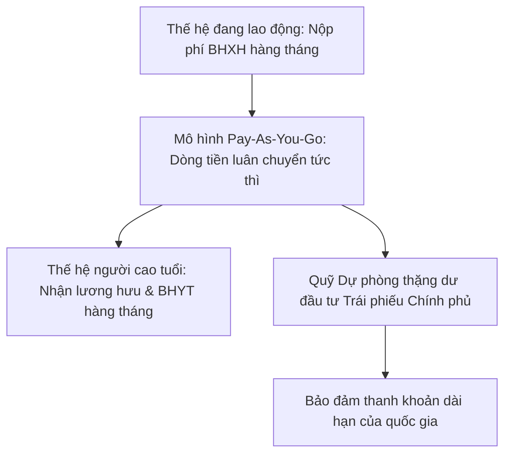
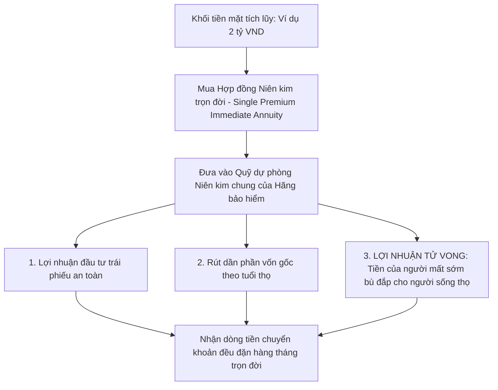
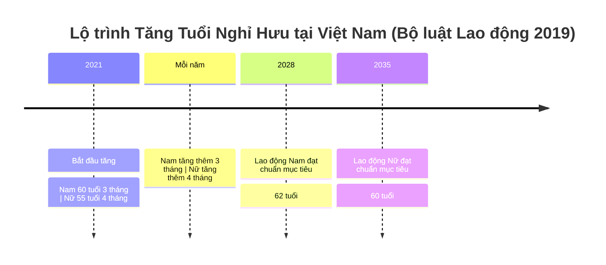
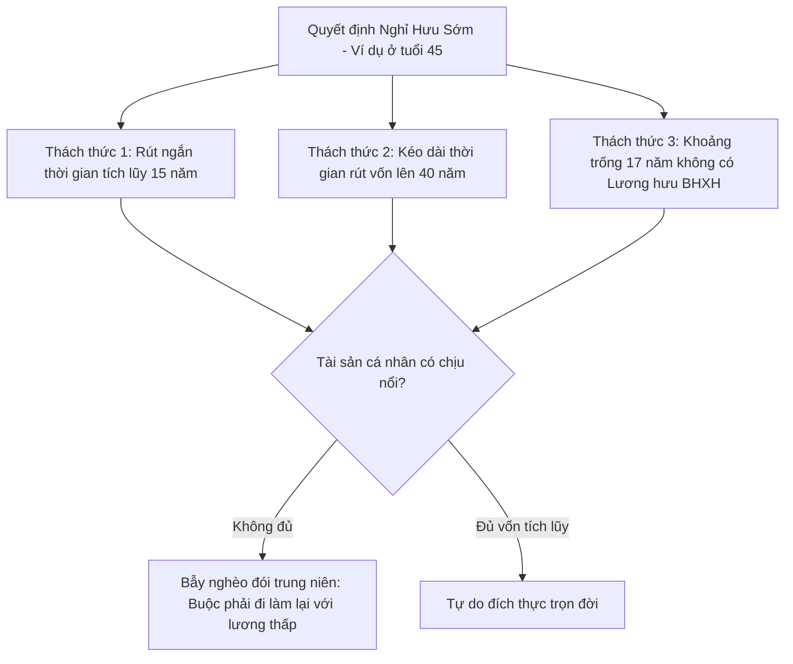
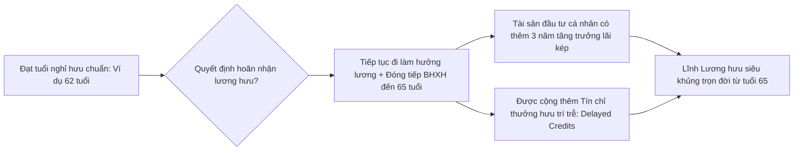

# An Sinh Xã Hội, Hợp Đồng Niên Kim Và Thời Điểm Nghỉ Hưu

Quyết định lựa chọn thời điểm rời khỏi thị trường lao động (nghỉ hưu sớm, đúng tuổi hay hoãn lại) và việc chuyển hóa tài sản tích lũy thành dòng niên kim trọn đời có tác động mang tính quyết định đến tính bền vững của dòng thu nhập tuổi già. Tài liệu này mổ xẻ cơ chế vận hành của hệ thống An sinh xã hội (Social Security), toán học tính toán bảo hiểm niên kim (Annuities), tác động của tuổi thọ bình quân (Life Expectancy) và các bài toán đánh đổi tài chính khi lựa chọn thời điểm nghỉ hưu.

> **Các câu hỏi cốt lõi:**
> 1. Tại sao hợp đồng niên kim (Annuity) lại tận dụng được "Lợi nhuận từ tỷ lệ tử vong" (Mortality Credits) để tạo ra tỷ suất chi trả dòng tiền cao hơn bất kỳ danh mục trái phiếu an toàn nào?
> 2. Đánh đổi tài chính toán học giữa Nghỉ hưu sớm (Early Retirement - bị phạt giảm trừ tỷ lệ hưởng) và Nghỉ hưu hoãn lại (Deferred Retirement - được cộng thêm quyền lợi) là gì?
> 3. Lộ trình điều chỉnh tăng Tuổi nghỉ hưu (Retirement Age) theo Bộ luật Lao động 2019 tại Việt Nam tác động như thế nào đến chiến lược tích lũy hưu trí cá nhân?

---

## 1. Social Security (Bảo hiểm xã hội / An sinh xã hội)

### 1. Là gì?
- **Định nghĩa hình thức:** An sinh xã hội là hệ thống các chương trình do nhà nước tổ chức và bảo đảm thực hiện, nhằm bảo vệ công dân trước tình trạng bị mất hoặc giảm sút nghiêm trọng thu nhập do các biến cố xã hội (ốm đau, thai sản, tai nạn lao động, thất nghiệp, già yếu và tử vong), đồng thời đảm bảo quyền tiếp cận các dịch vụ chăm sóc y tế cơ bản.
- **Giải thích đơn giản:** Là "lưới an sinh" của quốc gia để đảm bảo không một người già, người tàn tật hay người thất nghiệp nào bị bỏ rơi rơi vào cảnh cùng quẫn đói nghèo; bạn đóng tiền khi còn trẻ đi làm và nhận lại sự bảo bọc khi về già hoặc gặp hoạn nạn.
- **Nếu chỉ nhớ một điều:** An sinh xã hội là trụ cột phòng thủ cấp quốc gia vận hành theo nguyên tắc San sẻ cộng đồng (Social Pooling), không phải là tài khoản đầu tư sinh lời cá nhân.

### 2. Hoạt động thế nào?
- **Chủ thể ra quyết định:** Quốc hội và Chính phủ ban hành luật; Cơ quan Bảo hiểm Xã hội (như BHXH Việt Nam) thu nộp và quản lý chi trả.
- **Mục tiêu tối ưu hóa:** Giảm tỷ lệ nghèo đói trong nhóm người cao tuổi và duy trì sự ổn định, gắn kết trật tự xã hội.
- **Ràng buộc:** Cân đối giữa đóng và hưởng; chịu áp lực nhân khẩu học khốc liệt khi tỷ lệ phụ thuộc tuổi già (Old-age Dependency Ratio) tăng cao do già hóa dân số.
- **Cơ chế tác động:**

### 3. Công thức & Mô hình
Cơ chế Tài trợ Hưu trí Phân bổ dòng tiền theo thời gian thực (Pay-As-You-Go - PAYGO):
Trong trạng thái cân bằng tài chính của hệ thống PAYGO:
$$\tau \times N_w \times \overline{w} = N_r \times \overline{b}$$
Trong đó:
- $\tau$: Tỷ lệ đóng góp bảo hiểm xã hội bắt buộc.
- $N_w$: Số lượng người đang trong độ tuổi lao động đóng bảo hiểm.
- $\overline{w}$: Tiền lương bình quân của lực lượng lao động.
- $N_r$: Số lượng người già đang hưởng lương hưu.
- $\overline{b}$: Mức lương hưu bình quân chi trả cho người già.
Tỷ lệ thay thế thu nhập xã hội ($b / w$) phụ thuộc trực tiếp vào Hệ số phụ thuộc ($N_w / N_r$). Khi dân số già hóa ($N_w / N_r$ giảm), hệ thống buộc phải: Tăng tuổi nghỉ hưu, Tăng tỷ lệ đóng $\tau$, hoặc Giảm mức hưởng $\overline{b}$.

### 4. Ví dụ
- **Ví dụ định lượng:** Tại một quốc gia có 4 người lao động nuôi 1 người về hưu ($N_w / N_r = 4$). Mức lương bình quân lao động là 10.000.000 VND. Tỷ lệ đóng BHXH hưu trí là $\tau = 20\%$.
  - Mức lương hưu bình quân hệ thống có thể chi trả:
    $$\overline{b} = \tau \times \frac{N_w}{N_r} \times \overline{w} = 20\% \times 4 \times 10.000.000 = 8.000.000 \text{ VND/tháng}$$
  - Sau 30 năm, dân số già hóa khiến tỷ lệ chỉ còn 2 người lao động nuôi 1 người về hưu ($N_w / N_r = 2$). Nếu giữ nguyên tỷ lệ đóng $20\%$, mức lương hưu bắt buộc phải giảm xuống:
    $$\overline{b} = 20\% \times 2 \times 10.000.000 = 4.000.000 \text{ VND/tháng}$$
  - Điều này giải thích tại sao mọi quốc gia đều phải cải cách tăng dần tuổi nghỉ hưu để giữ chân người lao động ở lại thị trường lâu hơn.
- **Ví dụ thực tế:** Tại Việt Nam, hệ thống BHXH bắt buộc trích nộp tổng cộng $32\%$ tiền lương đóng BHXH hàng tháng (Doanh nghiệp đóng $21,5\%$, Người lao động đóng $10,5\%$), trong đó riêng quỹ hưu trí và tử tuất là $22\%$.
- **Phản ví dụ (Counterfactual):** Một quốc gia duy trì tuổi nghỉ hưu quá sớm (50 tuổi) trong bối cảnh tuổi thọ tăng lên 80 tuổi mà không chịu cải cách quỹ an sinh xã hội. Quỹ hưu trí quốc gia bị cạn kiệt thặng dư dự phòng sau 15 năm, buộc chính phủ phải cắt giảm $30\%$ lương hưu của toàn bộ người dân, gây ra làn sóng biểu tình và khủng hoảng kinh tế xã hội sâu sắc.

### 5. Ứng dụng & Tranh luận
- **Ứng dụng thực tiễn:** Xem lương hưu an sinh xã hội là "tầng đáy an toàn tuyệt đối" trong tháp tài chính cá nhân; tuyệt đối không rút một lần nếu không có lý do bất khả kháng.
- **Ưu và nhược điểm:**
  - *Ưu điểm:* Được nhà nước bảo trợ, có tính chống lạm phát (điều chỉnh tăng định kỳ); tự động tích hợp bảo hiểm y tế suốt đời.
  - *Nhược điểm:* Chịu rủi ro chính sách cải cách hưu trí; mức hưởng bình quân chỉ đáp ứng mức sống tối thiểu, không thể mang lại cuộc sống xa hoa.
- **Sai lầm phổ biến:** Kỳ vọng lương hưu nhà nước sẽ chi trả đủ cho mọi nhu cầu du lịch, hưởng thụ xa xỉ khi về già, dẫn đến việc không chủ động tự tích lũy tài khoản đầu tư hưu trí cá nhân.

### 6. Liên kết
- Cùng chủ đề: [01_Retirement_Foundations_and_Pensions.md](file:///Users/ductri0981/Documents/Studying/Studying-Economic/04_Personal_Finance_and_Wealth_Management/08_Retirement_Planning/01_Retirement_Foundations_and_Pensions.md)
- Liên kết chéo: [01_Personal_Finance_Foundations/07_Security_Independence_and_Freedom.md](file:///Users/ductri0981/Documents/Studying/Studying-Economic/04_Personal_Finance_and_Wealth_Management/01_Personal_Finance_Foundations/07_Security_Independence_and_Freedom.md)

---

## 2. Annuity (Niên kim / Hợp đồng niên kim hưu trí)

### 1. Là gì?
- **Định nghĩa hình thức:** Hợp đồng niên kim là một hợp đồng tài chính giữa cá nhân và một tổ chức tài chính (thường là công ty bảo hiểm nhân thọ), trong đó cá nhân nộp một khoản tiền duy nhất hoặc một chuỗi các khoản đóng góp tích lũy, để đổi lấy cam kết của tổ chức chi trả một chuỗi các khoản tiền định kỳ đều đặn bắt đầu ngay lập tức hoặc trong tương lai và kéo dài cho đến hết cuộc đời người thụ hưởng (Life Annuity).
- **Giải thích đơn giản:** Là việc bạn đem một cục tiền tiết kiệm nộp cho công ty bảo hiểm, và ký cam kết rằng: từ nay đến khi bạn mất, mỗi tháng công ty bảo hiểm phải "nhả" lại cho bạn một số tiền cố định (ví dụ 10 triệu/tháng), dù bạn có sống thọ đến 105 tuổi công ty vẫn phải trả đủ.
- **Nếu chỉ nhớ một điều:** Niên kim là sản phẩm nghịch đảo của bảo hiểm nhân thọ: Bảo hiểm nhân thọ phòng ngừa rủi ro "Chết quá sớm" (Die too soon), còn Niên kim phòng ngừa rủi ro "Sống quá thọ" (Live too long).

### 2. Hoạt động thế nào?
- **Chủ thể ra quyết định:** Người về hưu muốn biến khối tài sản tích lũy (Lump-sum) thành dòng thu nhập đều đặn trọn đời không bao giờ cạn kiệt.
- **Mục tiêu tối ưu hóa:** Loại bỏ hoàn toàn sự lo lắng về việc thị trường chứng khoán giảm giá và bảo đảm dòng tiền ăn tiêu cố định mỗi tháng.
- **Ràng buộc:** Tính thanh khoản bị khóa chặt (khi đã mua niên kim trọn đời không thể rút lại tiền gốc); đối mặt với rủi ro lạm phát nếu mua niên kim danh nghĩa cố định.
- **Cơ chế tác động:**

### 3. Công thức & Mô hình
Số tiền niên kim trọn đời chi trả hàng tháng ($PMT_{\text{annuity}}$) ở tuổi $x$ từ khối vốn ban đầu $V_0$:
$$PMT_{\text{annuity}} = \frac{V_0}{a_x}$$
Trong đó $a_x$ là hệ số niên kim tính toán trọn đời (Actuarial Present Value of Life Annuity) ở tuổi $x$:
$$a_x = \sum_{t=1}^{\omega - x} v^t \cdot {}_t p_x$$
- $v = (1 + i)^{-1}$: Hệ số chiết khấu dòng tiền.
- ${}_t p_x$: Xác suất một người tuổi $x$ sống thêm $t$ năm nữa.
- $\omega$: Tuổi thọ tối đa theo bảng tử vong (thường là 100 - 110 tuổi).

Khái niệm **Mortality Credits (Lợi nhuận tử vong):**
Tỷ suất chi trả của Niên kim luôn cao hơn tỷ suất sinh lời của trái phiếu chính phủ có cùng kỳ hạn:
$$\text{Payout Rate} = \text{Bond Yield} + \text{Principal Drawdown} + \text{Mortality Credits}$$
Phần "Mortality Credits" sinh ra từ vốn gốc của những người trong nhóm không may qua đời sớm được để lại quỹ và chia đều cho những người sống thọ.

### 4. Ví dụ
- **Ví dụ định lượng:** Ông Nam (65 tuổi) đem 2.000.000.000 VND mua hợp đồng niên kim trọn đời trả ngay (Single Premium Immediate Annuity - SPIA).
  - Lãi suất trái phiếu chính phủ là $5\%$/năm (nếu tự mua trái phiếu, ông chỉ nhận được 100 triệu/năm tức khoảng 8,3 triệu/tháng và giữ nguyên gốc).
  - Công ty bảo hiểm tính toán tuổi thọ và Mortality Credits, đưa ra tỷ lệ chi trả niên kim là $7,8\%$/năm.
  - Số tiền ông Nam nhận được:
    $$PMT = 2.000.000.000 \times 7,8\% = 156.000.000 \text{ VND/năm } (13.000.000 \text{ VND/tháng})$$
  - Ông Nam nhận 13 triệu/tháng trọn đời (cao hơn nhiều so với 8,3 triệu). Nếu ông sống đến năm 95 tuổi (30 năm), tổng số tiền ông nhận được là $30 \times 156 \text{ triệu} = 4,68$ tỷ VND từ khoản vốn ban đầu 2 tỷ!
- **Ví dụ thực tế:** Tại các quốc gia như Singapore, chương trình **CPF LIFE** là một mô hình niên kim quốc gia bắt buộc: Khi công dân tròn 65 tuổi, số tiền trong tài khoản hưu trí sẽ được tự động chuyển thành hợp đồng niên kim trọn đời, chi trả tiền hàng tháng cho đến khi người dân qua đời.
- **Phản ví dụ (Counterfactual):** Một người mua niên kim trọn đời 2 tỷ đồng tháng trước, tháng sau không may bị đột quỵ qua đời và hợp đồng là loại niên kim thuần túy (Straight Life Annuity không có điều khoản bảo lưu hoàn vốn). Toàn bộ 2 tỷ đồng thuộc về quỹ niên kim chung, con cháu không được thừa kế đồng nào. (Để tránh điều này, người mua hiện nay thường chọn Niên kim có thời hạn đảm bảo - Cash Refund Annuity).

### 5. Ứng dụng & Tranh luận
- **Ứng dụng thực tiễn:** Công cụ hoàn hảo để tạo "sàn thu nhập an toàn" (Income Floor) cho người già e ngại rủi ro suy giảm thị trường chứng khoán.
- **Ưu và nhược điểm:**
  - *Ưu điểm:* Dòng tiền bảo đảm trọn đời tuyệt đối; không đòi hỏi phải quản lý danh mục đầu tư phức tạp; tận dụng được Mortality Credits.
  - *Nhược điểm:* Mất tính thanh khoản linh hoạt của vốn gốc; phí quản lý của công ty bảo hiểm có thể cao; rủi ro lạm phát làm giảm sức mua.
- **Sai lầm phổ biến:** Đưa toàn bộ tài sản tích lũy vào mua niên kim trọn đời loại không hoàn vốn, khiến gia đình mất sạch tính linh hoạt tiền mặt khi cần tiền cấp cứu khẩn cấp.

### 6. Liên kết
- Cùng chủ đề: [01_Retirement_Foundations_and_Pensions.md](file:///Users/ductri0981/Documents/Studying/Studying-Economic/04_Personal_Finance_and_Wealth_Management/08_Retirement_Planning/01_Retirement_Foundations_and_Pensions.md)
- Liên kết chéo: [04_Retirement_Risks_and_Healthcare.md](file:///Users/ductri0981/Documents/Studying/Studying-Economic/04_Personal_Finance_and_Wealth_Management/08_Retirement_Planning/04_Retirement_Risks_and_Healthcare.md)

---

## 3. Life Expectancy (Kỳ vọng sống / Tuổi thọ bình quân)

### 1. Là gì?
- **Định nghĩa hình thức:** Kỳ vọng sống (hoặc Tuổi thọ trung bình dự kiến) là chỉ số thống kê phản ánh số năm trung bình mà một nhóm cá nhân ở một độ tuổi cụ thể có thể kỳ vọng sẽ tiếp tục sống, được tính toán dựa trên các bảng tỷ lệ tử vong theo độ tuổi (Mortality Tables) tại một thời điểm nhất định.
- **Giải thích đơn giản:** Là con số ước tính xem trung bình bạn sẽ sống thọ được bao nhiêu năm nữa.
- **Nếu chỉ nhớ một điều:** Tuổi thọ khi mới sinh (Life Expectancy at Birth) khác xa với Tuổi thọ có điều kiện khi đã đạt 60 tuổi (Conditional Life Expectancy at age 60); người đã sống đến 60 tuổi có xác suất rất cao sẽ sống thọ vượt qua 85 hoặc 90 tuổi.

### 2. Hoạt động thế nào?
- **Chủ thể ra quyết định:** Chuyên gia tính toán hưu trí (Actuaries) và cá nhân hoạch định tài chính.
- **Mục tiêu tối ưu hóa:** Xác định độ dài của "Giai đoạn giải ngân tài sản" (Decumulation Period) để phân bổ dòng tiền không bị cạn trước khi chết.
- **Ràng buộc:** Quy luật sinh học, tiến bộ y tế kéo dài tuổi thọ và sự khác biệt về giới tính (nữ giới bình quân sống thọ hơn nam giới từ 4 đến 6 năm).
- **Cơ chế tác động:**

### 3. Công thức & Mô hình
Kỳ vọng sống còn lại ở độ tuổi $x$ ($e_x$):
$$e_x = \sum_{t=1}^{\infty} {}_t p_x = \sum_{t=1}^{\infty} \prod_{k=0}^{t-1} (1 - q_{x+k})$$
Trong đó:
- $q_{x+k}$: Xác suất tử vong ở tuổi $x+k$.
- ${}_t p_x$: Xác suất một người tuổi $x$ sống sót thêm ít nhất $t$ năm nữa.

Nguyên tắc Hoạch định cho Một Cặp vợ chồng (Joint Longevity Risk):
Xác suất để ít nhất một trong hai vợ chồng sống thọ đến tuổi $T$:
$$P(\text{Ít nhất một người sống sót}) = 1 - (1 - p_{\text{husband}}) \times (1 - p_{\text{wife}})$$
Xác suất để một người trong cặp vợ chồng cùng tuổi 65 sống qua tuổi 90 lên tới gần $50\%$!

### 4. Ví dụ
- **Ví dụ định lượng:** Một người đàn ông Việt Nam nghỉ hưu ở tuổi 62.
  - Tuổi thọ trung bình khi sinh của nam giới Việt Nam là khoảng 71 tuổi. Nếu người này chỉ chuẩn bị tài chính đến 71 tuổi (9 năm hưu trí), đây là sai lầm chết người.
  - Theo Bảng tỷ lệ tử vong dân số, một nam giới đã sống khỏe mạnh đến 62 tuổi có kỳ vọng sống còn lại là $e_{62} \approx 18$ năm (sống đến 80 tuổi), và có $25\%$ cơ hội sống thọ đến 88 tuổi.
  - Do đó, kế hoạch hưu trí tài chính phải được thiết kế dự phòng dòng tiền chi trả tối thiểu cho 25 đến 30 năm (đến năm 88-92 tuổi).
- **Ví dụ thực tế:** Tại Việt Nam, theo số liệu của Tổng cục Thống kê, tuổi thọ trung bình của người dân đã tăng lên 74,5 tuổi vào năm 2023 (nữ 76,5 tuổi, nam 71,1 tuổi). Việt Nam là một trong những quốc gia có tốc độ già hóa dân số nhanh nhất thế giới.
- **Phản ví dụ (Counterfactual):** Một người lên kế hoạch hưu trí dựa trên giả định mình chỉ sống đến tuổi 75. Người này rút tiền tiêu xài hoang phí mỗi năm $10\%$ tài sản. Đến năm 76 tuổi, tiền cạn sạch nhưng sức khỏe vẫn dồi dào, người này phải sống 15 năm tiếp theo trong cảnh nghèo đói cùng cực và hoàn toàn lệ thuộc vào trợ cấp xã hội.

### 5. Ứng dụng & Tranh luận
- **Ứng dụng thực tiễn:** Luôn cộng thêm biên an toàn 5-10 năm vào tuổi thọ kỳ vọng trung bình khi lập kế hoạch giải ngân tài chính hưu trí.
- **Ưu và nhược điểm:**
  - *Ưu điểm:* Loại trừ nguy cơ phá sản tài chính tuổi già; đảm bảo chất lượng sống cao suốt những năm tháng cuối đời.
  - *Nhược điểm:* Đòi hỏi quy mô quỹ hưu trí mục tiêu phải lớn hơn đáng kể.
- **Sai lầm phổ biến:** Sử dụng số liệu tuổi thọ bình quân chung của cả nước (đã bao gồm tỷ lệ tử vong trẻ sơ sinh và tai nạn thời trẻ) để làm mốc thời gian kết thúc kế hoạch tài chính cho người đã 60 tuổi.

### 6. Liên kết
- Cùng chủ đề: [04_Retirement_Risks_and_Healthcare.md](file:///Users/ductri0981/Documents/Studying/Studying-Economic/04_Personal_Finance_and_Wealth_Management/08_Retirement_Planning/04_Retirement_Risks_and_Healthcare.md)
- Liên kết chéo: [01_Personal_Finance_Foundations/06_Financial_Goals_and_Time_Horizons.md](file:///Users/ductri0981/Documents/Studying/Studying-Economic/04_Personal_Finance_and_Wealth_Management/01_Personal_Finance_Foundations/06_Financial_Goals_and_Time_Horizons.md)

---

## 4. Retirement Age (Tuổi nghỉ hưu)

### 1. Là gì?
- **Định nghĩa hình thức:** Tuổi nghỉ hưu là mốc độ tuổi được pháp luật lao động và an sinh xã hội quy định (hoặc do cá nhân tự chọn), tại đó người lao động chính thức chấm dứt quan hệ lao động hợp đồng tiêu chuẩn và bắt đầu đủ điều kiện hưởng đầy đủ các chế độ hưu trí và an sinh xã hội theo luật định.
- **Giải thích đơn giản:** Là độ tuổi bạn được pháp luật cho phép "nghỉ việc dưỡng già" và bắt đầu được lĩnh lương hưu hàng tháng.
- **Nếu chỉ nhớ một điều:** Tuổi nghỉ hưu pháp định là một biến số chính sách luôn có xu hướng tăng lên theo thời gian để thích ứng với tuổi thọ ngày càng cao của con người.

### 2. Hoạt động thế nào?
- **Chủ thể ra quyết định:** Nhà nước ban hành khung pháp luật; người lao động căn cứ vào tình trạng sức khỏe và tài chính để quyết định tiếp tục làm việc hay nghỉ ngơi.
- **Mục tiêu tối ưu hóa:** Cân bằng giữa nhu cầu nghỉ ngơi phục hồi sức khỏe của người lao động và sự phát triển kinh tế bền vững của quỹ hưu trí quốc gia.
- **Ràng buộc:** Quy định tại Bộ luật Lao động về độ tuổi tối thiểu; các điều kiện về suy giảm khả năng lao động hoặc làm nghề nặng nhọc độc hại để được nghỉ sớm hơn.
- **Cơ chế tác động:**

### 3. Công thức & Mô hình
Lộ trình tăng tuổi nghỉ hưu của Việt Nam theo Điều 169 Bộ luật Lao động 2019 và Nghị định 135/2020/NĐ-CP:
- Kể từ năm 2021, tuổi nghỉ hưu của người lao động trong điều kiện lao động bình thường được điều chỉnh theo lộ trình:
  - Lao động nam: Mỗi năm tăng thêm 03 tháng cho đến khi đạt **62 tuổi** vào năm 2028.
  - Lao động nữ: Mỗi năm tăng thêm 04 tháng cho đến khi đạt **60 tuổi** vào năm 2035.
Xác định tuổi nghỉ hưu năm $Y$ ($Y \ge 2021$):
$$\text{Tuổi hưu Nam}(Y) = 60 \text{ tuổi } + 3 \times (Y - 2020) \text{ tháng } \quad (\le 62)$$
$$\text{Tuổi hưu Nữ}(Y) = 55 \text{ tuổi } + 4 \times (Y - 2020) \text{ tháng } \quad (\le 60)$$

### 4. Ví dụ
- **Ví dụ định lượng:** Chị Lan (sinh tháng 8 năm 1972) làm việc trong điều kiện bình thường. Chị muốn biết mình nghỉ hưu vào năm nào và ở độ tuổi bao nhiêu.
  - Tra cứu theo bảng lộ trình Nghị định 135/2020/NĐ-CP: Lao động nữ sinh năm 1972 sẽ nghỉ hưu ở mốc **58 tuổi 4 tháng**.
  - Chị Lan sẽ chính thức đủ tuổi nghỉ hưu vào tháng 12 năm 2030.
  - Nắm được con số này giúp chị Lan lên kế hoạch tài chính chính xác: chị còn đúng 6 năm làm việc tích lũy (từ 2024 đến 2030) để chuẩn bị quỹ hưu trí bổ sung trước khi rời nhiệm sở.
- **Ví dụ thực tế:** Tại Pháp, cuộc cải cách nâng tuổi nghỉ hưu từ 62 lên 64 tuổi vào năm 2023 của Tổng thống Emmanuel Macron đã gây ra làn sóng tranh cãi dữ dội, phản ánh sự xung đột giữa mong muốn nghỉ ngơi của người dân và bài toán thâm hụt ngân sách an sinh của chính phủ.
- **Phản ví dụ (Counterfactual):** Một người lên kế hoạch tài chính dựa trên mốc tuổi nghỉ hưu cũ (55 tuổi đối với nữ), quyết định từ bỏ công việc ở tuổi 55 mà chưa đủ điều kiện hưởng lương hưu theo luật mới. Hậu quả là người này phải chờ đợi thêm 3-4 năm không có lương hưu cũng không có việc làm, tạo ra khoảng trống thu nhập nguy hiểm.

### 5. Ứng dụng & Tranh luận
- **Ứng dụng thực tiễn:** Cập nhật chính xác mốc tuổi hưu pháp định của bản thân để tính toán số tháng làm việc còn lại và kế hoạch đóng BHXH liên tục.
- **Ưu và nhược điểm:**
  - *Ưu điểm của việc tăng tuổi hưu:* Giúp cá nhân tích lũy thêm tài sản và lương hưu cao hơn; tận dụng nguồn tri thức của người lao động có kinh nghiệm; cân đối quỹ quốc gia.
  - *Nhược điểm:* Gây áp lực thể lực cho người lao động trực tiếp và làm chậm cơ hội thăng tiến của thế hệ trẻ.
- **Sai lầm phổ biến:** Nhầm lẫn giữa Tuổi nghỉ hưu pháp định (tuổi được hưởng lương hưu nhà nước) và Tuổi tự do tài chính (thời điểm bạn có đủ tiền để tự nghỉ việc bất cứ lúc nào).

### 6. Liên kết
- Cùng chủ đề: [05_Early_Retirement.md](file:///Users/ductri0981/Documents/Studying/Studying-Economic/04_Personal_Finance_and_Wealth_Management/08_Retirement_Planning/05_Early_Retirement.md)
- Liên kết chéo: [01_Personal_Finance_Foundations/06_Financial_Goals_and_Time_Horizons.md](file:///Users/ductri0981/Documents/Studying/Studying-Economic/04_Personal_Finance_and_Wealth_Management/01_Personal_Finance_Foundations/06_Financial_Goals_and_Time_Horizons.md)

---

## 5. Early Retirement (Nghỉ hưu sớm)

### 1. Là gì?
- **Định nghĩa hình thức:** Nghỉ hưu sớm là việc một cá nhân chủ động hoặc bị động chấm dứt làm việc toàn thời gian để hưởng thụ cuộc sống hưu trí trước độ tuổi nghỉ hưu tiêu chuẩn quy định của pháp luật hoặc doanh nghiệp.
- **Giải thích đơn giản:** Là việc bạn "về hưu trước tuổi" – có thể vì bạn đã tự kiếm đủ tiền tự do tài chính (phong trào FIRE), hoặc do sức khỏe suy giảm, hoặc bị công ty tinh giản biên chế.
- **Nếu chỉ nhớ một điều:** Nghỉ hưu sớm là con dao hai lưỡi tài chính: bạn vừa bị cắt ngắn số năm tích lũy vốn, vừa bị kéo dài số năm phải rút tiền tiêu xài, đồng thời bị phạt giảm trừ tỷ lệ hưởng lương hưu an sinh xã hội.

### 2. Hoạt động thế nào?
- **Chủ thể ra quyết định:** Người theo đuổi phong trào Độc lập tài chính (FIRE) hoặc người lao động bị suy giảm khả năng lao động.
- **Mục tiêu tối ưu hóa:** Giải phóng toàn bộ thời gian sống khi còn sung sức để cống hiến cho đam mê cá nhân, gia đình và sở thích.
- **Ràng buộc:** Chịu chế tài giảm trừ tỷ lệ lương hưu nhà nước (mỗi năm nghỉ sớm bị trừ $2\%$ tỷ lệ hưởng theo Luật BHXH Việt Nam); quỹ hưu trí cá nhân phải có quy mô khổng lồ để gánh vác giai đoạn rút vốn kéo dài 40-50 năm.
- **Cơ chế tác động:**

### 3. Công thức & Mô hình
Đánh đổi tài chính toán học của Nghỉ hưu sớm:
Khi nghỉ hưu sớm trước tuổi quy định $k$ năm, Tỷ lệ hưởng lương hưu nhà nước ($\text{Pension Rate}$) bị chiết khấu:
$$\text{Pension Rate}_{\text{early}} = \text{Pension Rate}_{\text{standard}} - (2\% \times k)$$
Đồng thời, Tỷ lệ rút tiền an toàn của danh mục đầu tư cá nhân ($\text{SWR}$) buộc phải hạ từ $4\%$ xuống còn $3\% - 3,25\%$ để danh mục không bị phá sản trong chân trời 40-50 năm:
$$W_{\text{FIRE}} = \frac{\text{Chi tiêu năm}}{\text{SWR}_{\text{FIRE}}} = \frac{\text{Chi tiêu năm}}{0,03} \approx 33,3 \times \text{Chi tiêu năm}$$
(Đòi hỏi khối tài sản tích lũy phải gấp 33 lần chi tiêu năm thay vì 25 lần như nghỉ hưu truyền thống).

### 4. Ví dụ
- **Ví dụ định lượng:** Anh Thành (sinh năm 1968, đóng BHXH được 30 năm). Tuổi nghỉ hưu chuẩn của anh là 62 tuổi vào năm 2030 (được hưởng tỷ lệ $65\%$). Tuy nhiên, do sức khỏe yếu, anh làm thủ tục giám định suy giảm lao động và xin nghỉ hưu sớm ở tuổi 57 (sớm hơn 5 năm, $k = 5$).
  - Mức bình quân lương đóng BHXH: 15.000.000 VND.
  - Tỷ lệ giảm trừ do nghỉ hưu sớm: $5 \times 2\% = 10\%$.
  - Tỷ lệ lương hưu thực tế của anh Thành: $65\% - 10\% = 55\%$.
  - Lương hưu hàng tháng:
    $$\text{Lương hưu} = 55\% \times 15.000.000 = 8.250.000 \text{ VND/tháng}$$
  - So với nghỉ hưu đúng tuổi (nhận $65\% \times 15 = 9.750.000$ VND), anh Thành bị mất vĩnh viễn 1,5 triệu đồng mỗi tháng trong suốt phần đời còn lại.
- **Ví dụ thực tế:** Tại Việt Nam, nhiều người lao động tuổi ngoài 50 bị sa thải trong các đợt cắt giảm nhân sự của ngành dệt may, da giày. Do không tìm được việc làm mới, họ buộc phải chấp nhận nghỉ hưu sớm với mức lương hưu bị trừ nặng nề hoặc rút BHXH một lần.
- **Phản ví dụ (Counterfactual):** Một bạn trẻ 35 tuổi tuyên bố "nghỉ hưu sớm" sau khi kiếm được 3 tỷ đồng từ cơn sốt tiền ảo và bất động sản. Với mức chi tiêu 15 triệu/tháng (180 triệu/năm), bạn tự tin sống an nhàn. Tuy nhiên, sau 5 năm lạm phát tăng cao và không còn thu nhập mới, số tiền cạn đi một nửa, bạn buộc phải quay trở lại thị trường lao động ở tuổi 40 với kỹ năng chuyên môn đã bị tụt hậu hoàn toàn.

### 5. Ứng dụng & Tranh luận
- **Ứng dụng thực tiễn:** Chỉ nên chủ động nghỉ hưu sớm khi đã đạt trạng thái độc lập tài chính bền vững (Coast FIRE, Lean FIRE hoặc Fat FIRE) với tài sản sinh dòng tiền dồi dào.
- **Ưu và nhược điểm:**
  - *Ưu điểm:* Sở hữu toàn quyền kiểm soát thời gian quý giá khi còn trẻ khỏe; tránh được căng thẳng (burnout) công việc.
  - *Nhược điểm:* Mất đi các phúc lợi bảo hiểm y tế doanh nghiệp; bị phạt lương hưu an sinh; đối mặt với khủng hoảng tâm lý mất đi danh phận nghề nghiệp và sự cô lập xã hội.
- **Sai lầm phổ biến:** Nghỉ hưu sớm vì "chán ghét công việc hiện tại" chứ không phải vì đã chuẩn bị đầy đủ nền tảng tài sản và kế hoạch hành động cho 40 năm tiếp theo.

### 6. Liên kết
- Cùng chủ đề: [04_Retirement_Age.md](file:///Users/ductri0981/Documents/Studying/Studying-Economic/04_Personal_Finance_and_Wealth_Management/08_Retirement_Planning/04_Retirement_Age.md)
- Liên kết chéo: [06_Wealth_Building_and_Compounding/07_FIRE_Movement_and_Variations.md](file:///Users/ductri0981/Documents/Studying/Studying-Economic/04_Personal_Finance_and_Wealth_Management/06_Wealth_Building_and_Compounding/07_FIRE_Movement_and_Variations.md)

---

## 6. Deferred Retirement (Nghỉ hưu hoãn lại / Nghỉ hưu muộn)

### 1. Là gì?
- **Định nghĩa hình thức:** Nghỉ hưu hoãn lại là quyết định tự nguyện của người lao động tiếp tục duy trì làm việc và đóng góp, hoãn thời điểm bắt đầu nhận lương hưu an sinh xã hội hoặc quyền lợi hưu trí doanh nghiệp vượt quá độ tuổi nghỉ hưu tiêu chuẩn luật định, nhằm đổi lấy mức chi trả lương hưu hàng tháng cao hơn đáng kể trong tương lai.
- **Giải thích đơn giản:** Là việc bạn "chưa vội nghỉ hưu mà làm thêm vài năm nữa". Vì bạn đi làm thêm và nhận lương hưu muộn hơn, quỹ an sinh xã hội hoặc quỹ bảo hiểm sẽ thưởng thêm tiền, giúp mức lương hưu của bạn mỗi tháng sau đó cao hơn rất nhiều.
- **Nếu chỉ nhớ một điều:** Mỗi năm bạn trì hoãn việc nhận lương hưu (trong khi vẫn có thu nhập từ công việc) là một năm tài sản của bạn tiếp tục tăng trưởng và mức lương hưu đảm bảo trọn đời được tăng thêm vĩnh viễn.

### 2. Hoạt động thế nào?
- **Chủ thể ra quyết định:** Chuyên gia, nhà khoa học, bác sĩ, giảng viên hoặc người có sức khỏe tốt có mong muốn tiếp tục cống hiến.
- **Mục tiêu tối ưu hóa:** Cực đại hóa mức lương hưu hàng tháng đảm bảo trọn đời và gia tăng tối đa khối tài sản di sản để lại cho thế hệ sau.
- **Ràng buộc:** Giới hạn bởi sức khỏe thể chất và tuổi thọ còn lại; sự sẵn sàng tiếp nhận nhân sự lớn tuổi của người sử dụng lao động.
- **Cơ chế tác động:**

### 3. Công thức & Mô hình
Cơ chế Tín dụng Thưởng hưu trí trễ (Delayed Retirement Credits - DRC):
Tại Mỹ (Social Security), việc hoãn nhận lương hưu sau tuổi hưu chuẩn (Full Retirement Age - FRA) giúp tăng mức hưởng $8\%$/năm cho đến tuổi 70:
$$\text{Social Security Payout} = \text{Primary Insurance Amount (PIA)} \times [1 + 8\% \times (t_{\text{claim}} - \text{FRA})]$$
(Hoãn từ tuổi 67 đến tuổi 70 giúp mức lương hưu tăng thêm vĩnh viễn $24\%$).
Tại Việt Nam, việc tiếp tục đóng BHXH sau khi đã đủ tuổi nghỉ hưu giúp người lao động đạt mức trần tối đa $75\%$ bình quân lương; nếu đã đóng thừa số năm đạt $75\%$, theo Luật BHXH 2024 người lao động khi nghỉ hưu còn được nhận thêm Trợ cấp một lần khi nghỉ hưu cho mỗi năm đóng vượt chuẩn.

### 4. Ví dụ
- **Ví dụ định lượng:** Bác sĩ Minh (đạt tuổi nghỉ hưu chuẩn 62 tuổi với 32 năm đóng BHXH, tỷ lệ hưởng $69\%$). Do sức khỏe rất tốt và bệnh viện mời ở lại làm cố vấn chuyên môn, bác sĩ Minh quyết định làm việc thêm 3 năm đến 65 tuổi.
  - Trong 3 năm làm thêm (62 đến 65 tuổi): Bác sĩ Minh vẫn nhận lương chuyên gia 40 triệu/tháng, tiếp tục đóng BHXH và tích lũy thêm tiền tiết kiệm.
  - Ở tuổi 65, tổng số năm đóng BHXH đạt 35 năm $\implies$ Đạt tỷ lệ lương hưu tối đa $75\%$.
  - Mức bình quân tiền lương đóng BHXH được nâng cao hơn nhờ 3 năm lương chuyên gia.
  - Khi chính thức nghỉ hưu ở tuổi 65, lương hưu của bác sĩ Minh tăng thêm hơn $15\%$ so với nếu nghỉ ở tuổi 62, đồng thời quỹ tiết kiệm cá nhân có thêm 3 năm sinh lãi kép mà không bị rút vốn một đồng nào.
- **Ví dụ thực tế:** Tại Nhật Bản và Hàn Quốc, trước áp lực già hóa dân số nghiêm trọng, chính phủ khuyến khích mạnh mẽ người cao tuổi tiếp tục làm việc và hoãn nhận lương hưu đến 70 tuổi để nhận mức lương hưu cao hơn tới $84\%$ so với nghỉ ở tuổi 60.
- **Phản ví dụ (Counterfactual):** Một người có sức khỏe rất yếu, mắc bệnh nan y tiên lượng sống không quá 5 năm nhưng vẫn cố chấp hoãn nhận lương hưu để hy vọng sau này nhận mức cao hơn. Người này qua đời ở tuổi 66 trước khi kịp nộp hồ sơ hưởng lương hưu, vô tình đánh mất toàn bộ dòng tiền hưu trí lẽ ra đã được nhận trong 4 năm trước đó.

### 5. Ứng dụng & Tranh luận
- **Ứng dụng thực tiễn:** Chiến lược tối ưu cho những cá nhân có tiền sử gia đình trường thọ (sống trên 85-90 tuổi) và còn tràn đầy năng lượng lao động.
- **Ưu và nhược điểm:**
  - *Ưu điểm:* Khóa chặt mức thu nhập hàng tháng cao nhất có thể cho những năm tháng tuổi già; giúp duy trì sự minh mẫn trí tuệ và kết nối xã hội.
  - *Nhược điểm:* Giảm bớt số năm được thảnh thơi an nhàn tự do hoàn toàn; rủi ro qua đời sớm trước khi kịp tận hưởng thành quả.
- **Sai lầm phổ biến:** Cố làm việc quá sức khi cơ thể đã phát tín hiệu kiệt quệ chỉ để chạy theo việc gia tăng lương hưu, đánh mất những năm tháng sức khỏe quý giá cuối cùng bên gia đình.

### 6. Liên kết
- Cùng chủ đề: [04_Retirement_Age.md](file:///Users/ductri0981/Documents/Studying/Studying-Economic/04_Personal_Finance_and_Wealth_Management/08_Retirement_Planning/04_Retirement_Age.md)
- Liên kết chéo: [02_Income_Management/06_Human_Capital_and_Career_Capital.md](file:///Users/ductri0981/Documents/Studying/Studying-Economic/04_Personal_Finance_and_Wealth_Management/02_Income_Management/06_Human_Capital_and_Career_Capital.md)

---

## Câu hỏi tự kiểm tra
1. So sánh cơ chế kinh tế giữa Bảo hiểm nhân thọ (Life Insurance) và Hợp đồng niên kim (Annuity). Khái niệm "Mortality Credits" trong niên kim trọn đời hoạt động như thế nào?
2. Tại sao Tuổi thọ có điều kiện khi đạt 60 tuổi (Conditional Life Expectancy at 60) lại là con số quan trọng hơn nhiều so với Tuổi thọ trung bình khi mới sinh khi lập kế hoạch hưu trí?
3. Trình bày bài toán đánh đổi tài chính giữa Nghỉ hưu sớm (Early Retirement) và Nghỉ hưu hoãn lại (Deferred Retirement). Theo luật BHXH Việt Nam, người nghỉ hưu sớm bị chế tài giảm trừ tỷ lệ hưởng như thế nào?
4. Phân tích tác động của lộ trình tăng tuổi nghỉ hưu theo Bộ luật Lao động 2019 (62 tuổi với nam, 60 tuổi với nữ) đến chiến lược tích lũy và dòng tiền hưu trí của người lao động Việt Nam.

## Ghi chú nguồn
- Bộ luật Lao động số 45/2019/QH14 và Nghị định số 135/2020/NĐ-CP về tuổi nghỉ hưu.
- Luật Bảo hiểm Xã hội số 41/2024/QH15.
- Milevsky, M. A. - *The Calculus of Retirement Income: Financial Models for Pension Annuities and Life Insurance*, Cambridge University Press.
- Mitchell, O. S., & Utkus, S. P. - *Pension Design and Structure: New Lessons from Behavioral Finance*, Oxford University Press.
