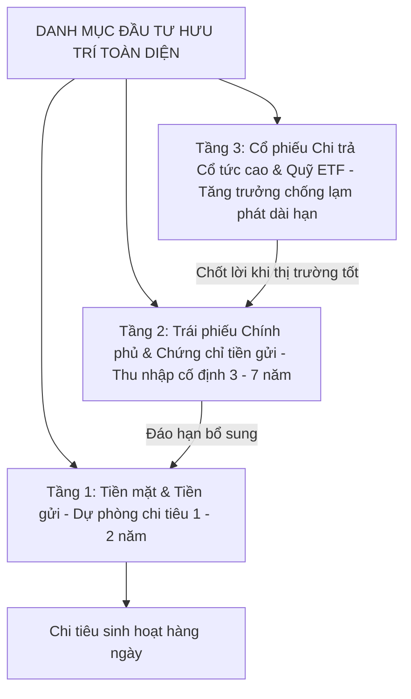
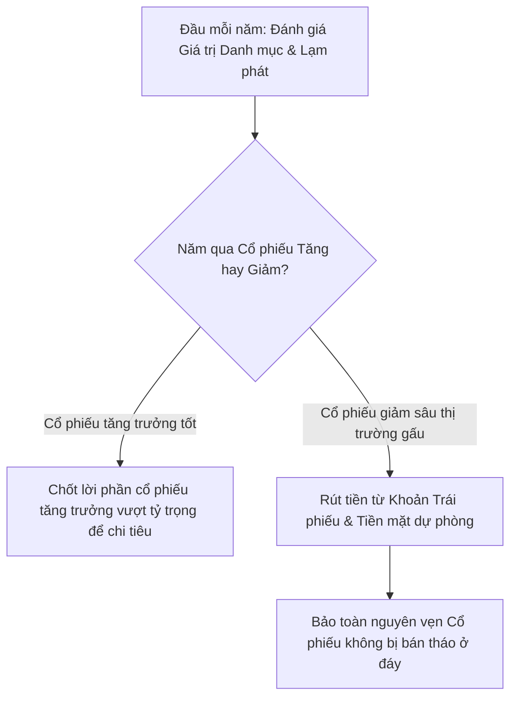
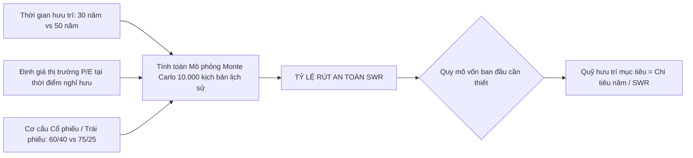

# Danh Mục Đầu Tư Hưu Trí Và Các Chiến Lược Rút Tiền An Toàn

Chuyển giao từ giai đoạn tích sản (Accumulation) sang giai đoạn giải ngân tài sản (Decumulation) là bước ngoặt tài chính thách thức nhất trong cuộc đời. Trong giai đoạn này, mục tiêu của nhà đầu tư không còn là tối đa hóa lợi nhuận mà là tối đa hóa sự an toàn của dòng tiền và triệt tiêu nguy cơ phá sản tài sản. Tài liệu này phân tích kiến trúc thiết kế Danh mục đầu tư hưu trí, cơ cấu giải ngân tài sản, cơ sở toán học của Tỷ lệ rút tiền an toàn (Safe Withdrawal Rate) và bản chất của Quy tắc 4% kinh điển.

> **Các câu hỏi cốt lõi:**
> 1. Quy tắc 4% (4% Rule) xuất phát từ nghiên cứu Trinity Study hoạt động như thế nào và tại sao việc áp dụng máy móc quy tắc này trong bối cảnh lợi suất thực tế biến động mạnh có thể dẫn đến rủi ro cạn kiệt tài sản?
> 2. Chiến lược "Chiếc xô 3 tầng" (Bucket Strategy) và Chiến lược "Hàng rào bảo vệ Guyton-Klinger" (Guardrails Strategy) giải quyết bài toán tâm lý và tối ưu hóa giải ngân hưu trí ra sao?
> 3. Đường bay phân bổ tài sản (Glidepath) trước và sau thời điểm nghỉ hưu cần được thiết kế như thế nào để phòng chống bẫy sụt giảm thị trường?

---

## 1. Retirement Portfolio (Danh mục đầu tư hưu trí)

### 1. Là gì?
- **Định nghĩa hình thức:** Danh mục đầu tư hưu trí là tập hợp các tài sản tài chính (cổ phiếu, trái phiếu, bất động sản tạo dòng tiền, tiền mặt) được cấu trúc và quản lý chuyên biệt nhằm tạo ra dòng thu nhập thường xuyên ổn định, bảo toàn vốn gốc và duy trì sức mua trước lạm phát trong suốt giai đoạn giải ngân sau khi nghỉ hưu.
- **Giải thích đơn giản:** Là "kho tiền đầu tư" mà bạn đã dành cả đời để tích lũy, nay được cơ cấu lại một cách thận trọng để mỗi tháng nó tự sinh ra tiền lãi và cổ tức nuôi sống bạn mà không sợ bị bốc hơi khi thị trường sụt giảm.
- **Nếu chỉ nhớ một điều:** Danh mục khi còn trẻ tập trung vào TĂNG TRƯỞNG (Growth); danh mục khi về hưu bắt buộc phải ưu tiên DÒNG TIỀN (Cash Flow) và BẢO TOÀN VỐN (Capital Preservation).

### 2. Hoạt động thế nào?
- **Chủ thể ra quyết định:** Người về hưu phối hợp với chuyên gia tư vấn quản lý tài sản.
- **Mục tiêu tối ưu hóa:** Cung cấp dòng tiền sinh hoạt đều đặn trong suốt 25-35 năm mà không để giá trị danh mục rơi về 0 trước khi người thụ hưởng qua đời.
- **Ràng buộc:** Không còn khả năng bù đắp thua lỗ bằng tiền lương làm việc mới; chịu tác động tàn khốc của Rủi ro chuỗi tỷ suất sinh lời (Sequence of Returns Risk).
- **Cơ chế tác động:**


### 3. Công thức & Mô hình
Đường bay phân bổ tài sản (Asset Allocation Glidepath):
Mô hình truyền thống "Quy tắc 110 trừ tuổi":
$$\text{Tỷ trọng Cổ phiếu } (\%) = 110 - \text{Tuổi của nhà đầu tư}$$
$$\text{Tỷ trọng Trái phiếu / Tiền mặt } (\%) = 100\% - \text{Tỷ trọng Cổ phiếu}$$
(Ví dụ: Ở tuổi 60, danh mục nắm giữ $110 - 60 = 50\%$ cổ phiếu và $50\%$ trái phiếu/tiền mặt).

Mô hình Lều Trái phiếu (Bond Tent) của Michael Kitces:
Hạ tỷ trọng cổ phiếu xuống mức thấp nhất tại đúng ngày nghỉ hưu (ví dụ $30\% - 40\%$) để chống sốc rủi ro chuỗi, sau đó tăng dần lại tỷ trọng cổ phiếu khi tuổi già tăng lên (Rising Equity Glidepath) để danh mục không bị cạn tiền do lạm phát.

### 4. Ví dụ
- **Ví dụ định lượng:** Ông Hoàng (60 tuổi) nghỉ hưu với khối tài sản đầu tư 6.000.000.000 VND. Nhu cầu chi tiêu từ danh mục là 240 triệu/năm (20 triệu/tháng). Ông cơ cấu danh mục hưu trí theo Chiến lược 3 chiếc xô:
  - Chiếc xô 1 (Tiền mặt và tiền gửi linh hoạt): 480.000.000 VND (đủ chi tiêu 2 năm đầu tiên không cần đụng đến tài sản khác).
  - Chiếc xô 2 (Trái phiếu chính phủ và trái phiếu doanh nghiệp top 1): 2.520.000.000 VND ($42\%$ danh mục, sinh lãi an toàn $6\%$/năm $\implies$ mang lại khoảng 150 triệu tiền lãi/năm).
  - Chiếc xô 3 (Quỹ ETF chỉ số VN30 và cổ phiếu cổ tức): 3.000.000.000 VND ($50\%$ danh mục, kỳ vọng tăng trưởng $9\% - 10\%$/năm để đánh bại lạm phát 20 năm sau).
  - Khi thị trường chứng khoán giảm mạnh, ông Hoàng hoàn toàn bình thản vì 2 năm chi tiêu của ông nằm an toàn trong Xô 1 và tiền lãi ổn định từ Xô 2.
- **Ví dụ thực tế:** Tại Việt Nam, nhiều người về hưu phân bổ danh mục thành: Một căn nhà mặt phố cho thuê nhận dòng tiền 15 triệu/tháng + Sổ tiết kiệm ngân hàng 2 tỷ nhận lãi + Một tài khoản cổ phiếu các doanh nghiệp đầu ngành chi trả cổ tức tiền mặt đều đặn (FPT, Vinamilk, VEA, DPM).
- **Phản ví dụ (Counterfactual):** Một người 62 tuổi giữ $100\%$ danh mục hưu trí 5 tỷ trong các cổ phiếu penny đầu cơ bất động sản. Thị trường bước vào chu kỳ lao dốc $60\%$, danh mục bốc hơi còn 2 tỷ. Để có tiền ăn mỗi tháng, người này buộc phải bán tháo cổ phiếu ở đáy đáy sâu hoắm, khiến số vốn không bao giờ hồi phục lại được.

### 5. Ứng dụng & Tranh luận
- **Ứng dụng thực tiễn:** Bắt đầu chuyển dịch cơ cấu danh mục hưu trí trước thời điểm nghỉ hưu dự kiến từ 3 đến 5 năm để tạo vùng đệm an toàn.
- **Ưu và nhược điểm:**
  - *Ưu điểm:* Mang lại giấc ngủ ngon và sự bình an tâm lý; bảo đảm dòng tiền sinh hoạt không bao giờ bị gián đoạn.
  - *Nhược điểm:* Tỷ suất sinh lời tổng thể của danh mục sẽ thấp hơn danh mục $100\%$ cổ phiếu trong thời kỳ thị trường bùng nổ.
- **Sai lầm phổ biến:** Rút toàn bộ tiền chuyển sang $100\%$ tiền mặt để trong nhà hoặc gửi tiết kiệm không kỳ hạn, khiến tài sản bị lạm phát âm thầm tiêu hủy sức mua qua từng năm.

### 6. Liên kết
- Cùng chủ đề: [02_Retirement_Withdrawal_Strategy.md](file:///Users/ductri0981/Documents/Studying/Studying-Economic/04_Personal_Finance_and_Wealth_Management/08_Retirement_Planning/02_Retirement_Withdrawal_Strategy.md)
- Liên kết chéo: [06_Wealth_Building_and_Compounding/04_Asset_Classification_and_Allocation.md](file:///Users/ductri0981/Documents/Studying/Studying-Economic/04_Personal_Finance_and_Wealth_Management/06_Wealth_Building_and_Compounding/04_Asset_Classification_and_Allocation.md)

---

## 2. Retirement Withdrawal Strategy (Chiến lược rút vốn hưu trí)

### 1. Là gì?
- **Định nghĩa hình thức:** Chiến lược rút vốn hưu trí là một bộ các quy tắc mang tính hệ thống quy định số tiền chính xác, tần suất rút và thứ tự ưu tiên thanh lý các loại tài sản trong danh mục hưu trí hàng năm để chi tiêu sinh hoạt, nhằm vừa bảo đảm mức sống mong muốn vừa tối thiểu hóa nguy cơ cạn kiệt tài sản trước khi qua đời.
- **Giải thích đơn giản:** Là bản quy tắc hướng dẫn bạn: mỗi năm nên rút bao nhiêu tiền từ tài khoản hưu trí ra tiêu, và khi rút thì nên bán cổ phiếu trước, bán trái phiếu trước, hay rút từ sổ tiết kiệm trước để có lợi nhất về thuế và tài sản.
- **Nếu chỉ nhớ một điều:** Cách bạn rút tiền khi về hưu quan trọng tương đương với cách bạn đầu tư tiền khi còn trẻ; một chiến lược rút tiền bừa bãi có thể phá hủy một danh mục đầu tư dù thị trường tài chính sinh lời tốt.

### 2. Hoạt động thế nào?
- **Chủ thể ra quyết định:** Người về hưu thực hiện tái cân bằng danh mục và rút vốn định kỳ hàng năm.
- **Mục tiêu tối ưu hóa:** Cân bằng giữa sự ổn định của mức tiêu dùng thực tế và tỷ lệ tồn tại sống sót của danh mục tài sản qua 30 năm ($P(\text{Survival}) \ge 95\%$).
- **Ràng buộc:** Tác động của lạm phát hàng năm; biến động thất thường của thị trường chứng khoán; tối ưu hóa nghĩa vụ thuế thu nhập.
- **Cơ chế tác động:**


### 3. Công thức & Mô hình
Ba Chiến lược Rút vốn Hưu trí Kinh điển:
1. **Chiến lược Rút số tiền cố định điều chỉnh lạm phát (Constant Dollar / Bengen Rule):**
$$W_t = W_{t-1} \times (1 + \pi_t)$$
Trong đó $W_1 = \text{SWR} \times V_0$ và $\pi_t$ là tỷ lệ lạm phát năm $t$.
2. **Chiến lược Rút tỷ lệ phần trăm cố định trên số dư thực tế (Constant Percentage):**
$$W_t = c \times V_{t-1}$$
(Ưu điểm: Không bao giờ bị cạn tiền; Nhược điểm: Thu nhập chi tiêu bị trồi sụt mạnh theo thị trường).
3. **Chiến lược Hàng rào bảo vệ Guyton-Klinger (Guardrails Strategy):**
Nếu tỷ lệ rút thực tế $\frac{W_t}{V_t} > 1,2 \times \text{SWR}_0 \implies$ Cắt giảm chi tiêu $10\%$.
Nếu tỷ lệ rút thực tế $\frac{W_t}{V_t} < 0,8 \times \text{SWR}_0 \implies$ Tăng chi tiêu thêm $10\%$.

### 4. Ví dụ
- **Ví dụ định lượng:** Bà Cúc có danh mục hưu trí 4.000.000.000 VND. Tỷ lệ rút an toàn ban đầu là $4\%$ ($W_1 = 160.000.000$ VND/năm).
  - Áp dụng Quy tắc Hàng rào Guyton-Klinger với biên độ $\pm 20\%$: Ngưỡng trên là $4,8\%$, ngưỡng dưới là $3,2\%$.
  - Kịch bản thị trường sụp đổ: Năm thứ hai, thị trường khủng hoảng làm danh mục giảm còn 3.000.000.000 VND. Nếu giữ nguyên mức rút 160 triệu điều chỉnh lạm phát $4\%$ thành 166,4 triệu, tỷ lệ rút sẽ là:
    $$\frac{166,4 \text{ triệu}}{3.000 \text{ triệu}} = 5,55\% > 4,8\% \quad (\text{Vi phạm hàng rào trên!})$$
  - Quy tắc bảo vệ kích hoạt: Bà Cúc cắt giảm chi tiêu $10\%$, chỉ rút:
    $$W_2 = 166,4 \text{ triệu} \times (1 - 0,10) = 149.760.000 \text{ VND}$$
  - Nhờ động thái cắt giảm linh hoạt này, danh mục 3 tỷ của bà không bị bào mòn quá mức và có cơ hội phục hồi mạnh mẽ khi thị trường quay trở lại chu kỳ tăng trưởng.
- **Ví dụ thực tế:** Tại các quỹ tài trợ đại học danh tiếng thế giới như Harvard hay Yale Endowment, họ áp dụng biến thể của quy tắc rút vốn linh hoạt (Spending Policy Rule) kết hợp giữa lạm phát quá khứ và tỷ lệ phần trăm trên giá trị trung bình 3 năm của danh mục.
- **Phản ví dụ (Counterfactual):** Một người về hưu kiên quyết rút cố định mỗi năm 300 triệu bất chấp thị trường chứng khoán giảm $40\%$ trong 2 năm liên tiếp. Số lượng chứng chỉ quỹ bị bán rẻ ở đáy tăng gấp đôi, làm danh mục bị "chảy máu tài chính" không thể cứu vãn và phá sản hoàn toàn chỉ sau 11 năm nghỉ hưu.

### 5. Ứng dụng & Tranh luận
- **Ứng dụng thực tiễn:** Thiết kế ngân sách hưu trí linh hoạt: chia chi tiêu thành "Chi phí thiết yếu cố định" (không thể cắt giảm) và "Chi phí hưởng thụ linh hoạt" (sẵn sàng cắt giảm du lịch, ăn ngoài trong những năm thị trường suy thoái).
- **Ưu và nhược điểm:**
  - *Ưu điểm của chiến lược linh hoạt:* Tăng xác suất sống sót của danh mục lên trên $99\%$, cho phép tỷ lệ rút ban đầu cao hơn ($4,5\% - 5\%$).
  - *Nhược điểm:* Đòi hỏi người về hưu phải có kỷ luật và sẵn sàng thắt lưng buộc bụng trong những giai đoạn khó khăn.
- **Sai lầm phổ biến:** Rút tiền cứng nhắc theo số tiền cố định mà không theo dõi tình trạng sức khỏe thực tế của danh mục đầu tư.

### 6. Liên kết
- Cùng chủ đề: [03_Safe_Withdrawal_Rate.md](file:///Users/ductri0981/Documents/Studying/Studying-Economic/04_Personal_Finance_and_Wealth_Management/08_Retirement_Planning/03_Safe_Withdrawal_Rate.md)
- Liên kết chéo: [03_Budgeting_and_Expense_Management/02_Alternative_Budgeting_Approaches.md](file:///Users/ductri0981/Documents/Studying/Studying-Economic/04_Personal_Finance_and_Wealth_Management/03_Budgeting_and_Expense_Management/02_Alternative_Budgeting_Approaches.md)

---

## 3. Safe Withdrawal Rate (Tỷ lệ rút tiền an toàn - SWR)

### 1. Là gì?
- **Định nghĩa hình thức:** Tỷ lệ rút tiền an toàn (SWR) là tỷ lệ phần trăm tối đa được tính trên số dư ban đầu của danh mục đầu tư hưu trí mà một cá nhân có thể rút ra để chi tiêu trong năm đầu tiên nghỉ hưu (và sau đó điều chỉnh số tiền này theo tỷ lệ lạm phát hàng năm) sao cho xác suất danh mục không bị cạn kiệt trong một khoảng thời gian dự kiến (thường là 30 năm) đạt mức cực cao (thường $\ge 95\%$).
- **Giải thích đơn giản:** SWR là "tỷ lệ rút tiền không lo hết vốn": nếu bạn có 1 tỷ, bạn được rút bao nhiêu phần trăm trong năm đầu tiên để vừa đủ sống mà tài sản vẫn trường tồn suốt đời?
- **Nếu chỉ nhớ một điều:** SWR phụ thuộc mật thiết vào độ dài của thời gian hưu trí: nếu bạn nghỉ hưu truyền thống 30 năm, SWR là khoảng $4\%$; nhưng nếu bạn nghỉ hưu sớm FIRE kéo dài 50 năm, SWR bắt buộc phải giảm xuống $3\% - 3,25\%$.

### 2. Hoạt động thế nào?
- **Chủ thể ra quyết định:** Nhà hoạch định tài chính và người theo đuổi tự do tài chính.
- **Mục tiêu tối ưu hóa:** Tìm điểm cân bằng hoàn hảo giữa việc tận hưởng cuộc sống (không rút quá ít khiến sống kham khổ vô nghĩa) và sự an toàn tài chính (không rút quá nhiều gây nguy cơ phá sản).
- **Ràng buộc:** Chịu sự chi phối của tỷ suất sinh lời thực tế của cổ phiếu và trái phiếu, tỷ lệ lạm phát, và định giá thị trường (P/E của thị trường chứng khoán tại ngày bắt đầu nghỉ hưu).
- **Cơ chế tác động:**


### 3. Công thức & Mô hình
Định nghĩa toán học của Tỷ lệ rút tiền an toàn với độ tin cậy $1 - \alpha$ (với $\alpha = 5\%$ rủi ro thất bại):
$$\text{SWR}^* = \max \left\{ w \in (0, 1) \ \middle|\ P\left( V_T > 0 \ \middle|\ V_0, w, \mathbf{r}, \boldsymbol{\pi} \right) \ge 1 - \alpha \right\}$$
Trong đó Phương trình biến động tài sản qua các năm:
$$V_t = (V_{t-1} - W_t) \times (1 + r_t)$$
$$W_t = W_{t-1} \times (1 + \pi_t), \quad \text{với } W_1 = w \times V_0$$
Với $r_t$ là tỷ suất sinh lời danh mục và $\pi_t$ là tỷ lệ lạm phát năm $t$.

Mối quan hệ Nghịch đảo giữa SWR và Hệ số vốn cần tích lũy ($M$):
$$M = \frac{1}{\text{SWR}}$$
- Nếu $\text{SWR} = 5\% \implies M = 20$ lần chi tiêu năm.
- Nếu $\text{SWR} = 4\% \implies M = 25$ lần chi tiêu năm.
- Nếu $\text{SWR} = 3\% \implies M = 33,3$ lần chi tiêu năm.

### 4. Ví dụ
- **Ví dụ định lượng:** Một cá nhân cần rút 300.000.000 VND/năm cho chi phí sinh hoạt tuổi già.
  - Kịch bản A (Nghỉ hưu truyền thống ở tuổi 65, dự kiến sống 25-30 năm): Chọn $\text{SWR} = 4\%$.
    $$V_{0, A} = \frac{300.000.000}{0,04} = 7.500.000.000 \text{ VND}$$
  - Kịch bản B (Nghỉ hưu sớm FIRE ở tuổi 40, dự kiến giai đoạn hưu trí kéo dài 45-50 năm): Chọn tỷ lệ an toàn cao $\text{SWR} = 3,25\%$ để phòng ngừa biến số thiên nga đen.
    $$V_{0, B} = \frac{300.000.000}{0,0325} \approx 9.230.769.000 \text{ VND}$$
  - Để nghỉ hưu sớm hơn 25 năm, người này phải tích lũy thêm hơn 1,73 tỷ đồng để bảo đảm tỷ lệ an toàn.
- **Ví dụ thực tế:** Các nghiên cứu mô phỏng Monte Carlo của Vanguard và Morningstar gần đây chỉ ra rằng: do mức định giá thị trường chứng khoán toàn cầu ở mức cao và lợi suất trái phiếu dài hạn có xu hướng hạ nhiệt, SWR danh mục 50/50 cho giai đoạn 30 năm hiện nay được khuyến nghị thận trọng ở mức $3,5\% - 3,8\%$ thay vì cố định $4\%$.
- **Phản ví dụ (Counterfactual):** Một người áp dụng SWR quá cao là $8\%$/năm (nghĩ rằng "lãi suất ngân hàng được $7\%$ thì rút $8\%$ có sao đâu"). Gặp đúng năm thị trường sụt giảm kết hợp lạm phát cao, danh mục bị ăn vào vốn gốc nặng nề và cạn sạch tiền chỉ sau vỏn vẹn 9 năm.

### 5. Ứng dụng & Tranh luận
- **Ứng dụng thực tiễn:** Làm kim chỉ nam định lượng cho toàn bộ kế hoạch độc lập tài chính; giúp người tích sản biết chính xác ngày nào mình có thể nộp đơn xin nghỉ việc.
- **Ưu và nhược điểm:**
  - *Ưu điểm:* Cung cấp chuẩn mực toán học chặt chẽ đã được kiểm định qua hơn một thế kỷ dữ liệu lịch sử thị trường tài chính.
  - *Nhược điểm:* Giả định tĩnh về lịch sử có thể không lặp lại nguyên vẹn trong tương lai; có thể dẫn đến việc tích lũy quá mức cần thiết khiến chết đi để lại quá nhiều tiền thừa.
- **Sai lầm phổ biến:** Nhầm lẫn SWR với tỷ suất sinh lời danh nghĩa của danh mục (nghĩ rằng danh mục sinh lời $10\%$ thì SWR là $10\%$, bỏ qua lạm phát và biến động thị trường).

### 6. Liên kết
- Cùng chủ đề: [04_The_4_Percent_Rule.md](file:///Users/ductri0981/Documents/Studying/Studying-Economic/04_Personal_Finance_and_Wealth_Management/08_Retirement_Planning/04_The_4_Percent_Rule.md)
- Liên kết chéo: [06_Wealth_Building_and_Compounding/07_FIRE_Movement_and_Variations.md](file:///Users/ductri0981/Documents/Studying/Studying-Economic/04_Personal_Finance_and_Wealth_Management/06_Wealth_Building_and_Compounding/07_FIRE_Movement_and_Variations.md)

---

## 4. 4% Rule (Quy tắc 4%)

### 1. Là gì?
- **Định nghĩa hình thức:** Quy tắc 4% là một quy tắc ngón tay cái nổi tiếng trong hoạch định tài chính hưu trí, được khởi xướng bởi William Bengen (1994) và sau đó được chứng thực bởi Nghiên cứu Trinity Study (1998), khẳng định rằng một người về hưu có thể an toàn rút $4\%$ giá trị ban đầu của một danh mục đầu tư cân bằng (gồm $50\% - 75\%$ cổ phiếu và phần còn lại là trái phiếu) trong năm đầu tiên nghỉ hưu, sau đó điều chỉnh số tiền rút hàng năm theo tỷ lệ lạm phát, thì danh mục sẽ có xác suất thành công từ $95\% - 98\%$ không bị cạn kiệt trong thời gian tối thiểu 30 năm.
- **Giải thích đơn giản:** Quy tắc 4% nói rằng: Cứ có 1 tỷ đồng tiền tiết kiệm đầu tư, mỗi năm bạn được rút 40 triệu đồng (cộng thêm bù trượt giá lạm phát mỗi năm), bạn có thể yên tâm sống khỏe trong 30 năm mà không sợ bị "cháy túi".
- **Nếu chỉ nhớ một điều:** Quy tắc 4% là công cụ tính toán quy mô tự do tài chính đơn giản nhất: Bạn chỉ cần lấy Chi tiêu hàng năm nhân với 25 (vì $\frac{1}{0,04} = 25$) là ra số tiền cần có để nghỉ hưu trọn đời!

### 2. Hoạt động thế nào?
- **Chủ thể ra quyết định:** Nhà đầu tư cá nhân và người lập kế hoạch hưu trí.
- **Mục tiêu tối ưu hóa:** Tìm ra số tiền hưu trí mục tiêu nhanh chóng và thiết lập mức chi tiêu kỷ luật.
- **Ràng buộc:** Dựa trên dữ liệu thị trường Mỹ giai đoạn 1926 - 1992 (đã trải qua cả Đại Khủng hoảng 1929 và siêu lạm phát thập niên 1970); đòi hỏi danh mục phải nắm giữ tỷ trọng cổ phiếu đủ lớn ($50\% - 75\%$).
- **Cơ chế tác động:**
```mermaid
flowchart TD
    InitialPort[Số vốn ban đầu $V_0$: Ví dụ 5 tỷ VND] --> Year1[Năm 1: Rút đúng 4% = 200 triệu VND]
    Year1 --> InflationCheck[Theo dõi Lạm phát thực tế CPI trong năm: Ví dụ 5%]
    InflationCheck --> Year2[Năm 2: Rút = 200 triệu x (1 + 0,05) = 210 triệu VND]
    Year2 --> Repeat[Lặp lại điều chỉnh lạm phát suốt 30 năm]
    Repeat --> Result{Xác suất sống sót sau 30 năm?}
    Result -->|Tỷ lệ thành công 95%| WealthSafe[Danh mục vẫn còn tiền hoặc thậm chí phình to gấp đôi!]
```

### 3. Công thức & Mô hình
Toán học vận hành của Quy tắc 4% qua thời gian:
Năm 1 ($t = 1$):
$$W_1 = 4\% \times V_0$$
Năm thứ $t$ ($t \ge 2$):
$$W_t = W_{t-1} \times (1 + \pi_t)$$
Giá trị còn lại của danh mục sau năm thứ $t$:
$$V_t = (V_{t-1} - W_t) \times (1 + R_t)$$
Trong đó:
- $V_0$: Giá trị danh mục tại ngày bắt đầu nghỉ hưu.
- $\pi_t$: Tỷ lệ lạm phát năm $t$.
- $R_t = w_{\text{equity}} R_{\text{equity}, t} + (1 - w_{\text{equity}}) R_{\text{bond}, t}$: Lợi nhuận danh mục thực tế năm $t$.
- Tiêu chí thành công của Trinity Study: $V_{30} > 0$.

Quy tắc Nhân 25 (The Rule of 25):
$$\text{Quỹ Hưu trí Mục tiêu} = \text{Chi tiêu thường niên mong muốn} \times 25$$

### 4. Ví dụ
- **Ví dụ định lượng:** Gia đình anh Tuấn muốn có cuộc sống hưu trí với mức chi tiêu 25.000.000 VND/tháng (300.000.000 VND/năm).
  - Áp dụng Quy tắc 25:
    $$\text{Quỹ Mục tiêu} = 300.000.000 \times 25 = 7.500.000.000 \text{ VND}$$
  - Cơ chế rút tiền:
    - Năm 1: Rút đúng $4\% \times 7,5 \text{ tỷ} = 300.000.000$ VND.
    - Giả sử lạm phát năm 1 là $4\%$. Sang Năm 2: Anh rút $300 \times 1,04 = 312.000.000$ VND (bất kể giá trị danh mục lúc này tăng lên 8 tỷ hay giảm xuống 7 tỷ).
    - Giả sử lạm phát năm 2 là $3\%$. Sang Năm 3: Anh rút $312 \times 1,03 = 321.360.000$ VND.
  - Sau 30 năm, nghiên cứu lịch sử cho thấy trong đại đa số kịch bản, số tiền còn lại trong danh mục không những không cạn mà còn tăng lên gấp nhiều lần con số 7,5 tỷ ban đầu nhờ sức mạnh tăng trưởng dài hạn của cổ phiếu.
- **Ví dụ thực tế:** Phong trào FIRE (Financial Independence, Retire Early) toàn cầu lấy Quy tắc 4% làm "kinh thánh" định lượng: mọi thành viên đều phấn đấu đạt được số tài sản gấp 25 lần chi tiêu năm để tuyên bố tự do tài chính.
- **Phản ví dụ (Counterfactual):** Một người hiểu sai Quy tắc 4% thành "mỗi năm rút 4% trên số tiền còn lại trong tài khoản". Khi thị trường giảm sút mạnh từ 5 tỷ còn 3 tỷ, người này rút $4\% \times 3 \text{ tỷ} = 120$ triệu (giảm mạnh từ 200 triệu), khiến mức sống sinh hoạt gia đình bị xáo trộn nghiêm trọng. (Đó là quy tắc Constant Percentage, không phải Quy tắc 4% của Bengen).

### 5. Ứng dụng & Tranh luận
- **Ứng dụng thực tiễn:** Dùng làm thước đo ước tính nhanh quy mô vốn cần tích lũy trong toàn bộ giai đoạn tuổi trẻ.
- **Ưu và nhược điểm:**
  - *Ưu điểm:* Cực kỳ đơn giản, trực quan, dễ nhớ, có cơ sở dữ liệu thực nghiệm hàng thế kỷ chứng minh.
  - *Nhược điểm:* Quá cứng nhắc trong thế giới thực (con người thường tự động cắt giảm tiêu dùng khi thấy tài sản sụt giảm chứ không rút máy móc); có thể không hoàn toàn đúng nếu nền kinh tế bước vào thời kỳ đình lạm (Stagflation) kéo dài.
- **Sai lầm phổ biến:** Áp dụng Quy tắc 4% cho một danh mục $100\%$ tiền gửi tiết kiệm hoặc trái phiếu ngắn hạn. Bengen và Trinity Study đã chứng minh: nếu không có tối thiểu $50\%$ cổ phiếu trong danh mục, Quy tắc 4% sẽ thất bại thảm hại do danh mục không thể đánh bại được lạm phát 30 năm.

### 6. Liên kết
- Cùng chủ đề: [03_Safe_Withdrawal_Rate.md](file:///Users/ductri0981/Documents/Studying/Studying-Economic/04_Personal_Finance_and_Wealth_Management/08_Retirement_Planning/03_Safe_Withdrawal_Rate.md)
- Liên kết chéo: [06_Wealth_Building_and_Compounding/07_FIRE_Movement_and_Variations.md](file:///Users/ductri0981/Documents/Studying/Studying-Economic/04_Personal_Finance_and_Wealth_Management/06_Wealth_Building_and_Compounding/07_FIRE_Movement_and_Variations.md)

---

## Câu hỏi tự kiểm tra
1. Hãy mô tả cấu trúc "Chiến lược 3 chiếc xô" (Bucket Strategy) trong quản lý danh mục đầu tư hưu trí và giải thích cơ chế tương tác luân chuyển vốn giữa các xô.
2. Tại sao William Bengen và Nghiên cứu Trinity Study lại nhấn mạnh rằng danh mục hưu trí bắt buộc phải chứa từ 50% đến 75% cổ phiếu thì Quy tắc 4% mới có thể thành công trong 30 năm?
3. Trình bày cơ chế kích hoạt của "Hàng rào bảo vệ Guyton-Klinger" (Guardrails Strategy). Chiến lược này giúp người về hưu vượt qua thời kỳ thị trường gấu (Bear Market) như thế nào?
4. Khái niệm "Lều Trái phiếu" (Bond Tent) của Michael Kitces giải quyết nguy cơ sụt giảm tài sản ngay trước và sau thời điểm nghỉ hưu ra sao?

## Ghi chú nguồn
- Bengen, W. P. (1994) - *Determining Withdrawal Rates Using Historical Data*, Journal of Financial Planning.
- Cooley, P. L., Hubbard, C. M., & Walz, D. T. (1998) - *Retirement Savings: Choosing a Withdrawal Rate That Is Sustainable* (Trinity Study).
- Kitces, M. - *The Kitces Report: Resolving The Sequence Of Returns Risk In Retirement*.
- Guyton, J. T., & Klinger, W. J. (2006) - *Using Decision Rules to Create Retirement Withdrawal Profiles*, Journal of Financial Planning.
