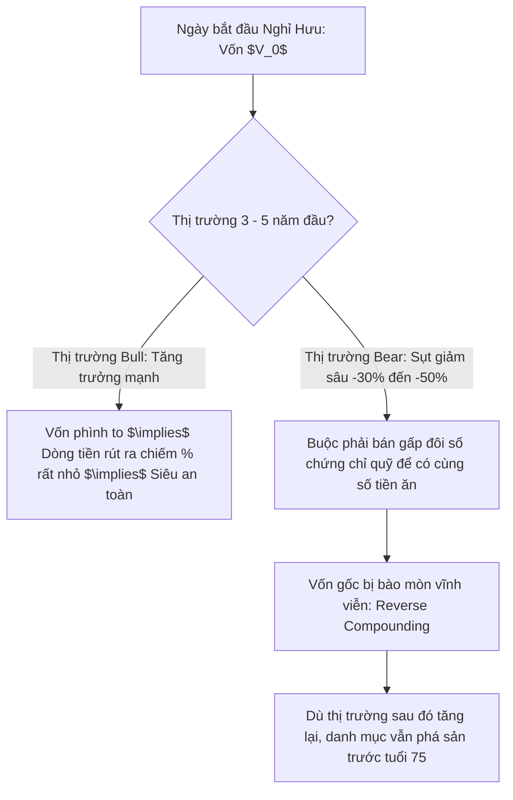
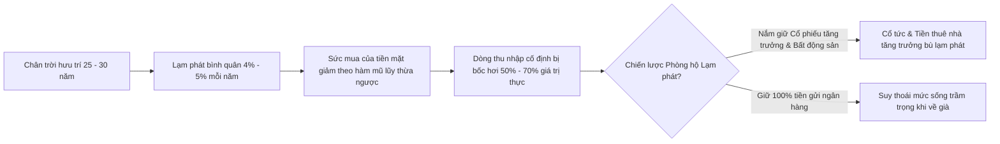
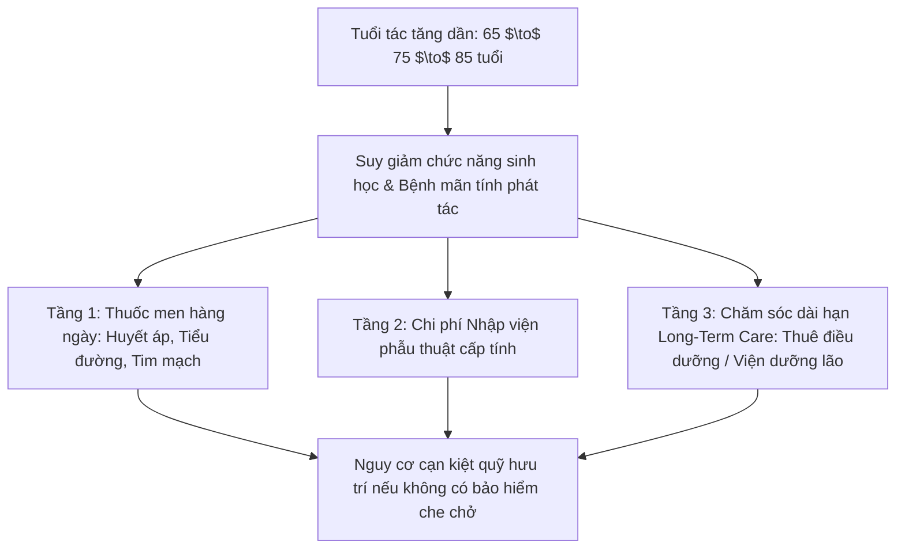

# Các Rủi Ro Trọng Yếu Khi Nghỉ Hưu Và Chi Phí Chăm Sóc Sức Khỏe Tuổi Già

Trong giai đoạn tích lũy tài sản, thị trường biến động giảm sâu chỉ là cơ hội để mua thêm cổ phiếu giá rẻ. Tuy nhiên, khi bước sang giai đoạn giải ngân hưu trí, sự kết hợp độc hại giữa các cú sốc thị trường ban đầu, tuổi thọ kéo dài ngoài dự kiến, sự bào mòn sức mua của lạm phát và chi phí y tế tuổi già tăng phi mã có thể biến một kế hoạch hưu trí hoàn hảo thành một thảm họa phá sản. Tài liệu này mổ xẻ bốn "sát thủ vô hình" đe dọa sự trường tồn của dòng tiền hưu trí.

> **Các câu hỏi cốt lõi:**
> 1. Tại sao Rủi ro chuỗi tỷ suất sinh lời (Sequence of Returns Risk) lại có thể khiến hai người có cùng số vốn ban đầu và cùng mức sinh lời bình quân trong 30 năm nhận hai kết cục hoàn toàn trái ngược: một người nhân ba tài sản, một người phá sản sau 15 năm?
> 2. Sự khác biệt giữa Chỉ số lạm phát giá tiêu dùng chung (Headline CPI) và Chỉ số lạm phát chi tiêu của người cao tuổi (Retiree Inflation Index) là gì?
> 3. Cơ chế ứng phó với Chi phí chăm sóc dài hạn (Long-Term Care - LTC) và viện phí bệnh mãn tính sau tuổi 65 cần được dự phòng ra sao?

---

## 1. Sequence of Returns Risk (Rủi ro chuỗi tỷ suất sinh lời)

### 1. Là gì?
- **Định nghĩa hình thức:** Rủi ro chuỗi tỷ suất sinh lời (Sequence of Returns Risk - SRR) là rủi ro mà thứ tự thời gian xuất hiện của các mức tỷ suất sinh lời trong danh mục đầu tư tác động tiêu cực đến giá trị tài sản ròng và khả năng tồn tại của danh mục trong giai đoạn rút vốn giải ngân, ngay cả khi tỷ suất sinh lời bình quân số học dài hạn của danh mục là như nhau.
- **Giải thích đơn giản:** Khi bạn đang đi làm tích lũy, thị trường giảm trước hay tăng trước không quan trọng bằng kết quả cuối cùng. Nhưng khi bạn đã nghỉ hưu và phải rút tiền ăn mỗi tháng, nếu thị trường chứng khoán sụp đổ ngay trong những năm đầu tiên, bạn sẽ phải bán tháo tài sản ở mức giá đáy cực rẻ để lấy tiền ăn, làm cho số vốn gốc bị teo tóp vĩnh viễn và không bao giờ hồi phục lại được.
- **Nếu chỉ nhớ một điều:** 5 năm trước và 5 năm sau ngày nghỉ hưu chính là "Vùng nguy hiểm đỏ" (Fragile Decade); những gì xảy ra với thị trường trong giai đoạn này sẽ quyết định bạn có giàu có đến chết hay bị phá sản giữa đường.

### 2. Hoạt động thế nào?
- **Chủ thể ra quyết định:** Người về hưu quản lý danh mục và chuyên gia tư vấn đầu tư.
- **Mục tiêu tối ưu hóa:** Phòng thủ tuyệt đối, tránh việc buộc phải thanh lý các tài sản đang bị định giá thấp trong giai đoạn thị trường gấu (Bear market).
- **Ràng buộc:** Nhu cầu rút tiền sinh hoạt hàng năm là bắt buộc không thể trì hoãn; tính chất không thể đảo ngược của các khoản rút tiền ở đáy thị trường.
- **Cơ chế tác động:**

### 3. Công thức & Mô hình
So sánh Toán học giữa Tích sản và Giải ngân:
- Giai đoạn Tích sản (Không rút vốn):
  $$V_T = V_0 \prod_{t=1}^T (1 + r_t)$$
  Phép nhân có tính chất giao hoán: Thứ tự của $r_t$ hoàn toàn KHÔNG làm thay đổi $V_T$ cuối kỳ.
- Giai đoạn Giải ngân (Có rút vốn $W_t$):
  $$V_t = (V_{t-1} - W_t) \times (1 + r_t)$$
  Phép tính không còn tính chất giao hoán: Nếu $r_1, r_2, r_3$ âm sâu trong khi $W_1, W_2, W_3 > 0$, lượng vốn gốc bị triệt tiêu sẽ làm giảm cơ số nhân cho các năm sinh lời cao $r_{10}, r_{15}$ sau này.

### 4. Ví dụ
- **Ví dụ định lượng (Bài toán Kinh điển về Sequence Risk):**
  Hai nhà đầu tư An và Bình đều nghỉ hưu với số vốn ban đầu 5.000.000.000 VND và cùng rút 300.000.000 VND vào đầu mỗi năm. Cả hai danh mục đều có tỷ suất sinh lời bình quân trong 3 năm đầu là $+5\%$/năm, nhưng thứ tự ngược nhau:
  - **Bác An (Chuỗi xui xẻo: Giảm trước, Tăng sau):**
    - Năm 1: Thị trường giảm $-20\%$. Đầu năm rút 300 triệu, còn 4,7 tỷ. Cuối năm giảm $-20\%$ còn $4,7 \times 0,8 = 3.760.000.000$ VND.
    - Năm 2: Thị trường giảm tiếp $-10\%$. Đầu năm rút 300 triệu, còn 3,46 tỷ. Cuối năm giảm $-10\%$ còn $3,46 \times 0,9 = 3.114.000.000$ VND.
    - Năm 3: Thị trường tăng mạnh $+45\%$. Đầu năm rút 300 triệu, còn 2,814 tỷ. Cuối năm tăng $+45\%$ lên $2,814 \times 1,45 \approx \mathbf{4.080.000.000}$ VND.
  - **Bác Bình (Chuỗi may mắn: Tăng trước, Giảm sau):**
    - Năm 1: Thị trường tăng $+45\%$. Đầu năm rút 300 triệu, còn 4,7 tỷ. Cuối năm tăng $+45\%$ lên $4,7 \times 1,45 = 6.815.000.000$ VND.
    - Năm 2: Thị trường giảm $-10\%$. Đầu năm rút 300 triệu, còn 6,515 tỷ. Cuối năm giảm $-10\%$ còn $6,515 \times 0,9 = 5.863.500.000$ VND.
    - Năm 3: Thị trường giảm $-20\%$. Đầu năm rút 300 triệu, còn 5,5635 tỷ. Cuối năm giảm $-20\%$ còn $5,5635 \times 0,8 \approx \mathbf{4.450.000.000}$ VND.
  - Sau 3 năm, Bác Bình có nhiều hơn Bác An gần 400 triệu đồng dù mức sinh lời bình quân của 3 năm là hoàn toàn như nhau. Nếu chuỗi xấu của Bác An kéo dài thêm 2 năm, danh mục của An sẽ bị phá hủy không thể cứu vãn.
- **Ví dụ thực tế:** Những người nghỉ hưu vào đúng năm 2000 (bong bóng Dot-com sụp đổ) hoặc năm 2008 (Khủng hoảng tài chính toàn cầu) phải đối mặt với Sequence Risk khốc liệt nhất lịch sử. Những ai rút tiền cố định theo Quy tắc 4% máy móc trong giai đoạn đó đã bị cạn kiệt tài sản nhanh hơn nhiều so với dự báo của Trinity Study.
- **Phản ví dụ (Counterfactual):** Một người về hưu chuẩn bị sẵn "Chiếc xô tiền mặt" dự phòng đủ chi tiêu cho 3 năm đầu tiên. Khi thị trường chứng khoán giảm sâu năm 2022, người này hoàn toàn không bán một cổ phiếu nào mà chỉ rút tiền từ xô tiền mặt. Nhờ đó, danh mục cổ phiếu của họ được giữ nguyên số lượng và phục hồi ngoạn mục vào năm 2023 - 2024.

### 5. Ứng dụng & Tranh luận
- **Ứng dụng thực tiễn:** Áp dụng chiến lược Lều Trái phiếu (Bond Tent) hoặc duy trì Quỹ dự phòng thanh khoản tiền mặt $2 - 4$ năm chi tiêu ngay tại thời điểm bắt đầu nghỉ hưu.
- **Ưu và nhược điểm:**
  - *Ưu điểm:* Vô hiệu hóa "vùng nguy hiểm đỏ", bảo vệ sự trường tồn của danh mục hưu trí.
  - *Nhược điểm:* Giữ quá nhiều tiền mặt hoặc trái phiếu ngắn hạn làm giảm tỷ suất sinh lời tiềm năng nếu thị trường bùng nổ ngay sau khi nghỉ hưu.
- **Sai lầm phổ biến:** Nghỉ hưu với danh mục $100\%$ cổ phiếu tăng trưởng mà không có bất kỳ khoản tiền mặt hay trái phiếu phòng thủ nào để trang trải sinh hoạt ngắn hạn.

### 6. Liên kết
- Cùng chủ đề: [03_Retirement_Portfolio_and_Withdrawal_Strategies.md](file:///Users/ductri0981/Documents/Studying/Studying-Economic/04_Personal_Finance_and_Wealth_Management/08_Retirement_Planning/03_Retirement_Portfolio_and_Withdrawal_Strategies.md)
- Liên kết chéo: [06_Wealth_Building_and_Compounding/04_Asset_Classification_and_Allocation.md](file:///Users/ductri0981/Documents/Studying/Studying-Economic/04_Personal_Finance_and_Wealth_Management/06_Wealth_Building_and_Compounding/04_Asset_Classification_and_Allocation.md)

---

## 2. Longevity Risk (Rủi ro tuổi thọ)

### 1. Là gì?
- **Định nghĩa hình thức:** Rủi ro tuổi thọ là rủi ro tài chính phát sinh khi một cá nhân sống lâu hơn đáng kể so với kỳ vọng sống trung bình được dự báo trong kế hoạch hưu trí của mình, dẫn đến nguy cơ các nguồn lực tài chính tích lũy cá nhân bị cạn kiệt hoàn toàn trước khi người đó qua đời.
- **Giải thích đơn giản:** Là "nỗi sợ sống quá lâu mà hết tiền". Bạn chuẩn bị tiền để sống đến 80 tuổi, nhưng bạn lại khỏe mạnh sống đến 95 tuổi; 15 năm sống thêm đó bạn không còn một đồng nào để chi tiêu.
- **Nếu chỉ nhớ một điều:** Sống lâu là một phước lành về mặt sinh học nhưng là một rủi ro tài chính khổng lồ nếu không có các dòng tiền bảo đảm trọn đời che chở.

### 2. Hoạt động thế nào?
- **Chủ thể ra quyết định:** Cá nhân lập kế hoạch và các định chế quản lý quỹ an sinh xã hội.
- **Mục tiêu tối ưu hóa:** Đảm bảo dòng tiền chi tiêu không bao giờ bị cắt đứt bất kể tuổi thọ đạt đến giới hạn sinh học nào.
- **Ràng buộc:** Sự phát triển vượt bậc của công nghệ sinh học và y tế làm gia tăng tuổi thọ bình quân liên tục qua từng thập kỷ; lạm phát chi phí y tế tuổi già tăng lũy tiến.
- **Cơ chế tác động:**

### 3. Công thức & Mô hình
Đo lường Xác suất Phá sản hưu trí do Tuổi thọ (Ruined Probability - $\Psi$):
$$\Psi = \int_0^\infty f_T(t) \cdot I(V_t \le 0) \, dt$$
Trong đó:
- $f_T(t)$: Hàm mật độ xác suất tuổi thọ của cá nhân (tính từ bảng tử vong).
- $I(V_t \le 0)$: Biến chỉ thị tài sản cạn kiệt tại thời điểm $t$ ($I = 1$ nếu danh mục hết tiền).
Chiến lược phòng chống Longevity Risk tuyệt đối (Hedging Longevity Risk):
Chuyển hóa một phần tài sản tích lũy ($V_{\text{annuity}}$) thành hợp đồng Niên kim trọn đời (Life Annuity):
$$RI_{\text{guaranteed}} = \frac{V_{\text{annuity}}}{a_x} \implies \text{Dòng tiền chảy liên tục cho đến khi hàm } f_T(t) = 0$$

### 4. Ví dụ
- **Ví dụ định lượng:** Bà Nga nghỉ hưu năm 60 tuổi với 3 tỷ đồng tiết kiệm. Bà rút mỗi năm 200 triệu (tỷ lệ $6,7\%$/năm). Lãi suất sau lạm phát chỉ đạt $2\%$/năm.
  - Danh mục của bà Nga cạn sạch tiền sau đúng 18 năm (ở tuổi 78).
  - Tuy nhiên, bà Nga sống rất khỏe mạnh đến năm 93 tuổi (sống thêm 15 năm sau khi cạn tiền).
  - Khoảng trống tài chính 15 năm cuối đời của bà Nga:
    $$\text{Shortfall} = 15 \text{ năm} \times 200.000.000 = 3.000.000.000 \text{ VND}$$
  - Bà Nga rơi vào cảnh kiệt quệ tài chính đúng vào giai đoạn sức khỏe suy giảm nhất.
- **Ví dụ thực tế:** Tại Nhật Bản, hiện tượng "Người cao tuổi cô đơn nghèo đói" (Rōgo Hōkai) trở thành vấn đề xã hội nhức nhối khi hàng trăm ngàn cụ ông cụ bà sống thọ trên 90 tuổi đã tiêu hết sạch tiền tiết kiệm từ nhiều năm trước và phải sống dựa vào suất ăn trợ cấp xã hội ít ỏi.
- **Phản ví dụ (Counterfactual):** Một người trích $40\%$ tài sản hưu trí để mua hợp đồng niên kim trọn đời hoặc duy trì đóng BHXH để có lương hưu vững chắc. Khi sống thọ đến 98 tuổi, người này vẫn nhận tiền đều đặn mỗi tháng từ quỹ bảo hiểm và thẻ BHYT thanh toán viện phí, ung dung hưởng thụ tuổi già trường thọ trong thanh thản.

### 5. Ứng dụng & Tranh luận
- **Ứng dụng thực tiễn:** Không bao giờ xem nhẹ tuổi thọ của bản thân; luôn lập kế hoạch tài chính với giả định bạn sẽ sống thọ ít nhất đến 95 tuổi (hoặc 100 tuổi đối với nữ).
- **Ưu và nhược điểm:**
  - *Ưu điểm của việc quản trị longevity risk:* Triệt tiêu hoàn toàn nỗi sợ hãi lớn nhất của tuổi già; đảm bảo phẩm giá độc lập đến hơi thở cuối cùng.
  - *Nhược điểm:* Đòi hỏi phải thắt chặt tỷ lệ rút tiền an toàn (SWR) thấp hơn trong những năm đầu nghỉ hưu.
- **Sai lầm phổ biến:** Tự trấn an bản thân rằng "ông bà bố mẹ tôi mất sớm nên tôi cũng không sống lâu đâu", bỏ qua thực tế rằng điều kiện dinh dưỡng và y tế hiện đại đã thay đổi hoàn toàn kỳ vọng sống của thế hệ hiện nay.

### 6. Liên kết
- Cùng chủ đề: [02_Social_Security_Annuities_and_Timing.md](file:///Users/ductri0981/Documents/Studying/Studying-Economic/04_Personal_Finance_and_Wealth_Management/08_Retirement_Planning/02_Social_Security_Annuities_and_Timing.md)
- Liên kết chéo: [01_Personal_Finance_Foundations/07_Security_Independence_and_Freedom.md](file:///Users/ductri0981/Documents/Studying/Studying-Economic/04_Personal_Finance_and_Wealth_Management/01_Personal_Finance_Foundations/07_Security_Independence_and_Freedom.md)

---

## 3. Inflation Risk (Rủi ro lạm phát)

### 1. Là gì?
- **Định nghĩa hình thức:** Rủi ro lạm phát (hoặc Rủi ro sức mua) trong hưu trí là rủi ro mà sự gia tăng liên tục của mức giá chung của hàng hóa và dịch vụ trong nền kinh tế qua thời gian dài sẽ làm xói mòn giá trị thực tế của một dòng thu nhập hưu trí cố định hoặc làm giảm sức mua của khối tài sản tích lũy.
- **Giải thích đơn giản:** Lạm phát là "kẻ trộm tiền thầm lặng": một bát phở hôm nay giá 50.000 đồng, sau 25 năm nữa với lạm phát $5\%$/năm sẽ có giá 170.000 đồng. Nếu lương hưu của bạn vẫn giữ nguyên mức cũ, bạn sẽ chỉ mua được một phần ba bát phở.
- **Nếu chỉ nhớ một điều:** Trong chân trời hưu trí 30 năm, một mức lạm phát tưởng chừng vô hại $3\% - 4\%$/năm sẽ âm thầm cắt giảm hơn một nửa sức mua thực tế của bạn!

### 2. Hoạt động thế nào?
- **Chủ thể ra quyết định:** Ngân hàng Trung ương điều hành chính sách tiền tệ; người về hưu lựa chọn kênh tài sản phòng hộ lạm phát.
- **Mục tiêu tối ưu hóa:** Duy trì giá trị thực tế của dòng tiền chi tiêu (Real Purchasing Power) không bị sụt giảm theo năm tháng.
- **Ràng buộc:** Lãi suất tiền gửi tiết kiệm ngân hàng thường có xu hướng bám sát lạm phát sau thuế (lãi suất thực tế rất thấp hoặc âm); cổ phiếu có độ biến động ngắn hạn cao.
- **Cơ chế tác động:**

### 3. Công thức & Mô hình
Sức mua thực tế của số tiền $M$ sau $t$ năm với tỷ lệ lạm phát hàng năm $\pi$:
$$\text{Real Value}_t = \frac{M}{(1 + \pi)^t}$$
Quy tắc 72 ứng dụng cho sự bốc hơi sức mua:
Số năm để sức mua của đồng tiền bị chia đôi ($\tau_{\text{halving}}$):
$$\tau_{\text{halving}} \approx \frac{72}{\pi \ (\% \text{ lạm phát})}$$
- Nếu lạm phát $\pi = 4\% \implies$ Sau $\frac{72}{4} = 18$ năm, 1 tỷ đồng chỉ còn giá trị bằng 500 triệu hôm nay.
- Nếu lạm phát $\pi = 6\% \implies$ Sau $\frac{72}{6} = 12$ năm, sức mua bị cắt đôi.

Chỉ số Giá Tiêu dùng Dành riêng cho Người Cao tuổi (CPI-E / Retiree CPI):
$$\pi_{\text{retiree}} = \sum w_i^{\text{senior}} \times \pi_i > \pi_{\text{headline}}$$
Do tỷ trọng chi tiêu cho Y tế, Dược phẩm và Giúp việc của người già cao gấp 2-3 lần người trẻ, mà lạm phát y tế (Medical Inflation) thường cao hơn lạm phát chung từ $2\% - 4\%$/năm.

### 4. Ví dụ
- **Ví dụ định lượng:** Ông Dũng nghỉ hưu năm 60 tuổi với sổ tiết kiệm 3 tỷ đồng, nhận lãi cố định $6\%$/năm (180 triệu/năm, tương đương 15 triệu/tháng) và tiêu hết số tiền lãi này. Giả sử lạm phát bình quân $4,5\%$/năm.
  - Năm 60 tuổi: 15 triệu/tháng đủ cho ông sống thoải mái.
  - Năm 76 tuổi (sau 16 năm): Mức lãi 180 triệu/năm vẫn giữ nguyên, nhưng sức mua thực tế của số tiền này chỉ còn:
    $$\text{Real Value} = \frac{180.000.000}{(1 + 0,045)^{16}} = \frac{180.000.000}{2,022} \approx 89.000.000 \text{ VND/năm } (7,4 \text{ triệu/tháng})$$
  - Mức sống thực tế của ông Dũng bị giảm hơn một nửa dù trên danh nghĩa ông vẫn nhận đủ 15 triệu/tháng như cũ.
- **Ví dụ thực tế:** Tại Việt Nam, những người về hưu trong thập niên 1990 từng có sổ tiết kiệm trị giá bằng cả một căn nhà phố, nhưng do lạm phát cao và các đợt đổi tiền, số tiền tiết kiệm cố định danh nghĩa đó sau vài thập kỷ chỉ còn mua được vài bát phở. Đây là bài học xương máu về rủi ro lạm phát của việc chỉ nắm giữ tài sản tiền tệ danh nghĩa.
- **Phản ví dụ (Counterfactual):** Một người phân bổ $50\%$ danh mục hưu trí vào quỹ chỉ số cổ phiếu ETF và bất động sản cho thuê. Qua 20 năm, giá trị cổ phiếu và cổ tức tăng trưởng bình quân $9\%$/năm, giá thuê nhà tăng $5\%$/năm, hoàn toàn đánh bại mức lạm phát $4,5\%$/năm, giúp sức mua của gia đình thậm chí còn tăng lên sau hai thập kỷ nghỉ hưu.

### 5. Ứng dụng & Tranh luận
- **Ứng dụng thực tiễn:** Bắt buộc phải duy trì một tỷ trọng hợp lý các tài sản thực (Real Assets: Cổ phiếu tăng trưởng, Bất động sản, Vàng) trong danh mục hưu trí để chống lạm phát dài hạn.
- **Ưu và nhược điểm:**
  - *Ưu điểm:* Bảo toàn trọn vẹn mức sống và sức mua thực phẩm, thuốc men suốt 30 năm hưu trí.
  - *Nhược điểm:* Phải chấp nhận sự biến động lên xuống ngắn hạn của giá cổ phiếu và bất động sản.
- **Sai lầm phổ biến:** Nghĩ rằng gửi tiền tiết kiệm ngân hàng kỳ hạn dài là "an toàn tuyệt đối", không nhận ra rằng an toàn về danh nghĩa chính là tự sát về sức mua thực tế.

### 6. Liên kết
- Cùng chủ đề: [03_Retirement_Portfolio_and_Withdrawal_Strategies.md](file:///Users/ductri0981/Documents/Studying/Studying-Economic/04_Personal_Finance_and_Wealth_Management/08_Retirement_Planning/03_Retirement_Portfolio_and_Withdrawal_Strategies.md)
- Liên kết chéo: [06_Wealth_Building_and_Compounding/03_Rates_of_Return_and_Inflation.md](file:///Users/ductri0981/Documents/Studying/Studying-Economic/04_Personal_Finance_and_Wealth_Management/06_Wealth_Building_and_Compounding/03_Rates_of_Return_and_Inflation.md)

---

## 4. Healthcare Costs in Retirement (Chi phí chăm sóc y tế tuổi hưu)

### 1. Là gì?
- **Định nghĩa hình thức:** Chi phí chăm sóc y tế tuổi hưu là toàn bộ các khoản chi tiêu tài chính phát sinh sau khi nghỉ hưu liên quan đến việc duy trì sức khỏe, điều trị bệnh lý cấp tính và mãn tính, phẫu thuật, thuốc men, thiết bị y tế hỗ trợ và các dịch vụ chăm sóc dài hạn (Long-Term Care) tại nhà hoặc tại các viện dưỡng lão.
- **Giải thích đơn giản:** Là "khoản tiền viện phí và thuốc thang khi về già". Đây là loại chi tiêu kỳ lạ nhất trong đời: khi già đi, bạn ăn ít đi, mặc ít đi, đi chơi ít đi, nhưng tiền nộp cho bệnh viện và hiệu thuốc lại tăng vọt không có giới hạn.
- **Nếu chỉ nhớ một điều:** Chi phí y tế là khoản chi tiêu có tốc độ tăng trưởng nhanh nhất và khó dự báo nhất trong hưu trí; một cơn bạo bệnh tuổi già có thể "quét sạch" toàn bộ tài sản tích lũy cả đời chỉ trong vài tháng.

### 2. Hoạt động thế nào?
- **Chủ thể ra quyết định:** Người cao tuổi và thân nhân gia đình; bác sĩ điều trị và hệ thống y tế an sinh.
- **Mục tiêu tối ưu hóa:** Tiếp cận được các phác đồ điều trị và chăm sóc y tế tốt nhất nhằm kéo dài tuổi thọ khỏe mạnh (Healthspan) mà không làm kiệt quệ tài chính của gia đình.
- **Ràng buộc:** Tỷ lệ lạm phát y tế (Medical Inflation) thường xuyên cao gấp 1,5 - 2 lần tỷ lệ lạm phát CPI chung; bảo hiểm y tế nhà nước chỉ chi trả theo danh mục thuốc và dịch vụ hạn định.
- **Cơ chế tác động:**

### 3. Công thức & Mô hình
Đường cong Chi tiêu Hưu trí hình chữ U (The Retirement Spending Smile / U-Curve):
Chi tiêu của một người về hưu không cố định mà biến thiên theo 3 giai đoạn:
1. **Giai đoạn Hoạt động (Go-go Years: 60 - 70 tuổi):** Chi tiêu cao cho du lịch, sở thích, quan hệ xã hội; chi phí y tế thấp.
2. **Giai đoạn Chậm lại (Slow-go Years: 70 - 80 tuổi):** Chi tiêu du lịch giảm mạnh, sinh hoạt giản dị; chi tiêu tổng thể ở đáy chữ U.
3. **Giai đoạn Không hoạt động (No-go Years: Trên 80 tuổi):** Chi tiêu hưởng thụ gần như bằng 0; Chi phí Y tế và Chăm sóc đặc biệt tăng vọt theo phương thẳng đứng (tạo thành nhánh bên phải của chữ U).

Dự phòng Chi phí Chăm sóc Dài hạn (LTC Fund):
$$W_{\text{LTC}} = \text{Chi phí thuê điều dưỡng/tháng} \times 12 \times \text{Thời gian cần chăm sóc trung bình } (3 - 5 \text{ năm})$$

### 4. Ví dụ
- **Ví dụ định lượng:** Ước tính chi phí y tế cho một người cao tuổi trên 75 tuổi tại đô thị Việt Nam:
  - Thuốc điều trị tăng huyết áp, mỡ máu và thoái hóa khớp: 2.000.000 VND/tháng (24 triệu/năm).
  - Khám định kỳ và xét nghiệm chuyên sâu tự nguyện: 10.000.000 VND/năm.
  - Dự phòng 1 đợt nằm viện cấp tính mỗi 2 năm: 30.000.000 VND/2 năm (15 triệu/năm).
  - Chi phí chăm sóc khi suy yếu vận động (thuê người giúp việc chăm sóc tại nhà trong 3 năm cuối đời): $8.000.000 \text{ VND/tháng} \times 12 \times 3 \text{ năm} = 288.000.000$ VND.
  - Tổng quỹ y tế và chăm sóc dự phòng tối thiểu cần có: khoảng **500.000.000 - 800.000.000 VND** cho mỗi người (tách biệt hoàn toàn khỏi tiền ăn uống hàng ngày).
- **Ví dụ thực tế:** Theo nghiên cứu của Fidelity Investments tại Mỹ năm 2023, một cặp vợ chồng trung bình ở tuổi 65 cần dự trù khoảng **315.000 USD** (hơn 7,8 tỷ VND) chỉ để chi trả cho các chi phí y tế và chăm sóc sức khỏe ngoài phạm vi bảo hiểm trong suốt quãng đời hưu trí còn lại.
- **Phản ví dụ (Counterfactual):** Một người già không có thẻ Bảo hiểm Y tế (BHYT) nhà nước và không có quỹ dự phòng y tế. Khi bị đột quỵ nhồi máu não phải nằm phòng hồi sức tích cực (ICU) thở máy trong 1 tháng, chi phí y tế lên tới 150 triệu đồng. Con cái phải bán xe máy và vay mượn khắp nơi để trả viện phí, tạo ra bi kịch rạn nứt gia đình.

### 5. Ứng dụng & Tranh luận
- **Ứng dụng thực tiễn:** Tách riêng một "Quỹ Dự phòng Y tế Hưu trí" (Health Sinking Fund) ngay trong cơ cấu tài sản; duy trì tuyệt đối thẻ BHYT nhà nước liên tục 5 năm để hưởng quyền lợi chi trả không giới hạn viện phí đúng tuyến.
- **Ưu và nhược điểm:**
  - *Ưu điểm:* Đảm bảo người cao tuổi được chăm sóc chu đáo, giảm bớt áp lực tâm lý và gánh nặng thời gian cho con cháu.
  - *Nhược điểm:* Khó dự báo chính xác con số tuyệt đối vì tình trạng sức khỏe cá nhân rất khó lường.
- **Sai lầm phổ biến:** Nghĩ rằng chỉ cần có bảo hiểm sức khỏe thương mại là đủ, quên mất rằng sau tuổi 70-75, hầu hết các hợp đồng bảo hiểm sức khỏe tư nhân sẽ hết hạn hoặc áp dụng mức phí tái tục đắt đỏ đến mức không thể duy trì nổi.

### 6. Liên kết
- Cùng chủ đề: [02_Longevity_Risk.md](file:///Users/ductri0981/Documents/Studying/Studying-Economic/04_Personal_Finance_and_Wealth_Management/08_Retirement_Planning/02_Longevity_Risk.md)
- Liên kết chéo: [07_Insurance_and_Personal_Risk_Protection/04_Health_and_Living_Benefit_Insurances.md](file:///Users/ductri0981/Documents/Studying/Studying-Economic/04_Personal_Finance_and_Wealth_Management/07_Insurance_and_Personal_Risk_Protection/04_Health_and_Living_Benefit_Insurances.md)

---

## Câu hỏi tự kiểm tra
1. Hãy giải thích tại sao Rủi ro chuỗi tỷ suất sinh lời (Sequence of Returns Risk) lại là "kẻ thù số một" của người vừa mới nghỉ hưu, trong khi đối với người trẻ đang đi làm tích sản thì biến động này lại hoàn toàn vô hại?
2. So sánh sự khác nhau giữa Kỳ vọng sống trung bình khi sinh (Life Expectancy at Birth) và Rủi ro tuổi thọ (Longevity Risk) trong hoạch định tài chính hưu trí.
3. Trình bày tác động của Lạm phát chi tiêu của người cao tuổi (Retiree Inflation Index / CPI-E) và giải thích tại sao một danh mục chỉ nắm giữ 100% tiền gửi tiết kiệm lại bị coi là chiến lược tự sát về sức mua trong dài hạn.
4. Mô hình "Đường cong chi tiêu hưu trí hình chữ U" (The Retirement Spending Smile) diễn giải sự biến động của các danh mục chi tiêu qua các giai đoạn tuổi già như thế nào?

## Ghi chú nguồn
- Blanchett, D. (2014) - *Exploring the Retirement Consumption Puzzle*, Journal of Financial Planning.
- Pfau, W. - *Retirement Planning Guidebook: Navigating the Important Decisions for Retirement Success*.
- Kitces, M. - *Understanding Sequence Of Returns Risk In Retirement*.
- Fidelity Investments - *Retiree Health Care Cost Estimate Annual Reports*.
