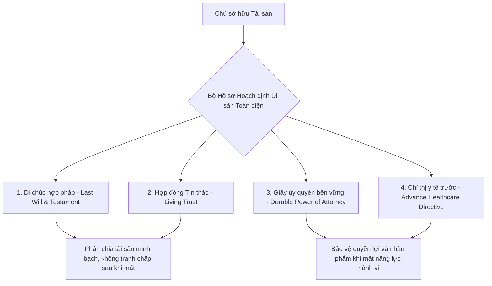
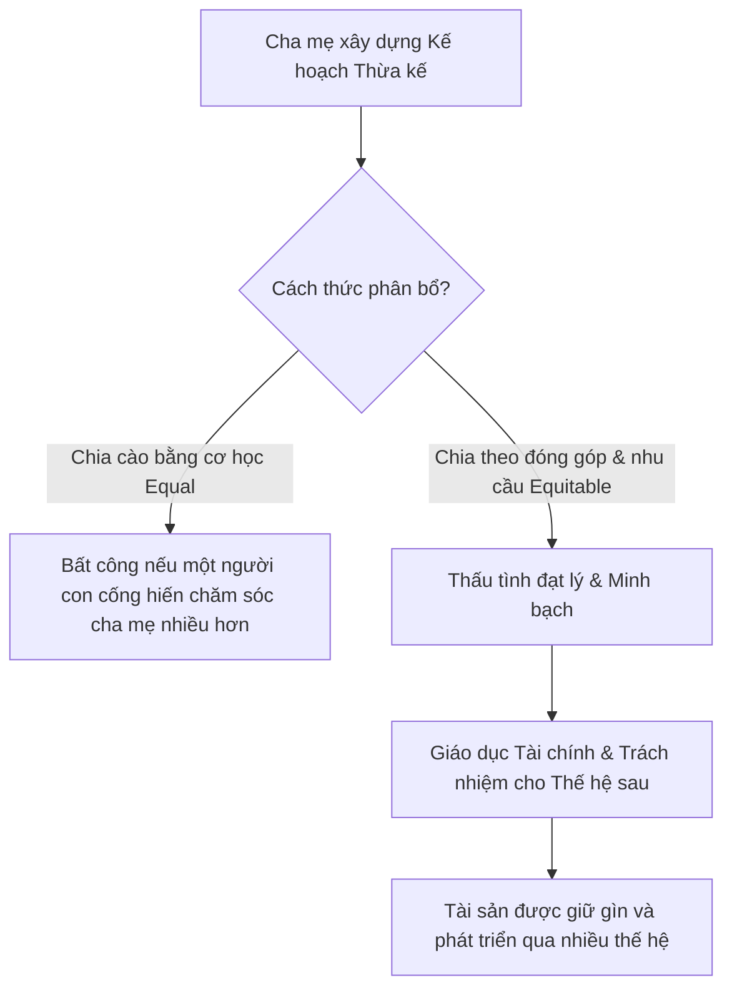
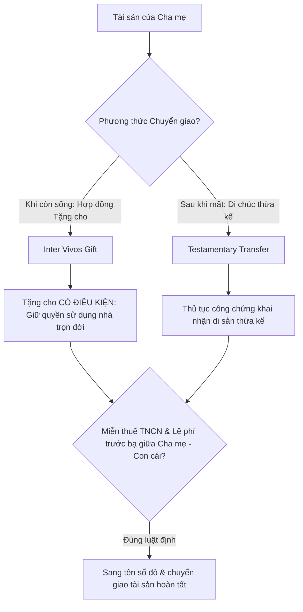
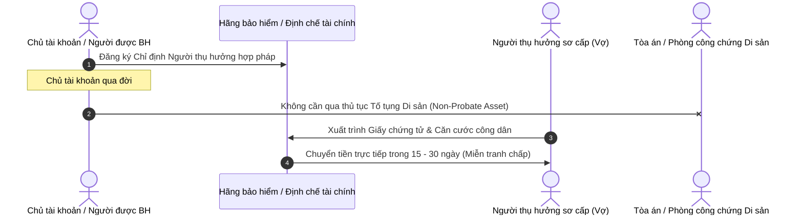

# Hoạch Định Di Sản, Kế Hoạch Thừa Kế Và Chuyển Giao Tài Sản

Hoạch định di sản là giai đoạn đỉnh cao và cuối cùng trong chu kỳ quản trị tài chính cá nhân toàn diện. Nếu không có một chiến lược chuyển giao tài sản được thiết kế chặt chẽ và thấu đáo, toàn bộ thành quả tích lũy của cả đời người có thể bị xé lẻ bởi tranh chấp kiện tụng giữa các thân nhân, bị hao hụt bởi thuế phí pháp lý, hoặc bị hủy hoại bởi thế hệ thừa kế thiếu năng lực quản trị tài chính. Tài liệu này mổ xẻ các nguyên tắc cốt lõi của Hoạch định di sản, Kế hoạch thừa kế, các cơ chế Chuyển giao tài sản và sức mạnh pháp lý tối thượng của Chỉ định người thụ hưởng.

> **Các câu hỏi cốt lõi:**
> 1. Tại sao Hoạch định di sản (Estate Planning) không chỉ dành riêng cho giới siêu giàu mà là trách nhiệm đạo đức và tài chính của mọi cá nhân có người phụ thuộc?
> 2. Sự khác biệt căn bản giữa Chuyển giao tài sản khi còn sống (Inter Vivos Gifts) và Chuyển giao tài sản sau khi qua đời (Testamentary Transfer) là gì?
> 3. Cơ chế Chỉ định người thụ hưởng (Beneficiary Designation) vượt qua các thủ tục tố tụng thừa kế (Probate Process) để chuyển giao dòng tiền ngay lập tức như thế nào?

---

## 1. Estate Planning (Hoạch định di sản)

### 1. Là gì?
- **Định nghĩa hình thức:** Hoạch định di sản là quy trình pháp lý và tài chính toàn diện nhằm dự liệu, quản trị, bảo toàn và quyết định phương thức định đoạt, phân chia toàn bộ khối tài sản (bất động sản, tài chính, doanh nghiệp, quyền sở hữu trí tuệ) của một cá nhân trong suốt cuộc đời và sau khi người đó qua đời hoặc mất năng lực hành vi dân sự, nhằm đạt được nguyện vọng cá nhân, giảm thiểu thuế phí pháp lý và ngăn ngừa mâu thuẫn gia đình.
- **Giải thích đơn giản:** Là việc bạn chuẩn bị sẵn sàng từ trước: nếu một ngày bạn mất đi hoặc bị hôn mê lú lẫn, ai sẽ là người chăm sóc bạn, ai sẽ quản lý tài sản thay bạn, và từng món tài sản của bạn sẽ được chia cho ai, chia như thế nào một cách êm đẹp nhất.
- **Nếu chỉ nhớ một điều:** Nếu bạn không tự mình lập kế hoạch cho di sản của chính mình, nhà nước và tòa án sẽ làm điều đó thay bạn theo các quy định cứng nhắc của pháp luật, bất kể ý nguyện thực sự của bạn là gì.

### 2. Hoạt động thế nào?
- **Chủ thể ra quyết định:** Chủ sở hữu tài sản (người lập di sản) phối hợp với luật sư di sản, công chứng viên và chuyên gia tài chính.
- **Mục tiêu tối ưu hóa:** Chuyển giao tối đa giá trị tài sản đến đúng những người nhận mong muốn, đúng thời điểm, với chi phí pháp lý và thuế tối thiểu nhất, đồng thời duy trì sự hòa thuận nội bộ gia tộc.
- **Ràng buộc:** Tuân thủ quy định của Bộ luật Dân sự (về người thừa kế không phụ thuộc vào nội dung di chúc, điều kiện năng lực hành vi); giải quyết các nghĩa vụ nợ tồn đọng trước khi phân chia.
- **Cơ chế tác động:**

### 3. Công thức & Mô hình
Khối Di sản Ròng để lại cho Thừa kế ($NetEstate$):
$$NetEstate = \text{Total Assets} - \text{Outstanding Liabilities} - \text{Administrative & Legal Costs} - \text{Taxes}$$
Trong đó:
- $\text{Total Assets}$: Toàn bộ bất động sản, tài khoản ngân hàng, cổ phiếu, vàng, doanh nghiệp.
- $\text{Outstanding Liabilities}$: Nợ vay ngân hàng, nghĩa vụ thuế còn nợ, các khoản nợ cá nhân hợp pháp.
- $\text{Administrative & Legal Costs}$: Phí công chứng, phí tòa án, chi phí định giá di sản, thù lao cho người quản lý di sản.
- $\text{Taxes}$: Thuế thu nhập phát sinh từ thừa kế (theo luật định từng quốc gia).

### 4. Ví dụ
- **Ví dụ định lượng:** Ông Trí sở hữu khối tài sản gồm: 1 căn nhà phố trị giá 10 tỷ VND, 1 sổ tiết kiệm 3 tỷ VND và cổ phiếu trị giá 2 tỷ VND (Tổng tài sản: 15 tỷ VND). Ông còn nợ thế chấp ngân hàng 1,5 tỷ VND.
  - Ông Trí lập bộ hồ sơ hoạch định di sản với sự tư vấn của luật sư (chi phí 30 triệu VND).
  - Khối di sản ròng thực tế:
    $$NetEstate = 15.000.000.000 - 1.500.000.000 - 30.000.000 = 13.470.000.000 \text{ VND}$$
  - Di chúc quy định: Căn nhà chuyển cho vợ toàn quyền sử dụng suốt đời (Life Estate), sau đó mới chuyển cho 2 con; tiền mặt và cổ phiếu được phân bổ rõ ràng cho từng con và một phần trích lập quỹ học bổng cho các cháu. Khi ông Trí mất, việc phân chia diễn ra êm đẹp trong 1 tháng mà không có bất kỳ mâu thuẫn nào.
- **Ví dụ thực tế:** Tại Việt Nam, hàng ngàn vụ án tranh chấp di sản thừa kế kéo dài hàng chục năm tại tòa án nhân dân các cấp đều bắt nguồn từ việc người quá cố qua đời đột ngột mà không có bất kỳ kế hoạch hoạch định di sản hay di chúc hợp pháp nào.
- **Phản ví dụ (Counterfactual):** Một doanh nhân thành đạt sở hữu chuỗi cửa hàng kinh doanh trị giá hàng trăm tỷ đồng nhưng đột ngột qua đời vì nhồi máu cơ tim ở tuổi 52 mà không lập di chúc. Các con của các cuộc hôn nhân trước và người vợ hiện tại kiện nhau ra tòa, tài khoản doanh nghiệp bị ngân hàng phong tỏa phục vụ tố tụng, việc kinh doanh đình trệ dẫn đến phá sản chuỗi cửa hàng, tài sản bị thất thoát hơn $70\%$.

### 5. Ứng dụng & Tranh luận
- **Ứng dụng thực tiễn:** Bắt buộc phải thực hiện ngay khi bạn có con cái, kết hôn, hoặc bắt đầu sở hữu các tài sản có giá trị lớn (nhà cửa, cổ phần công ty).
- **Ưu và nhược điểm:**
  - *Ưu điểm:* Kiểm soát hoàn toàn số phận tài sản của mình; bảo vệ người thân yếu thế; triệt tiêu xung đột gia đình.
  - *Nhược điểm:* Đòi hỏi phải đối mặt với chủ đề tâm lý nhạy cảm (cái chết); tốn chi phí thuê luật sư tư vấn chuyên sâu.
- **Sai lầm phổ biến:** Nghĩ rằng "mình còn trẻ, còn khỏe mạnh thì chưa cần quan tâm đến hoạch định di sản", quên rằng rủi ro tai nạn và bệnh tật không bao giờ báo trước.

### 6. Liên kết
- Cùng chủ đề: [02_Inheritance_Planning.md](file:///Users/ductri0981/Documents/Studying/Studying-Economic/04_Personal_Finance_and_Wealth_Management/08_Retirement_Planning/02_Inheritance_Planning.md)
- Liên kết chéo: [01_Personal_Finance_Foundations/08_Wealth_Lifecycle_Accumulation_Preservation_Transfer.md](file:///Users/ductri0981/Documents/Studying/Studying-Economic/04_Personal_Finance_and_Wealth_Management/01_Personal_Finance_Foundations/08_Wealth_Lifecycle_Accumulation_Preservation_Transfer.md)

---

## 2. Inheritance Planning (Kế hoạch thừa kế)

### 1. Là gì?
- **Định nghĩa hình thức:** Kế hoạch thừa kế là một cấu phần chuyên biệt trong hoạch định di sản, tập trung vào việc chuẩn bị, phân bổ và chuyển giao tài sản cho các thế hệ thừa kế tiếp theo (con cái, người phụ thuộc), bao gồm cả việc chuẩn bị năng lực quản trị tài chính, tư tưởng và giá trị gia đình cho người thừa kế để khối tài sản không bị phá hủy.
- **Giải thích đơn giản:** Là kế hoạch "dạy con cách giữ tiền và nhận tiền thừa kế": không chỉ quyết định chia cho con cái bao nhiêu tiền, mà còn chuẩn bị cho chúng sự trưởng thành để không bị đồng tiền làm hư hỏng hay phung phí.
- **Nếu chỉ nhớ một điều:** Để lại một đống tiền cho một đứa con chưa có năng lực tài chính không phải là tình yêu thương, mà là một lời nguyền phá hủy cuộc đời của nó.

### 2. Hoạt động thế nào?
- **Chủ thể ra quyết định:** Bậc cha mẹ (người để lại thừa kế) và những người thừa kế thế hệ thứ hai.
- **Mục tiêu tối ưu hóa:** Bảo toàn sự thịnh vượng qua nhiều thế hệ (vượt qua lời nguyền "Không ai giàu ba họ") và thúc đẩy động lực tự lập của con cái.
- **Ràng buộc:** Cân bằng giữa sự công bằng (Equitable) và sự cào bằng cơ học (Equal); tuân thủ quy định pháp luật về kỷ phần thừa kế bắt buộc.
- **Cơ chế tác động:**

### 3. Công thức & Mô hình
Nguyên tắc Thừa kế Không phụ thuộc vào nội dung di chúc theo Điều 644 Bộ luật Dân sự Việt Nam:
Những người sau đây vẫn được hưởng phần di sản bằng ít nhất **hai phần ba ($2/3$) suất của một người thừa kế theo pháp luật**, nếu di sản được chia theo pháp luật, trong trường hợp họ không được người lập di chúc cho hưởng di sản hoặc chỉ cho hưởng phần di sản ít hơn hai phần ba suất đó:
1. Con chưa thành niên, cha, mẹ, vợ, chồng.
2. Con thành niên mà không có khả năng lao động.

Kỷ phần bắt buộc của người thuộc Điều 644 ($K_{\text{mandatory}}$):
$$K_{\text{mandatory}} = \frac{2}{3} \times \left( \frac{\text{Tổng di sản thuần}}{N_{\text{thừa kế hàng 1}}} \right)$$
Trong đó $N_{\text{thừa kế hàng 1}}$ là tổng số người thuộc hàng thừa kế thứ nhất theo luật.

### 4. Ví dụ
- **Ví dụ định lượng:** Ông Hạnh qua đời để lại khối di sản ròng 6.000.000.000 VND. Ông có vợ và 2 người con trai đã trưởng thành. Do mâu thuẫn, ông Hạnh lập di chúc hợp pháp để lại toàn bộ 6 tỷ đồng cho người con trai út, không để lại đồng nào cho người vợ.
  - Theo luật thừa kế: Hàng thừa kế thứ nhất gồm 3 người: Vợ và 2 con ($N = 3$).
  - Một suất thừa kế theo pháp luật: $\frac{6.000.000.000}{3} = 2.000.000.000$ VND.
  - Người vợ thuộc đối tượng Điều 644 (không phụ thuộc vào di chúc), do đó bà bắt buộc phải được hưởng tối thiểu:
    $$K_{\text{mandatory}} = \frac{2}{3} \times 2.000.000.000 = 1.333.333.333 \text{ VND}$$
  - Tòa án sẽ trích 1,333 tỷ từ khối di sản trao cho người vợ; người con trai út chỉ nhận được phần còn lại: $6.000.000.000 - 1.333.333.333 = 4.666.666.667$ VND.
- **Ví dụ thực tế:** Tỷ phú Warren Buffett nổi tiếng với triết lý thừa kế: *"Để lại cho con cái đủ nhiều để chúng có thể làm bất cứ điều gì, nhưng không quá nhiều để chúng chẳng muốn làm gì cả"*. Ông cam kết quyên góp $99\%$ tài sản vào quỹ từ thiện và chỉ để lại cho mỗi người con vài triệu USD để tự lập.
- **Phản ví dụ (Counterfactual):** Một gia đình giàu có giao trọn khối tài sản 50 tỷ đồng tiền mặt cho người con trai duy nhất vào năm 21 tuổi. Chưa từng được học về quản lý tài chính và giá trị của lao động, người con nhanh chóng bị bạn bè lôi kéo vào cờ bạc, siêu xe và các dự án kinh doanh ảo, làm bốc hơi toàn bộ 50 tỷ chỉ trong vòng 3 năm.

### 5. Ứng dụng & Tranh luận
- **Ứng dụng thực tiễn:** Thiết kế kế hoạch thừa kế gắn liền với điều kiện tiến độ: con cái chỉ được nhận tài sản theo từng giai đoạn tuổi (ví dụ: $25\%$ ở tuổi 25, $25\%$ ở tuổi 30, $50\%$ ở tuổi 35) hoặc khi đạt được các cột mốc cuộc đời (tốt nghiệp đại học, tự mua nhà).
- **Ưu và nhược điểm:**
  - *Ưu điểm:* Bảo vệ con cái khỏi cạm bẫy của việc giàu lên quá nhanh; khuyến khích tinh thần tự lập và cống hiến.
  - *Nhược điểm:* Đòi hỏi phải xây dựng các cấu trúc pháp lý phức tạp (như Quỹ tín thác).
- **Sai lầm phổ biến:** Nhầm lẫn giữa "Công bằng" (Fair/Equitable) và "Cào bằng" (Equal). Chia đều cổ phần doanh nghiệp cho cả 3 người con (trong đó chỉ có 1 người trực tiếp điều hành, 2 người kia không hiểu gì về kinh doanh) thường dẫn đến việc doanh nghiệp gia đình bị tê liệt và sụp đổ.

### 6. Liên kết
- Cùng chủ đề: [01_Estate_Planning.md](file:///Users/ductri0981/Documents/Studying/Studying-Economic/04_Personal_Finance_and_Wealth_Management/08_Retirement_Planning/01_Estate_Planning.md)
- Liên kết chéo: [06_Wealth_Building_and_Compounding/06_Wealth_Lifecycle_and_Generational_Transfer.md](file:///Users/ductri0981/Documents/Studying/Studying-Economic/04_Personal_Finance_and_Wealth_Management/06_Wealth_Building_and_Compounding/06_Wealth_Lifecycle_and_Generational_Transfer.md)

---

## 3. Wealth Transfer (Chuyển giao tài sản)

### 1. Là gì?
- **Định nghĩa hình thức:** Chuyển giao tài sản là quá trình chuyển dịch quyền sở hữu hợp pháp đối với các nguồn lực tài chính, bất động sản hoặc quyền tài sản từ chủ thể này sang chủ thể khác, có thể được thực hiện khi người chuyển giao còn sống (Inter Vivos Transfer / Gifting) hoặc được kích hoạt sau khi người chuyển giao qua đời (Testamentary Transfer).
- **Giải thích đơn giản:** Là cách thức bạn "sang tên đổi chủ" tài sản của mình cho con cái: bạn muốn cho con đất đai, nhà cửa ngay từ bây giờ khi bạn còn sống, hay đợi đến khi bạn nhắm mắt xuôi tay mới để lại thừa kế?
- **Nếu chỉ nhớ một điều:** Chuyển giao tài sản khi còn sống cho phép bạn chứng kiến con cái thụ hưởng và hướng dẫn chúng quản lý, nhưng tiềm ẩn rủi ro con cái bội bạc tước đoạt quyền lợi của bạn lúc tuổi già.

### 2. Hoạt động thế nào?
- **Chủ thể ra quyết định:** Người tặng cho (Donor) và Người nhận chuyển giao (Donee).
- **Mục tiêu tối ưu hóa:** Tối ưu hóa nghĩa vụ thuế (thuế thu nhập cá nhân, lệ phí trước bạ) và bảo vệ quyền an cư trọn đời của cha mẹ.
- **Ràng buộc:** Các quy định pháp lý về hợp đồng tặng cho tài sản có điều kiện (Điều 462 Bộ luật Dân sự); các điều khoản miễn giảm thuế chuyển nhượng giữa thân nhân trực hệ.
- **Cơ chế tác động:**

### 3. Công thức & Mô hình
Đánh đổi Tài chính giữa Chuyển giao khi còn sống và Thừa kế:
Theo Luật Thuế Thu nhập Cá nhân Việt Nam (Điều 4) và Nghị định về Lệ phí trước bạ:
- Thu nhập từ thừa kế, quà tặng là bất động sản giữa: Vợ với chồng; Cha đẻ, mẹ đẻ với con đẻ; Cha nuôi, mẹ nuôi với con nuôi; Cha chồng, mẹ chồng với con dâu; Cha vợ, mẹ vợ với con rể; Ông bà với cháu; Anh chị em ruột với nhau:
$$\text{Thuế TNCN} = 0\%$$
$$\text{Lệ phí trước bạ} = 0\%$$
Quyền bảo vệ trong Hợp đồng tặng cho có điều kiện (Điều 462 Bộ luật Dân sự 2015):
Nếu người nhận tài sản không thực hiện nghĩa vụ đã cam kết (ví dụ: nghĩa vụ chăm sóc, phụng dưỡng, không được bán nhà khi cha mẹ còn sống):
$$\text{Bên tặng cho có quyền} \implies \text{Hủy hợp đồng & Đòi lại tài sản}$$

### 4. Ví dụ
- **Ví dụ định lượng:** Bà Tâm (70 tuổi) sở hữu một căn nhà trị giá 8 tỷ VND. Bà muốn chuyển giao cho người con trai độc nhất nhưng lo sợ sau khi sang tên, con trai sẽ mang nhà đi thế chấp kinh doanh thua lỗ khiến bà mất chỗ ở.
  - Giải pháp pháp lý chuẩn: Bà Tâm lập **Hợp đồng tặng cho bất động sản có điều kiện** tại phòng công chứng, trong đó quy định rõ 2 điều kiện bắt buộc:
    1. Bà Tâm có quyền cư trú và sử dụng căn nhà trọn đời đến khi qua đời; người con không được phép chuyển nhượng, thế chấp hoặc cầm cố căn nhà nếu không có sự đồng ý bằng văn bản của bà.
    2. Người con có nghĩa vụ chăm sóc, chi trả chi phí y tế cho bà khi ốm đau.
  - Hợp đồng được đăng bộ sang tên quyền sử dụng đất, nhưng điều kiện hạn chế được ghi chú vào hồ sơ địa chính. Bà Tâm vừa hoàn thành việc chuyển giao tài sản sớm, vừa bảo đảm an cư an toàn tuyệt đối.
- **Ví dụ thực tế:** Tại Việt Nam, nhiều trường hợp cha mẹ chuyển giao sang tên "cho trắng" toàn bộ đất đai cho con trai khi còn khỏe mạnh. Sau khi có sổ đỏ, người con nghe lời vợ bán nhà hoặc ngược đãi đuổi cha mẹ già ra đường, dẫn đến những vụ kiện tụng đòi lại đất đai vô cùng đau xót.
- **Phản ví dụ (Counterfactual):** Một chủ sở hữu tài sản muốn chuyển giao tài sản cho người cháu họ xa (không thuộc đối tượng trực hệ được miễn thuế). Nếu tặng cho khi còn sống, người cháu phải nộp $10\%$ thuế TNCN trên phần giá trị vượt 10 triệu đồng. Nhưng nếu chuyển giao qua di chúc bằng hình thức chia nhỏ hoặc thông qua các công cụ tài chính khác, số thuế phải nộp có thể được tối ưu hóa hợp pháp.

### 5. Ứng dụng & Tranh luận
- **Ứng dụng thực tiễn:** Chuyển giao tài sản dần dần khi con cái bước vào độ tuổi lập nghiệp (25 - 35 tuổi) để làm bệ phóng tài chính, thay vì giữ khư khư đến khi 85-90 tuổi mới để lại cho những đứa con đã 60 tuổi không còn nhiều nhu cầu vốn phát triển.
- **Ưu và nhược điểm:**
  - *Ưu điểm của chuyển giao sớm:* Giúp thế hệ sau có nguồn lực kinh doanh; người đi trước hướng dẫn và giám sát được con cái.
  - *Nhược điểm:* Nguy cơ mất quyền kiểm soát tài sản nếu không thiết lập chặt chẽ các rào cản pháp lý điều kiện.
- **Sai lầm phổ biến:** Sang tên sổ đỏ cho con cái dựa trên lời hứa miệng mà không công chứng hợp đồng tặng cho có điều kiện, tước bỏ hoàn toàn chiếc phao bảo hộ pháp lý của chính mình khi về già.

### 6. Liên kết
- Cùng chủ đề: [04_Beneficiary_Designation.md](file:///Users/ductri0981/Documents/Studying/Studying-Economic/04_Personal_Finance_and_Wealth_Management/08_Retirement_Planning/04_Beneficiary_Designation.md)
- Liên kết chéo: [01_Personal_Finance_Foundations/08_Wealth_Lifecycle_Accumulation_Preservation_Transfer.md](file:///Users/ductri0981/Documents/Studying/Studying-Economic/04_Personal_Finance_and_Wealth_Management/01_Personal_Finance_Foundations/08_Wealth_Lifecycle_Accumulation_Preservation_Transfer.md)

---

## 4. Beneficiary Designation (Chỉ định người thụ hưởng)

### 1. Là gì?
- **Định nghĩa hình thức:** Chỉ định người thụ hưởng là hành vi pháp lý của chủ sở hữu tài khoản tài chính (hợp đồng bảo hiểm nhân thọ, tài khoản hưu trí, tài khoản đầu tư chứng khoán, tiền gửi ngân hàng có thỏa thuận) chỉ định đích danh cá nhân hoặc tổ chức cụ thể sẽ tự động nhận chuyển giao toàn bộ số dư tài sản khi chủ sở hữu qua đời, độc lập hoàn toàn và đứng trên các quy định phân chia của di chúc.
- **Giải thích đơn giản:** Là việc bạn điền tên người thân vào ô "Người thụ hưởng" trong hợp đồng bảo hiểm hoặc tài khoản hưu trí. Khi bạn mất, công ty bảo hiểm sẽ trao thẳng tiền cho người đó trong vài ngày mà không ai có quyền tranh giành hay kiện tụng.
- **Nếu chỉ nhớ một điều:** Chỉ định người thụ hưởng ĐỨNG TRÊN DI CHÚC (Beneficiary Designations trump Wills); một tờ di chúc viết sau không thể thay đổi người thụ hưởng đã đăng ký hợp pháp trên hợp đồng bảo hiểm nhân thọ.

### 2. Hoạt động thế nào?
- **Chủ thể ra quyết định:** Chủ tài khoản / Bên mua bảo hiểm có quyền chỉ định và thay đổi bất cứ lúc nào trong suốt cuộc đời (Revocable Beneficiary).
- **Mục tiêu tối ưu hóa:** Chuyển giao thanh khoản tiền mặt ngay lập tức cho người thân mà không bị đóng băng tài sản và không phải thông qua thủ tục tố tụng phân chia thừa kế phức tạp tại tòa án (Bypassing Probate).
- **Ràng buộc:** Phải cập nhật định kỳ khi tình trạng hôn nhân thay đổi (ly hôn, tái hôn, sinh con); phân định rõ giữa Người thụ hưởng sơ cấp (Primary Beneficiary) và Người thụ hưởng dự phòng (Contingent Beneficiary).
- **Cơ chế tác động:**

### 3. Công thức & Mô hình
Phân loại Tài sản Di sản theo Thủ tục Pháp lý:
1. **Tài sản phải qua Tố tụng Thừa kế (Probate Assets):** Nhà đất, tài khoản cá nhân thông thường không chỉ định thụ hưởng $\implies$ Bị đóng băng tài khoản, phải đợi mở di chúc, họp mặt toàn bộ hàng thừa kế, niêm yết công chứng 15 ngày, tốn kém án phí.
2. **Tài sản phi Tố tụng (Non-Probate Assets):** Hợp đồng bảo hiểm nhân thọ, tài khoản có chỉ định người thụ hưởng, tài khoản đồng sở hữu (Joint Account with Rights of Survivorship - JTWROS):
$$\text{Payout} \to \text{Beneficiary Directly (Thời gian: Vài ngày, Chi phí pháp lý: 0 VND)}$$

Quy tắc Phân bổ theo Thế hệ (Per Stirpes vs. Per Capita):
- **Per Stirpes (Theo nhánh gia tộc):** Nếu một người con thụ hưởng qua đời trước cha mẹ, phần tiền của người đó tự động chuyển cho các con của người đó (cháu của người lập).
- **Per Capita (Theo đầu người còn sống):** Nếu một người con qua đời trước, phần tiền đó được chia đều lại cho những người con còn sống khác.

### 4. Ví dụ
- **Ví dụ định lượng:** Ông Kiên có 1 hợp đồng bảo hiểm nhân thọ 3.000.000.000 VND và 1 di chúc bằng văn bản.
  - Trong hợp đồng bảo hiểm ký năm 2015, ông Kiên chỉ định Người thụ hưởng là: Con gái lớn ($w_1 = 100\%$).
  - Năm 2023, ông Kiên viết di chúc để lại toàn bộ tài sản bao gồm cả tiền bảo hiểm cho người vợ thứ hai.
  - Năm 2024, ông Kiên qua đời.
  - Phán quyết pháp lý: Công ty bảo hiểm bắt buộc phải chuyển toàn bộ 3.000.000.000 VND cho Người con gái lớn theo đúng Chỉ định người thụ hưởng trên hợp đồng. Nội dung di chúc hoàn toàn vô hiệu đối với số tiền bảo hiểm này.
- **Ví dụ thực tế:** Tại Việt Nam, sau khi một người qua đời, toàn bộ sổ tiết kiệm ngân hàng mang tên người đó sẽ bị phong tỏa ngay lập tức. Thân nhân phải mất hàng tháng trời, tập hợp đầy đủ giấy tờ chứng minh quan hệ của tất cả những người thuộc hàng thừa kế thứ nhất (kể cả bố mẹ đẻ 90 tuổi ở quê) đến phòng công chứng ký biên bản phân chia di sản thì ngân hàng mới cho rút tiền. Nhưng đối với bảo hiểm nhân thọ có chỉ định thụ hưởng, công ty bảo hiểm chi trả tiền ngay lập tức sau khi nhận giấy chứng tử.
- **Phản ví dụ (Counterfactual):** Một người đàn ông ly hôn năm 40 tuổi và tái hôn năm 42 tuổi, có thêm 2 con với người vợ mới. Tuy nhiên, ông quên không cập nhật mục Người thụ hưởng trong hợp đồng bảo hiểm nhân thọ 2 tỷ (vẫn để tên người vợ cũ). Khi ông qua đời đột ngột ở tuổi 50, toàn bộ 2 tỷ đồng tiền bồi thường được chuyển thẳng vào tài khoản của người vợ cũ; người vợ hiện tại và 2 con thơ không nhận được một đồng nào.

### 5. Ứng dụng & Tranh luận
- **Ứng dụng thực tiễn:** Luôn rà soát và cập nhật mục Chỉ định người thụ hưởng sau mỗi sự kiện lớn: kết hôn, ly hôn, sinh con, hoặc khi người thụ hưởng trước đó đã qua đời.
- **Ưu và nhược điểm:**
  - *Ưu điểm:* Tốc độ giải ngân siêu tốc; tính bảo mật cao; chi phí chuyển giao bằng 0; vượt qua mọi tranh chấp kiện tụng di sản.
  - *Nhược điểm:* Nếu quên cập nhật sẽ gây ra những bất công tài chính đau đớn cho những người thân thực sự hiện tại.
- **Sai lầm phổ biến:** Để trống ô "Người thụ hưởng" hoặc chỉ định người thụ hưởng là một đứa trẻ chưa thành niên (dưới 18 tuổi) mà không chỉ định người giám hộ, khiến số tiền bị phong tỏa cho đến khi đứa trẻ đủ 18 tuổi.

### 6. Liên kết
- Cùng chủ đề: [01_Estate_Planning.md](file:///Users/ductri0981/Documents/Studying/Studying-Economic/04_Personal_Finance_and_Wealth_Management/08_Retirement_Planning/01_Estate_Planning.md)
- Liên kết chéo: [07_Insurance_and_Personal_Risk_Protection/01_Insurance_Fundamentals_and_Mechanics.md](file:///Users/ductri0981/Documents/Studying/Studying-Economic/04_Personal_Finance_and_Wealth_Management/07_Insurance_and_Personal_Risk_Protection/01_Insurance_Fundamentals_and_Mechanics.md)

---

## Câu hỏi tự kiểm tra
1. Hãy phân tích lý do tại sao một kế hoạch Hoạch định di sản (Estate Planning) chuẩn mực phải bao gồm cả các công cụ dự phòng khi mất năng lực hành vi (như Giấy ủy quyền bền vững và Chỉ thị y tế trước) chứ không chỉ dừng lại ở Di chúc?
2. Trình bày quy định về "Kỷ phần thừa kế bắt buộc không phụ thuộc vào nội dung di chúc" theo Điều 644 Bộ luật Dân sự Việt Nam. Ý nghĩa nhân văn và tác động kinh tế của quy định này là gì?
3. Tại sao nguyên tắc "Chỉ định người thụ hưởng đứng trên Di chúc" (Beneficiary Designations trump Wills) lại là một con dao hai lưỡi trong quản trị tài sản gia đình? Nêu ví dụ minh họa.
4. So sánh ưu và nhược điểm của việc Chuyển giao tài sản khi còn sống (Inter Vivos Gifts) so với Chuyển giao tài sản sau khi qua đời qua Di chúc.

## Ghi chú nguồn
- Bộ luật Dân sự số 91/2015/QH13 (Phần thứ tư: Thừa kế).
- Luật Thuế Thu nhập Cá nhân số 04/2007/QH12 (sửa đổi, bổ sung).
- Beyer, G. M. - *Estate Planning and Wills: Concepts and Application*, Aspen Publishing.
- Clontz, R. C. - *The Complete Guide to Estate Planning*, American Bar Association.
