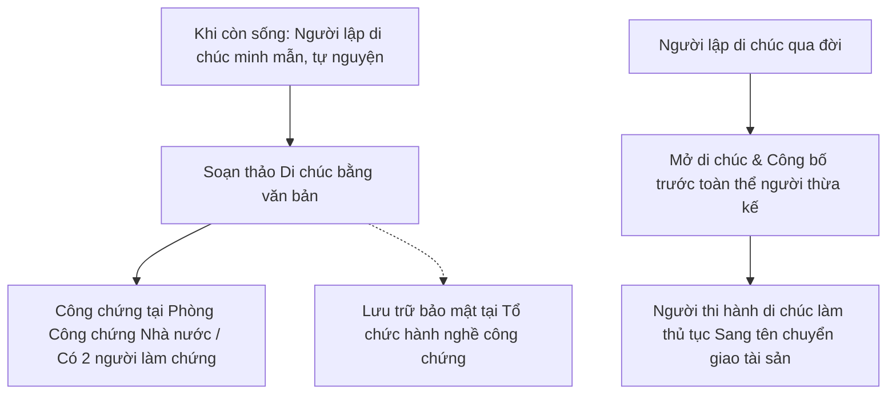
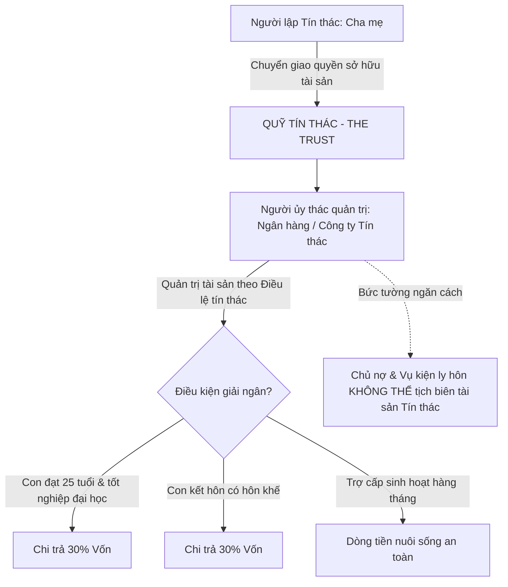
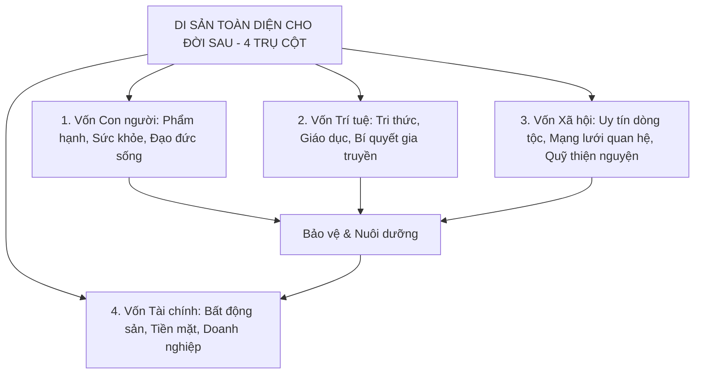

# Di Chúc, Quỹ Tín Thác Và Hoạch Định Di Sản Giá Trị Cho Đời Sau

Khi hành trình tích lũy và hưởng thụ tài sản khép lại, câu hỏi lớn nhất của một đời người không còn là "Tôi đã kiếm được bao nhiêu tiền?", mà là "Tôi sẽ để lại những giá trị gì cho thế hệ tiếp theo?". Di chúc (Will) và Quỹ tín thác (Trust) là hai công cụ pháp lý tối thượng giúp chuyển giao tài sản hữu hình một cách chính xác, trong khi Hoạch định di sản giá trị (Legacy Planning) là nghệ thuật truyền trao các giá trị vô hình, phẩm hạnh và tri thức cho dòng tộc và xã hội. Tài liệu này mổ xẻ toàn diện ba trụ cột này.

> **Các câu hỏi cốt lõi:**
> 1. Một bản Di chúc (Will) muốn có hiệu lực pháp lý tuyệt đối trước tòa án cần phải thỏa mãn những điều kiện khắt khe nào theo Bộ luật Dân sự Việt Nam?
> 2. Tại sao Quỹ tín thác (Trust) lại vượt trội hơn Di chúc trong việc bảo vệ tài sản khỏi chủ nợ của con cái và ngăn ngừa con cái phá sản vì ăn chơi sa đọa?
> 3. Hoạch định di sản giá trị (Legacy Planning) mở rộng định nghĩa về sự thịnh vượng từ "Vốn tài chính" sang "Vốn con người và Vốn xã hội" như thế nào?

---

## 1. Will (Di chúc)

### 1. Là gì?
- **Định nghĩa hình thức:** Di chúc là sự thể hiện ý chí của cá nhân bằng văn bản hoặc bằng miệng nhằm chuyển giao tài sản của mình cho người khác sau khi chết (theo Điều 624 Bộ luật Dân sự Việt Nam số 91/2015/QH13).
- **Giải thích đơn giản:** Di chúc là "bức thư di nguyện hợp pháp" của bạn nói rõ: sau khi bạn qua đời, từng ngôi nhà, mảnh đất, cuốn sổ tiết kiệm hay chiếc xe sẽ thuộc về ai, và giao cho ai đứng ra chia chác.
- **Nếu chỉ nhớ một điều:** Một bản di chúc chỉ bắt đầu có hiệu lực pháp lý KỂ TỪ THỜI ĐIỂM NGƯỜI LẬP QUA ĐỜI; khi còn sống, người lập có toàn quyền sửa đổi, bổ sung, thay thế hoặc hủy bỏ di chúc bất cứ lúc nào.

### 2. Hoạt động thế nào?
- **Chủ thể ra quyết định:** Người lập di chúc (Testator) phải là người thành niên, minh mẫn, sáng suốt trong khi lập; Người thi hành di chúc (Executor) và Người thừa kế (Heirs).
- **Mục tiêu tối ưu hóa:** Định đoạt tài sản theo đúng tâm nguyện cá nhân, xóa tan nguy cơ tranh chấp kiện tụng giữa các con sau khi cha mẹ khuất núi.
- **Ràng buộc:** Không được vi phạm điều cấm của luật và không trái đạo đức xã hội; phải bảo đảm kỷ phần bắt buộc cho những người thừa kế không phụ thuộc vào di chúc (cha, mẹ, vợ, chồng, con chưa thành niên theo Điều 644).
- **Cơ chế tác động:**

### 3. Công thức & Mô hình
Điều kiện Hiệu lực Hợp pháp của Di chúc theo Điều 630 Bộ luật Dân sự 2015:
$$\text{Di chúc Hợp pháp} \iff \begin{cases} 
1. \text{ Năng lực: Người lập minh mẫn, sáng suốt, không bị lừa dối, đe dọa, cưỡng ép} \\ 
2. \text{ Nội dung: Không vi phạm điều cấm của luật, không trái đạo đức xã hội} \\ 
3. \text{ Hình thức: Bằng văn bản (có công chứng/chứng thực hoặc có người làm chứng)} \\
4. \text{ Quyền sở hữu: Tài sản định đoạt phải thuộc quyền sở hữu hợp pháp của người lập}
\end{cases}$$
Di chúc bằng miệng (Oral Will) chỉ được công nhận hợp pháp nếu:
Người lập đang trong tình trạng bị cái chết đe dọa và thể hiện ý chí trước ít nhất 02 người làm chứng; người làm chứng ghi chép lại, ký tên và trong vòng **05 ngày làm việc** phải đi công chứng hoặc chứng thực chữ ký. Nếu sau 03 tháng người đó còn sống thì di chúc miệng tự động vô hiệu.

### 4. Ví dụ
- **Ví dụ định lượng:** Ông Vượng sở hữu khối tài sản gồm: 1 căn nhà 8 tỷ VND và 1 tài khoản tiết kiệm 2 tỷ VND. Ông có 2 người con gái đã lập gia đình độc lập tài chính. Ông muốn để lại toàn bộ căn nhà 8 tỷ cho người con gái đầu (người trực tiếp sống cùng và chăm sóc ông) và để lại 2 tỷ cho người con gái thứ hai.
  - Ông Vượng đến Phòng công chứng số 1 TP. Hà Nội, xuất trình giấy khám sức khỏe tâm thần chứng minh minh mẫn, sổ đỏ căn nhà và sổ tiết kiệm.
  - Công chứng viên trực tiếp soạn thảo và chứng nhận di chúc theo đúng quy định.
  - Khi ông Vượng mất ở tuổi 82, người con gái thứ hai có ý định khiếu nại nhưng do bản di chúc được công chứng hợp pháp chặt chẽ, tòa án bác bỏ yêu cầu chia đều và thực thi đúng $100\%$ nội dung di chúc.
- **Ví dụ thực tế:** Tại Việt Nam, nhiều người tự viết di chúc tay ở nhà (Di chúc viết tay không có người làm chứng). Sau khi mất, các con nghi ngờ chữ ký bị làm giả hoặc cho rằng bố mẹ bị ép buộc khi viết, dẫn đến việc phải mang bản di chúc đi giám định chữ ký tại Viện Khoa học Hình sự kéo dài nhiều năm.
- **Phản ví dụ (Counterfactual):** Một người tự ý lập di chúc để lại toàn bộ ngôi nhà chung của hai vợ chồng cho người cháu ruột mà không có chữ ký đồng thuận của người vợ. Sau khi người này mất, tòa án tuyên bản di chúc bị vô hiệu một phần đối với $50\%$ giá trị ngôi nhà (thuộc phần sở hữu của người vợ), gây ra rắc rối chia chác kéo dài.

### 5. Ứng dụng & Tranh luận
- **Ứng dụng thực tiễn:** Công cụ chuyển giao tài sản pháp lý cơ bản nhất và bắt buộc phải có cho mọi cá nhân trưởng thành sở hữu tài sản.
- **Ưu và nhược điểm:**
  - *Ưu điểm:* Chi phí lập rất rẻ (chỉ từ vài trăm ngàn đến vài triệu đồng tiền công chứng); dễ dàng sửa đổi hoặc hủy bỏ khi còn sống.
  - *Nhược điểm:* Phải qua thủ tục công chứng mở di sản sau khi mất; thông tin di chúc có thể bị công khai giữa các bên; dễ bị khiếu kiện nếu không được lập chặt chẽ.
- **Sai lầm phổ biến:** Tự ý gạch xóa, viết thêm vào bản di chúc viết tay cũ sau nhiều năm, làm mất tính toàn vẹn và có nguy cơ khiến toàn bộ bản di chúc bị tòa án tuyên vô hiệu.

### 6. Liên kết
- Cùng chủ đề: [02_Trust.md](file:///Users/ductri0981/Documents/Studying/Studying-Economic/04_Personal_Finance_and_Wealth_Management/08_Retirement_Planning/02_Trust.md)
- Liên kết chéo: [05_Estate_Inheritance_and_Wealth_Transfer.md](file:///Users/ductri0981/Documents/Studying/Studying-Economic/04_Personal_Finance_and_Wealth_Management/08_Retirement_Planning/05_Estate_Inheritance_and_Wealth_Transfer.md)

---

## 2. Trust (Quỹ tín thác / Hợp đồng tín thác)

### 1. Là gì?
- **Định nghĩa hình thức:** Quỹ tín thác là một thỏa thuận pháp lý ba bên (hoặc pháp nhân độc lập) mà theo đó một bên (Người lập tín thác - Settlor/Grantor) chuyển giao quyền sở hữu pháp lý đối với một khối tài sản cho một bên thứ hai (Người nhận ủy thác - Trustee) để quản lý, đầu tư và định đoạt khối tài sản đó vì lợi ích của một bên thứ ba (Người thụ hưởng - Beneficiary) theo các điều khoản nghiêm ngặt do người lập quy định.
- **Giải thích đơn giản:** Giống như việc bạn gửi tiền và nhà cửa vào một "chiếc két sắt thông minh có người gác cổng đáng tin cậy". Bạn ra lệnh cho người gác cổng: mỗi tháng chỉ được rút ra 20 triệu cho con trai tôi ăn học; nếu con tôi ly hôn hoặc cờ bạc nợ nần, không một ai (kể cả vợ của con hay chủ nợ) được phép chạm vào tiền trong chiếc két này.
- **Nếu chỉ nhớ một điều:** Quỹ tín thác vượt trội hơn Di chúc ở chỗ: Di chúc chỉ chuyển giao tài sản một lần rồi buông tay, còn Quỹ tín thác cho phép bạn "quản lý và kiểm soát tài sản từ bên kia thế giới" qua nhiều thế hệ.

### 2. Hoạt động thế nào?
- **Chủ thể ra quyết định:**
  - **Grantor/Settlor:** Người chủ tạo lập tài sản.
  - **Trustee:** Công ty quản lý tín thác chuyên nghiệp hoặc ngân hàng uy tín chịu trách nhiệm ủy thác (Fiduciary Duty).
  - **Beneficiary:** Người thân yêu được hưởng lợi từ hoa lợi, cổ tức và vốn gốc của quỹ.
- **Mục tiêu tối ưu hóa:** Bảo vệ tài sản tuyệt đối trước chủ nợ (Asset Protection), bảo mật thông tin tài chính, tránh thủ tục tố tụng thừa kế (Probate Avoidance), và ngăn chặn con cháu phá gia chi tử.
- **Ràng buộc:** Chi phí duy trì phí quản lý tín thác thường niên; các điều khoản pháp lý về tín thác bất khả thu hồi (Irrevocable Trust) không thể thay đổi một khi đã ký.
- **Cơ chế tác động:**

### 3. Công thức & Mô hình
Hai loại hình Quỹ tín thác cơ bản:
1. **Tín thác có thể hủy ngang (Revocable Living Trust):**
   - Người lập giữ toàn quyền thay đổi, rút lại tài sản khi còn sống.
   - Khi mất, tài sản tự động chuyển giao cho người thụ hưởng mà KHÔNG qua thủ tục tòa án (Avoid Probate).
   - *Hạn chế:* Không bảo vệ được tài sản trước chủ nợ của chính người lập khi còn sống.
2. **Tín thác bất khả thu hồi (Irrevocable Trust):**
   - Người lập từ bỏ hoàn toàn quyền sở hữu và kiểm soát tài sản sau khi chuyển vào quỹ.
   - *Sức mạnh tối thượng:* Tài sản tách biệt hoàn toàn khỏi người lập $\implies$ Miễn nhiễm tuyệt đối trước mọi phán quyết của chủ nợ, vụ kiện tụng dân sự và thuế di sản khổng lồ.

Điều khoản Chống Phung phí (Spendthrift Clause):
Ngăn chặn người thụ hưởng đem quyền lợi tín thác đi cầm cố, thế chấp vay nợ hoặc bị chủ nợ siết nợ:
$$\text{Asset in Trust} \cap \text{Creditor Claims} = \emptyset$$

### 4. Ví dụ
- **Ví dụ định lượng:** Gia đình doanh nhân có khối tài sản 50 tỷ VND và một người con trai 18 tuổi có tính ham chơi đua đòi. Cha mẹ lo sợ nếu qua đời, con trai sẽ bị lừa đảo mất sạch tiền.
  - Cha mẹ lập một **Quỹ tín thác bất khả thu hồi (Irrevocable Trust)** và thuê một ngân hàng uy tín làm Trustee (phí quản trị $0,5\%$/năm).
  - Điều lệ tín thác quy định:
    - Hàng tháng Trustee chi trả đúng 30 triệu VND vào tài khoản con trai để trang trải chi phí sinh hoạt.
    - Toàn bộ viện phí chữa bệnh nếu phát sinh sẽ do Trustee thanh toán trực tiếp cho bệnh viện.
    - Năm con tròn 30 tuổi: Giải ngân $20\%$ vốn (10 tỷ) nếu có báo cáo kinh doanh khả thi.
    - Năm con tròn 40 tuổi: Giải ngân nốt phần còn lại.
    - Bất kỳ khoản nợ cá nhân nào của con đều không được phép thanh toán từ tài sản quỹ tín thác.
  - Con trai dù có bị bạn bè rủ rê cờ bạc nợ 20 tỷ cũng không thể đem tài sản gia đình đi gán nợ. Khối tài sản được bảo toàn trọn vẹn suốt đời.
- **Ví dụ thực tế:** Gia tộc Rockefeller tại Mỹ đã duy trì sự giàu có tột bậc qua 7 thế hệ với hơn 200 người thừa kế nhờ hệ thống hàng trăm Quỹ tín thác (Rockefeller Family Trusts) được thành lập từ những năm 1930. Không một thành viên nào có quyền tự ý bán tài sản chung của dòng họ.
- **Phản ví dụ (Counterfactual):** Một gia đình giàu có để lại khối tài sản 30 tỷ trực tiếp qua di chúc cho con gái. Sau đó con gái kết hôn nhưng không làm thỏa thuận tài sản riêng. Khi ly hôn sau 5 năm, người chồng ngoại tình đã thành công chiếm đoạt một nửa khối tài sản (15 tỷ) theo quy định chia tài sản chung vợ chồng của tòa án.

### 5. Ứng dụng & Tranh luận
- **Ứng dụng thực tiễn:** Công cụ bắt buộc của giới trung lưu cấp cao và thượng lưu (HNWI); bảo vệ con khuyết tật hoặc con chưa thành niên có nguồn chu cấp suốt đời.
- **Ưu và nhược điểm:**
  - *Ưu điểm:* Bảo mật tuyệt đối (không bị công khai như di chúc); bảo vệ tài sản khỏi phá sản và ly hôn; kiểm soát dòng tiền giải ngân linh hoạt.
  - *Nhược điểm:* Chi phí thiết lập và duy trì ban đầu khá tốn kém; pháp luật về tín thác tại các nước đang phát triển (như Việt Nam) vẫn đang trong quá trình hoàn thiện hành lang pháp lý.
- **Sai lầm phổ biến:** Chọn người ủy thác (Trustee) là một người thân trong gia đình thiếu năng lực quản lý tài chính hoặc có xung đột lợi ích, dẫn đến việc quỹ bị lạm dụng hoặc thất thoát.

### 6. Liên kết
- Cùng chủ đề: [01_Will.md](file:///Users/ductri0981/Documents/Studying/Studying-Economic/04_Personal_Finance_and_Wealth_Management/08_Retirement_Planning/01_Will.md)
- Liên kết chéo: [05_Estate_Inheritance_and_Wealth_Transfer.md](file:///Users/ductri0981/Documents/Studying/Studying-Economic/04_Personal_Finance_and_Wealth_Management/08_Retirement_Planning/05_Estate_Inheritance_and_Wealth_Transfer.md)

---

## 3. Legacy Planning (Hoạch định di sản kế thừa / Kế hoạch để lại di sản)

### 1. Là gì?
- **Định nghĩa hình thức:** Hoạch định di sản kế thừa là phương pháp tiếp cận toàn diện và nhân văn nhất trong quản trị tài sản gia tộc, mở rộng vượt ra ngoài phạm vi chuyển giao tiền bạc thuần túy (vốn tài chính) để bao hàm việc hệ thống hóa, bảo tồn và truyền trao Vốn con người (Human Capital - sức khỏe, phẩm hạnh), Vốn trí tuệ (Intellectual Capital - tri thức, kỹ năng kinh doanh, bí quyết nghề nghiệp) và Vốn xã hội (Social Capital - uy tín gia đình, hoạt động thiện nguyện phụng sự cộng đồng) cho các thế hệ tương lai.
- **Giải thích đơn giản:** Là kế hoạch trả lời câu hỏi: *"Bạn muốn người đời và con cháu nhớ về bạn như thế nào sau khi bạn ra đi?"*. Đó là việc bạn để lại những bài học cuộc đời, triết lý gia phong, danh tiếng sạch và những việc làm tốt đẹp cho đời, chứ không chỉ là những con số vô hồn trong tài khoản ngân hàng.
- **Nếu chỉ nhớ một điều:** Tiền bạc mà không có giá trị và tri thức soi đường sẽ biến mất chỉ sau 3 thế hệ; di sản vĩ đại nhất mà một con người để lại là những phẩm giá sống được khắc sâu vào tâm khảm thế hệ sau.

### 2. Hoạt động thế nào?
- **Chủ thể ra quyết định:** Người sáng lập gia tộc (Patriarch/Matriarch) và Hội đồng Gia đình (Family Council).
- **Mục tiêu tối ưu hóa:** Thống nhất sứ mệnh gia tộc (Family Mission Statement), tạo dựng sự gắn kết yêu thương giữa các thế hệ và đóng góp tích cực cho xã hội.
- **Ràng buộc:** Sự thay đổi thế giới quan giữa các thế hệ (Gen Gap); đòi hỏi sự giao tiếp chân thành và cởi mở giữa cha mẹ và con cái.
- **Cơ chế tác động:**

### 3. Công thức & Mô hình
Mô hình Bốn Trụ Cột Di Sản của James E. Hughes Jr. (*Family Wealth: Keeping It in the Family*):
Sự giàu có thực sự của một gia tộc ($W_{\text{dynasty}}$):
$$W_{\text{dynasty}} = f(H, I, S, F)$$
Trong đó:
- $H$: Vốn con người (Human Capital) - Mỗi thành viên tìm thấy mục đích sống và phát triển năng lực tự thân.
- $I$: Vốn trí tuệ (Intellectual Capital) - Năng lực học tập, ra quyết định và kỹ năng thích ứng của thế hệ sau.
- $S$: Vốn xã hội (Social Capital) - Uy tín đạo đức và các hoạt động từ thiện kết nối gia đình với cộng đồng.
- $F$: Vốn tài chính (Financial Capital) - Là công cụ phục vụ cho sự phát triển của 3 loại vốn trên, không phải là mục đích tự thân.

Văn bản Sứ mệnh Gia đình (Family Constitution / Ethical Will):
Bản di nguyện đạo đức ghi chép lại các giá trị cốt lõi, bài học vượt qua nghịch cảnh và các nguyên tắc ứng xử mà mọi thế hệ con cháu phải noi theo.

### 4. Ví dụ
- **Ví dụ định lượng:** Một doanh nhân dành $80\%$ tài sản (40 tỷ VND) để phân bổ cho con cái thông qua các quỹ tín thác học vấn và khởi nghiệp, và trích $20\%$ tài sản (10 tỷ VND) để thành lập một Quỹ Học bổng Từ thiện Gia đình (Family Philanthropic Foundation).
  - Quỹ từ thiện được gửi vào ngân hàng lấy lãi hàng năm $6\%$ (600 triệu/năm).
  - Mỗi năm, Hội đồng con cháu trong gia tộc sẽ cùng nhau họp mặt, đích thân đi khảo sát và trao học bổng cho các học sinh nghèo vượt khó tại quê hương.
  - Hoạt động này vừa tạo ra phước báu và danh tiếng xã hội cho dòng tộc, vừa là trường học thực tế dạy cho con cháu lòng trắc ẩn, tính khiêm tốn và trách nhiệm cộng đồng.
- **Ví dụ thực tế:** Bản cam kết cho đi **The Giving Pledge** do Bill Gates và Warren Buffett khởi xướng năm 2010 đã quy tụ hàng trăm tỷ phú cam kết hiến tặng phần lớn tài sản cho các hoạt động thiện nguyện toàn cầu, biến di sản của họ thành công cụ xóa bỏ bệnh tật và đói nghèo trên toàn thế giới.
- **Phản ví dụ (Counterfactual):** Một người cha chỉ biết cắm đầu kiếm tiền, tích lũy hàng trăm tỷ đồng nhưng bỏ bê con cái, không dạy dỗ nhân cách. Khi ông qua đời, các con tranh giành tài sản đâm đơn kiện nhau, chửi bới nhau trên mạng xã hội, làm ô uế thanh danh cả đời của gia đình và hủy hoại toàn bộ di sản đạo đức của dòng họ.

### 5. Ứng dụng & Tranh luận
- **Ứng dụng thực tiễn:** Tổ chức các buổi họp gia đình định kỳ (Family Meetings) để chia sẻ cởi mở về tài chính; viết bản "Di nguyện đạo đức" (Ethical Will) ghi lại câu chuyện đời mình trao cho con cháu trước khi mất.
- **Ưu và nhược điểm:**
  - *Ưu điểm:* Giữ vững sự hưng thịnh của gia tộc qua nhiều thế hệ; tạo ra ý nghĩa cuộc đời sâu sắc vượt qua cái chết sinh học.
  - *Nhược điểm:* Đòi hỏi người lập phải có sự thấu cảm, kiên nhẫn và tầm nhìn văn hóa vượt thời gian.
- **Sai lầm phổ biến:** Nghĩ rằng chỉ cần để lại nhiều tiền và nhà đất là đã hoàn thành trách nhiệm của một người cha, người mẹ, mà bỏ quên việc bồi đắp nhân cách và trí tuệ cho thế hệ tiếp nối.

### 6. Liên kết
- Cùng chủ đề: [01_Will.md](file:///Users/ductri0981/Documents/Studying/Studying-Economic/04_Personal_Finance_and_Wealth_Management/08_Retirement_Planning/01_Will.md)
- Liên kết chéo: [01_Personal_Finance_Foundations/08_Wealth_Lifecycle_Accumulation_Preservation_Transfer.md](file:///Users/ductri0981/Documents/Studying/Studying-Economic/04_Personal_Finance_and_Wealth_Management/01_Personal_Finance_Foundations/08_Wealth_Lifecycle_Accumulation_Preservation_Transfer.md)

---

## Câu hỏi tự kiểm tra
1. Hãy phân tích các điều kiện để một bản Di chúc (Will) bằng văn bản có hiệu lực pháp lý tuyệt đối theo quy định của Bộ luật Dân sự Việt Nam. Tại sao di chúc miệng lại bị áp dụng các điều kiện thời gian cực kỳ khắt khe?
2. So sánh sự khác nhau căn bản giữa Di chúc (Will) và Quỹ tín thác (Trust). Trong trường hợp nào Quỹ tín thác bất khả thu hồi (Irrevocable Trust) phát huy tối đa sức mạnh bảo vệ tài sản gia đình?
3. Trình bày Mô hình Bốn Trụ Cột Di Sản của James E. Hughes Jr. Tại sao việc chỉ tập trung chuyển giao "Vốn tài chính" mà bỏ quên "Vốn con người và Vốn trí tuệ" lại là nguyên nhân hàng đầu dẫn đến việc các gia đình bị phá sản sau 3 thế hệ?
4. Bản "Di nguyện đạo đức" (Ethical Will) là gì và tại sao nó lại được các chuyên gia hoạch định gia tộc coi là tài sản quý giá nhất mà cha mẹ có thể để lại cho con cái?

## Ghi chú nguồn
- Bộ luật Dân sự số 91/2015/QH13 (Chương XXII: Di chúc).
- Hughes, J. E. Jr. - *Family Wealth: Keeping It in the Family*, Bloomberg Press.
- Cafferata, P. T. - *The Ultimate Trust and Estate Planning Guide*, American Bar Association.
- Baines, E. - *Ethical Wills: Putting Your Values on Paper*, Perseus Publishing.
