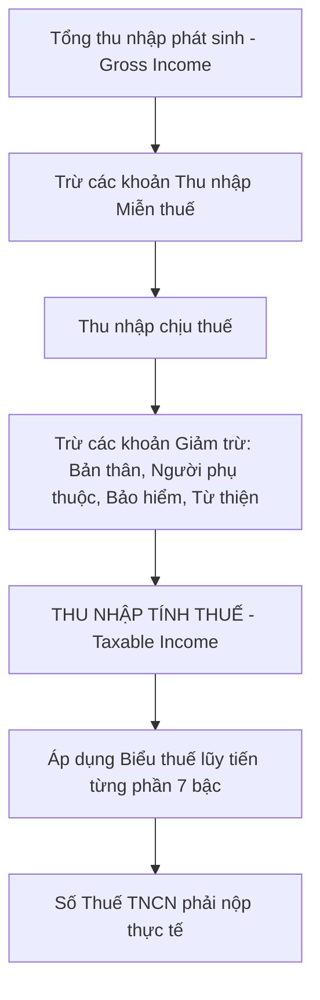
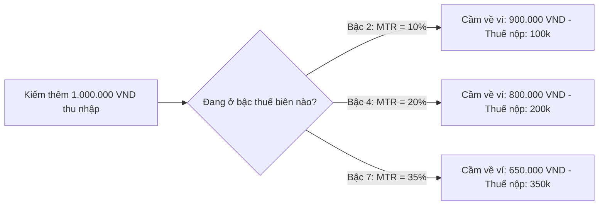

# Cơ Cấu Thuế Thu Nhập Cá Nhân, Biểu Thuế Lũy Tiến Và Các Loại Thuế Suất

Thuế là khoản chi phí lớn nhất và kéo dài nhất trong cuộc đời của một người tạo ra thu nhập. Việc hiểu tường tận cơ chế vận hành của Luật Thuế Thu nhập Cá nhân (Personal Income Tax - PIT), cấu trúc biểu thuế lũy tiến từng phần, sự khác biệt căn bản giữa Thuế suất biên (Marginal Tax Rate) và Thuế suất thực tế (Effective Tax Rate) là điều kiện tiên quyết để hoạch định tài chính và bảo vệ thành quả lao động một cách hợp pháp. Tài liệu này mổ xẻ chi tiết 5 khái niệm nền tảng trên.

> **Các câu hỏi cốt lõi:**
> 1. Tại sao biểu thuế lũy tiến từng phần (Progressive Tax) lại không bao giờ khiến bạn bị "thiệt hại ròng" khi được tăng lương sang bậc thuế cao hơn (bác bỏ huyền thoại ngộ nhận về thuế)?
> 2. Công thức toán học phân biệt giữa Thuế suất biên (Marginal Tax Rate) và Thuế suất thực tế (Effective Tax Rate) được tính toán như thế nào?
> 3. Cấu trúc 7 bậc thuế lũy tiến hiện hành theo Luật Thuế TNCN tại Việt Nam vận hành ra sao trong thực tiễn tính thuế tiền lương?

---

## 1. Personal Income Tax (Thuế thu nhập cá nhân - TNCN)

### 1. Là gì?
- **Định nghĩa hình thức:** Thuế thu nhập cá nhân là loại thuế trực thu đánh trực tiếp trên thu nhập chịu thuế của các thể nhân (cá nhân cư trú và cá nhân không cư trú) kiếm được trong một kỳ tính thuế nhất định, phát sinh từ tiền lương, tiền công, kinh doanh, đầu tư vốn, chuyển nhượng vốn, chuyển nhượng bất động sản, trúng thưởng, bản quyền, nhượng quyền thương mại, thừa kế và quà tặng.
- **Giải thích đơn giản:** Thuế TNCN là số tiền bạn có nghĩa vụ trích từ tiền lương, tiền kiếm được của mình nộp vào ngân sách nhà nước để nhà nước xây dựng đường sá, trường học, bệnh viện và duy trì an ninh quốc gia.
- **Nếu chỉ nhớ một điều:** Thuế TNCN là thuế trực thu đánh vào người kiếm ra tiền; người có thu nhập càng cao thì nghĩa vụ đóng góp cho ngân sách xã hội càng lớn.

### 2. Hoạt động thế nào?
- **Chủ thể ra quyết định:** Quốc hội ban hành luật thuế; Cơ quan Thuế (Tổng cục Thuế) quản lý thu; cá nhân người nộp thuế thực hiện tự kê khai, khấu trừ tại nguồn và quyết toán thuế cuối năm.
- **Mục tiêu tối ưu hóa:** Nhà nước tối đa hóa nguồn thu ngân sách và tái phân phối của cải xã hội; người nộp thuế tối ưu hóa nghĩa vụ thuế phải nộp trong khuôn khổ pháp luật.
- **Ràng buộc:** Căn cứ theo Luật Thuế Thu nhập Cá nhân số 04/2007/QH12 (và các luật sửa đổi, bổ sung); áp dụng nguyên tắc cư trú (Cá nhân cư trú chịu thuế trên thu nhập toàn cầu; Cá nhân không cư trú chỉ chịu thuế trên thu nhập phát sinh tại Việt Nam).
- **Cơ chế tác động:**


### 3. Công thức & Mô hình
Xác định Thuế TNCN phải nộp đối với thu nhập từ tiền lương, tiền công của cá nhân cư trú:
$$\text{Thuế TNCN phải nộp} = \text{Thu nhập tính thuế} \times \text{Thuế suất theo Biểu lũy tiến}$$
Trong đó:
$$\text{Thu nhập tính thuế} = \text{Thu nhập chịu thuế} - \text{Các khoản giảm trừ}$$
$$\text{Thu nhập chịu thuế} = \text{Tổng thu nhập (Gross)} - \text{Các khoản được miễn thuế}$$
Các khoản giảm trừ bao gồm:
- Giảm trừ gia cảnh cho bản thân người nộp thuế.
- Giảm trừ gia cảnh cho người phụ thuộc hợp pháp.
- Các khoản đóng bảo hiểm bắt buộc: BHXH ($8\%$), BHYT ($1,5\%$), BHTN ($1\%$).
- Các khoản đóng góp từ thiện, nhân đạo, khuyến học hợp pháp.

### 4. Ví dụ
- **Ví dụ định lượng:** Anh Hưng là cá nhân cư trú, có thu nhập từ tiền lương hàng tháng là 35.000.000 VND (chưa trừ bảo hiểm). Anh nuôi 1 con nhỏ (1 người phụ thuộc).
  - Đóng bảo hiểm bắt buộc ($10,5\%$): $10,5\% \times 35.000.000 = 3.675.000$ VND.
  - Giảm trừ gia cảnh cho bản thân: 11.000.000 VND/tháng.
  - Giảm trừ cho 1 người phụ thuộc: 4.400.000 VND/tháng.
  - Tổng các khoản giảm trừ: $3.675.000 + 11.000.000 + 4.400.000 = 19.075.000$ VND.
  - Thu nhập tính thuế của anh Hưng:
    $$\text{Taxable Income} = 35.000.000 - 19.075.000 = 15.925.000 \text{ VND}$$
  - Số tiền 15.925.000 VND này sẽ được đưa vào Biểu thuế lũy tiến 7 bậc để tính ra số thuế phải nộp chính xác.
- **Ví dụ thực tế:** Tại Việt Nam, vào tháng 3 và tháng 4 hàng năm, hàng triệu người lao động có từ 2 nguồn thu nhập trở lên phải thực hiện Quyết toán thuế TNCN trực tuyến qua cổng điện tử `thuedientu.gdt.gov.vn` để nộp thêm thuế còn thiếu hoặc làm thủ tục hoàn trả lại số thuế đã bị khấu trừ thừa trong năm.
- **Phản ví dụ (Counterfactual):** Một cá nhân có thu nhập 100 triệu/tháng từ nhiều công ty nhưng trốn kê khai quyết toán thuế trong suốt 5 năm. Cơ quan thuế quét dữ liệu mã số thuế cá nhân, phát hiện hành vi trốn thuế, ra quyết định truy thu toàn bộ số thuế còn thiếu kèm tiền phạt chậm nộp $0,03\%$/ngày và phạt hành chính gấp 1-3 lần số thuế trốn, tổng tiền phạt lên tới hàng trăm triệu đồng.

### 5. Ứng dụng & Tranh luận
- **Ứng dụng thực tiễn:** Hiểu rõ cấu trúc thuế TNCN để đàm phán hợp đồng lao động theo lương NET hay lương GROSS; chủ động đăng ký người phụ thuộc đúng hạn để tối ưu số thuế phải nộp.
- **Ưu và nhược điểm:**
  - *Ưu điểm:* Là nguồn lực tài chính chủ đạo của nhà nước; tạo ra sự công bằng trong điều tiết phân hóa giàu nghèo.
  - *Nhược điểm:* Nếu ngưỡng giảm trừ gia cảnh quá lạc hậu so với tốc độ trượt giá lạm phát sẽ gây áp lực sinh hoạt nặng nề cho tầng lớp lao động làm công ăn lương.
- **Sai lầm phổ biến:** Không chủ động đăng ký mã số thuế cho người phụ thuộc ngay từ đầu năm, dẫn đến việc bị khấu trừ thuế ở mức cao suốt cả năm mà không được áp dụng giảm trừ.

### 6. Liên kết
- Cùng chủ đề: [02_Progressive_Tax.md](file:///Users/ductri0981/Documents/Studying/Studying-Economic/04_Personal_Finance_and_Wealth_Management/09_Taxation_for_Individuals/02_Progressive_Tax.md)
- Liên kết chéo: [01_Personal_Finance_Foundations/04_Gross_Net_and_Income_Types.md](file:///Users/ductri0981/Documents/Studying/Studying-Economic/04_Personal_Finance_and_Wealth_Management/01_Personal_Finance_Foundations/04_Gross_Net_and_Income_Types.md)

---

## 2. Progressive Tax (Thuế lũy tiến)

### 1. Là gì?
- **Định nghĩa hình thức:** Thuế lũy tiến là cơ chế tính thuế trong đó thuế suất tăng dần theo sự gia tăng của cơ sở tính thuế (thu nhập tính thuế), theo đó các cá nhân có mức thu nhập cao hơn không chỉ phải nộp số tiền thuế tuyệt đối lớn hơn mà còn phải chịu một tỷ lệ phần trăm thuế trung bình trên thu nhập cao hơn so với người có thu nhập thấp.
- **Giải thích đơn giản:** Thuế lũy tiến là nguyên tắc "người kiếm được càng nhiều tiền thì tỷ lệ nộp thuế trên mỗi đồng kiếm thêm càng cao".
- **Nếu chỉ nhớ một điều:** Trong biểu thuế lũy tiến từng phần, chỉ có PHẦN THU NHẬP VƯỢT MỨC mới bị đánh thuế ở mức thuế suất cao hơn, phần thu nhập ở các bậc dưới vẫn giữ nguyên mức thuế suất thấp ban đầu.

### 2. Hoạt động thế nào?
- **Chủ thể ra quyết định:** Quốc hội thiết kế các nấc thang thuế suất nhằm hiện thực hóa nguyên tắc công bằng dọc (Vertical Equity) trong kinh tế học công cộng.
- **Mục tiêu tối ưu hóa:** Giảm hệ số bất bình đẳng thu nhập Gini, san sẻ gánh nặng ngân sách sang vai của nhóm có năng lực tài chính dồi dào nhất (Ability-to-Pay Principle).
- **Ràng buộc:** Nếu thuế suất ở các bậc trên quá cao (ví dụ vượt quá $50\% - 60\%$), nó sẽ triệt tiêu động lực lao động, khởi nghiệp và kích thích hiện tượng "chảy máu chất xám" cũng như trốn thuế sang các thiên đường thuế.
- **Cơ chế tác động:**


### 3. Công thức & Mô hình
Tổng thuế phải nộp theo Biểu thuế Lũy tiến từng phần ($T(Y)$) với các ngưỡng thu nhập $y_0 = 0 < y_1 < y_2 < \dots < y_m$ và các mức thuế suất tương ứng $t_1 < t_2 < \dots < t_m$:
$$T(Y) = \sum_{k=1}^j t_k \times (y_k - y_{k-1}) + t_{j+1} \times (Y - y_j), \quad \text{với } y_j \le Y < y_{j+1}$$
Công thức Tính nhanh (Short-cut formula):
$$T(Y) = Y \times t_{j+1} - C_{j+1}$$
Trong đó $C_{j+1}$ là số tiền giảm trừ bậc lũy tiến cố định đã được tính sẵn cho bậc đó.

### 4. Ví dụ
- **Ví dụ định lượng:** Tính thuế TNCN cho thu nhập tính thuế $Y = 15.925.000$ VND/tháng của anh Hưng ở ví dụ trước:
  - **Cách 1: Tính chi tiết từng bậc:**
    - Bậc 1 (đến 5 triệu): $5.000.000 \times 5\% = 250.000$ VND.
    - Bậc 2 (từ trên 5 đến 10 triệu): $(10.000.000 - 5.000.000) \times 10\% = 500.000$ VND.
    - Bậc 3 (từ trên 10 đến 15,925 triệu): $(15.925.000 - 10.000.000) \times 15\% = 888.750$ VND.
    - Tổng thuế TNCN phải nộp:
      $$T = 250.000 + 500.000 + 888.750 = 1.638.750 \text{ VND/tháng}$$
  - **Cách 2: Tính nhanh theo công thức bậc 3:**
    $$T = 15.925.000 \times 15\% - 750.000 = 2.388.750 - 750.000 = 1.638.750 \text{ VND}$$
  - Cả hai cách cho kết quả hoàn toàn trùng khớp.
- **Ví dụ thực tế:** Luật Thuế TNCN Việt Nam áp dụng Biểu thuế lũy tiến từng phần gồm 7 bậc từ $5\%$ đến $35\%$ cho thu nhập từ tiền lương, tiền công. Mức thuế suất cao nhất $35\%$ áp dụng cho phần thu nhập tính thuế vượt trên 80 triệu đồng/tháng.
- **Phản ví dụ (Counterfactual):** Một người từ chối nhận lời mời tăng lương từ 30 triệu lên 35 triệu vì lo sợ ngớ ngẩn: *"Lên bậc thuế mới thì toàn bộ tiền lương của tôi sẽ bị áp thuế suất cao hơn, khiến lương cầm về thực tế bị giảm đi"*. Đây là ngộ nhận tai hại nhất về thuế lũy tiến từng phần, vì mức thuế suất cao hơn chỉ áp dụng riêng cho 5 triệu tiền tăng thêm, số tiền lương cầm về ròng chắc chắn luôn luôn tăng.

### 5. Ứng dụng & Tranh luận
- **Ứng dụng thực tiễn:** Luôn đón nhận mọi cơ hội tăng lương và thăng chức; hiểu rằng thu nhập sau thuế luôn là một hàm đồng biến tăng đơn điệu theo thu nhập trước thuế.
- **Ưu và nhược điểm:**
  - *Ưu điểm:* Thúc đẩy công bằng xã hội; giảm gánh nặng tuyệt đối cho người nghèo.
  - *Nhược điểm:* Khá phức tạp trong việc tính toán khấu trừ; có thể tạo ra hiện tượng "Bracket Creep" khi lạm phát đẩy người lao động lên bậc thuế cao hơn dù sức mua thực tế không tăng.
- **Sai lầm phổ biến:** Nhầm lẫn giữa Thuế lũy tiến từng phần (chỉ tính thuế cao trên phần vượt mức) với Thuế lũy tiến toàn phần (áp một mức thuế suất duy nhất lên toàn bộ thu nhập - một hình thức đã bị bãi bỏ vì quá bất công).

### 6. Liên kết
- Cùng chủ đề: [03_Marginal_Tax_Rate.md](file:///Users/ductri0981/Documents/Studying/Studying-Economic/04_Personal_Finance_and_Wealth_Management/09_Taxation_for_Individuals/03_Marginal_Tax_Rate.md)
- Liên kết chéo: [01_Income_Tax_Structure_and_Rates.md](file:///Users/ductri0981/Documents/Studying/Studying-Economic/04_Personal_Finance_and_Wealth_Management/09_Taxation_for_Individuals/01_Income_Tax_Structure_and_Rates.md)

---

## 3. Marginal Tax Rate (Thuế suất biên / Thuế suất cận biên)

### 1. Là gì?
- **Định nghĩa hình thức:** Thuế suất biên là tỷ lệ phần trăm thuế áp dụng trên đồng thu nhập chịu thuế tăng thêm tiếp theo của một cá nhân, phản ánh mức thuế suất của bậc thuế cao nhất mà thu nhập của người đó đang chạm tới.
- **Giải thích đơn giản:** Thuế suất biên là câu trả lời cho câu hỏi: *"Nếu ngày mai tôi làm thêm giờ và kiếm thêm được 1 triệu đồng, tôi sẽ phải nộp bao nhiêu phần trăm tiền thuế cho riêng 1 triệu đồng đó?"*.
- **Nếu chỉ nhớ một điều:** Thuế suất biên quyết định động lực cận biên của việc kiếm thêm tiền; nó là con số quyết định việc bạn có nên nhận làm thêm dự án ngoài hay dành thời gian nghỉ ngơi.

### 2. Hoạt động thế nào?
- **Chủ thể ra quyết định:** Người lao động cân nhắc chi phí cơ hội giữa thời gian nghỉ ngơi và giá trị thu nhập ròng cận biên nhận về sau thuế.
- **Mục tiêu tối ưu hóa:** Tối đa hóa giá trị thời gian và sức lao động sau thuế.
- **Ràng buộc:** Giới hạn bởi bậc thuế cao nhất theo khung pháp lý ($35\%$ tại Việt Nam, hoặc trên $45\%$ tại một số quốc gia châu Âu).
- **Cơ chế tác động:**


### 3. Công thức & Mô hình
Định nghĩa toán học của Thuế suất biên (Marginal Tax Rate - $\text{MTR}$):
$$\text{MTR} = \frac{d T(Y)}{d Y} \approx \frac{\Delta T}{\Delta Y}$$
Trong đó:
- $\Delta Y$: Số tiền thu nhập tăng thêm.
- $\Delta T$: Số tiền thuế tăng thêm phải nộp tương ứng.
Số tiền thực nhận về tay từ đồng thu nhập tăng thêm:
$$\Delta \text{Net Income} = \Delta Y \times (1 - \text{MTR})$$

### 4. Ví dụ
- **Ví dụ định lượng:** Anh Tuấn có thu nhập tính thuế hiện tại là 25.000.000 VND/tháng (đang nằm ở Bậc 4: từ 18 đến 32 triệu đồng, có thuế suất bậc là $20\%$).
  - Thuế suất biên của anh Tuấn: $\text{MTR} = 20\%$.
  - Công ty thưởng nóng cho anh một khoản dự án là $\Delta Y = 5.000.000$ VND.
  - Vì tổng thu nhập tính thuế mới là $25 + 5 = 30$ triệu (vẫn nằm trọn vẹn trong Bậc 4), toàn bộ 5 triệu thưởng này sẽ chịu thuế suất biên $20\%$:
    $$\Delta T = 5.000.000 \times 20\% = 1.000.000 \text{ VND}$$
  - Số tiền thưởng thực tế anh Tuấn cầm về tay:
    $$\Delta \text{Net} = 5.000.000 \times (1 - 0,20) = 4.000.000 \text{ VND}$$
- **Ví dụ thực tế:** Khi xem xét các khoản giảm trừ thuế hợp pháp (như đóng góp từ thiện hay đóng bảo hiểm hưu trí bổ sung), giá trị tiết kiệm tiền mặt thực tế của mỗi đồng giảm trừ được tính đúng bằng Thuế suất biên của bạn: Người ở bậc $35\%$ đóng 10 triệu từ thiện sẽ tiết kiệm được 3,5 triệu tiền thuế; người ở bậc $10\%$ đóng 10 triệu chỉ tiết kiệm được 1 triệu tiền thuế.
- **Phản ví dụ (Counterfactual):** Một nhân sự cấp cao ở bậc thuế biên $35\%$ nhận làm thêm một công việc part-time vất vả vào cuối tuần kiếm thêm 10 triệu/tháng. Sau khi nộp thuế TNCN hết 3,5 triệu, người này chỉ còn lại 6,5 triệu, cảm thấy kiệt sức và nhận ra thời gian dành cho con cái và sức khỏe có giá trị cao hơn nhiều so với 6,5 triệu kiếm thêm.

### 5. Ứng dụng & Tranh luận
- **Ứng dụng thực tiễn:** Dùng để ra quyết định tài chính cận biên: Có nên làm thêm giờ không? Đóng góp vào quỹ hưu trí tự nguyện tiết kiệm được bao nhiêu tiền thuế?
- **Ưu và nhược điểm:**
  - *Ưu điểm:* Cung cấp con số chính xác để đo lường hiệu quả tài chính của mọi hành động kiếm thêm thu nhập hoặc giảm trừ chi phí.
  - *Nhược điểm:* Dễ bị nhầm lẫn với thuế suất thực tế, dẫn đến tâm lý bi quan quá mức về gánh nặng thuế tổng thể.
- **Sai lầm phổ biến:** Nghĩ rằng "tôi đang ở bậc thuế $35\%$ nghĩa là nhà nước lấy đi $35\%$ toàn bộ thu nhập của tôi", không biết rằng thuế suất thực tế trên toàn bộ thu nhập của bạn thấp hơn con số đó rất nhiều.

### 6. Liên kết
- Cùng chủ đề: [04_Effective_Tax_Rate.md](file:///Users/ductri0981/Documents/Studying/Studying-Economic/04_Personal_Finance_and_Wealth_Management/09_Taxation_for_Individuals/04_Effective_Tax_Rate.md)
- Liên kết chéo: [02_Income_Management/01_Earned_and_Self_Employment_Income.md](file:///Users/ductri0981/Documents/Studying/Studying-Economic/04_Personal_Finance_and_Wealth_Management/02_Income_Management/01_Earned_and_Self_Employment_Income.md)

---

## 4. Effective Tax Rate (Thuế suất thực tế / Thuế suất hiệu dụng)

### 1. Là gì?
- **Định nghĩa hình thức:** Thuế suất thực tế (hoặc Thuế suất trung bình) là tỷ lệ phần trăm thực tế giữa tổng số tiền thuế thu nhập cá nhân mà một cá nhân phải nộp chia cho tổng thu nhập (Gross Income) hoặc tổng thu nhập chịu thuế của cá nhân đó trong kỳ tính thuế.
- **Giải thích đơn giản:** Thuế suất thực tế là câu trả lời chân thật nhất cho câu hỏi: *"Tính chung lại, tôi đã phải nộp cho nhà nước bao nhiêu phần trăm trên tổng số tiền tôi kiếm được?"*.
- **Nếu chỉ nhớ một điều:** Thuế suất thực tế (Effective Tax Rate) LUÔN LUÔN THẤP HƠN Thuế suất biên (Marginal Tax Rate); đây mới là con số thực sự phản ánh gánh nặng thuế đè lên vai bạn.

### 2. Hoạt động thế nào?
- **Chủ thể ra quyết định:** Cá nhân đánh giá hiệu quả chi phí thuế trên bức tranh tài chính tổng thể.
- **Mục tiêu tối ưu hóa:** Tìm cách hạ thấp thuế suất thực tế một cách hợp pháp thông qua các khoản giảm trừ gia cảnh, miễn thuế và tối ưu hóa danh mục đầu tư.
- **Ràng buộc:** Tỷ lệ này tăng dần khi thu nhập tăng nhưng không bao giờ vượt qua mức thuế suất cao nhất của biểu thuế ($35\%$).
- **Cơ chế tác động:**
```mermaid
flowchart TD
    TotalEarned[TỔNG THU NHẬP KIẾM ĐƯỢC: 100% Gross Income] --> TaxSlice[Tổng số tiền Thuế nộp thực tế: $T$]
    TotalEarned --> PocketSlice[Thu nhập ròng cầm về ví: $\text{Gross} - T$]
    TaxSlice --> CalcRatio[Tỷ lệ: Thuế nộp / Tổng thu nhập]
    CalcRatio --> ETR[THUẾ SUẤT THỰC TẾ - Effective Tax Rate]
```

### 3. Công thức & Mô hình
Thuế suất thực tế trên Tổng thu nhập (Effective Tax Rate on Gross Income - $\text{ETR}_{\text{gross}}$):
$$\text{ETR}_{\text{gross}} = \frac{\text{Tổng số Thuế TNCN phải nộp}}{\text{Tổng Thu nhập (Gross Income)}} \times 100\%$$
Thuế suất thực tế trên Thu nhập tính thuế (Effective Tax Rate on Taxable Income - $\text{ETR}_{\text{taxable}}$):
$$\text{ETR}_{\text{taxable}} = \frac{\text{Tổng số Thuế TNCN phải nộp}}{\text{Thu nhập tính thuế (Taxable Income)}} \times 100\%$$
Mối quan hệ bất đẳng thức kinh điển trong hệ thống thuế lũy tiến:
$$\text{ETR}_{\text{gross}} \le \text{ETR}_{\text{taxable}} \le \text{MTR}$$

### 4. Ví dụ
- **Ví dụ định lượng:** Quay trở lại trường hợp anh Hưng có Tổng thu nhập Gross là 35.000.000 VND/tháng.
  - Tổng số thuế TNCN anh phải nộp mỗi tháng: $T = 1.638.750$ VND.
  - Thuế suất biên của anh Hưng (đang ở Bậc 3): $\text{MTR} = 15\%$.
  - Thuế suất thực tế trên Thu nhập tính thuế:
    $$\text{ETR}_{\text{taxable}} = \frac{1.638.750}{15.925.000} \approx 10,29\%$$
  - Thuế suất thực tế trên Tổng thu nhập Gross:
    $$\text{ETR}_{\text{gross}} = \frac{1.638.750}{35.000.000} \approx 4,68\%$$
  - Nhận xét: Dù anh Hưng chạm tới bậc thuế biên $15\%$, nhưng trên thực tế gánh nặng thuế chỉ lấy đi vỏn vẹn **$4,68\%$** tổng thu nhập của anh!
- **Ví dụ thực tế:** Tỷ phú Warren Buffett từng gây chấn động dư luận Mỹ khi công bố rằng Thuế suất thực tế của ông chỉ là khoảng $17,4\%$, thấp hơn nhiều so với thuế suất thực tế của người thư ký văn phòng của ông (trên $30\%$). Lý do là thu nhập của ông phần lớn đến từ Cổ tức và Lãi vốn đầu tư (chịu thuế suất cố định ưu đãi), trong khi thư ký của ông chịu thuế lũy tiến trên tiền lương làm việc.
- **Phản ví dụ (Counterfactual):** Một người nghe phong thanh rằng thu nhập 50 triệu sẽ bị đánh thuế bậc $25\%$, liền nhầm tưởng rằng mình sẽ phải nộp $50 \times 25\% = 12,5$ triệu đồng tiền thuế, dẫn đến tâm lý bất mãn với công việc. Khi được chuyên gia tài chính giải thích và tính ra số thuế thực tế chỉ khoảng 3,5 triệu (thuế suất thực tế chỉ $7\%$), người này mới hiểu đúng và an tâm làm việc.

### 5. Ứng dụng & Tranh luận
- **Ứng dụng thực tiễn:** Sử dụng Thuế suất thực tế để lập kế hoạch ngân sách sinh hoạt chính xác; so sánh hiệu quả chi phí thuế giữa các vùng lãnh thổ hoặc quốc gia khác nhau.
- **Ưu và nhược điểm:**
  - *Ưu điểm:* Là thước đo chân thực nhất phản ánh chi phí thuế thực tế tác động lên chất lượng cuộc sống.
  - *Nhược điểm:* Đòi hỏi phải tập hợp toàn bộ các nguồn thu nhập và chứng từ khấu trừ cuối năm mới tính được con số chính xác tuyệt đối.
- **Sai lầm phổ biến:** So sánh Thuế suất biên của mình với người khác để than vãn mà không nhận ra người kia có nhiều người phụ thuộc nên Thuế suất thực tế của họ có thể thấp hơn rất nhiều.

### 6. Liên kết
- Cùng chủ đề: [03_Marginal_Tax_Rate.md](file:///Users/ductri0981/Documents/Studying/Studying-Economic/04_Personal_Finance_and_Wealth_Management/09_Taxation_for_Individuals/03_Marginal_Tax_Rate.md)
- Liên kết chéo: [01_Personal_Finance_Foundations/04_Gross_Net_and_Income_Types.md](file:///Users/ductri0981/Documents/Studying/Studying-Economic/04_Personal_Finance_and_Wealth_Management/01_Personal_Finance_Foundations/04_Gross_Net_and_Income_Types.md)

---

## 5. Tax Bracket (Bậc thuế / Khung thuế)

### 1. Là gì?
- **Định nghĩa hình thức:** Bậc thuế là các khoảng giới hạn giá trị của thu nhập tính thuế được pháp luật quy định cụ thể trong biểu thuế lũy tiến, trong đó mọi đồng thu nhập rơi vào bên trong khoảng giới hạn đó sẽ chịu một mức thuế suất phần trăm nhất định và duy nhất.
- **Giải thích đơn giản:** Bậc thuế giống như các "ngăn kéo bậc thang" đựng tiền: Ngăn thứ nhất từ 0 đến 5 triệu chịu thuế $5\%$; ngăn thứ hai từ 5 đến 10 triệu chịu thuế $10\%$; cứ như vậy cho đến ngăn cao nhất. Tiền của bạn chảy đầy ngăn nào thì ngăn đó mới bị tính thuế.
- **Nếu chỉ nhớ một điều:** Rơi vào bậc thuế cao hơn không làm biến đổi mức thuế của các bậc thuế phía dưới; nó chỉ áp mức thuế suất mới cho phần tiền tràn vào bậc đó mà thôi.

### 2. Hoạt động thế nào?
- **Chủ thể ra quyết định:** Nhà làm luật thiết kế độ rộng và mức thuế suất của từng bậc thuế để điều tiết vĩ mô nền kinh tế.
- **Mục tiêu tối ưu hóa:** Xác định chính xác nghĩa vụ nộp thuế theo từng phần thu nhập một cách minh bạch, có thể lập trình tự động hóa trên hệ thống máy tính ngành thuế.
- **Ràng buộc:** Hiện tượng "Trượt bậc thuế do lạm phát" (Bracket Creep) xảy ra khi thu nhập danh nghĩa tăng theo trượt giá khiến người dân bị nhảy lên bậc thuế cao hơn mà mức sống thực tế không đổi.
- **Cơ chế tác động:**


### 3. Công thức & Mô hình
Bảng Chi tiết Biểu thuế Lũy tiến từng phần theo Điều 22 Luật Thuế TNCN Việt Nam:

| Bậc thuế | Phần thu nhập tính thuế / tháng (triệu VND) | Phần thu nhập tính thuế / năm (triệu VND) | Thuế suất ($\%$) | Số tiền giảm trừ theo công thức tính nhanh (triệu VND/tháng) |
| :---: | :---: | :---: | :---: | :---: |
| **1** | Đến 5 | Đến 60 | **$5\%$** | $0$ |
| **2** | Trên 5 đến 10 | Trên 60 đến 120 | **$10\%$** | $0,25$ |
| **3** | Trên 10 đến 18 | Trên 120 đến 216 | **$15\%$** | $0,75$ |
| **4** | Trên 18 đến 32 | Trên 216 đến 384 | **$20\%$** | $1,65$ |
| **5** | Trên 32 đến 52 | Trên 384 đến 624 | **$25\%$** | $3,25$ |
| **6** | Trên 52 đến 80 | Trên 624 đến 960 | **$30\%$** | $5,85$ |
| **7** | Trên 80 | Trên 960 | **$35\%$** | $9,85$ |

Công thức tính nhanh cho Bậc $k$:
$$T(Y) = Y \times t_k - C_k$$

### 4. Ví dụ
- **Ví dụ định lượng:** Một chuyên gia có thu nhập tính thuế hàng tháng là $Y = 60.000.000$ VND (rơi vào Bậc 6: từ 52 đến 80 triệu đồng).
  - Áp dụng công thức tính nhanh của Bậc 6: Thuế suất $30\%$, số trừ $5,85$ triệu VND.
  - Số thuế TNCN phải nộp hàng tháng:
    $$T = 60.000.000 \times 30\% - 5.850.000 = 18.000.000 - 5.850.000 = 12.150.000 \text{ VND/tháng}$$
  - Thuế suất thực tế trên thu nhập tính thuế: $\frac{12,15}{60} = 20,25\%$ (thấp hơn nhiều so với mức $30\%$ của bậc thuế chạm tới).
- **Ví dụ thực tế:** Tại Mỹ và nhiều quốc gia phát triển, các ngưỡng của Bậc thuế (Tax Brackets) được điều chỉnh tự động hàng năm theo Chỉ số Giá tiêu dùng (CPI Indexation) để người dân không bị rơi vào tình trạng đóng thuế oan do lạm phát. Tại Việt Nam, các chuyên gia đang đề xuất sửa đổi Luật Thuế TNCN để giãn khoảng cách giữa các bậc thuế nhằm khoan thư sức dân.
- **Phản ví dụ (Counterfactual):** Một nhân viên có thu nhập tính thuế 10.000.000 VND (nằm trọn trong Bậc 2, nộp 750.000 VND tiền thuế). Công ty tăng lương thêm 100.000 VND khiến thu nhập tính thuế lên 10.100.000 VND (chạm vào Bậc 3). Số thuế phải nộp mới:
  $$T = 10.100.000 \times 15\% - 750.000 = 765.000 \text{ VND}$$
  Số thuế tăng thêm đúng bằng $100.000 \times 15\% = 15.000$ VND. Nhân viên vẫn nhận thêm về tay 85.000 VND tiền mặt.

### 5. Ứng dụng & Tranh luận
- **Ứng dụng thực tiễn:** Quản trị chiến lược thu nhập: nếu thu nhập của bạn đang ngấp nghé ở ngưỡng chuyển tiếp giữa hai bậc thuế, việc gia tăng các khoản chi phí được giảm trừ (như đóng góp từ thiện, chứng từ hợp lệ) có thể kéo toàn bộ phần thu nhập đỉnh trở lại bậc thuế thấp hơn.
- **Ưu và nhược điểm:**
  - *Ưu điểm:* Cấu trúc rõ ràng, minh bạch, tạo điều kiện thuận lợi cho việc kiểm tra đối soát tự động.
  - *Nhược điểm:* Biểu thuế 7 bậc tại Việt Nam hiện nay bị đánh giá là quá dày và các bước nhảy thu nhập còn hẹp so với tốc độ phát triển kinh tế.
- **Sai lầm phổ biến:** Sợ chạm vào bậc thuế tiếp theo, dẫn đến việc từ chối các cơ hội thưởng hoặc tăng lương xứng đáng với năng lực.

### 6. Liên kết
- Cùng chủ đề: [02_Progressive_Tax.md](file:///Users/ductri0981/Documents/Studying/Studying-Economic/04_Personal_Finance_and_Wealth_Management/09_Taxation_for_Individuals/02_Progressive_Tax.md)
- Liên kết chéo: [01_Personal_Finance_Foundations/04_Gross_Net_and_Income_Types.md](file:///Users/ductri0981/Documents/Studying/Studying-Economic/04_Personal_Finance_and_Wealth_Management/01_Personal_Finance_Foundations/04_Gross_Net_and_Income_Types.md)

---

## Câu hỏi tự kiểm tra
1. Hãy phân biệt rõ sự khác nhau giữa Thuế suất biên (Marginal Tax Rate) và Thuế suất thực tế (Effective Tax Rate). Tại sao trong hệ thống thuế lũy tiến, Thuế suất thực tế luôn luôn nhỏ hơn hoặc bằng Thuế suất biên?
2. Bác bỏ định kiến sai lầm phổ biến: *"Nếu tôi được tăng lương và nhảy sang bậc thuế cao hơn thì thu nhập thực nhận sau thuế của tôi sẽ bị giảm đi"*. Dùng công thức toán học và số liệu để chứng minh.
3. Trình bày các khoản giảm trừ hợp pháp theo quy định của Luật Thuế TNCN Việt Nam hiện hành để xác định từ Thu nhập chịu thuế sang Thu nhập tính thuế.
4. Hiện tượng "Trượt bậc thuế do lạm phát" (Bracket Creep) là gì? Các quốc gia phát triển sử dụng cơ chế nào để bảo vệ người nộp thuế trước hiện tượng này?

## Ghi chú nguồn
- Luật Thuế Thu nhập Cá nhân số 04/2007/QH12 và Luật số 26/2012/QH13 sửa đổi, bổ sung một số điều của Luật Thuế TNCN.
- Nghị quyết số 954/2020/UBTVQH14 về điều chỉnh mức giảm trừ gia cảnh của thuế thu nhập cá nhân.
- Thông tư số 111/2013/TT-BTC của Bộ Tài chính hướng dẫn thực hiện Luật Thuế TNCN.
- Stiglitz, J. E., & Rosengard, J. K. - *Economics of the Public Sector*, W. W. Norton & Company.
