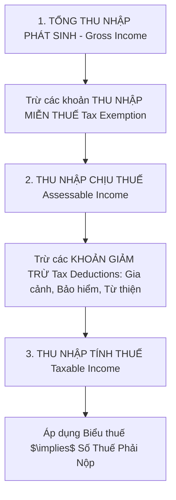
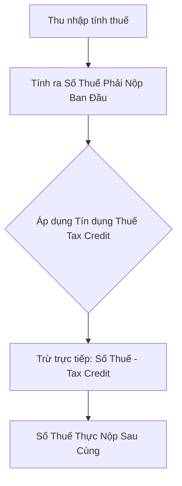
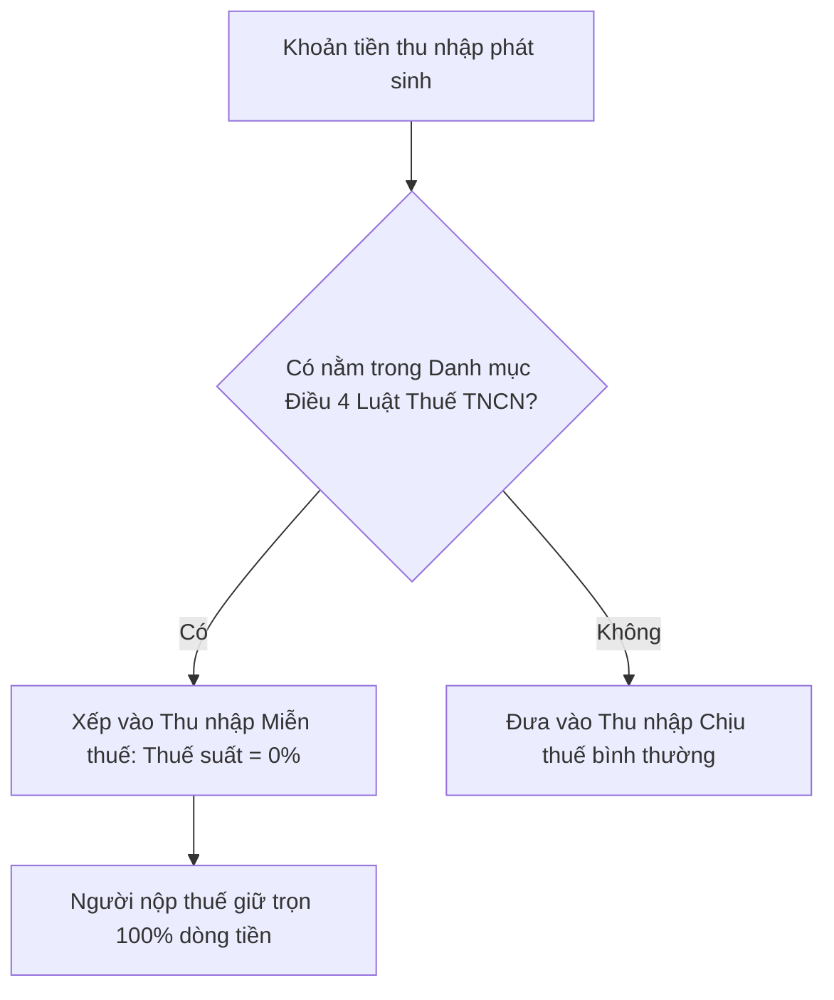
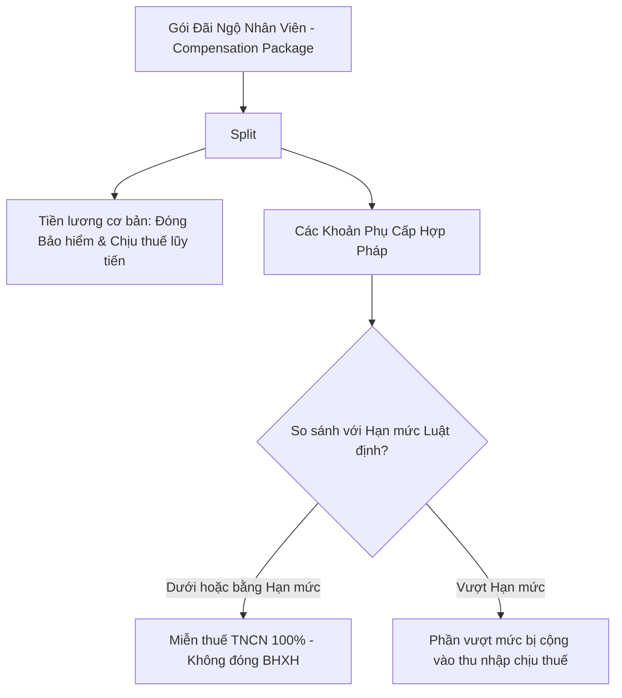

# Thu Nhập Tính Thuế, Các Khoản Giảm Trừ, Tín Dụng Thuế Và Miễn Trừ Thuế

Để tối ưu hóa nghĩa vụ thuế một cách minh bạch và hợp pháp, người nộp thuế cần phân biệt tường tận giữa các khái niệm kỹ thuật cốt lõi trong Luật Thuế Thu nhập Cá nhân. Việc hiểu rõ ranh giới giữa Thu nhập tính thuế, Khoản giảm trừ (Tax Deduction), Tín dụng thuế (Tax Credit), Thu nhập miễn thuế (Tax Exemption) và Hạn mức phụ cấp miễn trừ (Tax Allowance) giúp người lao động và nhà đầu tư tận dụng tối đa các quyền lợi pháp lý để bảo toàn dòng tiền ròng của mình.

> **Các câu hỏi cốt lõi:**
> 1. Sự khác biệt mang tính bản chất giữa Khoản giảm trừ thuế (Tax Deduction - giảm thu nhập trước khi tính thuế) và Tín dụng thuế (Tax Credit - trừ thẳng vào số thuế phải nộp) là gì?
> 2. Danh mục 16 khoản thu nhập được Miễn thuế (Tax Exemption) theo Điều 4 Luật Thuế TNCN Việt Nam gồm những nhóm nguồn tiền nào?
> 3. Cơ chế phân bổ hạn mức giảm trừ gia cảnh cho bản thân và người phụ thuộc hoạt động như thế nào trong thực tế quyết toán thuế?

---

## 1. Taxable Income (Thu nhập tính thuế)

### 1. Là gì?
- **Định nghĩa hình thức:** Thu nhập tính thuế là phần thu nhập của cá nhân thực tế được dùng làm căn cứ trực tiếp để áp dụng thuế suất (theo biểu lũy tiến hoặc thuế suất toàn phần) nhằm xác định số thuế thu nhập cá nhân phải nộp trong kỳ tính thuế, sau khi đã lấy tổng thu nhập trừ đi các khoản thu nhập được miễn thuế và các khoản giảm trừ theo luật định.
- **Giải thích đơn giản:** Thu nhập tính thuế là "số tiền thực sự bị đem ra tính thuế", chứ không phải là toàn bộ số tiền bạn kiếm được.
- **Nếu chỉ nhớ một điều:** Tổng thu nhập (Gross Income) $\ne$ Thu nhập chịu thuế (Assessable Income) $\ne$ Thu nhập tính thuế (Taxable Income); bạn chỉ phải nộp thuế trên con số cuối cùng sau khi đã trừ sạch các khoản ưu đãi và giảm trừ.

### 2. Hoạt động thế nào?
- **Chủ thể ra quyết định:** Cơ quan Thuế xác định công thức chuẩn; doanh nghiệp chi trả thu nhập thực hiện khấu trừ và cá nhân quyết toán cuối năm.
- **Mục tiêu tối ưu hóa:** Người nộp thuế tìm cách thu hẹp tối đa Thu nhập tính thuế bằng các công cụ pháp lý hợp lệ.
- **Ràng buộc:** Các khoản khấu trừ và miễn trừ phải có đầy đủ hóa đơn, chứng từ hợp pháp và đăng ký đúng hạn theo quy định của Bộ Tài chính.
- **Cơ chế tác động:**


### 3. Công thức & Mô hình
Phương trình Chuẩn xác định Thu nhập tính thuế từ tiền lương, tiền công tại Việt Nam:
$$\text{Taxable Income} = \text{Assessable Income} - \sum \text{Deductions}$$
Trong đó:
$$\text{Assessable Income} = \text{Gross Income} - \text{Exempt Income} - \text{Exempt Allowances}$$
$$\sum \text{Deductions} = \text{Deduction}_{\text{personal}} + \text{Deduction}_{\text{dependents}} + \text{Deduction}_{\text{insurance}} + \text{Deduction}_{\text{charity}}$$
Nếu $\text{Assessable Income} \le \sum \text{Deductions} \implies \text{Taxable Income} = 0 \implies \text{Thuế phải nộp} = 0$ VND.

### 4. Ví dụ
- **Ví dụ định lượng:** Chị Lan làm việc tại một công ty với tổng lương Gross là 28.000.000 VND/tháng. Trong đó có 1.000.000 VND tiền ăn trưa giữa ca (thuộc diện phụ cấp miễn thuế theo quy chế nội bộ). Chị nuôi 1 người con nhỏ.
  - Thu nhập chịu thuế: $28.000.000 - 1.000.000 = 27.000.000$ VND.
  - Các khoản giảm trừ:
    - Bảo hiểm bắt buộc ($10,5\%$ trên lương đóng BHXH 27 triệu): $2.835.000$ VND.
    - Giảm trừ bản thân: 11.000.000 VND.
    - Giảm trừ 1 con nhỏ: 4.400.000 VND.
    - Tổng giảm trừ: $2.835.000 + 11.000.000 + 4.400.000 = 18.235.000$ VND.
  - Thu nhập tính thuế của chị Lan:
    $$\text{Taxable Income} = 27.000.000 - 18.235.000 = 8.765.000 \text{ VND/tháng}$$
  - Chị Lan chỉ bị tính thuế trên con số 8,765 triệu đồng (rơi vào Bậc 2), số thuế phải nộp là:
    $$T = 8.765.000 \times 10\% - 250.000 = 626.500 \text{ VND/tháng}$$
- **Ví dụ thực tế:** Tại Việt Nam, một người có thu nhập 15 triệu/tháng nếu nuôi 1 người phụ thuộc thì sau khi trừ bảo hiểm ($10,5\% = 1,575$ triệu), giảm trừ bản thân (11 triệu) và giảm trừ con cái (4,4 triệu), tổng giảm trừ là 16,975 triệu > 15 triệu $\implies$ Thu nhập tính thuế bằng 0 và người này hoàn toàn không phải nộp một đồng thuế TNCN nào.
- **Phản ví dụ (Counterfactual):** Một kế toán viên công ty nhầm lẫn lấy trực tiếp Tổng lương Gross 28 triệu nhân với thuế suất mà không trừ các khoản giảm trừ gia cảnh, khiến chị Lan bị khấu trừ oan hàng triệu đồng tiền thuế mỗi tháng.

### 5. Ứng dụng & Tranh luận
- **Ứng dụng thực tiễn:** Quản lý cơ cấu thu nhập cá nhân để chuyển hóa tối đa các khoản thu nhập thành các khoản phụ cấp miễn thuế và khoản chi được giảm trừ hợp lệ.
- **Ưu và nhược điểm:**
  - *Ưu điểm:* Thể hiện chính xác năng lực nộp thuế thực sự của từng hoàn cảnh gia đình.
  - *Nhược điểm:* Đòi hỏi quy trình kê khai và kiểm tra hóa đơn chứng từ phức tạp.
- **Sai lầm phổ biến:** Nghĩ rằng kiếm được 12 triệu/tháng là đã phải nộp thuế (vì vượt mức giảm trừ bản thân 11 triệu), quên mất rằng sau khi trừ tiền bảo hiểm bắt buộc $10,5\%$, thu nhập tính thuế vẫn bằng 0.

### 6. Liên kết
- Cùng chủ đề: [02_Tax_Deduction.md](file:///Users/ductri0981/Documents/Studying/Studying-Economic/04_Personal_Finance_and_Wealth_Management/09_Taxation_for_Individuals/02_Tax_Deduction.md)
- Liên kết chéo: [01_Income_Tax_Structure_and_Rates.md](file:///Users/ductri0981/Documents/Studying/Studying-Economic/04_Personal_Finance_and_Wealth_Management/09_Taxation_for_Individuals/01_Income_Tax_Structure_and_Rates.md)

---

## 2. Tax Deduction (Khoản giảm trừ thuế / Khấu trừ gia cảnh)

### 1. Là gì?
- **Định nghĩa hình thức:** Khoản giảm trừ thuế là một khoản chi phí cụ thể hoặc một định mức tài chính pháp định được phép khấu trừ trực tiếp vào Thu nhập chịu thuế của người nộp thuế trước khi tiến hành tính toán áp dụng thuế suất thuế thu nhập cá nhân.
- **Giải thích đơn giản:** Là những khoản tiền mà nhà nước cho phép bạn "trừ đi" khỏi thu nhập kiếm được (như tiền nuôi bản thân, tiền nuôi con, tiền đóng bảo hiểm xã hội, tiền làm từ thiện) để bạn chỉ phải nộp thuế trên phần tiền còn lại.
- **Nếu chỉ nhớ một điều:** Giá trị tiết kiệm tiền mặt thực tế của một Khoản giảm trừ (Tax Deduction) luôn tỷ lệ thuận với Thuế suất biên (Marginal Tax Rate) của bạn; người ở bậc thuế càng cao thì mỗi đồng giảm trừ càng mang lại giá trị tiết kiệm lớn hơn.

### 2. Hoạt động thế nào?
- **Chủ thể ra quyết định:** Người nộp thuế chủ động thu thập chứng từ hợp pháp và nộp hồ sơ đăng ký giảm trừ gia cảnh cho cơ quan thuế.
- **Mục tiêu tối ưu hóa:** Giảm gánh nặng tài chính cho những người gánh vác trách nhiệm nuôi dưỡng người phụ thuộc (con nhỏ, cha mẹ già yếu).
- **Ràng buộc:** Người phụ thuộc phải không có thu nhập hoặc có thu nhập bình quân tháng trong năm từ tất cả các nguồn không vượt quá 1.000.000 VND; mỗi người phụ thuộc chỉ được tính giảm trừ một lần vào một người nộp thuế duy nhất.
- **Cơ chế tác động:**
```mermaid
flowchart LR
    DeductApply[Áp dụng Khoản Giảm trừ: $\Delta D$] --> LowerTaxable[Hạ thấp Thu nhập tính thuế: $\text{Taxable} - \Delta D$]
    LowerTaxable --> TaxSaved[Tiết kiệm tiền thuế nộp: $\Delta T = \Delta D \times \text{Marginal Tax Rate}$]
```

### 3. Công thức & Mô hình
Giá trị Tiết kiệm Thuế Tiền mặt Thực tế ($\text{Tax Savings}$) từ một Khoản Giảm trừ $\Delta D$:
$$\text{Tax Savings} = \Delta D \times \text{MTR}$$
Trong đó $\text{MTR}$ là Thuế suất biên của người nộp thuế.

Quy định Mức Giảm trừ Gia cảnh hiện hành tại Việt Nam (theo Nghị quyết 954/2020/UBTVQH14):
- Mức giảm trừ đối với đối tượng nộp thuế: **11.000.000 VND/tháng** (132.000.000 VND/năm).
- Mức giảm trừ đối với mỗi người phụ thuộc: **4.400.000 VND/tháng** (52.800.000 VND/năm).

Khoản Giảm trừ Đóng góp Từ thiện, Nhân đạo, Khuyến học (Điều 9 Thông tư 111/2013/TT-BTC):
Được giảm trừ $100\%$ vào thu nhập chịu thuế nếu đóng góp vào các tổ chức, cơ sở được thành lập và hoạt động theo quy định của pháp luật Việt Nam.

### 4. Ví dụ
- **Ví dụ định lượng (So sánh Giá trị Tiết kiệm giữa 2 Bậc thuế):**
  Một khoản giảm trừ người phụ thuộc là 4.400.000 VND/tháng (52,8 triệu/năm):
  - **Trường hợp A (Người lao động ở Bậc 1: $\text{MTR} = 5\%$):**
    $$\text{Tax Savings}_A = 52.800.000 \times 5\% = 2.640.000 \text{ VND/năm } (220.000 \text{ VND/tháng})$$
  - **Trường hợp B (Chuyên gia ở Bậc 7: $\text{MTR} = 35\%$):**
    $$\text{Tax Savings}_B = 52.800.000 \times 35\% = 18.480.000 \text{ VND/năm } (1.540.000 \text{ VND/tháng})$$
  - Cùng một người phụ thuộc, người ở bậc thuế $35\%$ tiết kiệm được số tiền thuế mặt gấp 7 lần người ở bậc $5\%$.
- **Ví dụ thực tế:** Tại Việt Nam, nhiều người có cha mẹ già hết tuổi lao động không có lương hưu (hoặc thu nhập dưới 1 triệu/tháng) nhưng quên không làm thủ tục "Đăng ký người phụ thuộc". Khi hoàn tất thủ tục đăng ký bổ sung và nộp hồ sơ quyết toán thuế cuối năm, họ được hoàn lại hàng chục triệu đồng tiền thuế đã khấu trừ thừa trong năm.
- **Phản ví dụ (Counterfactual):** Hai vợ chồng cùng đăng ký giảm trừ gia cảnh cho cùng một đứa con tại hai công ty khác nhau. Khi cơ quan thuế đối soát mã định danh căn cước công dân của đứa trẻ trên hệ thống quản lý thuế tập trung (TMS), hành vi trùng lặp bị phát hiện, một bên bị truy thu toàn bộ số thuế đã giảm trừ kèm tiền phạt chậm nộp.

### 5. Ứng dụng & Tranh luận
- **Ứng dụng thực tiễn:** Tận dụng triệt để các khoản giảm trừ hợp pháp: đăng ký đầy đủ người phụ thuộc hợp lệ; lưu giữ chứng từ đóng góp vào các quỹ khuyến học, quỹ từ thiện nhà nước.
- **Ưu và nhược điểm:**
  - *Ưu điểm:* Mang tính nhân văn cao, hỗ trợ thiết thực cho những người gánh vác trách nhiệm gia đình.
  - *Nhược điểm:* Đem lại lợi ích tiền tệ lớn hơn cho người có thu nhập cao (Regressive benefit in progressive system).
- **Sai lầm phổ biến:** Nhầm tưởng rằng giảm trừ 4,4 triệu nghĩa là được trừ 4,4 triệu tiền thuế phải nộp, không hiểu rằng nó chỉ giúp giảm 4,4 triệu tiền thu nhập tính thuế.

### 6. Liên kết
- Cùng chủ đề: [03_Tax_Credit.md](file:///Users/ductri0981/Documents/Studying/Studying-Economic/04_Personal_Finance_and_Wealth_Management/09_Taxation_for_Individuals/03_Tax_Credit.md)
- Liên kết chéo: [01_Income_Tax_Structure_and_Rates.md](file:///Users/ductri0981/Documents/Studying/Studying-Economic/04_Personal_Finance_and_Wealth_Management/09_Taxation_for_Individuals/01_Income_Tax_Structure_and_Rates.md)

---

## 3. Tax Credit (Tín dụng thuế / Khoản trừ thuế trực tiếp)

### 1. Là gì?
- **Định nghĩa hình thức:** Tín dụng thuế là một khoản tiền pháp định được phép khấu trừ trực tiếp từng đồng (Dollar-for-dollar reduction) vào tổng số nghĩa vụ thuế thu nhập cá nhân phải nộp cho nhà nước, sau khi số thuế đó đã được tính toán xong dựa trên biểu thuế.
- **Giải thích đơn giản:** Tín dụng thuế giống như một chiếc "phiếu giảm giá trừ thẳng vào hóa đơn thuế": nếu bạn tính ra phải nộp 10 triệu tiền thuế nhưng có một khoản tín dụng thuế 3 triệu, bạn chỉ cần nộp 7 triệu đồng.
- **Nếu chỉ nhớ một điều:** Tín dụng thuế (Tax Credit) luôn có giá trị kinh tế mạnh hơn Khoản giảm trừ (Tax Deduction); 1 triệu đồng Tax Credit giúp bạn giữ lại đúng 1 triệu đồng tiền mặt, bất kể bạn đang ở bậc thuế nào!

### 2. Hoạt động thế nào?
- **Chủ thể ra quyết định:** Nhà nước sử dụng Tín dụng thuế như một công cụ chính sách kinh tế - xã hội đắc lực nhằm khuyến khích các hành vi mong muốn (như năng lượng tái tạo, sinh con, nghiên cứu khoa học, hoặc tránh đánh thuế trùng quốc tế).
- **Mục tiêu tối ưu hóa:** Hỗ trợ trực tiếp cho các nhóm đối tượng ưu tiên mà không bị phụ thuộc vào mức thuế suất biên của người nhận.
- **Ràng buộc:** Phân loại thành Tín dụng thuế có hoàn lại (Refundable - nếu số tín dụng lớn hơn số thuế phải nộp thì nhà nước trả lại tiền thừa) và Tín dụng thuế không hoàn lại (Non-refundable - chỉ giảm tối đa số thuế về 0, phần thừa bị mất).
- **Cơ chế tác động:**


### 3. Công thức & Mô hình
So sánh Sức mạnh Tài chính giữa Tax Credit ($TC$) và Tax Deduction ($TD$):
$$\text{Tax Payable}_{\text{after Credit}} = \text{Tax Payable}_{\text{initial}} - TC$$
$$\Delta \text{Tax}_{\text{saved by Credit}} = TC$$
$$\Delta \text{Tax}_{\text{saved by Deduction}} = TD \times \text{MTR}$$
Vì $\text{MTR} \le 35\% < 100\%$, nên với cùng một quy mô giá trị danh nghĩa $X$:
$$TC(X) = X > TD(X) \times \text{MTR} = X \times \text{MTR}$$
(Tín dụng thuế luôn có giá trị tiền mặt cao gấp 3 đến 20 lần so với Khoản giảm trừ thuế!).

Cơ chế Tín dụng Thuế Chống Đánh thuế Trùng Quốc tế (Foreign Tax Credit - FTC):
Nếu một cá nhân cư trú đã nộp thuế thu nhập ở nước ngoài ($T_{\text{foreign}}$) cho khoản thu nhập phát sinh tại nước đó:
$$T_{\text{domestic payable}} = T_{\text{total}} - \min(T_{\text{foreign}}, T_{\text{domestic limit}})$$

### 4. Ví dụ
- **Ví dụ định lượng (So sánh Trực quan):**
  Bạn ở bậc thuế suất biên $\text{MTR} = 20\%$ và số thuế tính ra ban đầu là 15.000.000 VND. Bạn được chính phủ trao 2 lựa chọn ưu đãi chính sách trị giá danh nghĩa 10.000.000 VND:
  - Lựa chọn 1 (Khoản Giảm trừ $TD = 10.000.000$ VND):
    - Thu nhập tính thuế giảm 10 triệu $\implies$ Tiền thuế tiết kiệm được:
      $$\text{Tiết kiệm} = 10.000.000 \times 20\% = 2.000.000 \text{ VND}$$
    - Số thuế thực nộp: $15 - 2 = 13.000.000$ VND.
  - Lựa chọn 2 (Tín dụng Thuế $TC = 10.000.000$ VND):
    - Trừ thẳng 10 triệu vào số thuế phải nộp $\implies$ Tiền thuế tiết kiệm được: đúng **10.000.000 VND**!
    - Số thuế thực nộp: $15 - 10 = 5.000.000$ VND.
  - Tín dụng thuế giúp bạn tiết kiệm nhiều hơn tới 8 triệu đồng tiền mặt!
- **Ví dụ thực tế:** Tại Mỹ, chương trình **Child Tax Credit (CTC)** cho phép các gia đình trừ thẳng tới 2.000 USD/mỗi đứa trẻ vào hóa đơn thuế; chương trình **EV Tax Credit** trừ thẳng tới 7.500 USD tiền thuế cho người mua xe ô tô điện. Tại Việt Nam, cơ chế Tín dụng thuế xuất hiện chủ yếu dưới dạng "Khấu trừ số thuế đã nộp ở nước ngoài" theo các Hiệp định tránh đánh thuế hai lần (DTA).
- **Phản ví dụ (Counterfactual):** Một người nộp thuế nhầm lẫn giữa Tax Credit và Tax Deduction, từ chối một chương trình tín dụng thuế 5 triệu vì tưởng rằng nó chỉ giúp giảm được 1 triệu tiền thuế như khoản giảm trừ gia cảnh, làm mất đi 5 triệu đồng tiền mặt thực tế.

### 5. Ứng dụng & Tranh luận
- **Ứng dụng thực tiễn:** Khai báo đầy đủ các khoản thuế đã bị khấu trừ tại nước ngoài khi quyết toán thuế thu nhập toàn cầu tại Việt Nam để được cấp Tín dụng thuế bù trừ.
- **Ưu và nhược điểm:**
  - *Ưu điểm:* Công bằng tuyệt đối giữa các tầng lớp thu nhập; tác động kích thích hành vi kinh tế xã hội cực kỳ mạnh mẽ và tức thì.
  - *Nhược điểm:* Làm xói mòn nguồn thu ngân sách nhà nước nhanh chóng nếu không kiểm soát chặt chẽ điều kiện cấp tín dụng.
- **Sai lầm phổ biến:** Đánh đồng Tax Credit với Tax Deduction trong các bài toán hoạch định tài chính và kế hoạch kinh doanh.

### 6. Liên kết
- Cùng chủ đề: [02_Tax_Deduction.md](file:///Users/ductri0981/Documents/Studying/Studying-Economic/04_Personal_Finance_and_Wealth_Management/09_Taxation_for_Individuals/02_Tax_Deduction.md)
- Liên kết chéo: [04_International_Taxation_and_Residency.md](file:///Users/ductri0981/Documents/Studying/Studying-Economic/04_Personal_Finance_and_Wealth_Management/09_Taxation_for_Individuals/04_International_Taxation_and_Residency.md)

---

## 4. Tax Exemption (Miễn thuế)

### 1. Là gì?
- **Định nghĩa hình thức:** Miễn thuế là quy định của pháp luật loại trừ hoàn toàn một số loại thu nhập cụ thể ra khỏi cơ sở tính thuế thu nhập cá nhân, theo đó người nộp thuế phát sinh các khoản thu nhập này không phải thực hiện nghĩa vụ kê khai nộp thuế và được giữ lại trọn vẹn $100\%$ giá trị thu nhập nhận được.
- **Giải thích đơn giản:** Miễn thuế là những khoản tiền "hợp pháp sạch thuế $100\%$": nhà nước tuyên bố không đánh thuế một xu nào vào những khoản tiền này (ví dụ tiền lãi gửi tiết kiệm ngân hàng, tiền kiều hối, tiền bồi thường bảo hiểm nhân thọ).
- **Nếu chỉ nhớ một điều:** Thu nhập miễn thuế không phải là hành vi trốn thuế hay lách thuế; đó là chính sách ưu đãi tài chính minh bạch được Quốc hội quy định rõ ràng trong luật nhằm phục vụ an sinh và khuyến khích kinh tế.

### 2. Hoạt động thế nào?
- **Chủ thể ra quyết định:** Quốc hội quy định danh mục miễn thuế tại Điều 4 Luật Thuế TNCN; cá nhân thụ hưởng thực hiện theo đúng điều kiện luật định.
- **Mục tiêu tối ưu hóa:** Bảo vệ an sinh xã hội cho các nhóm yếu thế, thu hút ngoại tệ (kiều hối), bảo vệ dòng tiền bồi thường rủi ro và khuyến khích tích lũy tiết kiệm quốc gia.
- **Ràng buộc:** Phải đáp ứng đúng các điều kiện nghiêm ngặt về chủ thể và tính chất giao dịch (ví dụ chuyển nhượng nhà đất chỉ được miễn thuế nếu là giữa thân nhân trực hệ hoặc là căn nhà duy nhất).
- **Cơ chế tác động:**


### 3. Công thức & Mô hình
Danh mục Các Khoản Thu Nhập Miễn Thuế Trọng Yếu theo Điều 4 Luật Thuế TNCN Việt Nam:
$$\text{Tax Liability} = 0 \quad \text{đối với:}$$
1. Thu nhập từ chuyển nhượng, thừa kế, quà tặng là bất động sản giữa thân nhân trực hệ (Vợ - chồng; Cha mẹ - con; Ông bà - cháu; Anh chị em ruột).
2. Thu nhập từ chuyển nhượng nhà ở, quyền sử dụng đất ở và tài sản gắn liền với đất ở của cá nhân trong trường hợp người chuyển nhượng **chỉ có duy nhất một nhà ở, đất ở** tại Việt Nam.
3. Thu nhập từ **Lãi tiền gửi tại tổ chức tín dụng, chi nhánh ngân hàng nước ngoài**; lãi từ hợp đồng bảo hiểm nhân thọ.
4. Thu nhập từ **Kiều hối** (tiền người Việt Nam định cư ở nước ngoài chuyển về cho thân nhân).
5. Thu nhập từ phần tiền lương làm việc ban đêm, làm thêm giờ được trả cao hơn so với tiền lương làm việc ban ngày, làm trong giờ theo quy định.
6. Tiền lương hưu do Quỹ bảo hiểm xã hội chi trả trọn đời.
7. Tiền bồi thường bảo hiểm nhân thọ, phi nhân thọ, tiền bồi thường tai nạn lao động.

### 4. Ví dụ
- **Ví dụ định lượng:** Ông Sáu bán căn nhà duy nhất của mình với giá 5.000.000.000 VND (ông không còn sở hữu bất kỳ mảnh đất hay căn nhà nào khác tại Việt Nam và đã sở hữu nhà trên 183 ngày).
  - Thuế suất chuyển nhượng bất động sản thông thường là $2\%$ trên giá chuyển nhượng.
  - Nếu không được miễn: Số thuế phải nộp là $2\% \times 5.000.000.000 = 100.000.000$ VND.
  - Tuy nhiên, vì thỏa mãn điều kiện "Nhà ở duy nhất" theo Khoản 2 Điều 4 Luật Thuế TNCN:
    $$\text{Thuế TNCN phải nộp} = 0 \text{ VND}$$
  - Ông Sáu được miễn thuế trọn vẹn 100 triệu đồng và cầm về đủ 5 tỷ đồng.
- **Ví dụ thực tế:** Tại Việt Nam, hàng triệu người gửi tiết kiệm ngân hàng nhận hàng trăm tỷ đồng tiền lãi mỗi năm nhưng hoàn toàn không phải nộp một đồng thuế TNCN nào (trong khi tại Mỹ hoặc châu Âu, lãi tiền gửi tiết kiệm bị đánh thuế từ $15\% - 30\%$). Đây là chính sách ưu đãi miễn thuế vượt trội của Việt Nam để khuyến khích người dân gửi tiền vào hệ thống ngân hàng.
- **Phản ví dụ (Counterfactual):** Một người sở hữu 2 căn nhà nhưng khi bán căn thứ hai đã gian dối làm cam kết "đây là căn nhà duy nhất" để trốn $2\%$ thuế chuyển nhượng. Khi cơ quan thuế phối hợp với Văn phòng Đăng ký Đất đai tra cứu cơ sở dữ liệu quốc gia về đất đai, hành vi khai man bị phát hiện; người này bị truy thu thuế, phạt tiền và hồ sơ chuyển sang cơ quan công an điều tra tội trốn thuế.

### 5. Ứng dụng & Tranh luận
- **Ứng dụng thực tiễn:** Cấu trúc tài sản hợp pháp: ưu tiên các kênh tài sản được pháp luật miễn thuế (tiền gửi ngân hàng, bồi thường bảo hiểm, bất động sản thân nhân) để tối đa hóa dòng tiền ròng.
- **Ưu và nhược điểm:**
  - *Ưu điểm:* Tạo hành lang chính sách thông thoáng, thu hút nguồn vốn nhàn rỗi trong dân chúng và nguồn kiều hối ngoại tệ từ nước ngoài.
  - *Nhược điểm:* Tạo ra các kẽ hở cho các hành vi gian lận (như hiện tượng "nhờ người thân đứng tên hộ nhà đất" để lách luật nhà duy nhất).
- **Sai lầm phổ biến:** Nhầm tưởng rằng mọi giao dịch mua bán nhà đất đều bị thu thuế $2\%$, không biết tận dụng quyền miễn thuế hợp pháp khi giao dịch giữa cha mẹ và con cái.

### 6. Liên kết
- Cùng chủ đề: [05_Tax_Allowance.md](file:///Users/ductri0981/Documents/Studying/Studying-Economic/04_Personal_Finance_and_Wealth_Management/09_Taxation_for_Individuals/05_Tax_Allowance.md)
- Liên kết chéo: [03_Investment_and_Passive_Income_Taxation.md](file:///Users/ductri0981/Documents/Studying/Studying-Economic/04_Personal_Finance_and_Wealth_Management/09_Taxation_for_Individuals/03_Investment_and_Passive_Income_Taxation.md)

---

## 5. Tax Allowance (Hạn mức miễn trừ thuế / Phụ cấp miễn thuế)

### 1. Là gì?
- **Định nghĩa hình thức:** Phụ cấp miễn trừ thuế là các khoản phụ cấp, trợ cấp, lợi ích bằng tiền hoặc không bằng tiền do người sử dụng lao động chi trả cho người lao động nhằm hỗ trợ các chi phí sinh hoạt, đi lại, phương tiện hoặc làm việc thực tế, được pháp luật thuế cho phép không tính vào thu nhập chịu thuế thu nhập cá nhân trong giới hạn các định mức (hạn mức) quy định.
- **Giải thích đơn giản:** Là những khoản tiền công ty phụ cấp thêm cho bạn (như tiền ăn trưa, tiền điện thoại, tiền trang phục, tiền xăng xe công tác) mà không bị trừ thuế TNCN nếu số tiền đó nằm trong hạn mức cho phép.
- **Nếu chỉ nhớ một điều:** Việc tái cấu trúc tiền lương thành các khoản Phụ cấp miễn thuế hợp lệ là kỹ thuật tối ưu hóa thuế thu nhập cá nhân phổ biến và an toàn nhất cho cả người lao động lẫn doanh nghiệp.

### 2. Hoạt động thế nào?
- **Chủ thể ra quyết định:** Doanh nghiệp ban hành Quy chế tài chính / Thỏa ước lao động tập thể quy định rõ tiêu chuẩn phụ cấp; người lao động hưởng lợi.
- **Mục tiêu tối ưu hóa:** Tăng thu nhập thực nhận (Net Take-home Pay) của người lao động mà không làm tăng chi phí thuế và chi phí đóng bảo hiểm bắt buộc của doanh nghiệp.
- **Ràng buộc:** Khoản phụ cấp phải được quy định rõ trong hợp đồng lao động hoặc quy chế nội bộ; phần chi vượt quá định mức luật định vẫn bị tính thuế bình thường.
- **Cơ chế tác động:**


### 3. Công thức & Mô hình
Danh mục Các Khoản Phụ Cấp Miễn Thuế Phổ Biến tại Việt Nam (theo Thông tư 111/2013/TT-BTC và Thông tư 25/2018/TT-BTC):
1. **Tiền ăn giữa ca, ăn trưa:**
   - Nếu công ty tự nấu ăn hoặc mua suất ăn: Miễn toàn bộ.
   - Nếu chi tiền mặt cho người lao động: Tối đa không quá **730.000 VND/người/tháng** (theo quy định của Bộ LĐTBXH). Phần chi vượt 730k bị tính thuế.
2. **Tiền trang phục:**
   - Chi bằng hiện vật: Miễn toàn bộ.
   - Chi bằng tiền mặt: Miễn tối đa không quá **5.000.000 VND/người/năm**. Phần vượt 5 triệu bị tính thuế.
3. **Tiền điện thoại, công tác phí, văn phòng phẩm:**
   - Miễn thuế theo định mức thực tế được quy định trong Quy chế tài chính của doanh nghiệp.
4. **Tiền đám hiếu, hỉ:**
   - Cho bản thân và gia đình người lao động theo quy chế doanh nghiệp: Phù hợp với mức quy định của Luật Thuế TNDN (tổng chi phúc lợi không quá 1 tháng lương bình quân thực hiện).

### 4. Ví dụ
- **Ví dụ định lượng:** Anh Bình có thỏa thuận tổng thu nhập là 30.000.000 VND/tháng.
  - **Phương án 1 (Không cấu trúc phụ cấp):** Toàn bộ 30 triệu là lương cơ bản $\implies$ Thu nhập chịu thuế là 30.000.000 VND.
  - **Phương án 2 (Tái cấu trúc thông minh vào hợp đồng lao động):**
    - Lương cơ bản: 25.000.000 VND.
    - Phụ cấp ăn trưa: 730.000 VND/tháng (miễn thuế).
    - Phụ cấp điện thoại công việc: 1.000.000 VND/tháng (theo quy chế, miễn thuế).
    - Phụ cấp trang phục: $400.000$ VND/tháng (khoảng 4,8 triệu/năm, miễn thuế).
    - Phụ cấp xăng xe công tác phí khoán: 2.870.000 VND/tháng (có chứng từ, miễn thuế).
    - $\implies$ Tổng phụ cấp miễn thuế: $730k + 1tr + 400k + 2,87tr = 5.000.000$ VND.
  - Thu nhập chịu thuế ở Phương án 2 chỉ còn: $30.000.000 - 5.000.000 = 25.000.000$ VND.
  - Giả sử anh Bình ở bậc thuế biên $20\%$, việc tái cấu trúc phụ cấp giúp anh tiết kiệm tiền thuế mỗi tháng:
    $$\text{Tax Saved} = 5.000.000 \times 20\% = 1.000.000 \text{ VND/tháng } (12.000.000 \text{ VND/năm})$$
  - Thu nhập ròng cầm về tay tăng thêm 12 triệu đồng mỗi năm hoàn toàn hợp pháp!
- **Ví dụ thực tế:** Tất cả các tập đoàn đa quốc gia và doanh nghiệp lớn tại Việt Nam đều áp dụng chính sách cấu trúc gói đãi ngộ linh hoạt (Flexible Benefit Package) để tối ưu hóa hạn mức phụ cấp miễn thuế cho cán bộ nhân viên.
- **Phản ví dụ (Counterfactual):** Một công ty chi tiền trang phục bằng tiền mặt 20.000.000 VND/năm cho nhân viên nhưng kế toán kê khai miễn thuế toàn bộ. Khi thanh tra thuế quyết toán, cơ quan thuế bóc tách và truy thu thuế TNCN trên phần chi vượt định mức $20 - 5 = 15$ triệu đồng, phạt tiền doanh nghiệp và người lao động.

### 5. Ứng dụng & Tranh luận
- **Ứng dụng thực tiễn:** Khi đàm phán hợp đồng lao động, hãy đề nghị nhà tuyển dụng phân bổ thu nhập vào các danh mục phụ cấp miễn thuế được pháp luật cho phép.
- **Ưu và nhược điểm:**
  - *Ưu điểm:* Tiết kiệm thuế ngay lập tức trên từng tháng lương; hoàn toàn hợp pháp và minh bạch.
  - *Nhược điểm:* Đòi hỏi phòng kế toán phải lưu trữ đầy đủ hồ sơ quy chế và hóa đơn chứng từ chứng minh chi phí thực tế.
- **Sai lầm phổ biến:** Cố tình "vẽ" ra các loại phụ cấp khống hoặc chi vượt quá các định mức khống chế của Bộ Tài chính, dẫn đến việc bị thanh tra thuế loại trừ và truy thu.

### 6. Liên kết
- Cùng chủ đề: [04_Tax_Exemption.md](file:///Users/ductri0981/Documents/Studying/Studying-Economic/04_Personal_Finance_and_Wealth_Management/09_Taxation_for_Individuals/04_Tax_Exemption.md)
- Liên kết chéo: [02_Income_Management/04_Compensation_and_Salary_Negotiation.md](file:///Users/ductri0981/Documents/Studying/Studying-Economic/04_Personal_Finance_and_Wealth_Management/02_Income_Management/04_Compensation_and_Salary_Negotiation.md)

---

## Câu hỏi tự kiểm tra
1. So sánh sự khác nhau căn bản giữa Khoản giảm trừ thuế (Tax Deduction) và Tín dụng thuế (Tax Credit). Tại sao Tín dụng thuế lại có giá trị kinh tế mạnh hơn đối với người có thu nhập thấp?
2. Trình bày các điều kiện pháp lý khắt khe để một giao dịch chuyển nhượng bất động sản được Miễn thuế TNCN (Tax Exemption) theo diện "Nhà ở duy nhất" tại Việt Nam.
3. Kể tên 4 khoản Phụ cấp miễn thuế (Tax Allowance) phổ biến nhất trong thu nhập từ tiền lương và nêu rõ định mức tối đa được miễn thuế của từng khoản theo quy định hiện hành.
4. Một người có thu nhập Gross 40 triệu/tháng muốn tối ưu hóa thuế TNCN. Hãy đề xuất một cơ cấu phân bổ thu nhập (gồm lương cơ bản, các khoản bảo hiểm, phụ cấp miễn thuế và người phụ thuộc) để hạ thấp Thu nhập tính thuế một cách hợp pháp.

## Ghi chú nguồn
- Luật Thuế Thu nhập Cá nhân số 04/2007/QH12 và các văn bản hợp nhất.
- Nghị quyết số 954/2020/UBTVQH14 của Ủy ban Thường vụ Quốc hội.
- Thông tư số 111/2013/TT-BTC và Thông tư số 25/2018/TT-BTC của Bộ Tài chính.
- Gruber, J. - *Public Finance and Public Policy*, Worth Publishers.
