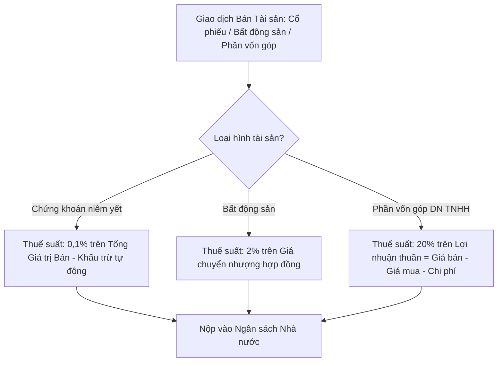
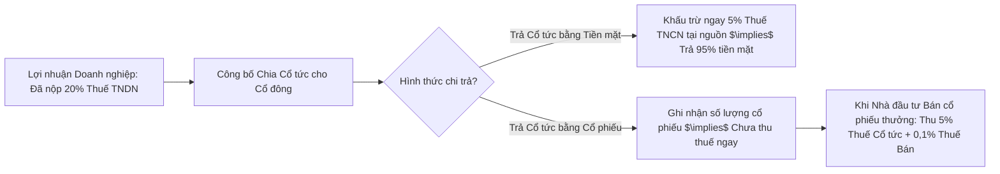
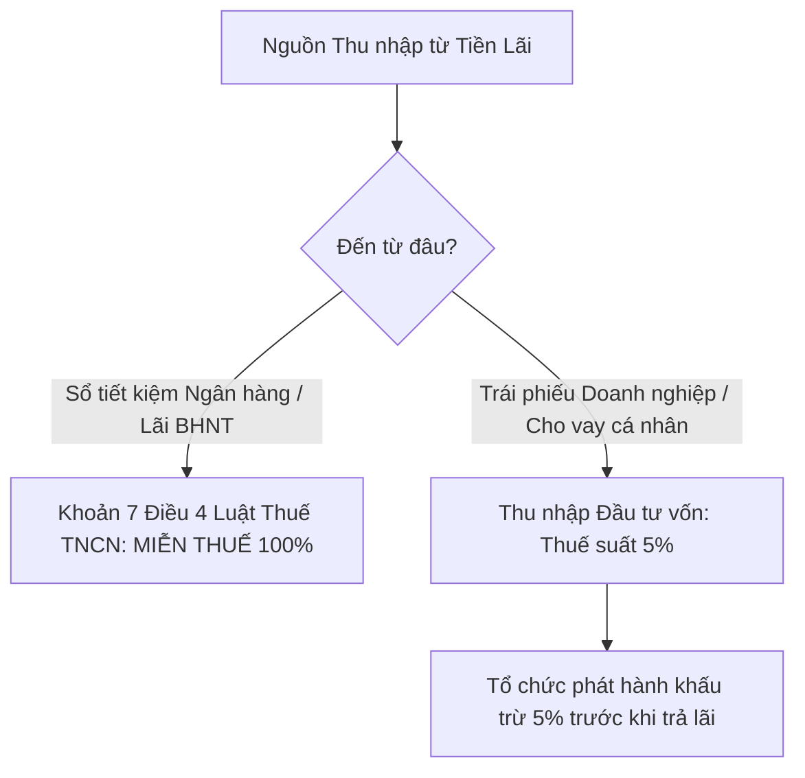
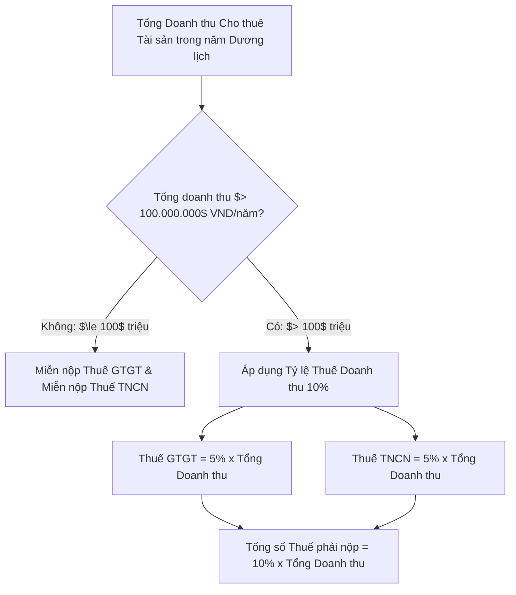
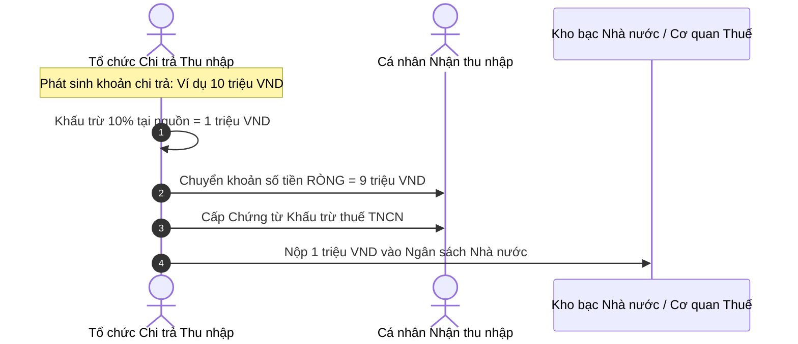

# Thuế Đối Với Thu Nhập Đầu Tư, Thu Nhập Thụ Động Và Cơ Chế Khấu Trừ Tại Nguồn

Trong hành trình xây dựng tự do tài chính, việc chuyển dịch từ thu nhập chủ động (tiền lương) sang các dòng thu nhập thụ động và thu nhập đầu tư (cổ tức, lãi vốn, tiền thuê nhà) là quy luật tất yếu. Tuy nhiên, các dòng thu nhập này chịu sự điều chỉnh của các chính sách thuế suất riêng biệt (thường là thuế suất toàn phần cố định) với các cơ chế khấu trừ tại nguồn đặc thù. Tài liệu này mổ xẻ chi tiết khung thuế suất và phương pháp tính thuế đối với 5 nguồn thu nhập đầu tư trọng yếu theo quy định hiện hành.

> **Các câu hỏi cốt lõi:**
> 1. Tại sao thuế chuyển nhượng chứng khoán niêm yết tại Việt Nam lại đánh $0,1\%$ trên Tổng giá trị bán (Gross Selling Price) thay vì đánh trên Lợi nhuận thực tế (Capital Gains), và điều này tác động ra sao đến nhà đầu tư khi thua lỗ?
> 2. Cơ chế thu thuế $10\%$ (gồm $5\%$ thuế GTGT và $5\%$ thuế TNCN) đối với hoạt động cho thuê nhà có doanh thu trên 100 triệu đồng/năm vận hành như thế nào?
> 3. Cơ chế Khấu trừ tại nguồn (Withholding Tax) giúp cơ quan thuế triệt tiêu nguy cơ thất thu thuế và giảm chi phí tuân thủ cho xã hội ra sao?

---

## 1. Capital Gains Tax (Thuế lãi vốn / Thuế chuyển nhượng vốn)

### 1. Là gì?
- **Định nghĩa hình thức:** Thuế lãi vốn (hoặc Thuế thu nhập từ chuyển nhượng vốn, chuyển nhượng chứng khoán, chuyển nhượng bất động sản) là loại thuế đánh trên khoản thặng dư vốn phát sinh khi một cá nhân bán hoặc thanh lý một tài sản tài chính hoặc tài sản thực với giá bán cao hơn giá vốn mua vào ban đầu.
- **Giải thích đơn giản:** Là tiền thuế bạn phải nộp khi bán một tài sản có lời: ví dụ bạn mua mảnh đất 2 tỷ bán được 3 tỷ (lãi 1 tỷ), hoặc mua cổ phiếu 50 triệu bán được 70 triệu (lãi 20 triệu), nhà nước sẽ thu một phần tiền thuế trên giao dịch này.
- **Nếu chỉ nhớ một điều:** Tại Việt Nam, để đơn giản hóa quản lý, pháp luật thuế áp dụng phương pháp khoán thu theo tỷ lệ phần trăm trên Tổng giá trị chuyển nhượng ($0,1\%$ đối với cổ phiếu niêm yết, $2\%$ đối với bất động sản) bất kể giao dịch đó bạn lãi lớn hay cắt lỗ đau đớn.

### 2. Hoạt động thế nào?
- **Chủ thể ra quyết định:** Nhà đầu tư cá nhân thực hiện giao dịch mua bán trên thị trường tài chính hoặc thị trường bất động sản.
- **Mục tiêu tối ưu hóa:** Nhà nước bảo đảm nguồn thu ngân sách tức thời tại mỗi khâu giao dịch; nhà đầu tư tối đa hóa tỷ suất sinh lời thực tế sau thuế.
- **Ràng buộc:** Bị khấu trừ tự động ngay khi khớp lệnh bán (đối với chứng khoán) hoặc bắt buộc phải có biên lai nộp thuế mới được sang tên sổ đỏ (đối với nhà đất).
- **Cơ chế tác động:**

### 3. Công thức & Mô hình
Các Công thức Tính Thuế Chuyển nhượng Vốn tại Việt Nam (theo Thông tư 111/2013/TT-BTC và Thông tư 92/2015/TT-BTC):
1. **Thuế đối với Chuyển nhượng Chứng khoán (cổ phiếu, chứng chỉ quỹ niêm yết):**
$$T_{\text{securities}} = \text{Giá chuyển nhượng từng lần (Tổng giá bán)} \times 0,1\%$$
(Đánh trực tiếp trên doanh thu bán, không phụ thuộc vào giá mua hay kết quả lời/lỗ).
2. **Thuế đối với Chuyển nhượng Bất động sản:**
$$T_{\text{real\_estate}} = \text{Giá chuyển nhượng ghi trên hợp đồng} \times 2\%$$
(Nếu giá trên hợp đồng thấp hơn Bảng giá đất của UBND cấp tỉnh thì tính theo Bảng giá đất).
3. **Thuế đối với Chuyển nhượng Phần vốn góp (Công ty TNHH, Hợp danh):**
$$T_{\text{capital}} = (\text{Giá chuyển nhượng} - \text{Giá mua phần vốn} - \text{Chi phí hợp lý}) \times 20\%$$
(Đánh trên Lãi vốn thuần thực tế).

### 4. Ví dụ
- **Ví dụ định lượng:**
  - **Trường hợp A (Bán cổ phiếu):** Nhà đầu tư bán 10.000 cổ phiếu FPT với giá thị trường 130.000 VND/cổ phiếu.
    - Tổng giá trị khớp lệnh bán: $10.000 \times 130.000 = 1.300.000.000$ VND.
    - Công ty chứng khoán tự động khấu trừ thuế TNCN:
      $$T_{\text{stock}} = 1.300.000.000 \times 0,1\% = 1.300.000 \text{ VND}$$
    - Tiền về tài khoản nhà đầu tư: $1,3 \text{ tỷ} - 1,3 \text{ triệu} = 1.298.700.000$ VND (chưa trừ phí môi giới). Dù lô cổ phiếu này nhà đầu tư vừa mua hôm qua bị lỗ 50 triệu thì số thuế $0,1\%$ vẫn bị thu đủ.
  - **Trường hợp B (Bán nhà đất):** Anh Nam bán căn hộ chung cư với giá thỏa thuận công chứng là 3.000.000.000 VND.
    - Thuế TNCN chuyển nhượng bất động sản phải nộp:
      $$T_{\text{bds}} = 3.000.000.000 \times 2\% = 60.000.000 \text{ VND}$$
- **Ví dụ thực tế:** Tại Mỹ, thuế lãi vốn chia làm 2 loại: Short-term Capital Gains (nắm giữ dưới 1 năm, đánh thuế lũy tiến lên tới $37\%$) và Long-term Capital Gains (nắm giữ trên 1 năm, đánh thuế ưu đãi $0\%, 15\%$ hoặc $20\%$) để khuyến khích đầu tư dài hạn. Tại Việt Nam, mức thuế $0,1\%$ trên doanh thu bán áp dụng đồng nhất cho mọi kỳ hạn nắm giữ.
- **Phản ví dụ (Counterfactual):** Trong giao dịch bất động sản trước đây, người mua và người bán thường thỏa thuận "ghi giá trên hợp đồng công chứng thấp hơn giá thực tế" (gọi là hợp đồng hai giá) để trốn $2\%$ thuế TNCN. Hiện nay, cơ quan thuế áp dụng cơ sở dữ liệu giá thị trường và phối hợp với cơ quan điều tra hình sự để xử lý nghiêm các trường hợp khai man trốn thuế bất động sản.

### 5. Ứng dụng & Tranh luận
- **Ứng dụng thực tiễn:** Dự trù chi phí thuế $0,1\%$ và $2\%$ vào bài toán tính toán tỷ suất sinh lời ròng (ROI) khi đầu tư chứng khoán và bất động sản.
- **Ưu và nhược điểm:**
  - *Ưu điểm:* Dễ thu, dễ quản lý, chống thất thu thuế tuyệt đối nhờ khấu trừ tức thì; nhà đầu tư không phải lưu giữ hóa đơn chứng từ mua vào qua nhiều năm.
  - *Nhược điểm:* Không công bằng cho nhà đầu tư khi thua lỗ vẫn phải nộp thuế (đánh thuế trên sự mất mát vốn).
- **Sai lầm phổ biến:** Nghĩ rằng "tôi lướt sóng cổ phiếu bị lỗ thì công ty chứng khoán không được trừ thuế của tôi", không hiểu rằng luật Việt Nam thu thuế trên Doanh số bán chứ không thu trên Lợi nhuận.

### 6. Liên kết
- Cùng chủ đề: [02_Dividend_Tax.md](file:///Users/ductri0981/Documents/Studying/Studying-Economic/04_Personal_Finance_and_Wealth_Management/09_Taxation_for_Individuals/02_Dividend_Tax.md)
- Liên kết chéo: [06_Wealth_Building_and_Compounding/05_Appreciation_and_Reinvestment_Dynamics.md](file:///Users/ductri0981/Documents/Studying/Studying-Economic/04_Personal_Finance_and_Wealth_Management/06_Wealth_Building_and_Compounding/05_Appreciation_and_Reinvestment_Dynamics.md)

---

## 2. Dividend Tax (Thuế cổ tức)

### 1. Là gì?
- **Định nghĩa hình thức:** Thuế cổ tức (thuế thu nhập từ đầu tư vốn) là loại thuế thu nhập cá nhân áp dụng đối với các khoản lợi nhuận, cổ tức bằng tiền hoặc cổ tức bằng cổ phiếu mà cá nhân nhận được do việc góp vốn, mua cổ phần của các doanh nghiệp, công ty cổ phần.
- **Giải thích đơn giản:** Khi bạn mua cổ phiếu của một công ty làm ăn có lãi và công ty chia tiền thưởng (cổ tức) cho bạn, nhà nước sẽ trích thu một khoản thuế cố định trước khi tiền chảy vào tài khoản của bạn.
- **Nếu chỉ nhớ một điều:** Tại Việt Nam, thuế suất đối với thu nhập từ cổ tức là **$5\%$ cố định**; kể cả khi bạn nhận cổ tức bằng cổ phiếu (thưởng cổ phiếu), bạn vẫn phải nộp $5\%$ thuế khi thực hiện bán số cổ phiếu đó.

### 2. Hoạt động thế nào?
- **Chủ thể ra quyết định:** Đại hội đồng cổ đông doanh nghiệp biểu quyết chia cổ tức; công ty chi trả hoặc công ty chứng khoán thực hiện khấu trừ thuế thay cho cá nhân.
- **Mục tiêu tối ưu hóa:** Thu thuế trên dòng tiền sinh lời từ vốn của cổ đông.
- **Ràng buộc:** Ngoại trừ cổ tức nhận được từ trái phiếu chính phủ (được miễn); các hình thức chi trả cổ tức bằng tiền hoặc bằng cổ phiếu đều thuộc diện chịu thuế.
- **Cơ chế tác động:**

### 3. Công thức & Mô hình
Thuế TNCN đối với Thu nhập từ Đầu tư vốn (Cổ tức):
$$T_{\text{dividend}} = \text{Thu nhập từ cổ tức} \times 5\%$$
Trường hợp Nhận Cổ tức bằng Cổ phiếu (theo Nghị định 126/2020/NĐ-CP):
Tại thời điểm nhận cổ phiếu thưởng/cổ tức bằng cổ phiếu: Chưa phải nộp thuế.
Tại thời điểm chuyển nhượng (bán) số cổ phiếu đó:
$$T_{\text{total payout}} = (\text{Số lượng CP bán} \times \min(\text{Mệnh giá 10k}, \text{Giá bán}) \times 5\%) + (\text{Số lượng CP bán} \times \text{Giá bán} \times 0,1\%)$$

Khái niệm **Đánh thuế hai lần kinh tế (Economic Double Taxation):**
Lợi nhuận của doanh nghiệp trước khi chia cổ tức đã phải chịu Thuế Thu nhập Doanh nghiệp ($\text{CIT} = 20\%$). Khi chia cho cổ đông, phần lợi nhuận sau thuế đó lại tiếp tục bị đánh thêm $5\%$ Thuế TNCN.
Tổng gánh nặng thuế thực tế trên 1 đồng lợi nhuận doanh nghiệp làm ra:
$$\text{Total Tax Burden} = 20\% + (1 - 0,20) \times 5\% = 20\% + 4\% = 24\%$$

### 4. Ví dụ
- **Ví dụ định lượng:**
  - **Nhận Cổ tức Tiền mặt:** Ông Thành sở hữu 20.000 cổ phiếu Vinamilk (VNM). Công ty thông báo tạm ứng cổ tức bằng tiền mặt tỷ lệ $15\%$ (tương đương 1.500 VND/cổ phiếu).
    - Tổng số tiền cổ tức được nhận: $20.000 \times 1.500 = 30.000.000$ VND.
    - Số thuế TNCN $5\%$ bị khấu trừ tại nguồn:
      $$T_{\text{dividend}} = 30.000.000 \times 5\% = 1.500.000 \text{ VND}$$
    - Số tiền thực nhận chuyển vào tài khoản chứng khoán của ông Thành:
      $$\text{Net Cash} = 30.000.000 - 1.500.000 = 28.500.000 \text{ VND}$$
- **Ví dụ thực tế:** Nghị định 126/2020/NĐ-CP của Chính phủ từng gây xôn xao cộng đồng nhà đầu tư chứng khoán Việt Nam khi quy định các công ty chứng khoán phải có trách nhiệm tự động theo dõi và khấu trừ $5\%$ thuế cổ tức đối với các lô cổ phiếu trả thưởng ngay khi nhà đầu tư đặt lệnh bán ra thị trường.
- **Phản ví dụ (Counterfactual):** Một nhà đầu tư nhận cổ tức bằng cổ phiếu nhưng bán tháo khi giá cổ phiếu rớt xuống dưới mệnh giá (ví dụ giá cổ phiếu chỉ còn 6.000 VND/cổ phiếu). Theo luật, số thuế $5\%$ sẽ tính trên giá bán 6.000 VND chứ không tính trên mệnh giá 10.000 VND, giúp bảo vệ nhà đầu tư không bị thu thuế quá mức khi giá thị trường suy giảm.

### 5. Ứng dụng & Tranh luận
- **Ứng dụng thực tiễn:** So sánh hiệu quả sau thuế giữa chiến lược đầu tư cổ phiếu nhận cổ tức tiền mặt (chịu thuế $5\%$) và cổ phiếu tăng trưởng tái đầu tư không chia cổ tức (chỉ chịu thuế $0,1\%$ khi bán).
- **Ưu và nhược điểm:**
  - *Ưu điểm:* Thuế suất $5\%$ là mức rất ưu đãi so với biểu thuế lũy tiến của tiền lương (lên tới $35\%$), khuyến khích người dân bỏ vốn đầu tư sản xuất kinh doanh.
  - *Nhược điểm:* Bản chất là đánh thuế hai lần trên cùng một dòng lợi nhuận đã nộp thuế TNDN.
- **Sai lầm phổ biến:** Nhầm tưởng rằng nhận cổ tức bằng cổ phiếu là "được thưởng tiền miễn phí", không nhận ra rằng vào ngày giao dịch không hưởng quyền, thị giá cổ phiếu sẽ bị điều chỉnh giảm tương ứng và khi bán còn bị thu thêm $5\%$ thuế cổ tức.

### 6. Liên kết
- Cùng chủ đề: [01_Capital_Gains_Tax.md](file:///Users/ductri0981/Documents/Studying/Studying-Economic/04_Personal_Finance_and_Wealth_Management/09_Taxation_for_Individuals/01_Capital_Gains_Tax.md)
- Liên kết chéo: [02_Income_Management/02_Investment_and_Passive_Income_Sources.md](file:///Users/ductri0981/Documents/Studying/Studying-Economic/04_Personal_Finance_and_Wealth_Management/02_Income_Management/02_Investment_and_Passive_Income_Sources.md)

---

## 3. Interest Income Tax (Thuế thu nhập từ lãi tiền gửi / lãi vay)

### 1. Là gì?
- **Định nghĩa hình thức:** Thuế thu nhập từ lãi là loại thuế áp dụng đối với các khoản thu nhập mà cá nhân nhận được từ tiền lãi cho vay, tiền lãi từ hợp đồng trái phiếu, tín phiếu, kỳ phiếu và các hình thức trả lãi khác, ngoại trừ các khoản lãi được pháp luật quy định miễn thuế.
- **Giải thích đơn giản:** Là tiền thuế bạn phải nộp khi cho người khác hoặc công ty khác vay tiền và lấy lãi: ví dụ bạn cho công ty vay tiền qua trái phiếu doanh nghiệp, tiền lãi bạn nhận được sẽ bị trừ $5\%$ thuế.
- **Nếu chỉ nhớ một điều:** Tiền lãi gửi tiết kiệm tại các Ngân hàng thương mại được MIỄN THUẾ $100\%$; nhưng tiền lãi mua Trái phiếu doanh nghiệp hoặc lãi cho vay cá nhân bắt buộc phải nộp **$5\%$ thuế TNCN**.

### 2. Hoạt động thế nào?
- **Chủ thể ra quyết định:** Tổ chức phát hành trái phiếu hoặc người đi vay thực hiện khấu trừ $5\%$ thuế tại nguồn trước khi trả lãi cho cá nhân cho vay.
- **Mục tiêu tối ưu hóa:** Nhà nước kiểm soát dòng vốn cho vay tư nhân; định hướng dòng tiền gửi tiết kiệm của nhân dân chảy vào hệ thống ngân hàng an toàn.
- **Ràng buộc:** Quy định rõ ranh giới miễn thuế tại Khoản 7 Điều 4 Luật Thuế TNCN (chỉ miễn lãi tiền gửi tại TCTD và lãi bảo hiểm nhân thọ).
- **Cơ chế tác động:**

### 3. Công thức & Mô hình
Thuế TNCN đối với Lãi Trái phiếu Doanh nghiệp / Lãi Cho vay:
$$T_{\text{interest}} = \text{Tiền lãi nhận được} \times 5\%$$
Tỷ suất sinh lời thực tế sau thuế của Trái phiếu Doanh nghiệp ($r_{\text{bond\_net}}$):
$$r_{\text{bond\_net}} = r_{\text{nominal}} \times (1 - 5\%) = 0,95 \times r_{\text{nominal}}$$
So sánh điểm hòa vốn với Lãi suất Tiền gửi Ngân hàng ($r_{\text{bank}}$ - miễn thuế):
$$r_{\text{bond\_net}} > r_{\text{bank}} \iff 0,95 \times r_{\text{nominal}} > r_{\text{bank}} \iff r_{\text{nominal}} > \frac{r_{\text{bank}}}{0,95} \approx 1,053 \times r_{\text{bank}}$$

### 4. Ví dụ
- **Ví dụ định lượng:** Nhà đầu tư có 1 tỷ đồng, phân bổ vào 2 kênh:
  - Kênh 1 (Gửi tiết kiệm ngân hàng kỳ hạn 12 tháng): Lãi suất $6\%$/năm.
    - Tiền lãi nhận được: $1 \text{ tỷ} \times 6\% = 60.000.000$ VND.
    - Thuế TNCN: $0$ VND (miễn thuế hoàn toàn).
    - Tiền lãi thực nhận về tay: **60.000.000 VND**.
  - Kênh 2 (Mua trái phiếu doanh nghiệp niêm yết): Lãi suất danh nghĩa $8,5\%$/năm.
    - Tiền lãi danh nghĩa: $1 \text{ tỷ} \times 8,5\% = 85.000.000$ VND.
    - Thuế TNCN $5\%$ bị khấu trừ tại nguồn:
      $$T_{\text{interest}} = 85.000.000 \times 5\% = 4.250.000 \text{ VND}$$
    - Tiền lãi thực nhận về tay: $85.000.000 - 4.250.000 = \mathbf{80.750.000 \text{ VND}}$.
    - Lãi suất thực nhận sau thuế của trái phiếu là $8,075\%$/năm (vẫn cao hơn ngân hàng $2,075\%$).
- **Ví dụ thực tế:** Khi các tập đoàn lớn tại Việt Nam (như Masan, Vingroup) phát hành trái phiếu ra công chúng cho các nhà đầu tư cá nhân, bản cáo bạch phát hành luôn ghi rõ: "Tổ chức phát hành sẽ thực hiện khấu trừ $5\%$ thuế TNCN trên tiền lãi trái phiếu trước khi thanh toán vào tài khoản của nhà đầu tư".
- **Phản ví dụ (Counterfactual):** Một người dân mang tiền gửi vào một "Hợp tác xã tín dụng đen" không có giấy phép ngân hàng để nhận lãi suất $15\%$/năm. Khi cơ quan thuế thanh tra hợp tác xã này, toàn bộ tiền lãi chi trả cho cá nhân bị truy thu $5\%$ thuế TNCN, đồng thời người gửi đối mặt với rủi ro mất trắng vốn gốc khi tín dụng đen vỡ nợ.

### 5. Ứng dụng & Tranh luận
- **Ứng dụng thực tiễn:** Luôn quy đổi lãi suất danh nghĩa của trái phiếu doanh nghiệp về lãi suất thực nhận sau thuế (nhân với 0,95) trước khi so sánh với lãi suất tiền gửi ngân hàng.
- **Ưu và nhược điểm:**
  - *Ưu điểm:* Chính sách miễn thuế lãi ngân hàng giúp bảo vệ tiền nhàn rỗi của đại bộ phận nhân dân lao động và người về hưu.
  - *Nhược điểm:* Việc miễn thuế lãi tiền gửi ngân hàng tạo ra sự bất bình đẳng với các kênh đầu tư khác và làm thất thu một khoản ngân sách lớn từ nhóm người siêu giàu có hàng trăm tỷ tiền gửi.
- **Sai lầm phổ biến:** Nghĩ rằng "lãi suất trái phiếu $9\%$ nghĩa là cầm về đủ $9\%$", quên trừ đi $5\%$ thuế thu nhập cá nhân bị khấu trừ tại nguồn.

### 6. Liên kết
- Cùng chủ đề: [02_Dividend_Tax.md](file:///Users/ductri0981/Documents/Studying/Studying-Economic/04_Personal_Finance_and_Wealth_Management/09_Taxation_for_Individuals/02_Dividend_Tax.md)
- Liên kết chéo: [04_Saving_and_Emergency_Funds/03_Savings_Vehicles_and_Deposit_Instruments.md](file:///Users/ductri0981/Documents/Studying/Studying-Economic/04_Personal_Finance_and_Wealth_Management/04_Saving_and_Emergency_Funds/03_Savings_Vehicles_and_Deposit_Instruments.md)

---

## 4. Rental Income Tax (Thuế thu nhập cho thuê tài sản / cho thuê nhà)

### 1. Là gì?
- **Định nghĩa hình thức:** Thuế thu nhập cho thuê tài sản là loại thuế áp dụng đối với cá nhân có phát sinh doanh thu từ việc cho thuê bất động sản (nhà, đất, căn hộ, mặt bằng kinh doanh) hoặc động sản (phương tiện vận tải, máy móc), bao gồm Thuế Giá trị gia tăng (GTGT) và Thuế Thu nhập cá nhân (TNCN) theo tỷ lệ phần trăm cố định trên doanh thu.
- **Giải thích đơn giản:** Nếu bạn có căn nhà hoặc phòng trọ cho người khác thuê và tổng tiền thu về vượt quá 100 triệu đồng một năm, bạn phải trích nộp $10\%$ tổng số tiền thuê đó cho nhà nước ($5\%$ thuế GTGT và $5\%$ thuế TNCN).
- **Nếu chỉ nhớ một điều:** Ngưỡng doanh thu miễn thuế cho thuê nhà tại Việt Nam là **100.000.000 VND/năm** (khoảng 8,33 triệu/tháng); nếu tổng doanh thu trong năm từ 100 triệu trở xuống, bạn hoàn toàn không phải nộp một đồng thuế nào.

### 2. Hoạt động thế nào?
- **Chủ thể ra quyết định:** Chủ nhà (bên cho thuê) hoặc bên thuê nhà (nếu trong hợp đồng có thỏa thuận bên thuê nộp thuế thay).
- **Mục tiêu tối ưu hóa:** Tuân thủ pháp luật thuế để hợp đồng thuê có giá trị pháp lý làm thủ tục đăng ký kinh doanh, xuất hóa đơn hợp lệ cho doanh nghiệp đi thuê.
- **Ràng buộc:** Căn cứ theo Thông tư 40/2021/TT-BTC; tính thuế trên tổng doanh thu không được trừ chi phí sửa chữa hay lãi vay ngân hàng.
- **Cơ chế tác động:**

### 3. Công thức & Mô hình
Xác định Nghĩa vụ Thuế cho thuê tài sản theo Thông tư 40/2021/TT-BTC:
Nếu $\text{Tổng Doanh thu trong năm } (R) \le 100.000.000$ VND:
$$\text{Thuế GTGT} = 0 \text{ VND}, \quad \text{Thuế TNCN} = 0 \text{ VND}$$
Nếu $\text{Tổng Doanh thu trong năm } (R) > 100.000.000$ VND:
$$\text{Thuế GTGT phải nộp} = R \times 5\%$$
$$\text{Thuế TNCN phải nộp} = R \times 5\%$$
$$\text{Tổng Thuế phải nộp} = R \times (5\% + 5\%) = R \times 10\%$$
(Lưu ý: Thuế đánh trên TOÀN BỘ doanh thu $R$, không phải chỉ đánh trên phần vượt 100 triệu!).

Tỷ suất Sinh lời Cho thuê Ròng sau thuế (Net Rental Yield - $Y_{\text{net}}$):
$$Y_{\text{net}} = \frac{R \times (1 - 10\%) - C_{\text{maintenance}} - C_{\text{management}}}{\text{Giá trị Bất động sản}} \times 100\%$$

### 4. Ví dụ
- **Ví dụ định lượng:**
  - **Tình huống 1:** Chị Hoa cho thuê căn hộ chung cư với giá 8.000.000 VND/tháng.
    - Doanh thu 1 năm: $12 \times 8.000.000 = 96.000.000$ VND.
    - Vì $96 \text{ triệu} \le 100 \text{ triệu} \implies$ Chị Hoa được miễn toàn bộ thuế.
  - **Tình huống 2:** Anh Tuấn cho thuê nhà phố làm văn phòng công ty với giá 20.000.000 VND/tháng.
    - Doanh thu 1 năm: $12 \times 20.000.000 = 240.000.000$ VND ($> 100$ triệu).
    - Thuế GTGT phải nộp: $240.000.000 \times 5\% = 12.000.000$ VND.
    - Thuế TNCN phải nộp: $240.000.000 \times 5\% = 12.000.000$ VND.
    - Tổng số thuế phải nộp trong năm:
      $$T_{\text{rental}} = 12.000.000 + 12.000.000 = 24.000.000 \text{ VND } (2.000.000 \text{ VND/tháng})$$
    - Thu nhập ròng anh Tuấn cầm về tay: $20 - 2 = 18.000.000$ VND/tháng.
- **Ví dụ thực tế:** Trong các hợp đồng cho thuê nhà tại Việt Nam, các bên thường thỏa thuận điều khoản "Giá thuê trên là giá Net (chưa bao gồm thuế); bên thuê chịu trách nhiệm kê khai và nộp thay toàn bộ các loại thuế, phí phát sinh cho cơ quan nhà nước". Khi đó bên thuê sẽ nộp $10\%$ thuế để lấy hóa đơn hợp pháp tính vào chi phí được trừ của doanh nghiệp.
- **Phản ví dụ (Counterfactual):** Một chủ nhà cho thuê doanh thu 150 triệu/năm nhưng không kê khai thuế trong 3 năm. Người thuê nhà chuyển đi và gửi đơn phản ánh lên Chi cục Thuế. Cơ quan thuế truy thu 45 triệu tiền thuế gốc của 3 năm kèm tiền phạt chậm nộp và phạt vi phạm hành chính, tổng số tiền lên tới hơn 70 triệu đồng.

### 5. Ứng dụng & Tranh luận
- **Ứng dụng thực tiễn:** Làm rõ điều khoản bên nào chịu trách nhiệm nộp thuế trong Hợp đồng thuê nhà (Gross vs Net Lease) ngay từ đầu để tránh tranh chấp.
- **Ưu và nhược điểm:**
  - *Ưu điểm:* Thuế suất khoán $10\%$ đơn giản, không cần giải trình hóa đơn chi phí phức tạp.
  - *Nhược điểm:* Ngưỡng 100 triệu/năm được duy trì từ năm 2015 đến nay đã quá lạc hậu, chỉ cần cho thuê 1 căn hộ trung bình 9 triệu/tháng là đã bị đánh thuế trên toàn bộ doanh thu mà không được trừ chi phí khấu hao tài sản.
- **Sai lầm phổ biến:** Nghĩ rằng "doanh thu 120 triệu thì chỉ bị nộp thuế trên 20 triệu phần vượt mức", không biết rằng một khi đã vượt ngưỡng 100 triệu thì bị thu $10\%$ trên toàn bộ 120 triệu (phải nộp đủ 12 triệu).

### 6. Liên kết
- Cùng chủ đề: [01_Capital_Gains_Tax.md](file:///Users/ductri0981/Documents/Studying/Studying-Economic/04_Personal_Finance_and_Wealth_Management/09_Taxation_for_Individuals/01_Capital_Gains_Tax.md)
- Liên kết chéo: [02_Income_Management/02_Investment_and_Passive_Income_Sources.md](file:///Users/ductri0981/Documents/Studying/Studying-Economic/04_Personal_Finance_and_Wealth_Management/02_Income_Management/02_Investment_and_Passive_Income_Sources.md)

---

## 5. Withholding Tax (Thuế khấu trừ tại nguồn)

### 1. Là gì?
- **Định nghĩa hình thức:** Thuế khấu trừ tại nguồn là phương thức thu thuế mà theo đó tổ chức, cá nhân chi trả thu nhập có nghĩa vụ pháp lý phải tính toán, trích giữ lại một khoản tiền thuế nhất định từ tổng số tiền thu nhập trước khi thực hiện chi trả thu nhập cho người thụ hưởng, và có trách nhiệm nộp trực tiếp số tiền thuế đó vào kho bạc nhà nước.
- **Giải thích đơn giản:** Khấu trừ tại nguồn là cơ chế "chặn thu thuế từ gốc": thay vì đợi bạn cầm trọn tiền về nhà rồi tự giác đi nộp thuế, công ty chi trả tiền sẽ tự động cắt lại phần thuế để nộp cho nhà nước, bạn chỉ được nhận phần tiền ròng còn lại.
- **Nếu chỉ nhớ một điều:** Với Withholding Tax, người chi trả tiền là người chịu trách nhiệm pháp lý trước cơ quan thuế; đây là công cụ hữu hiệu nhất giúp nhà nước triệt tiêu việc trốn thuế.

### 2. Hoạt động thế nào?
- **Chủ thể ra quyết định:** Đơn vị chi trả thu nhập (Doanh nghiệp, Tổ chức phát hành, Ngân hàng, Sàn giao dịch) đóng vai trò là "Đại lý thu thuế cho nhà nước".
- **Mục tiêu tối ưu hóa:** Nhà nước bảo đảm dòng tiền thuế chảy vào ngân sách liên tục hàng tháng (Pay-As-You-Earn), giảm thiểu chi phí quản lý thu và ngăn chặn nợ đọng thuế.
- **Ràng buộc:** Tổ chức chi trả phải cấp Chứng từ khấu trừ thuế TNCN điện tử cho cá nhân để cá nhân làm căn cứ quyết toán thuế cuối năm.
- **Cơ chế tác động:**

### 3. Công thức & Mô hình
Khấu trừ tại nguồn đối với Hợp đồng dịch vụ / Lao động vãng lai không ký hợp đồng lao động từ 3 tháng trở lên (theo Điểm i Khoản 1 Điều 25 Thông tư 111/2013/TT-BTC):
Đối với mỗi lần chi trả thu nhập từ **2.000.000 VND trở lên**:
$$T_{\text{withholding}} = \text{Tổng thu nhập chi trả} \times 10\%$$
Cá nhân thực nhận:
$$\text{Net Payout} = \text{Gross Payout} \times (1 - 10\%)$$

Quyền Cam kết Tạm thời chưa khấu trừ thuế (Mẫu 08/CK-TNCN theo Thông tư 80/2021/TT-BTC):
Nếu cá nhân chỉ có duy nhất thu nhập thuộc đối tượng phải khấu trừ thuế theo tỷ lệ $10\%$ nhưng ước tính tổng mức thu nhập chịu thuế của cá nhân sau khi trừ gia cảnh chưa đến mức phải nộp thuế:
$$\text{Làm Bản cam kết} \implies \text{Tổ chức chi trả tạm thời KHÔNG khấu trừ 10\%}$$
(Người làm cam kết phải chịu hoàn toàn trách nhiệm pháp lý nếu khai man).

### 4. Ví dụ
- **Ví dụ định lượng:** Chuyên gia tư vấn Nam nhận lời thỉnh giảng một khóa đào tạo ngắn hạn cho một doanh nghiệp với mức thù lao thỏa thuận là 20.000.000 VND.
  - Vì anh Nam không phải là nhân viên cơ hữu ký hợp đồng dài hạn và thù lao $> 2.000.000$ VND:
  - Doanh nghiệp bắt buộc phải thực hiện Khấu trừ tại nguồn $10\%$:
    $$T_{\text{withholding}} = 20.000.000 \times 10\% = 2.000.000 \text{ VND}$$
  - Doanh nghiệp chuyển khoản cho anh Nam: $20.000.000 - 2.000.000 = 18.000.000$ VND.
  - Doanh nghiệp xuất cho anh Nam một Chứng từ khấu trừ thuế TNCN điện tử ghi rõ số thuế đã nộp 2 triệu đồng.
  - Đến cuối năm, khi anh Nam tổng hợp thu nhập toàn quốc để quyết toán thuế: Khoản 2 triệu này được coi như số thuế "đã nộp trước" và được trừ thẳng vào tổng số thuế cả năm. Nếu cả năm thu nhập của anh chưa đến ngưỡng phải nộp thuế, anh sẽ được Nhà nước hoàn trả lại trọn vẹn 2 triệu đồng tiền mặt.
- **Ví dụ thực tế:** Tất cả các nền tảng công nghệ tài chính, công ty chứng khoán, sàn thương mại điện tử và doanh nghiệp tại Việt Nam đều bắt buộc phải tích hợp phân hệ tự động khấu trừ thuế tại nguồn $10\%$ (đối với hoa hồng dịch vụ) hoặc $0,1\%$ (đối với bán chứng khoán) trên hệ thống phần mềm kế toán.
- **Phản ví dụ (Counterfactual):** Một doanh nghiệp chi trả thù lao 15 triệu cho chuyên gia nhưng "quên" không khấu trừ $10\%$ thuế tại nguồn mà trả đủ 15 triệu tiền mặt. Khi thanh tra thuế kiểm tra, doanh nghiệp bị xử phạt vi phạm hành chính về hành vi không thực hiện trách nhiệm khấu trừ thuế và bị truy thu số tiền thuế phải nộp thay.

### 5. Ứng dụng & Tranh luận
- **Ứng dụng thực tiễn:** Luôn chủ động yêu cầu đơn vị chi trả cung cấp Chứng từ khấu trừ thuế TNCN ngay sau khi nhận tiền thù lao để làm bằng chứng hoàn thuế cuối năm.
- **Ưu và nhược điểm:**
  - *Ưu điểm:* Ngăn chặn hành vi gian lận trốn thuế; giúp cá nhân không bị dồn một khoản nợ thuế khổng lồ vào cuối năm.
  - *Nhược điểm:* Tạm thời giam giữ dòng tiền thanh khoản của người lao động có thu nhập thấp (buộc họ phải chờ đợi thủ tục hoàn thuế rườm rà vào năm sau mới lấy lại được tiền).
- **Sai lầm phổ biến:** Vứt bỏ hoặc làm mất chứng từ khấu trừ thuế tại nguồn của các công ty làm thêm vãng lai, dẫn đến việc không đủ hồ sơ hợp lệ để làm thủ tục xin hoàn lại tiền thuế đã nộp thừa khi quyết toán năm.

### 6. Liên kết
- Cùng chủ đề: [01_Capital_Gains_Tax.md](file:///Users/ductri0981/Documents/Studying/Studying-Economic/04_Personal_Finance_and_Wealth_Management/09_Taxation_for_Individuals/01_Capital_Gains_Tax.md)
- Liên kết chéo: [02_Income_Management/01_Earned_and_Self_Employment_Income.md](file:///Users/ductri0981/Documents/Studying/Studying-Economic/04_Personal_Finance_and_Wealth_Management/02_Income_Management/01_Earned_and_Self_Employment_Income.md)

---

## Câu hỏi tự kiểm tra
1. So sánh cơ chế tính Thuế chuyển nhượng chứng khoán ($0,1\%$ trên doanh thu bán) tại Việt Nam với cơ chế Thuế lãi vốn (Capital Gains Tax trên lợi nhuận thuần) tại các quốc gia phát triển. Ưu và nhược điểm của từng phương pháp là gì?
2. Tại sao việc chia cổ tức bằng cổ phiếu lại bị coi là làm phát sinh nghĩa vụ thuế kép đối với nhà đầu tư tại thời điểm bán số cổ phiếu đó?
3. Nêu rõ sự khác biệt về chính sách thuế giữa Lãi tiền gửi tiết kiệm tại Ngân hàng thương mại và Lãi mua Trái phiếu doanh nghiệp tại Việt Nam.
4. Trình bày quy định về ngưỡng doanh thu 100 triệu đồng/năm đối với hoạt động cho thuê nhà theo Thông tư 40/2021/TT-BTC. Nếu tổng doanh thu cho thuê là 120 triệu đồng thì số thuế phải nộp được tính như thế nào?

## Ghi chú nguồn
- Luật Thuế Thu nhập Cá nhân số 04/2007/QH12 và Luật Thuế Giá trị gia tăng số 13/2008/QH12.
- Nghị định số 126/2020/NĐ-CP của Chính phủ quy định chi tiết một số điều của Luật Quản lý thuế.
- Thông tư số 111/2013/TT-BTC, Thông tư số 92/2015/TT-BTC và Thông tư số 40/2021/TT-BTC của Bộ Tài chính.
- OECD - *Taxing Wages and Capital Income Reports*.
