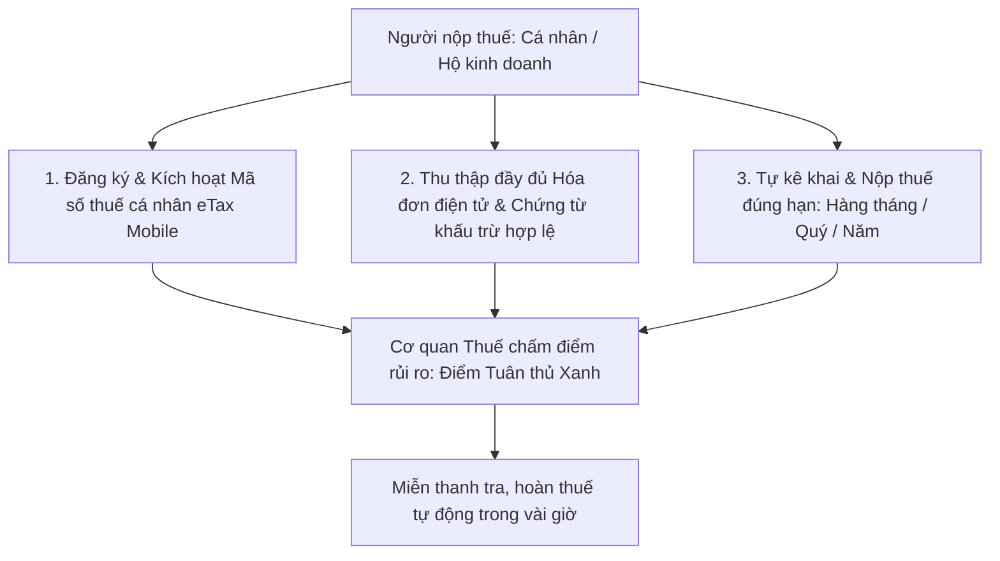

```mermaid
flowchart TD
    Person[Cá nhân có phát sinh Thu nhập] --> CheckResidency{Kiểm tra Tiêu chí Cư trú tại Việt Nam}
    CheckResidency -->|Có mặt tại VN $\ge 183$ ngày / năm HOẶC Có nơi ở thường trú hợp pháp| Resident[CÁ NHÂN CƯ TRÚ THUẾ]
    CheckResidency -->|Không thỏa mãn 2 điều kiện trên| NonResident[CÁ NHÂN KHÔNG CƯ TRÚ THUẾ]
    Resident --> GlobalTax[Phạm vi: Đánh thuế trên THU NHẬP TOÀN CẦU - Worldwide]
    Resident --> ProgressiveScale[Áp dụng Biểu thuế Lũy tiến từng phần 5% - 35% + Được Giảm trừ gia cảnh]
    NonResident --> LocalTax[Phạm vi: Chỉ đánh thuế trên THU NHẬP PHÁT SINH TẠI VIỆT NAM]
    NonResident --> FlatRate[Áp dụng Thuế suất Toàn phần 20% - KHÔNG ĐƯỢC GIẢM TRỪ GIA CẢNH]
```

# Thuế Quốc Tế, Tình Trạng Cư Trú Thuế Và Tuân Thủ Pháp Luật Thuế

Trong một nền kinh tế toàn cầu hóa sâu sắc, người lao động từ xa (Digital Nomads), các chuyên gia quốc tế và các nhà đầu tư xuyên biên giới thường xuyên đối mặt với các tình huống xung đột thẩm quyền tài phán thuế giữa nhiều quốc gia. Việc xác định chính xác Tình trạng cư trú thuế (Tax Residency), áp dụng các Hiệp định tránh đánh thuế hai lần (Double Taxation Agreements - DTA) và duy trì Tính tuân thủ thuế (Tax Compliance) theo các tiêu chuẩn quốc tế (như CRS và FATCA) là điều kiện sống còn để phòng ngừa các rủi ro pháp lý và tổn thất tài chính nghiêm trọng.

> **Các câu hỏi cốt lõi:**
> 1. Quy tắc "183 ngày" và Tiêu chí "Nơi ở thường trú" được áp dụng như thế nào để xác định một cá nhân là Đối tượng cư trú thuế (Tax Resident) tại Việt Nam?
> 2. Sự khác biệt về nghĩa vụ thuế giữa Cá nhân cư trú (chịu thuế trên thu nhập toàn cầu - Worldwide Income) và Cá nhân không cư trú (chỉ chịu thuế trên thu nhập phát sinh tại Việt Nam) là gì?
> 3. Cơ chế Khấu trừ thuế nước ngoài (Tax Credit Method) trong các Hiệp định Tránh đánh thuế hai lần (DTA) giúp triệt tiêu hiện tượng đánh thuế trùng ra sao?

---

## 1. Double Taxation (Đánh thuế hai lần / Đánh thuế trùng)

### 1. Là gì?
- **Định nghĩa hình thức:** Đánh thuế hai lần là tình trạng mà cùng một cá nhân (hoặc thực thể) phải chịu hai hay nhiều nghĩa vụ thuế thu nhập đối với cùng một khoản thu nhập hoặc cơ sở tính thuế trong cùng một kỳ tính thuế, bởi hai hay nhiều cơ quan thuế thuộc các quốc gia khác nhau (Đánh thuế hai lần pháp lý - Juridical Double Taxation) hoặc trên cùng một dòng thu nhập kinh tế qua các chủ thể khác nhau (Đánh thuế hai lần kinh tế - Economic Double Taxation).
- **Giải thích đơn giản:** Đánh thuế trùng là việc bạn kiếm được một đồng tiền mà bị hai nước khác nhau cùng đè ra thu thuế: ví dụ bạn làm việc cho công ty ở Singapore, tiền chuyển về Việt Nam bị cơ quan thuế Singapore thu một lần, về đến Việt Nam lại bị cơ quan thuế Việt Nam thu thêm một lần nữa.
- **Nếu chỉ nhớ một điều:** Để loại bỏ gánh nặng vô lý này, các quốc gia ký kết các Hiệp định Tránh đánh thuế hai lần (Double Taxation Agreements - DTA); nếu bạn đã nộp thuế hợp pháp ở nước ngoài, bạn sẽ được khấu trừ số thuế đó khi tính thuế ở nước sở tại.

### 2. Hoạt động thế nào?
- **Chủ thể ra quyết định:** Chính phủ hai nước ký kết điều ước quốc tế DTA; cá nhân người nộp thuế thực hiện thủ tục áp dụng hiệp định để xin khấu trừ hoặc miễn thuế.
- **Mục tiêu tối ưu hóa:** Thúc đẩy lưu chuyển tự do dòng vốn, nhân lực và thương mại quốc tế mà không bị rào cản thuế khóa bóp nghẹt.
- **Ràng buộc:** Phải có Giấy chứng nhận cư trú thuế (Tax Residency Certificate) và Biên lai xác nhận nộp thuế tại nước ngoài do cơ quan thuế nước sở tại cấp hợp pháp và được hợp pháp hóa lãnh sự.
- **Cơ chế tác động:**
```mermaid
flowchart TD
    IncomeSource[Thu nhập phát sinh tại Nước ngoài - Nước Nguồn: Source Country] --> Tax1[Nước Nguồn thu thuế theo luật nội địa: $T_{\text{source}}$]
    IncomeSource --> SendHome[Chuyển thu nhập về Nước cư trú: Residence Country]
    SendHome --> DTA{Áp dụng Hiệp định DTA giữa 2 nước}
    DTA -->|Phương pháp Miễn thuế Exemption| ExemptHome[Nước cư trú Miễn thuế 100% cho khoản thu nhập đó]
    DTA -->|Phương pháp Khấu trừ tín dụng Credit| CreditHome[Nước cư trú tính thuế toàn cầu trừ đi $T_{\text{source}}$]
```

### 3. Công thức & Mô hình
Hai Phương pháp Triệt tiêu Đánh thuế Hai lần theo Chuẩn mực OECD và UN Model:
1. **Phương pháp Miễn thuế (Exemption Method):**
$$\text{Tax at Home} = 0 \quad (\text{đối với phần thu nhập phát sinh tại nước ngoài})$$
2. **Phương pháp Khấu trừ Thuế (Credit Method - Việt Nam áp dụng phổ biến):**
Số thuế phải nộp bổ sung tại Nước cư trú ($T_{\text{net\_home}}$):
$$T_{\text{net\_home}} = \max(0, T_{\text{home\_worldwide}} - T_{\text{foreign\_paid}})$$
Với điều kiện số thuế được khấu trừ không được vượt quá mức thuế tính theo luật nội địa của nước cư trú:
$$\text{Allowed Credit} = \min(T_{\text{foreign\_paid}}, T_{\text{home\_limit}})$$

### 4. Ví dụ
- **Ví dụ định lượng:** Anh Quân là cá nhân cư trú thuế tại Việt Nam. Trong năm, anh nhận một khoản thù lao chuyên gia tại Nhật Bản là 500.000.000 VND.
  - Cơ quan thuế Nhật Bản khấu trừ tại nguồn mức thuế $20\%$:
    $$T_{\text{Japan}} = 500.000.000 \times 20\% = 100.000.000 \text{ VND}$$
  - Khi quyết toán thuế tại Việt Nam (theo nguyên tắc thu nhập toàn cầu), khoản thu nhập 500 triệu này sau khi cộng dồn vào biểu thuế lũy tiến tương ứng với mức thuế suất tính theo luật Việt Nam là $15\%$ (tương đương 75 triệu VND).
  - Áp dụng Hiệp định DTA giữa Việt Nam và Nhật Bản theo phương pháp Khấu trừ tín dụng:
    $$\text{Allowed Credit} = \min(100 \text{ triệu}, 75 \text{ triệu}) = 75.000.000 \text{ VND}$$
  - Số thuế anh Quân phải nộp thêm tại Việt Nam cho khoản thu nhập này:
    $$T_{\text{net\_VN}} = 75.000.000 - 75.000.000 = 0 \text{ VND}$$
  - Anh Quân không phải nộp thêm thuế tại Việt Nam (nhưng phần 25 triệu nộp thừa tại Nhật không được Việt Nam hoàn tiền mặt).
- **Ví dụ thực tế:** Tính đến nay, Việt Nam đã ký kết Hiệp định tránh đánh thuế hai lần (DTA) với hơn 80 quốc gia và vùng lãnh thổ trên thế giới (bao gồm Mỹ, Nhật Bản, Hàn Quốc, Singapore, các nước EU), tạo khung pháp lý an toàn cho kiều bào và lao động chuyên gia.
- **Phản ví dụ (Counterfactual):** Một lập trình viên làm việc từ xa nhận lương từ một công ty tại một quốc gia CHƯA ký hiệp định DTA với Việt Nam. Người này bị nước sở tại khấu trừ $30\%$ thuế, khi chuyển tiền về Việt Nam lại tiếp tục bị cơ quan thuế Việt Nam truy thu thêm $35\%$ thuế lũy tiến mà không được khấu trừ. Tổng cộng hơn $65\%$ thu nhập bị bốc hơi do hiện tượng đánh thuế trùng.

### 5. Ứng dụng & Tranh luận
- **Ứng dụng thực tiễn:** Luôn kiểm tra danh sách các quốc gia có DTA với Việt Nam trước khi ký kết các hợp đồng làm việc quốc tế hoặc đầu tư ra nước ngoài; nộp hồ sơ xin áp dụng hiệp định thuế ngay từ đầu năm.
- **Ưu và nhược điểm:**
  - *Ưu điểm:* Bảo vệ thu nhập chính đáng của người lao động toàn cầu; ngăn ngừa việc bị thu thuế 2 lần.
  - *Nhược điểm:* Thủ tục hồ sơ hành chính xin xác nhận khấu trừ thuế nước ngoài rất rườm rà (yêu cầu dịch thuật công chứng, hợp pháp hóa lãnh sự).
- **Sai lầm phổ biến:** Nghĩ rằng "đã nộp thuế ở nước ngoài rồi thì mặc nhiên không cần khai báo gì ở Việt Nam nữa", vi phạm nghĩa vụ kê khai thu nhập toàn cầu của cá nhân cư trú.

### 6. Liên kết
- Cùng chủ đề: [02_Tax_Residency.md](file:///Users/ductri0981/Documents/Studying/Studying-Economic/04_Personal_Finance_and_Wealth_Management/09_Taxation_for_Individuals/02_Tax_Residency.md)
- Liên kết chéo: [02_Taxable_Income_Deductions_and_Reliefs.md](file:///Users/ductri0981/Documents/Studying/Studying-Economic/04_Personal_Finance_and_Wealth_Management/09_Taxation_for_Individuals/02_Taxable_Income_Deductions_and_Reliefs.md)

---

## 2. Tax Residency (Cư trú thuế / Tình trạng cư trú vì mục đích thuế)

### 1. Là gì?
- **Định nghĩa hình thức:** Tình trạng cư trú thuế là tình trạng pháp lý của một thể nhân được xác lập dựa trên các tiêu chí luật định (thời gian hiện diện thực tế, nơi ở thường trú, trung tâm lợi ích kinh tế - gia đình) nhằm xác định phạm vi thẩm quyền đánh thuế của một quốc gia đối với cá nhân đó.
- **Giải thích đơn giản:** Cư trú thuế là việc xác định xem bạn là "người của nước nào dưới góc nhìn của cơ quan thuế". Nếu bạn là Người cư trú thuế của một nước, nước đó có quyền đánh thuế trên MỌI KHOẢN TIỀN bạn kiếm được trên toàn thế giới; nếu là Người không cư trú, họ chỉ được đánh thuế trên phần tiền bạn kiếm được trên lãnh thổ của họ.
- **Nếu chỉ nhớ một điều:** Quốc tịch (Citizenship) KHÔNG ĐỒNG NGHĨA với Cư trú thuế (Tax Residency); một công dân Việt Nam sống và làm việc tại nước ngoài trên 183 ngày có thể trở thành Cá nhân không cư trú thuế tại Việt Nam.

### 2. Hoạt động thế nào?
- **Chủ thể ra quyết định:** Cơ quan Thuế xác định tình trạng cư trú dựa trên hộ chiếu, dấu xuất nhập cảnh, hợp đồng thuê nhà và các tiêu chuẩn kiểm tra pháp lý.
- **Mục tiêu tối ưu hóa:** Xác định chính xác phạm vi thu thuế và biểu thuế áp dụng (Biểu lũy tiến 7 bậc đối với người cư trú so với thuế suất cố định toàn phần đối với người không cư trú).
- **Ràng buộc:** Căn cứ theo Điều 2 Luật Thuế TNCN và Điều 1 Thông tư 111/2013/TT-BTC tại Việt Nam.
- **Cơ chế tác động:**


### 3. Công thức & Mô hình
Tiêu chuẩn Xác định Cá nhân Cư trú Thuế tại Việt Nam (theo Điều 1 Thông tư 111/2013/TT-BTC):
Một cá nhân là Cá nhân Cư trú nếu thỏa mãn **MỘT TRONG HAI** điều kiện sau:
1. **Tiêu chí Hiện diện Thể chất (Physical Presence Test):** Có mặt tại Việt Nam từ **183 ngày trở lên** tính trong một năm dương lịch hoặc trong 12 tháng liên tục kể từ ngày đầu tiên có mặt tại Việt Nam.
2. **Tiêu chí Nơi ở Thường trú (Permanent Home Test):** Có nơi ở thường xuyên tại Việt Nam theo một trong hai trường hợp:
   - Có nơi ở đăng ký thường trú ghi trong Căn cước công dân / Sổ hộ khẩu (đối với công dân Việt Nam) hoặc Thẻ tạm trú / Thẻ thường trú (đối với người nước ngoài).
   - Có nhà thuê để ở tại Việt Nam với thời hạn các hợp đồng thuê từ **183 ngày trở lên** trong năm tính thuế.

So sánh Nghĩa vụ Thuế giữa Người Cư Trú và Không Cư Trú:

| Tiêu chí so sánh | Cá nhân Cư trú (Resident) | Cá nhân Không cư trú (Non-Resident) |
| :--- | :--- | :--- |
| **Phạm vi đánh thuế** | Toàn bộ thu nhập toàn cầu (Việt Nam + Nước ngoài) | Chỉ thu nhập phát sinh tại lãnh thổ Việt Nam |
| **Thuế suất tiền lương** | Biểu thuế Lũy tiến từng phần ($5\% - 35\%$) | Thuế suất cố định toàn phần **$20\%$** |
| **Giảm trừ gia cảnh** | **Được giảm trừ** bản thân (11tr) & người phụ thuộc (4,4tr) | **KHÔNG** được áp dụng bất kỳ khoản giảm trừ nào |

### 4. Ví dụ
- **Ví dụ định lượng:** Chuyên gia David (quốc tịch Anh) đến Việt Nam làm việc trong 4 tháng (ở 120 ngày) rồi về nước, không thuê nhà dài hạn tại Việt Nam. Anh nhận được thù lao dự án tại Việt Nam là 100.000.000 VND.
  - Xác định cư trú: Ở dưới 183 ngày và không có nơi ở thường trú $\implies$ David là **Cá nhân không cư trú**.
  - Tính thuế TNCN: Thuế suất cố định $20\%$ trên tổng thu nhập (không được giảm trừ gia cảnh):
    $$T_{\text{David}} = 100.000.000 \times 20\% = 20.000.000 \text{ VND}$$
  - Công ty tại Việt Nam khấu trừ $20\%$ (20 triệu) và chi trả cho David 80 triệu VND. Các khoản thu nhập của David kiếm được tại Anh hay các nước khác trong thời gian đó hoàn toàn không phải báo cáo hay nộp thuế cho Việt Nam.
- **Ví dụ thực tế:** Nhiều người Việt Nam đi xuất khẩu lao động hoặc định cư tại Nhật Bản, Hàn Quốc trên 183 ngày/năm. Khi đó, họ trở thành đối tượng cư trú thuế của nước bạn; số tiền họ kiếm được ở nước ngoài gửi về Việt Nam (kiều hối) được miễn thuế hoàn toàn theo Khoản 8 Điều 4 Luật Thuế TNCN.
- **Phản ví dụ (Counterfactual):** Một người nước ngoài sống và thuê căn hộ tại TP.HCM trong 10 tháng (trên 183 ngày) nhưng chỉ kê khai nộp thuế trên phần tiền lương nhận tại Việt Nam, giấu khoản thu nhập 5.000 USD/tháng nhận tại tài khoản Singapore. Vì đã là Cá nhân cư trú thuế tại Việt Nam, người này có nghĩa vụ pháp lý bắt buộc phải nộp thuế trên Thu nhập toàn cầu; hành vi giấu thu nhập nước ngoài cấu thành tội trốn thuế.

### 5. Ứng dụng & Tranh luận
- **Ứng dụng thực tiễn:** Quản trị lịch trình di chuyển quốc tế: các chuyên gia và nhà đầu tư toàn cầu chủ động quản lý số ngày lưu trú (dưới 183 ngày) tại các quốc gia có thuế suất cao để tránh bị kích hoạt tình trạng cư trú thuế không mong muốn.
- **Ưu và nhược điểm:**
  - *Ưu điểm:* Thiết lập ranh giới tài phán pháp lý rõ ràng, bảo vệ chủ quyền thuế quốc gia.
  - *Nhược điểm:* Có thể dẫn đến tình trạng tranh chấp cư trú kép (Dual Residency) khi cả hai quốc gia cùng nhận một người là đối tượng cư trú của mình (buộc phải dùng quy tắc Tie-Breaker Rules trong Hiệp định DTA để phân xử).
- **Sai lầm phổ biến:** Nghĩ rằng "tôi mang quốc tịch nước ngoài thì cơ quan thuế Việt Nam không được phép đánh thuế thu nhập toàn cầu của tôi", bỏ qua thực tế rằng nếu ở Việt Nam trên 183 ngày thì toàn bộ thu nhập toàn cầu đều thuộc diện chịu thuế của Việt Nam.

### 6. Liên kết
- Cùng chủ đề: [01_Double_Taxation.md](file:///Users/ductri0981/Documents/Studying/Studying-Economic/04_Personal_Finance_and_Wealth_Management/09_Taxation_for_Individuals/01_Double_Taxation.md)
- Liên kết chéo: [01_Income_Tax_Structure_and_Rates.md](file:///Users/ductri0981/Documents/Studying/Studying-Economic/04_Personal_Finance_and_Wealth_Management/09_Taxation_for_Individuals/01_Income_Tax_Structure_and_Rates.md)

---

## 3. Tax Compliance (Tuân thủ thuế / Tính tuân thủ pháp luật thuế)

### 1. Là gì?
- **Định nghĩa hình thức:** Tuân thủ thuế là mức độ và hành vi của người nộp thuế trong việc thực hiện đầy đủ, chính xác, kịp thời và tự nguyện mọi nghĩa vụ pháp lý về thuế theo quy định của pháp luật, bao gồm: đăng ký thuế, mở mã số thuế, lưu giữ sổ sách chứng từ, kê khai trung thực, nộp thuế đúng hạn và thực hiện quyết toán thuế với cơ quan nhà nước có thẩm quyền.
- **Giải thích đơn giản:** Tuân thủ thuế là việc bạn "chơi đúng luật thuế": khai báo tiền kiếm được một cách trung thực, không giấu giếm, nộp tiền thuế đúng hạn và lưu giữ đầy đủ hóa đơn giấy tờ để không bao giờ bị phạt hay bị thanh tra xử lý.
- **Nếu chỉ nhớ một điều:** Chi phí của việc Không tuân thủ thuế (Non-compliance: tiền phạt truy thu, lãi chậm nộp $10,95\%$/năm, rủi ro bị khởi tố hình sự và tổn hại danh tiếng) luôn đắt đỏ hơn gấp nhiều lần so với số tiền thuế bạn cố gắng che giấu.

### 2. Hoạt động thế nào?
- **Chủ thể ra quyết định:** Cá nhân người nộp thuế tự giác thực hiện trên nền tảng số; Cơ quan Thuế ứng dụng Trí tuệ nhân tạo (AI) và dữ liệu lớn để kiểm soát rủi ro tuân thủ.
- **Mục tiêu tối ưu hóa:** Đảm bảo an toàn pháp lý tuyệt đối cho bản thân và doanh nghiệp; xây dựng hồ sơ tín nhiệm công dân sạch (Tax Clearance).
- **Ràng buộc:** Chế tài xử phạt vi phạm hành chính về thuế theo Nghị định 125/2020/NĐ-CP; cơ chế chia sẻ thông tin tài chính toàn cầu tự động (CRS - Common Reporting Standard và FATCA).
- **Cơ chế tác động:**


### 3. Công thức & Mô hình
Chi phí Tài chính của Việc Chậm nộp Thuế (theo Luật Quản lý Thuế số 38/2019/QH14):
$$M_{\text{penalty}} = T_{\text{overdue}} \times 0,03\% \times d_{\text{late}}$$
Trong đó:
- $T_{\text{overdue}}$: Số tiền thuế chậm nộp.
- $0,03\%$/ngày: Tỷ lệ tính tiền chậm nộp quy định (tương đương lãi suất phạt khoảng **$10,95\%$/năm** tính trên số thuế nợ).
- $d_{\text{late}}$: Tổng số ngày chậm nộp tiền thuế.

Mạng lưới Trao đổi Thông tin Tài chính Tự động Toàn cầu (Common Reporting Standard - CRS):
Hơn 110 quốc gia thành viên tự động chia sẻ thông tin tài khoản ngân hàng, số dư chứng khoán và thu nhập đầu tư của người nộp thuế cho cơ quan thuế nước sở tại:
$$\text{Foreign Bank Data} \xrightarrow{\text{AEOI / CRS}} \text{Tổng cục Thuế Việt Nam} \implies \text{Xóa bỏ hoàn toàn bí mật tài khoản nước ngoài}$$

### 4. Ví dụ
- **Ví dụ định lượng:** Một cá nhân kinh doanh trực tuyến (bán hàng online) có số thuế TNCN phải nộp năm 2022 là 100.000.000 VND nhưng không kê khai và không nộp thuế.
  - Sau 2 năm (730 ngày), cơ quan thuế phát hiện và ra quyết định xử lý:
    - Truy thu số thuế gốc: 100.000.000 VND.
    - Tiền chậm nộp:
      $$M_{\text{penalty}} = 100.000.000 \times 0,03\% \times 730 = 21.900.000 \text{ VND}$$
    - Phạt hành vi khai sai dẫn đến thiếu số thuế phải nộp ($20\%$): $20\% \times 100.000.000 = 20.000.000$ VND.
    - Tổng số tiền phải nộp phạt và truy thu: $100 + 21,9 + 20 = \mathbf{141.900.000 \text{ VND}}$ (mất thêm $41,9\%$ tiền phạt!).
- **Ví dụ thực tế:** Tại Việt Nam, Tổng cục Thuế đã triển khai ứng dụng di động **eTax Mobile** tích hợp định danh VNeID, cho phép hàng triệu cá nhân tự tra cứu toàn bộ các nguồn thu nhập đã bị khấu trừ trong năm của mình, phát hiện ngay các khoản nợ thuế và nộp thuế điện tử chỉ bằng vài thao tác quét mã QR ngân hàng.
- **Phản ví dụ (Counterfactual):** Một YouTuber tại Việt Nam có doanh thu hàng triệu USD từ Google AdSense nhưng kiên quyết không kê khai tuân thủ thuế. Cơ quan thuế phối hợp với ngân hàng thương mại trích xuất sao kê dòng tiền ngoại tệ nhận về, chuyển hồ sơ sang Cơ quan Cảnh sát Điều tra khởi tố về tội Trốn thuế theo Điều 200 Bộ luật Hình sự, đối mặt với án phạt tù và tịch thu toàn bộ số tiền bất chính.

### 5. Ứng dụng & Tranh luận
- **Ứng dụng thực tiễn:** Cài đặt ứng dụng eTax Mobile, chủ động tra cứu nghĩa vụ thuế hàng năm; lưu trữ điện tử toàn bộ chứng từ khấu trừ và hóa đơn giá trị gia tăng tối thiểu 5 năm để phục vụ đối chiếu.
- **Ưu và nhược điểm:**
  - *Ưu điểm:* Mang lại sự thanh thản tuyệt đối về mặt tâm lý và pháp lý; xây dựng điểm tín nhiệm tài chính sạch để dễ dàng vay vốn ngân hàng hoặc xin thị thực định cư nước ngoài.
  - *Nhược điểm:* Tốn công sức quản lý hồ sơ và theo dõi các thay đổi thường xuyên của thông tư, nghị định thuế.
- **Sai lầm phổ biến:** Chủ quan cho rằng "mình làm tự do, nhận tiền qua tài khoản cá nhân thì cơ quan thuế không biết được", không biết rằng ngành thuế đã liên thông dữ liệu tài khoản với Ngân hàng Nhà nước và các cổng thanh toán số.

### 6. Liên kết
- Cùng chủ đề: [01_Double_Taxation.md](file:///Users/ductri0981/Documents/Studying/Studying-Economic/04_Personal_Finance_and_Wealth_Management/09_Taxation_for_Individuals/01_Double_Taxation.md)
- Liên kết chéo: [05_Tax_Planning_Optimization_and_Compliance.md](file:///Users/ductri0981/Documents/Studying/Studying-Economic/04_Personal_Finance_and_Wealth_Management/09_Taxation_for_Individuals/05_Tax_Planning_Optimization_and_Compliance.md)

---

## Câu hỏi tự kiểm tra
1. Hãy phân tích các tiêu chí pháp lý để một người nước ngoài được công nhận là Cá nhân Cư trú thuế tại Việt Nam theo Thông tư 111/2013/TT-BTC. Hậu quả thuế đối với thu nhập toàn cầu của cá nhân đó là gì?
2. Trình bày cơ chế Khấu trừ tín dụng (Tax Credit Method) trong việc loại bỏ Đánh thuế hai lần (Double Taxation) theo các Hiệp định DTA mà Việt Nam đã ký kết.
3. Phân biệt rõ sự khác nhau giữa Quốc tịch (Citizenship) và Tình trạng Cư trú thuế (Tax Residency). Một người có thể mang quốc tịch Việt Nam nhưng lại là đối tượng không cư trú thuế tại Việt Nam hay không? Nêu ví dụ.
4. Chuẩn mực Trao đổi Thông tin Tài chính Tự động Toàn cầu (Common Reporting Standard - CRS) hoạt động như thế nào và nó đã xóa bỏ khái niệm "Thiên đường thuế bí mật" ra sao?

## Ghi chú nguồn
- Luật Quản lý Thuế số 38/2019/QH14.
- Nghị định số 125/2020/NĐ-CP quy định xử phạt vi phạm hành chính về thuế, hóa đơn.
- Thông tư số 111/2013/TT-BTC và Thông tư số 205/2013/TT-BTC hướng dẫn thực hiện các Hiệp định tránh đánh thuế hai lần.
- OECD - *Model Tax Convention on Income and on Capital* & *Standard for Automatic Exchange of Financial Account Information (CRS)*.
