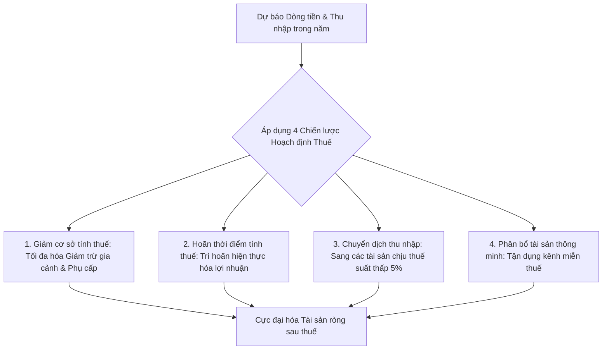
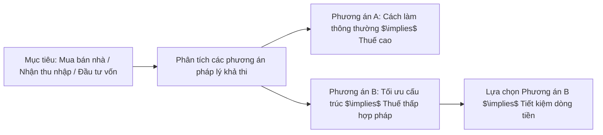
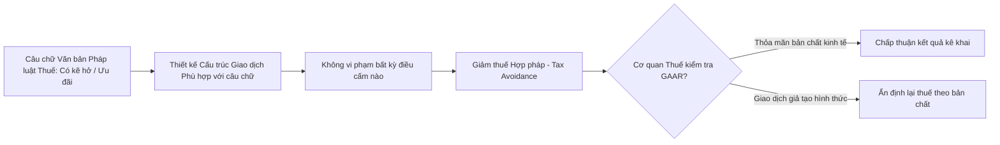
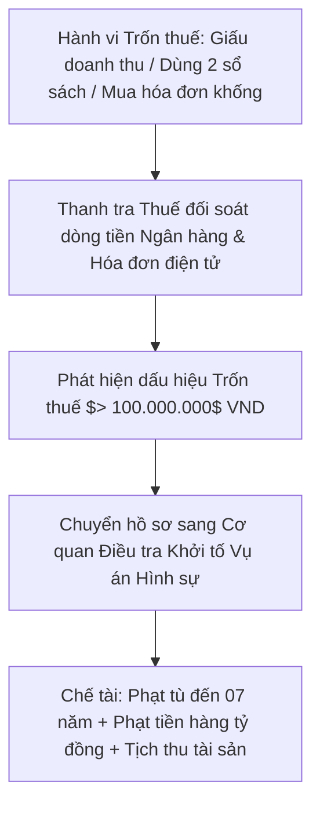
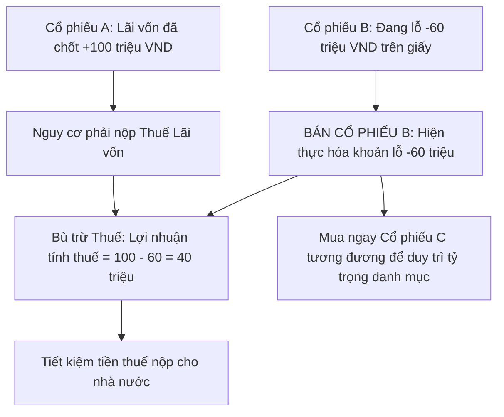
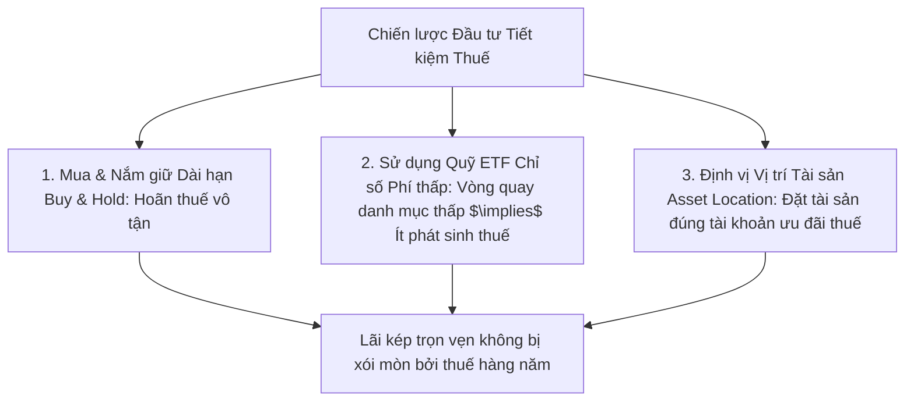

# Hoạch Định Thuế, Tối Ưu Hóa Thuế Và Ranh Giới Pháp Lý Với Trốn Thuế

"Không có gì chắc chắn trên đời này ngoại trừ cái chết và thuế" - câu nói bất hủ của Benjamin Franklin phản ánh tính tất yếu của nghĩa vụ thuế. Tuy nhiên, nghĩa vụ nộp thuế không đồng nghĩa với việc phải nộp nhiều hơn mức luật pháp yêu cầu. Việc thấu hiểu sự khác biệt bản chất giữa Tránh thuế hợp pháp (Tax Avoidance) và Trốn thuế bất hợp pháp (Tax Evasion), cùng với việc làm chủ các chiến lược Hoạch định thuế (Tax Planning), Tối ưu hóa thuế (Tax Optimization), Thu hoạch lỗ tính thuế (Tax Loss Harvesting) và Đầu tư tiết kiệm thuế (Tax-efficient Investing) là vũ khí tài chính sắc bén của mọi nhà đầu tư thông minh.

> **Các câu hỏi cốt lõi:**
> 1. Ranh giới đỏ phân định giữa Tránh thuế hợp pháp (Tax Avoidance) và Tội trốn thuế (Tax Evasion) được quy định như thế nào trong Bộ luật Hình sự và Luật Quản lý Thuế?
> 2. Kỹ thuật "Thu hoạch lỗ tính thuế" (Tax Loss Harvesting) hoạt động ra sao để biến các khoản thua lỗ đầu tư tạm thời thành khoản tiết kiệm thuế tiền mặt có thật?
> 3. Chiến lược "Định vị tài sản thông minh theo thuế" (Asset Location) giúp gia tăng lợi nhuận kép ròng dài hạn như thế nào?

---

## 1. Tax Planning (Hoạch định thuế)

### 1. Là gì?
- **Định nghĩa hình thức:** Hoạch định thuế là quá trình phân tích, dự báo và chủ động cấu trúc các hoạt động tài chính, kinh doanh, đầu tư và chi tiêu cá nhân một cách có hệ thống ngay từ đầu kỳ, nhằm khai thác tối đa các ưu đãi, miễn trừ, giảm trừ và các khoảng trống chính sách do luật pháp cho phép để giảm thiểu nghĩa vụ thuế tổng thể qua các năm.
- **Giải thích đơn giản:** Hoạch định thuế là việc bạn "tính toán trước chuyện thuế": trước khi mở công ty, mua nhà, hay đầu tư, bạn xem trước luật thuế quy định ra sao để chọn con đường hợp pháp giúp bạn phải nộp ít thuế nhất.
- **Nếu chỉ nhớ một điều:** Hoạch định thuế là hành động CHỦ ĐỘNG ĐI TRƯỚC (Proactive), khác biệt hoàn toàn với việc khai thuế bị động (Reactive) khi sự việc đã an bài vào cuối năm.

### 2. Hoạt động thế nào?
- **Chủ thể ra quyết định:** Cá nhân phối hợp cùng chuyên gia tư vấn thuế và kiểm toán viên độc lập.
- **Mục tiêu tối ưu hóa:** Cực đại hóa giá trị tài sản ròng tích lũy sau thuế (After-tax Wealth) trong dài hạn.
- **Ràng buộc:** Phải tuân thủ tuyệt đối chữ viết và tinh thần của các đạo luật thuế hiện hành; không được thực hiện các giao dịch giả tạo thiếu bản chất kinh tế.
- **Cơ chế tác động:**

### 3. Công thức & Mô hình
Bốn Trụ Cột Chiến Lược của Hoạch Định Thuế Cá Nhân:
1. **Chiến lược Thu nhỏ Thu nhập tính thuế (Tax Reduction):** Tối đa hóa các khoản giảm trừ gia cảnh, bảo hiểm, từ thiện và phụ cấp miễn thuế:
$$\min \left( \text{Gross Income} - \sum \text{Allowances} - \sum \text{Deductions} \right)$$
2. **Chiến lược Hoãn thuế (Tax Deferral):** Chuyển dòng tiền đóng thuế từ hiện tại ($t$) sang tương lai ($t+k$) để tận dụng giá trị thời gian của tiền và lãi kép của số tiền thuế được hoãn:
$$\text{Value of Deferral} = T_0 \times \left[ (1 + r)^k - 1 \right]$$
3. **Chiến lược Chuyển dịch Thu nhập (Income Shifting):** Chuyển dịch thu nhập từ các loại hình chịu thuế suất cao (tiền lương $35\%$) sang các loại hình chịu thuế suất ưu đãi (cổ tức, chuyển nhượng chứng khoán $5\%$ hoặc $0,1\%$).
4. **Chiến lược Chuyển đổi Khung thuế (Bracket Management):** Phân bổ dàn trải thu nhập đều qua các năm để không bị nhảy vọt vào các bậc thuế lũy tiến đỉnh cao.

### 4. Ví dụ
- **Ví dụ định lượng:** Một cá nhân sở hữu danh mục đầu tư 2 tỷ VND có lãi $10\%$/năm (sinh lời 200 triệu/năm).
  - Kịch bản A (Không hoạch định thuế): Đầu tư lướt sóng ngắn hạn, chốt lời liên tục và nhận cổ tức tiền mặt hàng năm, chịu thuế khấu trừ $5\%$ cổ tức và $0,1\%$ phí bán mỗi lần xoay vòng vốn.
  - Kịch bản B (Hoạch định thuế chuyên nghiệp): Đầu tư dài hạn vào chứng chỉ quỹ ETF tích lũy (không chia cổ tức tiền mặt mà tự động tái đầu tư vào quỹ). Thuế chỉ phát sinh vào thời điểm bán sau 20 năm nữa.
  - Sau 20 năm, số tiền thuế được "hoãn lại" liên tục sinh lãi kép trong Kịch bản B giúp giá trị tài sản ròng sau thuế cao hơn Kịch bản A tới hơn 450 triệu đồng!
- **Ví dụ thực tế:** Tại Việt Nam, nhiều chuyên gia và lập trình viên cao cấp khi có thu nhập vượt ngưỡng 80 triệu/tháng (bị áp thuế suất $35\%$) đã chủ động chuyển đổi mô hình từ làm việc dưới dạng cá nhân sang thành lập Doanh nghiệp một thành viên hoặc Hộ kinh doanh cá thể để áp dụng mức thuế suất khoán trên doanh thu thấp hơn nhiều ($1,5\% - 7\%$ tùy ngành nghề).
- **Phản ví dụ (Counterfactual):** Một người bán một lô đất lớn vào ngày 28/12 và bán một lô đất khác vào ngày 5/1 năm sau. Do không hoạch định thời điểm, người này dồn toàn bộ nguồn vốn bán đất vào một năm khiến dòng tiền nộp thuế và chi phí giao dịch tập trung quá mức, làm mất tính thanh khoản ngắn hạn.

### 5. Ứng dụng & Tranh luận
- **Ứng dụng thực tiễn:** Lập kế hoạch thuế vào đầu mỗi năm dương lịch, rà soát lại vào tháng 11 trước khi kết thúc năm tài chính.
- **Ưu và nhược điểm:**
  - *Ưu điểm:* Tiết kiệm hàng chục đến hàng trăm triệu đồng một cách hợp pháp; hoàn toàn an tâm về mặt pháp lý.
  - *Nhược điểm:* Đòi hỏi phải cập nhật liên tục các văn bản quy phạm pháp luật thuế mới ban hành.
- **Sai lầm phổ biến:** Nhầm tưởng hoạch định thuế là việc của kế toán công ty vào tháng 3 hàng năm, trong khi đây là trách nhiệm chiến lược của chính cá nhân trong suốt cả năm.

### 6. Liên kết
- Cùng chủ đề: [02_Tax_Optimization.md](file:///Users/ductri0981/Documents/Studying/Studying-Economic/04_Personal_Finance_and_Wealth_Management/09_Taxation_for_Individuals/02_Tax_Optimization.md)
- Liên kết chéo: [01_Personal_Finance_Foundations/01_Literacy_Planning_and_Management.md](file:///Users/ductri0981/Documents/Studying/Studying-Economic/04_Personal_Finance_and_Wealth_Management/01_Personal_Finance_Foundations/01_Literacy_Planning_and_Management.md)

---

## 2. Tax Optimization (Tối ưu hóa thuế)

### 1. Là gì?
- **Định nghĩa hình thức:** Tối ưu hóa thuế là việc áp dụng một cách đồng bộ các giải pháp tài chính, pháp lý, cơ cấu sở hữu và thời điểm giao dịch tối ưu nhất để đạt được mức chi phí thuế thấp nhất có thể cho một mục tiêu tài chính cụ thể, trong khi vẫn bảo đảm tuân thủ đầy đủ mọi quy định của pháp luật thuế.
- **Giải thích đơn giản:** Tối ưu hóa thuế là việc bạn "chọn con đường ngắn nhất và tốn ít tiền nhất": giữa nhiều cách làm khác nhau cùng hợp pháp, bạn chọn cách nào giúp bạn nộp ít thuế nhất cho nhà nước.
- **Nếu chỉ nhớ một điều:** Tối ưu hóa thuế không phải là tìm cách gian dối để che giấu thu nhập; đó là sự thông thái trong việc sử dụng đúng các công cụ mà chính sách nhà nước ban hành.

### 2. Hoạt động thế nào?
- **Chủ thể ra quyết định:** Cá nhân chủ động điều chỉnh hành vi tiêu dùng, đầu tư và cơ cấu hợp đồng.
- **Mục tiêu tối ưu hóa:** Cực đại hóa tỷ lệ $\frac{\text{Thu nhập ròng sau thuế}}{\text{Chi phí tuân thủ}}$.
- **Ràng buộc:** Tính khả thi trong thực tế và chi phí quản lý vận hành của các cấu trúc pháp lý mới.
- **Cơ chế tác động:**

### 3. Công thức & Mô hình
Đo lường Hiệu quả Tối ưu hóa Thuế (Tax Optimization Alpha - $\alpha_{\text{tax}}$):
$$\alpha_{\text{tax}} = \frac{T_{\text{unoptimized}} - T_{\text{optimized}}}{V_{\text{portfolio}}}$$
Trong đó:
- $T_{\text{unoptimized}}$: Tổng số tiền thuế phải nộp nếu không có chiến lược tối ưu.
- $T_{\text{optimized}}$: Tổng số tiền thuế phải nộp sau khi áp dụng các giải pháp tối ưu hợp pháp.
- $V_{\text{portfolio}}$: Quy mô tổng tài sản của cá nhân.
Một chiến lược tối ưu hóa thuế tốt có thể tạo ra "Alpha thuế" từ $0,5\% - 1,5\%$/năm cho toàn bộ danh mục tài sản trọn đời.

### 4. Ví dụ
- **Ví dụ định lượng:** Một gia đình sở hữu một doanh nghiệp gia đình. Người cha muốn chia thu nhập cho người con gái 22 tuổi (vừa tốt nghiệp đại học, chưa có việc làm) 20 triệu/tháng.
  - Cách 1 (Không tối ưu): Người cha nhận trọn lương ở mức thuế suất biên $35\%$, nộp thuế hết 7 triệu, còn lại 13 triệu chuyển khoản cho con.
  - Cách 2 (Tối ưu hóa thuế): Công ty ký hợp đồng lao động tuyển dụng người con làm nhân viên truyền thông với mức lương 20 triệu/tháng.
    - Người con được giảm trừ bản thân 11 triệu + bảo hiểm 2,1 triệu $\implies$ Thu nhập tính thuế của con chỉ còn khoảng 6,9 triệu (rơi vào Bậc 1 và Bậc 2).
    - Số thuế người con phải nộp: chỉ khoảng 440.000 VND/tháng.
    - Gia đình tiết kiệm được: $7.000.000 - 440.000 = \mathbf{6.560.000 \text{ VND/tháng}}$ (gần 79 triệu VND/năm hoàn toàn hợp pháp!).
- **Ví dụ thực tế:** Tại Việt Nam, nhiều nhà đầu tư cá nhân tối ưu hóa thuế chuyển nhượng bất động sản bằng cách lập hợp đồng tặng cho giữa cha mẹ và con cái (được miễn $100\%$ thuế TNCN và lệ phí trước bạ) trước khi thực hiện các bước phân chia di sản tiếp theo.
- **Phản ví dụ (Counterfactual):** Một người muốn tối ưu thuế nhưng lại sử dụng các hóa đơn giá trị gia tăng giả mua trôi nổi trên mạng để đưa vào chi phí giảm trừ. Hành vi này không còn là tối ưu hóa thuế mà đã chuyển hóa thành hành vi Mua bán hóa đơn trái phép và Trốn thuế, bị cơ quan công an khởi tố hình sự.

### 5. Ứng dụng & Tranh luận
- **Ứng dụng thực tiễn:** Tối ưu hóa gói lương thưởng khi ký hợp đồng lao động; tối ưu hóa thời điểm chốt lãi tài sản đầu tư; sử dụng các công cụ bảo hiểm nhân thọ và hưu trí bổ sung tự nguyện để được khấu trừ thuế.
- **Ưu và nhược điểm:**
  - *Ưu điểm:* Gia tăng đáng kể dòng tiền tích lũy và đẩy nhanh tốc độ đạt tự do tài chính.
  - *Nhược điểm:* Đòi hỏi kiến thức pháp lý vững vàng; nếu làm sai ranh giới có thể bị cơ quan thuế xử phạt.
- **Sai lầm phổ biến:** Quá sa đà vào việc tối ưu thuế ("The tax tail wagging the investment dog"): chấp nhận mua các tài sản đầu tư tồi tệ chỉ vì nó có ưu đãi thuế.

### 6. Liên kết
- Cùng chủ đề: [01_Tax_Planning.md](file:///Users/ductri0981/Documents/Studying/Studying-Economic/04_Personal_Finance_and_Wealth_Management/09_Taxation_for_Individuals/01_Tax_Planning.md)
- Liên kết chéo: [03_Tax_Avoidance.md](file:///Users/ductri0981/Documents/Studying/Studying-Economic/04_Personal_Finance_and_Wealth_Management/09_Taxation_for_Individuals/03_Tax_Avoidance.md)

---

## 3. Tax Avoidance (Tránh thuế hợp pháp)

### 1. Là gì?
- **Định nghĩa hình thức:** Tránh thuế là việc người nộp thuế sử dụng các phương thức, cấu trúc giao dịch và kẽ hở pháp lý một cách hoàn toàn hợp pháp và công khai nhằm làm giảm thiểu hoặc loại bỏ số tiền thuế phải nộp, dựa trên việc khai thác đúng các điều khoản cho phép trong luật thuế mà không vi phạm bất kỳ điều cấm nào của pháp luật.
- **Giải thích đơn giản:** Tránh thuế là việc "tìm đường đi khôn ngoan trong khuôn khổ luật pháp": luật không cấm thì bạn có quyền làm để không phải nộp nhiều thuế.
- **Nếu chỉ nhớ một điều:** Phán quyết lịch sử của Thẩm phán Anh Lord Tomlin năm 1936 khẳng định: *"Mỗi công dân đều có toàn quyền sắp xếp công việc tài chính của mình sao cho số thuế phải nộp là ít nhất có thể; không một ai có nghĩa vụ yêu nước phải trả nhiều thuế hơn mức luật pháp bắt buộc"*.

### 2. Hoạt động thế nào?
- **Chủ thể ra quyết định:** Người nộp thuế dưới sự tham vấn của các luật sư thuế và chuyên gia tư vấn luật.
- **Mục tiêu tối ưu hóa:** Khai thác tối đa tinh thần và câu chữ của văn bản pháp luật để giảm gánh nặng tài chính.
- **Ràng buộc:** Đối mặt với các Quy tắc chung Chống tránh thuế (General Anti-Avoidance Rules - GAAR) và Nguyên tắc "Bản chất quan trọng hơn hình thức" (Substance over Form) của cơ quan thuế hiện đại.
- **Cơ chế tác động:**

### 3. Công thức & Mô hình
So sánh Ranh giới Pháp lý giữa Tránh thuế (Tax Avoidance) và Trốn thuế (Tax Evasion):

$$\text{Hành vi Pháp lý} = \begin{cases} 
\text{Tránh thuế (Tax Avoidance):} & \text{Hợp pháp (Legal)} \implies \text{Tuân thủ câu chữ luật} \\ 
\text{Trốn thuế (Tax Evasion):} & \text{Bất hợp pháp (Illegal)} \implies \text{Gian dối, che giấu, làm giả chứng từ}
\end{cases}$$

Nguyên tắc "Bản chất quyết định Hình thức" (Substance-over-Form Doctrine):
Nếu một chuỗi các giao dịch phức tạp được thực hiện mà KHÔNG CÓ BẤT KỲ MỤC ĐÍCH KINH TẾ NÀO ngoài việc né tránh nghĩa vụ thuế:
$$\text{Cơ quan Thuế có quyền} \implies \text{Xóa bỏ hình thức & Tái xác định nghĩa vụ thuế thực tế}$$

### 4. Ví dụ
- **Ví dụ định lượng:** Một cá nhân có 10 tỷ VND muốn đầu tư nhận dòng tiền sinh lời $6\%$/năm (600 triệu/năm).
  - Lựa chọn A: Mua trái phiếu doanh nghiệp $\implies$ Tiền lãi 600 triệu bị khấu trừ $5\%$ thuế TNCN, mất 30.000.000 VND tiền thuế.
  - Lựa chọn B (Tránh thuế hợp pháp): Đem toàn bộ 10 tỷ gửi vào sổ tiết kiệm Ngân hàng thương mại kỳ hạn 12 tháng lấy lãi $6\%$. Căn cứ Khoản 7 Điều 4 Luật Thuế TNCN, tiền lãi gửi ngân hàng được miễn thuế $100\%$.
  - Số thuế phải nộp ở Lựa chọn B: đúng **0 VND** (tiết kiệm trọn vẹn 30 triệu đồng). Đây là hành vi Tránh thuế hoàn toàn hợp pháp được nhà nước thừa nhận và khuyến khích.
- **Ví dụ thực tế:** Các tập đoàn công nghệ toàn cầu như Apple hay Google từng áp dụng các cấu trúc tránh thuế kinh điển như "Double Irish with a Dutch Sandwich" để chuyển hướng hàng chục tỷ USD lợi nhuận qua các quốc gia có thuế suất $0\%$ một cách hoàn toàn hợp pháp theo kẽ hở giữa các hiệp ước thuế quốc tế, buộc OECD phải phát động Sáng kiến Chống xói mòn cơ sở thuế (BEPS).
- **Phản ví dụ (Counterfactual):** Một chủ nhà cho thuê với giá 30 triệu/tháng nhưng lập hợp đồng công chứng ghi 5 triệu/tháng và nhận 25 triệu tiền mặt trao tay. Đây KHÔNG PHẢI là tránh thuế mà là hành vi Gian lận che giấu doanh thu (Trốn thuế bất hợp pháp).

### 5. Ứng dụng & Tranh luận
- **Ứng dụng thực tiễn:** Khai thác các ưu đãi thuế địa phương (ví dụ đầu tư vào các khu kinh tế đặc biệt, khu công nghệ cao có thuế suất ưu đãi $10\%$ trong 15 năm); lựa chọn hình thức kinh doanh tối ưu nhất.
- **Ưu và nhược điểm:**
  - *Ưu điểm:* Tiết kiệm chi phí tối đa trong ranh giới pháp luật cho phép.
  - *Nhược điểm:* Đứng trước rủi ro bị cơ quan thuế điều chỉnh tái phân loại giao dịch nếu luật thuế sửa đổi siết chặt kẽ hở.
- **Sai lầm phổ biến:** Tự tin cho rằng mình đang "tránh thuế" nhưng thực chất đã bước qua ranh giới trốn thuế do thiếu hiểu biết về nguyên tắc bản chất kinh tế.

### 6. Liên kết
- Cùng chủ đề: [04_Tax_Evasion.md](file:///Users/ductri0981/Documents/Studying/Studying-Economic/04_Personal_Finance_and_Wealth_Management/09_Taxation_for_Individuals/04_Tax_Evasion.md)
- Liên kết chéo: [02_Tax_Optimization.md](file:///Users/ductri0981/Documents/Studying/Studying-Economic/04_Personal_Finance_and_Wealth_Management/09_Taxation_for_Individuals/02_Tax_Optimization.md)

---

## 4. Tax Evasion (Trốn thuế / Gian lận thuế bất hợp pháp)

### 1. Là gì?
- **Định nghĩa hình thức:** Trốn thuế là hành vi cố ý vi phạm pháp luật của người nộp thuế bằng việc sử dụng các thủ đoạn gian dối, che giấu thu nhập, khai man số liệu, làm giả chứng từ sổ sách, không đăng ký kê khai hoặc tiêu hủy tài liệu kế toán nhằm không phải nộp hoặc nộp ít hơn số tiền thuế thực tế phải nộp theo quy định của pháp luật.
- **Giải thích đơn giản:** Trốn thuế là hành vi "ăn cắp tiền thuế của nhà nước": bạn kiếm được tiền nhưng giấu nhẹm đi, khai báo gian dối để không phải nộp thuế.
- **Nếu chỉ nhớ một điều:** Trốn thuế là TỘI PHẠM HÌNH SỰ (Criminal Offense); ranh giới giữa việc bị phạt tiền hành chính và phải ngồi tù chính là hành vi cố ý che giấu và gian dối chứng từ.

### 2. Hoạt động thế nào?
- **Chủ thể ra quyết định:** Đối tượng phạm tội (cố tình gian lận) và Cơ quan Cảnh sát Điều tra Tội phạm về Tham nhũng, Kinh tế, Buôn lậu phối hợp với Thanh tra Thuế.
- **Mục tiêu tối ưu hóa:** Cơ quan thực thi pháp luật triệt phá các hành vi gian lận, truy thu ngân sách và răn đe toàn xã hội.
- **Ràng buộc:** Căn cứ theo Điều 200 Bộ luật Hình sự Việt Nam số 100/2015/QH13 (sửa đổi bổ sung 2017) về "Tội trốn thuế".
- **Cơ chế tác động:**

### 3. Công thức & Mô hình
Khung Xử phạt Hình sự Tội Trốn thuế theo Điều 200 Bộ luật Hình sự Việt Nam:
Người nào trốn thuế với số tiền từ **100.000.000 VND đến dưới 300.000.000 VND** (hoặc dưới 100 triệu nhưng đã bị xử phạt hành chính):
$$\implies \text{Phạt tiền từ 100 triệu - 500 triệu VND HOẶC Phạt tù từ 03 tháng đến 01 năm}$$
Trốn thuế thuộc trường hợp phạm tội có tổ chức, hoặc số tiền trốn thuế từ **1.000.000.000 VND trở lên**:
$$\implies \text{Phạt tiền từ 1,5 tỷ - 4,5 tỷ VND HOẶC Phạt tù từ 02 năm đến 07 năm}$$
(Ngoài ra, người phạm tội còn có thể bị cấm hành nghề hoặc cấm đảm nhiệm chức vụ từ 01 năm đến 05 năm).

### 4. Ví dụ
- **Ví dụ định lượng:** Một chủ cửa hàng kinh doanh vàng bạc bán hàng online qua mạng xã hội thu về 50 tỷ VND trong 3 năm nhưng không kê khai thuế, sử dụng tài khoản cá nhân của người thân để nhận tiền hòng giấu doanh thu.
  - Số thuế TNCN và GTGT bị trốn ước tính: $1,5\% \times 50 \text{ tỷ} = 750.000.000$ VND.
  - Vì số tiền trốn thuế $> 300$ triệu đồng, cơ quan thuế chuyển hồ sơ sang công an khởi tố hình sự theo Khoản 2 Điều 200 Bộ luật Hình sự.
  - Bản án: Bị cáo bị phạt 2 năm tù giam, buộc nộp lại toàn bộ 750 triệu tiền thuế gốc, nộp phạt chậm nộp 180 triệu và nộp phạt bổ sung 500 triệu đồng. Toàn bộ sự nghiệp và danh dự gia đình bị hủy hoại.
- **Ví dụ thực tế:** Vụ án nhiều người nổi tiếng, KOLs, nghệ sĩ và các chủ shop bán hàng online lớn tại Việt Nam bị cơ quan thuế phối hợp cùng công an xử lý hình sự vì hành vi sử dụng tài khoản cá nhân nhận tiền livestream bán hàng nhưng không kê khai thuế đã gióng lên hồi chuông cảnh tỉnh về tính nghiêm minh của pháp luật.
- **Phản ví dụ (Counterfactual):** Một doanh nhân có thu nhập cao luôn thuê công ty kiểm toán uy tín rà soát và nộp đầy đủ hàng trăm triệu tiền thuế TNCN mỗi năm. Khi doanh nhân này huy động vốn mở rộng kinh doanh hoặc xin visa du học, định cư cho con cái, các cơ quan thẩm quyền phê duyệt hồ sơ trong vài ngày nhờ lịch sử tín nhiệm thuế trong sạch tuyệt đối.

### 5. Ứng dụng & Tranh luận
- **Ứng dụng thực tiễn:** Tuyệt đối nói KHÔNG với mọi hành vi trốn thuế: không sử dụng hóa đơn khống, không ghi giá ảo trên hợp đồng mua bán nhà đất, kê khai trung thực toàn bộ dòng tiền nhận về tài khoản.
- **Ưu và nhược điểm:**
  - *Lợi ích ảo của trốn thuế:* Giữ lại được một số tiền bất chính trong ngắn hạn.
  - *Hậu quả khốc liệt của trốn thuế:* Mất tự do (ngồi tù), phá sản tài chính bởi các khoản phạt lũy tiến, và mất toàn bộ danh tiếng xã hội vĩnh viễn.
- **Sai lầm phổ biến:** Nghĩ rằng "nhiều người trốn thuế có sao đâu, chắc cơ quan thuế không sờ đến mình", quên rằng ngành thuế hiện nay đã lưu trữ hóa đơn điện tử tập trung và ứng dụng AI đối soát dòng tiền tự động.

### 6. Liên kết
- Cùng chủ đề: [03_Tax_Avoidance.md](file:///Users/ductri0981/Documents/Studying/Studying-Economic/04_Personal_Finance_and_Wealth_Management/09_Taxation_for_Individuals/03_Tax_Avoidance.md)
- Liên kết chéo: [04_International_Taxation_and_Residency.md](file:///Users/ductri0981/Documents/Studying/Studying-Economic/04_Personal_Finance_and_Wealth_Management/09_Taxation_for_Individuals/04_International_Taxation_and_Residency.md)

---

## 5. Tax Loss Harvesting (Thu hoạch lỗ tính thuế)

### 1. Là gì?
- **Định nghĩa hình thức:** Thu hoạch lỗ tính thuế là kỹ thuật quản lý danh mục đầu tư chủ động, trong đó nhà đầu tư có chủ đích bán các tài sản đầu tư (cổ phiếu, chứng chỉ quỹ) đang ở trạng thái thua lỗ tạm thời để "hiện thực hóa" khoản lỗ đó, nhằm sử dụng khoản lỗ này để bù trừ (offset) với các khoản lãi vốn (Capital Gains) đã hiện thực hóa từ các tài sản khác trong cùng kỳ tính thuế, từ đó làm giảm số thuế thu nhập từ đầu tư phải nộp cho nhà nước.
- **Giải thích đơn giản:** Là chiêu "biến lỗ thành tiền": nếu bạn bán cổ phiếu A lãi được 100 triệu (sắp bị đánh thuế), bạn nhìn vào danh mục thấy cổ phiếu B đang lỗ 60 triệu; bạn bán luôn cổ phiếu B để ghi nhận lỗ 60 triệu, lấy lãi 100 trừ lỗ 60 chỉ còn lãi 40 triệu, bạn chỉ phải nộp thuế trên 40 triệu này.
- **Nếu chỉ nhớ một điều:** Thu hoạch lỗ tính thuế giúp bạn "tận dụng thua lỗ để tiết kiệm thuế tiền mặt", sau đó bạn có thể mua lại ngay một tài sản tương tự để tiếp tục duy trì vị thế danh mục đầu tư.

### 2. Hoạt động thế nào?
- **Chủ thể ra quyết định:** Nhà đầu tư chứng khoán và người quản lý danh mục tài sản cá nhân.
- **Mục tiêu tối ưu hóa:** Giảm hóa đơn thuế hiện tại và tái đầu tư số tiền thuế tiết kiệm được để hưởng lãi kép.
- **Ràng buộc:** Bị khống chế bởi Quy tắc Bán rửa (Wash-Sale Rule - tại Mỹ và nhiều nước: cấm mua lại chính chứng khoán đó trong vòng 30 ngày trước và sau khi bán); tại Việt Nam, quy định bù trừ lỗ hiện chỉ áp dụng cho Chuyển nhượng bất động sản và Chuyển nhượng phần vốn góp, chưa áp dụng cho chuyển nhượng chứng khoán niêm yết (do chứng khoán thu khoán $0,1\%$ trên doanh số bán).
- **Cơ chế tác động:**

### 3. Công thức & Mô hình
Lợi nhuận Chịu Thuế Ròng sau khi Thu hoạch Lỗ ($CG_{\text{net}}$):
$$CG_{\text{net}} = \max \left( 0, \sum \text{Capital Gains} - \sum \text{Realized Losses} \right)$$
Số tiền Thuế Tiết kiệm được ($\text{Tax Savings}$):
$$\text{Tax Savings} = \min \left( \sum \text{Capital Gains}, \sum \text{Realized Losses} \right) \times t_{\text{capital\_gains}}$$
Quy định Bù trừ Lỗ Bất động sản tại Việt Nam (theo Điều 8 Thông tư 111/2013/TT-BTC):
Trường hợp cá nhân kinh doanh chuyển nhượng bất động sản có giao dịch bị lỗ thì được bù trừ số lỗ của hoạt động chuyển nhượng bất động sản với số lãi của hoạt động chuyển nhượng bất động sản trong cùng năm tính thuế:
$$\text{Thu nhập tính thuế BĐS} = \text{Lãi từ BĐS 1} - \text{Lỗ từ BĐS 2}$$

### 4. Ví dụ
- **Ví dụ định lượng (Theo chuẩn quốc tế):** Nhà đầu tư tại Mỹ có khoản lãi bán cổ phiếu Apple là $+50.000$ USD (thuế suất lãi vốn $20\% \implies$ nếu không làm gì sẽ phải nộp $10.000$ USD thuế).
  - Nhà đầu tư rà soát danh mục thấy cổ phiếu Tesla đang lỗ tạm thời $-30.000$ USD.
  - Hành động Tax Loss Harvesting: Bán sạch cổ phiếu Tesla để ghi nhận lỗ $-30.000$ USD.
  - Lãi vốn ròng chịu thuế mới:
    $$CG_{\text{net}} = 50.000 - 30.000 = 20.000 \text{ USD}$$
  - Số thuế thực nộp: $20.000 \times 20\% = 4.000$ USD.
  - Nhà đầu tư tiết kiệm được ngay lập tức: $10.000 - 4.000 = \mathbf{6.000 \text{ USD}}$ tiền mặt!
  - Để tránh Wash-Sale Rule (30 ngày), nhà đầu tư dùng số tiền bán Tesla mua ngay chứng chỉ quỹ ETF ngành xe điện để không bỏ lỡ đà phục hồi của ngành.
- **Ví dụ thực tế:** Tại Việt Nam, nhiều nhà đầu tư bất động sản cá nhân áp dụng nguyên tắc bù trừ lỗ khi bán cùng lúc nhiều mảnh đất: Khoản lỗ từ việc bán cắt lỗ một mảnh đất vùng ven được bù trừ hợp pháp vào khoản lãi lớn từ việc bán căn nhà phố nội thành, giúp giảm đáng kể nghĩa vụ thuế phát sinh trong năm.
- **Phản ví dụ (Counterfactual):** Một nhà đầu tư tại Mỹ bán cổ phiếu lỗ để lấy khấu trừ thuế nhưng ngay ngày hôm sau lại bấm mua lại đúng cổ phiếu đó. Sở Thuế vụ Mỹ (IRS) áp dụng Wash-Sale Rule, vô hiệu hóa toàn bộ khoản lỗ được ghi nhận, nhà đầu tư vẫn phải nộp đủ tiền thuế lãi vốn ban đầu.

### 5. Ứng dụng & Tranh luận
- **Ứng dụng thực tiễn:** Rà soát danh mục đầu tư vào tháng 11 - 12 hàng năm để kích hoạt thu hoạch các khoản lỗ cần thiết trước khi kết thúc năm tính thuế.
- **Ưu và nhược điểm:**
  - *Ưu điểm:* Biến thất bại đầu tư tạm thời thành khoản tiền mặt phòng thủ thực tế; tối ưu hóa hiệu quả danh mục.
  - *Nhược điểm:* Phức tạp về mặt sổ sách; phát sinh chi phí giao dịch mua bán môi giới.
- **Sai lầm phổ biến:** Bán một cổ phiếu đang có tiềm năng tăng trưởng vượt trội chỉ để lấy khoản lỗ thuế nhỏ, để rồi sau đó cổ phiếu tăng giá mạnh mà không kịp mua lại.

### 6. Liên kết
- Cùng chủ đề: [06_Tax_Efficient_Investing.md](file:///Users/ductri0981/Documents/Studying/Studying-Economic/04_Personal_Finance_and_Wealth_Management/09_Taxation_for_Individuals/06_Tax_Efficient_Investing.md)
- Liên kết chéo: [06_Wealth_Building_and_Compounding/05_Appreciation_and_Reinvestment_Dynamics.md](file:///Users/ductri0981/Documents/Studying/Studying-Economic/04_Personal_Finance_and_Wealth_Management/06_Wealth_Building_and_Compounding/05_Appreciation_and_Reinvestment_Dynamics.md)

---

## 6. Tax-efficient Investing (Đầu tư tiết kiệm thuế / Đầu tư tối ưu hiệu quả thuế)

### 1. Là gì?
- **Định nghĩa hình thức:** Đầu tư tiết kiệm thuế là một triết lý và chiến lược quản lý danh mục đầu tư toàn diện, tập trung vào việc lựa chọn công cụ tài chính, phong cách giao dịch và cơ cấu phân bổ vị trí tài sản (Asset Location) nhằm giảm thiểu tối đa sự xói mòn của thuế đối với tỷ suất sinh lời tổng thể, qua đó tối đa hóa tỷ suất sinh lời thực tế sau thuế (After-tax Return) tích lũy trong dài hạn.
- **Giải thích đơn giản:** Là cách đầu tư "giữ lại nhiều tiền nhất cho mình": bạn không chỉ quan tâm cổ phiếu nào tăng giá mạnh, mà còn quan tâm xem mua nó thì phải nộp bao nhiêu thuế; bạn chọn cách mua và nắm giữ lâu dài thay vì mua đi bán lại liên tục để không bị thuế "cắn trộm" từng đợt.
- **Nếu chỉ nhớ một điều:** Tỷ suất sinh lời trước thuế là con số ảo để khoe mẽ; Tỷ suất sinh lời sau thuế (After-tax Return) mới là số tiền thực sự mua được đồ ăn và nuôi sống gia đình bạn.

### 2. Hoạt động thế nào?
- **Chủ thể ra quyết định:** Nhà đầu tư cá nhân dài hạn áp dụng kỷ luật danh mục.
- **Mục tiêu tối ưu hóa:** Triệt tiêu chi phí thuế phát sinh không cần thiết trong suốt vòng đời đầu tư.
- **Ràng buộc:** Phù hợp với mức độ chấp nhận rủi ro và mục tiêu thanh khoản của cá nhân.
- **Cơ chế tác động:**

### 3. Công thức & Mô hình
Tỷ suất Sinh lời Sau Thuế Thực tế (After-tax Real Return - $r_{\text{after-tax}}$):
$$r_{\text{after-tax}} = r_{\text{nominal}} \times (1 - t_{\text{effective}}) - \pi$$
Trong đó:
- $r_{\text{nominal}}$: Tỷ suất sinh lời danh nghĩa của tài sản.
- $t_{\text{effective}}$: Thuế suất thuế thu nhập thực tế áp dụng cho loại tài sản đó.
- $\pi$: Tỷ lệ lạm phát.

Sức Mạnh của Chiến Lược "Mua và Nắm giữ" (Buy & Hold) trong việc Hoãn thuế:
So sánh Giá trị Tích lũy sau $n$ năm giữa:
- **Nhà đầu tư chủ động lướt sóng (Trading - chịu thuế $t$ hàng năm):**
  $$V_{\text{active}} = V_0 \times [1 + r(1 - t)]^n$$
- **Nhà đầu tư tiết kiệm thuế (Buy & Hold - hoãn thuế đến năm thứ $n$):**
  $$V_{\text{passive}} = V_0 \times \left[ (1 + r)^n \times (1 - t) + t \right]$$
Với mọi $n > 1$ và $t > 0$, toán học chứng minh:
$$V_{\text{passive}} > V_{\text{active}}$$
(Khoản tiền chênh lệch này chính là "Lợi nhuận thặng dư do hoãn thuế").

### 4. Ví dụ
- **Ví dụ định lượng:** Hai nhà đầu tư bắt đầu với số vốn 1.000.000.000 VND, tỷ suất sinh lời danh mục là $10\%$/năm trong suốt 25 năm, thuế suất đánh trên lợi nhuận là $20\%$:
  - **Nhà đầu tư A (Lướt sóng, chốt lời nộp thuế hàng năm):**
    - Lợi nhuận sau thuế mỗi năm: $10\% \times (1 - 0,20) = 8\%$/năm.
    - Tài sản sau 25 năm:
      $$V_A = 1.000.000.000 \times (1 + 0,08)^{25} \approx \mathbf{6.848.000.000 \text{ VND}}$$
  - **Nhà đầu tư B (Mua và Nắm giữ quỹ ETF chỉ số, chỉ nộp thuế một lần vào cuối năm 25):**
    - Tài sản trước thuế ở năm 25: $1 \text{ tỷ} \times (1 + 0,10)^{25} \approx 10.834.700.000$ VND.
    - Lợi nhuận tích lũy: $10,834 - 1 = 9,834$ tỷ VND.
    - Thuế nộp vào năm thứ 25: $9,834 \text{ tỷ} \times 20\% \approx 1.966.800.000$ VND.
    - Tài sản ròng thực nhận về tay:
      $$V_B = 10.834.700.000 - 1.966.800.000 \approx \mathbf{8.867.900.000 \text{ VND}}$$
  - Nhà đầu tư B có nhiều hơn Nhà đầu tư A hơn **2.019.000.000 VND** (tăng thêm gần $30\%$ tổng tài sản!) nhờ việc không để thuế làm gián đoạn lãi kép hàng năm.
- **Ví dụ thực tế:** Tại Việt Nam, việc mua và nắm giữ chứng chỉ quỹ mở hoặc quỹ ETF (như VFMVN30, DCVFM VNDiamond) trong nhiều năm là chiến lược đầu tư tối ưu thuế vượt trội: Trong suốt thời gian nắm giữ, quỹ tự động tái cân bằng danh mục mà nhà đầu tư cá nhân không phải nộp một đồng thuế nào cho đến ngày quyết định bán chứng chỉ quỹ.
- **Phản ví dụ (Counterfactual):** Một nhà đầu tư cá nhân thực hiện hàng trăm giao dịch mua bán lướt sóng T+ trong năm. Tổng kết cả năm danh mục chỉ hòa vốn hoặc lãi nhẹ $3\%$, nhưng do mỗi lần bán đều bị trừ $0,1\%$ thuế và phí giao dịch, số tiền thuế và phí tích lũy đã "ăn cụt" toàn bộ lợi nhuận và biến tài khoản thành lỗ ròng.

### 5. Ứng dụng & Tranh luận
- **Ứng dụng thực tiễn:** Ưu tiên các quỹ chỉ số thụ động có tỷ lệ luân chuyển danh mục thấp (Low Portfolio Turnover); hạn chế tối đa việc mua bán nhảy nhót cổ phiếu ngắn hạn.
- **Ưu và nhược điểm:**
  - *Ưu điểm:* Gia tăng hàng tỷ đồng tài sản ròng sau nhiều thập kỷ mà không cần phải chấp nhận thêm bất kỳ rủi ro thị trường nào.
  - *Nhược điểm:* Đòi hỏi tính kiên nhẫn phi thường và sự điềm tĩnh trước những cám dỗ sốt nóng của thị trường.
- **Sai lầm phổ biến:** Chỉ nhìn vào lợi nhuận danh nghĩa trên bảng điện tử mà quên mất việc tính toán số thuế và phí giao dịch bị trừ sau mỗi vòng lướt sóng.

### 6. Liên kết
- Cùng chủ đề: [05_Tax_Loss_Harvesting.md](file:///Users/ductri0981/Documents/Studying/Studying-Economic/04_Personal_Finance_and_Wealth_Management/09_Taxation_for_Individuals/05_Tax_Loss_Harvesting.md)
- Liên kết chéo: [06_Wealth_Building_and_Compounding/01_Mathematics_of_Compounding_and_Interest.md](file:///Users/ductri0981/Documents/Studying/Studying-Economic/04_Personal_Finance_and_Wealth_Management/06_Wealth_Building_and_Compounding/01_Mathematics_of_Compounding_and_Interest.md)

---

## Câu hỏi tự kiểm tra
1. Hãy phân biệt rõ ranh giới pháp lý giữa Tránh thuế hợp pháp (Tax Avoidance) và Trốn thuế bất hợp pháp (Tax Evasion). Nguyên tắc "Bản chất quan trọng hơn hình thức" (Substance over Form) được cơ quan thuế áp dụng như thế nào?
2. Trình bày khung hình phạt đối với Tội trốn thuế theo Điều 200 Bộ luật Hình sự Việt Nam. Ngưỡng số tiền trốn thuế nào sẽ bị truy cứu trách nhiệm hình sự?
3. Cơ chế hoạt động của kỹ thuật "Thu hoạch lỗ tính thuế" (Tax Loss Harvesting) là gì? Quy tắc Wash-Sale Rule ngăn chặn hành vi lợi dụng kỹ thuật này ra sao?
4. Dùng công thức toán học chứng minh tại sao Chiến lược "Mua và Nắm giữ dài hạn" (Buy and Hold) lại mang lại giá trị tài sản ròng sau thuế vượt trội hơn hẳn so với việc mua bán chốt lời ngắn hạn qua 20 năm.

## Ghi chú nguồn
- Bộ luật Hình sự số 100/2015/QH13 và Luật số 12/2017/QH14 (Điều 200: Tội trốn thuế).
- Luật Quản lý Thuế số 38/2019/QH14.
- Bogle, J. C. - *The Little Book of Common Sense Investing*, John Wiley & Sons (Chương về chi phí thuế).
- Swensen, D. F. - *Unconventional Success: A Fundamental Approach to Personal Investment*, Free Press.
