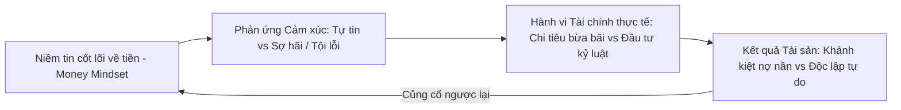
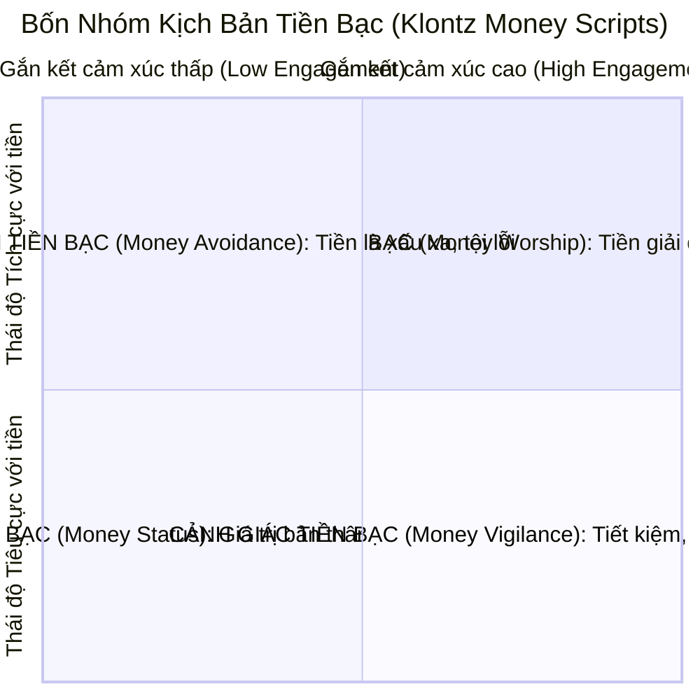
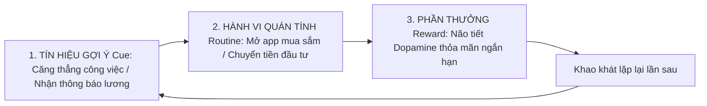
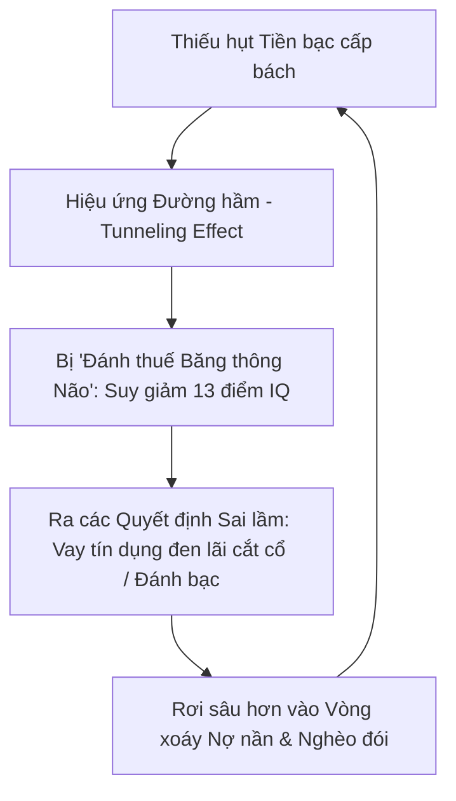
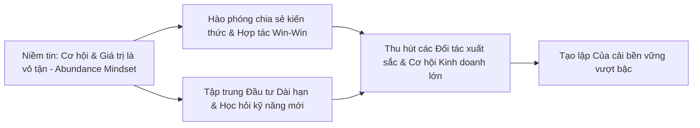

# Tư Duy Tiền Bạc, Kịch Bản Vô Thức Và Thói Quen Tài Chính

Tài chính cá nhân không đơn thuần là một môn toán học thuần túy hay kỹ năng đọc bảng cân đối kế toán; đó là khoa học về hành vi con người và tâm lý vô thức. Hầu hết các quyết định tài chính sai lầm không bắt nguồn từ việc thiếu kiến thức số học, mà xuất phát từ những "Kịch bản tiền bạc" (Money Scripts) tiêu cực được định hình từ thời thơ ấu và Tư duy khan hiếm (Scarcity Mindset) bóp nghẹt tầm nhìn chiến lược. Tài liệu này mổ xẻ cấu trúc tâm lý nền tảng, 4 hệ kịch bản tiền bạc kinh điển của Brad Klontz và cơ chế kiến tạo Thói quen tiền bạc bền vững.

> **Các câu hỏi cốt lõi:**
> 1. Tại sao các "Kịch bản tiền bạc" (Money Scripts) vô thức hình thành từ thời thơ ấu lại âm thầm chi phối 90% các quyết định chi tiêu và đầu tư của một người khi trưởng thành?
> 2. Bốn nhóm kịch bản tiền bạc của Klontz (Né tránh, Tôn sùng, Địa vị, Cảnh giác) biểu hiện cụ thể ra sao trong hành vi tài chính hàng ngày?
> 3. Cơ chế thần kinh học nào giúp chuyển hóa "Tư duy khan hiếm" (Scarcity Mindset) bế tắc thành "Tư duy dồi dào" (Abundance Mindset) rộng mở cơ hội?

---

## 1. Money Mindset (Tư duy tiền bạc)

### 1. Là gì?
- **Định nghĩa hình thức:** Tư duy tiền bạc là tập hợp các niềm tin, thái độ, giá trị nhận thức và cảm xúc cốt lõi mà một cá nhân nắm giữ đối với tiền bạc, sự giàu có và những người sở hữu tiền bạc, định hình cách thức cá nhân đó đưa ra các quyết định kiếm tiền, chi tiêu, tiết kiệm, vay nợ và đầu tư trong suốt cuộc đời.
- **Giải thích đơn giản:** Tư duy tiền bạc là "chiếc kính màu" mà bạn đeo khi nhìn vào tiền: bạn thấy tiền là công cụ tự do, phương tiện phụng sự, hay bạn thấy tiền là nguồn gốc của mọi tội lỗi, áp bức và tham lam?
- **Nếu chỉ nhớ một điều:** Bạn không thể kiếm được và giữ được số tiền vượt quá tầm nhận thức và tư duy tài chính của chính mình; tư duy đi trước, tài sản mới theo sau.

### 2. Hoạt động thế nào?
- **Chủ thể ra quyết định:** Hệ thống nhận thức vô thức (Hệ thống 1) và tư duy logic (Hệ thống 2) theo mô hình của Daniel Kahneman.
- **Mục tiêu tối ưu hóa:** Tái cấu trúc nhận thức (Cognitive Restructuring) từ tư duy tiền bạc tiêu cực, thụ động sang tư duy tiền bạc tích cực, hướng đến mục tiêu dài hạn.
- **Ràng buộc:** Chịu ảnh hưởng sâu sắc từ hoàn cảnh kinh tế gia đình lúc ấu thơ, nền văn hóa xã hội và những chấn thương tài chính (Financial Trauma) trong quá khứ.
- **Cơ chế tác động:**

### 3. Công thức & Mô hình
Mô hình Bánh xe Nhận thức - Hành vi trong Tài chính (Cognitive-Behavioral Financial Loop):
$$\text{Financial Outcome} = f(\text{Behaviors}) = f(g(\text{Emotions})) = f(g(h(\text{Money Mindset})))$$
Để thay đổi Kết quả tài sản ($\Delta \text{Outcome}$), cách duy nhất bền vững là thay đổi Hệ niềm tin gốc rễ ($\Delta \text{Mindset}$), thay vì chỉ cố gắng cưỡng chế hành vi bề nổi.

Chỉ số Sức khỏe Tư duy Tiền bạc (Financial Mindset Score - $FMS$):
Đo lường mức độ cân bằng giữa: Trách nhiệm cá nhân ($R$), Định hướng tương lai ($F$), Sự cởi mở học hỏi ($O$) và Năng lực tự chủ cảm xúc ($E$):
$$FMS = w_1 R + w_2 F + w_3 O + w_4 E$$

### 4. Ví dụ
- **Ví dụ định lượng:** Hai người có cùng mức thu nhập 20.000.000 VND/tháng:
  - **Người có Tư duy Tiền bạc Tiêu cực:** Luôn tin rằng "tiền bạc là hữu hạn, người giàu toàn là kẻ bất chính, kiếm bao nhiêu tiêu bấy nhiêu kẻo chết chẳng mang theo được". Kết quả: Mỗi tháng tiêu hết 20 triệu, nợ thẻ tín dụng 50 triệu, tài sản ròng âm.
  - **Người có Tư duy Tiền bạc Tích cực:** Tin rằng "tiền là công cụ tạo ra giá trị và sự tự do, tôi hoàn toàn có khả năng học hỏi cách làm giàu chân chính". Kết quả: Trích $20\%$ (4 triệu) đầu tư đều đặn vào ETF mỗi tháng, sống giản dị. Sau 15 năm tích lũy được khối tài sản hơn 1,5 tỷ đồng.
  - Sự khác biệt về tài sản ròng sau 15 năm không đến từ thu nhập (thu nhập bằng nhau), mà đến từ 100% Tư duy tiền bạc ban đầu.
- **Ví dụ thực tế:** Nghiên cứu về những người trúng xổ số độc đắc (Vietlott hoặc Powerball) hàng triệu USD cho thấy hơn $70\%$ trong số họ bị phá sản và rơi vào cảnh nợ nần sau 3-5 năm. Lý do: Họ nhận được một khối tiền khổng lồ nhưng vẫn giữ nguyên "Tư duy tiền bạc của người nghèo", khiến tiền bạc nhanh chóng bốc hơi qua tiêu xài hoang phí.
- **Phản ví dụ (Counterfactual):** Một người lớn lên trong gia đình nghèo khó nhưng chủ động đọc sách tài chính, tham gia các khóa học kinh tế và thay đổi tư duy tiền bạc sang tư duy làm chủ dòng tiền. Người này đã bẻ gãy chu kỳ nghèo đói truyền kiếp của dòng họ và trở thành triệu phú tự thân đầu tiên trong gia tộc.

### 5. Ứng dụng & Tranh luận
- **Ứng dụng thực tiễn:** Viết "Nhật ký tiền bạc" (Money Journal) để nhận diện những suy nghĩ tự động (Automatic Thoughts) mỗi khi chuẩn bị chi tiêu hoặc đầu tư một món tiền lớn.
- **Ưu và nhược điểm:**
  - *Ưu điểm:* Giải quyết tận gốc rễ nguyên nhân gây ra các thói quen tài chính độc hại; kiến tạo sự bình an nội tâm.
  - *Nhược điểm:* Đòi hỏi thời gian tự soi chiếu nội tâm và quá trình chuyển biến nhận thức lâu dài, không thể thay đổi chỉ sau một đêm.
- **Sai lầm phổ biến:** Nghĩ rằng "chỉ cần kiếm thật nhiều tiền thì tự khắc tâm lý tiền bạc sẽ ổn", không nhận ra rằng thu nhập tăng lên mà tư duy không đổi thì quy mô nợ nần và khủng hoảng sẽ chỉ càng phình to hơn.

### 6. Liên kết
- Cùng chủ đề: [02_Money_Scripts.md](file:///Users/ductri0981/Documents/Studying/Studying-Economic/04_Personal_Finance_and_Wealth_Management/10_Financial_Psychology/02_Money_Scripts.md)
- Liên kết chéo: [01_Personal_Finance_Foundations/01_Literacy_Planning_and_Management.md](file:///Users/ductri0981/Documents/Studying/Studying-Economic/04_Personal_Finance_and_Wealth_Management/01_Personal_Finance_Foundations/01_Literacy_Planning_and_Management.md)

---

## 2. Money Scripts (Kịch bản tiền bạc / Niềm tin vô thức về tiền)

### 1. Là gì?
- **Định nghĩa hình thức:** Kịch bản tiền bạc (Money Scripts) là khái niệm do Tiến sĩ Tâm lý học Tài chính Brad Klontz và Ted Klontz phát triển, dùng để chỉ những niềm tin cốt lõi vô thức, mang tính giả định mặc nhiên về tiền bạc được hình thành từ thời thơ ấu qua quá trình quan sát cha mẹ, trải nghiệm gia đình hoặc những cú sốc tài chính đầu đời, được nội tại hóa và tự động định hướng mọi hành vi tài chính của cá nhân khi trưởng thành.
- **Giải thích đơn giản:** Kịch bản tiền bạc là những "câu thần chú vô hình" được cài đặt vào não bạn từ bé (ví dụ: "tiền là xấu xa", "phải có thật nhiều tiền mới có giá trị", hay "tiền bạc là thứ tội lỗi"). Bạn hành động theo nó suốt đời mà không hề hay biết.
- **Nếu chỉ nhớ một điều:** Hầu hết các Kịch bản tiền bạc chỉ phản ánh một phần sự thật hoặc hoàn toàn sai lầm, nhưng bạn lại đối xử với chúng như những chân lý bất di bất dịch.

### 2. Hoạt động thế nào?
- **Chủ thể ra quyết định:** Bốn nhóm Kịch bản Tiền bạc theo Thang đo Klontz-Money Script Inventory (KMSI):
  1. **Né tránh tiền bạc (Money Avoidance).**
  2. **Tôn sùng tiền bạc (Money Worship).**
  3. **Địa vị tiền bạc (Money Status).**
  4. **Cảnh giác tiền bạc (Money Vigilance).**
- **Mục tiêu tối ưu hóa:** Nhận diện kịch bản chủ đạo của bản thân để hóa giải các niềm tin lệch lạc và chuyển dịch về trạng thái Cảnh giác tiền bạc lành mạnh.
- **Ràng buộc:** Kịch bản tiền bạc có tính di truyền qua các thế hệ gia đình (Intergenerational transmission) nếu không có sự can thiệp tỉnh thức.
- **Cơ chế tác động:**

### 3. Công thức & Mô hình
Đặc trưng Bốn Hệ Kịch Bản Tiền Bạc của Klontz:

| Nhóm Kịch bản | Niềm tin Vô thức Điển hình | Hành vi Tài chính Tiêu cực Phát sinh |
| :--- | :--- | :--- |
| **1. Money Avoidance (Né tránh)** | "Người giàu đều tham lam", "Tiền làm tha hóa con người", "Tôi không xứng đáng có nhiều tiền" | Vứt bỏ tiền, tự phá hoại tài chính (Sabotage), không dám xem số dư tài khoản, cho vay không đòi |
| **2. Money Worship (Tôn sùng)** | "Có tiền là có tất cả", "Thêm một ít tiền nữa sẽ giải quyết được mọi nỗi đau khổ trong đời" | Nghiện mua sắm, tham công tiếc việc (Workaholic), nợ nần do cố mua hạnh phúc |
| **3. Money Status (Địa vị)** | "Giá trị con người nằm ở thương hiệu quần áo họ mặc và chiếc xe họ đi", "Phải tỏ ra giàu có" | Chi tiêu khoe khoang, mua đồ xa xỉ vượt khả năng, giấu nợ nần, dễ rơi vào bẫy lừa đảo đa cấp |
| **4. Money Vigilance (Cảnh giác)** | "Phải luôn tiết kiệm cho ngày mưa bão", "Nói về tiền bạc là thô lỗ", "Không được tiêu xài hoang phí" | Tiết kiệm quá mức kham khổ, lo âu tài chính thái quá, không dám tận hưởng thành quả lao động |

### 4. Ví dụ
- **Ví dụ định lượng:** Đo lường tác động của Kịch bản "Money Status":
  - Một cá nhân có thu nhập 25 triệu/tháng nhưng mang kịch bản "Money Status" mạnh mẽ. Để chứng minh đẳng cấp với bạn bè, người này vay trả góp mua chiếc ô tô Mercedes cũ giá 1 tỷ VND.
  - Chi phí trả góp gốc và lãi: 15 triệu/tháng. Chi phí xăng xe, gửi xe, bảo dưỡng: 6 triệu/tháng. Tổng chi phí xe cộ: 21 triệu/tháng (chiếm tới $84\%$ thu nhập!).
  - Người này chỉ còn 4 triệu để ăn uống, rơi vào cảnh "vỏ ngoài hào nhoáng nhưng bên trong kiệt quệ", nợ thẻ tín dụng chồng chất.
- **Ví dụ thực tế:** Tại Việt Nam, nhiều người thuộc thế hệ lớn lên trong thời kỳ bao cấp khó khăn mang nặng kịch bản "Money Vigilance" (Cảnh giác cực đoan): Dù trong tài khoản có hàng tỷ đồng tiết kiệm, họ vẫn không dám bật điều hòa vào mùa hè, không dám đi khám bệnh hay mua thức ăn ngon, tích lũy tiền cho đến chết trong sự khắc khổ.
- **Phản ví dụ (Counterfactual):** Một người nhận diện được mình mang kịch bản "Money Avoidance" (luôn cảm thấy tội lỗi khi có nhiều tiền và tìm cách tiêu hết). Sau khi nhận thức được kịch bản này xuất phát từ việc bố mẹ từng cãi nhau dữ dội vì tiền, người này đã thiết lập lệnh tự động chuyển $30\%$ lương vào quỹ đầu tư ngay ngày nhận lương, ngăn chặn thành công hành vi tự tiêu sạch tiền.

### 5. Ứng dụng & Tranh luận
- **Ứng dụng thực tiễn:** Thực hiện bài kiểm tra trắc nghiệm Klontz Money Script Inventory (KMSI) để xác định rõ hồ sơ kịch bản của bản thân và bạn đời trước khi kết hôn nhằm tránh xung đột tài chính gia đình.
- **Ưu và nhược điểm:**
  - *Ưu điểm:* Lý giải chính xác nguyên nhân sâu xa của các hành vi tài chính phi lý trí lặp đi lặp lại.
  - *Nhược điểm:* Đòi hỏi sự trung thực tuyệt đối với chính mình; việc chữa lành các chấn thương tâm lý tài chính cần sự đồng hành của chuyên gia.
- **Sai lầm phổ biến:** Cho rằng kịch bản "Cảnh giác tiền bạc" là hoàn hảo $100\%$, không nhận ra rằng cảnh giác quá mức sẽ biến thành sự bủn xỉn, keo kiệt và đánh mất niềm vui cuộc sống.

### 6. Liên kết
- Cùng chủ đề: [01_Money_Mindset.md](file:///Users/ductri0981/Documents/Studying/Studying-Economic/04_Personal_Finance_and_Wealth_Management/10_Financial_Psychology/01_Money_Mindset.md)
- Liên kết chéo: [03_Budgeting_and_Expense_Management/07_Mindful_Spending_and_Consumption_Control.md](file:///Users/ductri0981/Documents/Studying/Studying-Economic/04_Personal_Finance_and_Wealth_Management/03_Budgeting_and_Expense_Management/07_Mindful_Spending_and_Consumption_Control.md)

---

## 3. Money Habits (Thói quen tiền bạc)

### 1. Là gì?
- **Định nghĩa hình thức:** Thói quen tiền bạc là những phản xạ hành vi tài chính tự động, lặp đi lặp lại được kích hoạt bởi các tín hiệu môi trường cụ thể và được củng cố thông qua các phần thưởng tâm lý nội tại hoặc bên ngoài, định hình cách thức một cá nhân quản lý dòng tiền hàng ngày mà không cần tiêu tốn nhiều nỗ lực suy nghĩ có ý thức.
- **Giải thích đơn giản:** Thói quen tiền bạc là những việc bạn "làm theo quán tính với tiền": như thói quen vừa nhận lương là chuyển tiền tiết kiệm ngay, thói quen uống cà phê 60k mỗi sáng, hay thói quen cứ buồn chán là mở app thương mại điện tử lên săn sale.
- **Nếu chỉ nhớ một điều:** Bạn không quyết định tương lai tài chính của mình; bạn quyết định các THÓI QUEN tài chính của mình, và chính các thói quen đó sẽ quyết định tương lai tài chính của bạn.

### 2. Hoạt động thế nào?
- **Chủ thể ra quyết định:** Vùng hạch nền của não bộ (Basal Ganglia) lưu trữ các vòng lặp thói quen tự động; Vỏ não trước trán (Prefrontal Cortex) chịu trách nhiệm can thiệp điều chỉnh.
- **Mục tiêu tối ưu hóa:** Tự động hóa các hành vi tài chính có lợi (tiết kiệm, đầu tư) và triệt tiêu các vòng lặp chi tiêu phá hoại tài sản.
- **Ràng buộc:** Cấu trúc Vòng lặp thói quen của Charles Duhigg: Gợi ý (Cue) $\to$ Thói quen (Routine) $\to$ Phần thưởng (Reward).
- **Cơ chế tác động:**

### 3. Công thức & Mô hình
Nguyên tắc Thay thế Thói quen Vàng (The Golden Rule of Habit Change):
Không thể xóa bỏ hoàn toàn một thói quen xấu, chỉ có thể THAY THẾ hành vi (Routine) trong khi giữ nguyên Tín hiệu (Cue) và Phần thưởng cảm xúc (Reward):
$$\text{Giữ nguyên Cue (Căng thẳng)} \implies \text{Thay thế Routine (Mua sắm } \to \text{ Đi bộ / Đọc sách)} \implies \text{Đạt cùng Reward (Giảm stress)}$$

Sức mạnh Lũy thừa của Thói quen Tài chính Tốt Nhỏ bé (Atomic Habits):
Nếu mỗi ngày cải thiện thói quen tài chính thêm $1\%$ ($0,01$):
$$(1 + 0,01)^{365} \approx 37,78 \text{ lần}$$
Nếu mỗi ngày duy trì thói quen chi tiêu rò rỉ làm hao hụt $1\%$ ($0,01$):
$$(1 - 0,01)^{365} \approx 0,0255 \text{ (bốc hơi gần 97,5\% tài sản!)}$$

### 4. Ví dụ
- **Ví dụ định lượng (Hiệu ứng Latte Factor):**
  - Thói quen nhỏ: Mỗi ngày đi làm mua một ly trà sữa/cà phê thương hiệu 60.000 VND và một món ăn vặt 40.000 VND $\implies$ Tiêu tốn 100.000 VND/ngày (3.000.000 VND/tháng).
  - Nếu thay thế thói quen bằng việc tự pha cà phê tại cơ quan (tốn 10.000 VND/ngày) và mang 2.700.000 VND tiết kiệm được mỗi tháng đầu tư đều đặn vào quỹ chỉ số cổ phiếu với tỷ suất sinh lời $10\%$/năm:
    - Sau 10 năm: Tích lũy được **557.000.000 VND**.
    - Sau 25 năm: Tích lũy được **3.560.000.000 VND**!
  - Một thói quen vô thức tưởng như vô hại đã âm thầm cướp đi một căn hộ chung cư 3,5 tỷ đồng trong tương lai.
- **Ví dụ thực tế:** Những người đạt tự do tài chính thành công nhất luôn áp dụng thói quen "Tự động hóa hoàn toàn" (Automation Habit): Cài đặt lệnh chuyển tiền tự động từ tài khoản thanh toán sang tài khoản đầu tư chứng chỉ quỹ vào đúng ngày 5 hàng tháng (ngày nhận lương), loại bỏ hoàn toàn sự can thiệp của ý chí và cảm xúc.
- **Phản ví dụ (Counterfactual):** Một người có thói quen "cứ rảnh rỗi là lướt TikTok Shop xem livestream". Tín hiệu rảnh rỗi kết hợp với các kỹ thuật kích thích tâm lý giảm giá tạo thành vòng lặp thói quen chốt đơn liên tục, khiến mỗi tháng phát sinh từ 5 đến 10 triệu đồng tiền mua các món đồ vô bổ không bao giờ dùng đến.

### 5. Ứng dụng & Tranh luận
- **Ứng dụng thực tiễn:** Áp dụng "Quy tắc 72 giờ": Mỗi khi có ham muốn mua một món đồ không thiết yếu, bắt buộc bản thân phải đợi đúng 72 giờ trước khi bấm thanh toán để cảm xúc hưng phấn hạ nhiệt.
- **Ưu và nhược điểm:**
  - *Ưu điểm:* Biến việc làm giàu thành một quá trình tự nhiên, nhẹ nhàng, không tốn ý chí đấu tranh nội tâm.
  - *Nhược điểm:* Đòi hỏi sự kiên trì thiết lập lại môi trường sống trong $30 - 60$ ngày đầu tiên.
- **Sai lầm phổ biến:** Trông cậy vào "ý chí và quyết tâm" để tiết kiệm tiền thay vì thiết lập các rào cản vật lý và tự động hóa hệ thống thói quen.

### 6. Liên kết
- Cùng chủ đề: [01_Money_Mindset.md](file:///Users/ductri0981/Documents/Studying/Studying-Economic/04_Personal_Finance_and_Wealth_Management/10_Financial_Psychology/01_Money_Mindset.md)
- Liên kết chéo: [03_Budgeting_and_Expense_Management/07_Mindful_Spending_and_Consumption_Control.md](file:///Users/ductri0981/Documents/Studying/Studying-Economic/04_Personal_Finance_and_Wealth_Management/03_Budgeting_and_Expense_Management/07_Mindful_Spending_and_Consumption_Control.md)

---

## 4. Scarcity Mindset (Tư duy khan hiếm)

### 1. Là gì?
- **Định nghĩa hình thức:** Tư duy khan hiếm (được nghiên cứu chuyên sâu bởi Sendhil Mullainathan và Eldar Shafir trong tác phẩm *Scarcity: Why Having Too Little Means So Much*) là trạng thái tâm lý nhận thức xuất hiện khi một cá nhân cảm thấy mình bị thiếu hụt nghiêm trọng một nguồn lực cốt lõi (tiền bạc, thời gian, sự an toàn), dẫn đến việc bộ não tự động "chiếm dụng băng thông nhận thức" (Cognitive Bandwidth), tập trung toàn bộ sự chú ý vào mối đe dọa trước mắt và làm suy giảm nghiêm trọng năng lực tư duy logic dài hạn.
- **Giải thích đơn giản:** Tư duy khan hiếm là "tâm lý đường hầm": khi bạn quá kẹt tiền và lo lắng về bữa ăn ngày mai, não của bạn bị thu hẹp lại như nhìn qua một cái ống hẹp; bạn chỉ thấy món nợ trước mắt mà không còn tâm trí đâu để nghĩ đến kế hoạch 5 năm hay học tập phát triển bản thân.
- **Nếu chỉ nhớ một điều:** Nỗi sợ thiếu tiền làm suy giảm chỉ số IQ thực tế tương đương với việc bạn bị mất ngủ trọn một đêm; sự nghèo khó bóp nghẹt năng lực ra quyết định thông minh của con người.

### 2. Hoạt động thế nào?
- **Chủ thể ra quyết định:** Hệ thống thần kinh phản ứng sinh tồn dưới áp lực thiếu hụt tài chính cấp bách.
- **Mục tiêu tối ưu hóa:** Tìm kiếm giải pháp sinh tồn tức thì để giải quyết khủng hoảng trước mắt (ngắn hạn cực đoan).
- **Ràng buộc:** Băng thông nhận thức (Bandwidth) của não bộ bị suy giảm tới $13 - 14$ điểm IQ theo các thực nghiệm tâm lý học hành vi.
- **Cơ chế tác động:**

### 3. Công thức & Mô hình
Mô hình "Thuế Băng thông Nhận thức" (The Cognitive Bandwidth Tax):
$$\text{Available Cognitive Capacity} = \text{Total Mental Capacity} - \text{Scarcity Load}$$
Khi Gánh nặng Khan hiếm ($\text{Scarcity Load}$) chiếm dụng $40\% - 50\%$ công suất xử lý của não bộ:
- Khả năng kiểm soát xung động (Executive Function) bị tê liệt.
- Tỷ lệ chiết khấu thời gian tăng vọt $\implies$ Đánh giá thấp tương lai, chỉ coi trọng hiện tại.

Mô hình Vòng xoáy Bẫy Nghèo (Poverty Trap Dynamics):
$$W_{t+1} = W_t + f(W_t) - C_{\text{emergency}} - \text{HighCostDebt}$$
Khi $W_t < W_{\text{critical}}$, chi phí tài chính phụ trội (phí phạt, lãi suất chợ đen) đẩy hệ thống vào trạng thái suy giảm đơn điệu về 0.

### 4. Ví dụ
- **Ví dụ định lượng:** Một người lao động nghèo không có quỹ khẩn cấp. Chiếc xe máy mưu sinh bị hỏng hóc cần 2.000.000 VND để sửa chữa nhưng trong túi không có tiền.
  - Dưới áp lực của Tư duy khan hiếm (phải có xe ngay để đi làm), người này bấm vay tiền qua ứng dụng "tín dụng đen" với lãi suất $10\%$/tuần (hơn $500\%$/năm).
  - Sau 2 tháng, khoản nợ 2 triệu ban đầu phình to thành 15 triệu đồng.
  - Người này rơi vào khủng hoảng tinh thần, mất tập trung làm việc, bị đuổi việc và bế tắc hoàn toàn.
  - Nếu có một Quỹ khẩn cấp nhỏ (Cash Buffer), người này đã bình tĩnh tự sửa xe mà không kích hoạt chuỗi thảm họa tài chính trên.
- **Ví dụ thực tế:** Thí nghiệm kinh điển của Mullainathan và Shafir trên các nông dân trồng mía tại Ấn Độ: Cùng một người nông dân, khi được kiểm tra trắc nghiệm IQ vào thời điểm *trước vụ thu hoạch* (khi đang túng thiếu tiền bạc), điểm IQ của họ thấp hơn đáng kể so với thời điểm *sau vụ thu hoạch* (khi đã bán mía có tiền rủng rỉnh). Cùng một con người, sự thiếu thốn tiền bạc tạm thời đã làm suy giảm trí thông minh của họ.
- **Phản ví dụ (Counterfactual):** Một người chủ động xây dựng Quỹ khẩn cấp tương đương 3 tháng sinh hoạt. Khi gặp biến cố mất việc, người này không bị rơi vào tư duy khan hiếm; họ bình tĩnh sử dụng quỹ khẩn cấp, dành thời gian học thêm chứng chỉ chuyên môn mới và sau đó tìm được công việc có mức lương cao hơn $50\%$.

### 5. Ứng dụng & Tranh luận
- **Ứng dụng thực tiễn:** Bước đầu tiên để thoát khỏi tư duy khan hiếm là tạo lập bằng mọi giá một "Vùng đệm an toàn thanh khoản" (Cash Buffer từ 10 đến 20 triệu đồng) để giải phóng băng thông não bộ khỏi các nỗi lo vụn vặt hàng ngày.
- **Ưu và nhược điểm:**
  - *Ưu điểm của sự tập trung khan hiếm:* Tạo ra sự tập trung phi thường vào một nhiệm vụ khẩn cấp duy nhất (Focus Dividend).
  - *Nhược điểm chí mạng:* Bỏ qua mọi rủi ro ngoại vi dài hạn, dẫn đến việc giải quyết một vấn đề nhỏ bằng cách tạo ra một thảm họa lớn hơn trong tương lai.
- **Sai lầm phổ biến:** Chỉ trích người nghèo là "lười biếng hoặc thiếu ý chí", không nhận ra rằng bộ não của họ đang phải chịu đựng mức tải nhận thức khổng lồ do áp lực sinh tồn hàng ngày gây ra.

### 6. Liên kết
- Cùng chủ đề: [05_Abundance_Mindset.md](file:///Users/ductri0981/Documents/Studying/Studying-Economic/04_Personal_Finance_and_Wealth_Management/10_Financial_Psychology/05_Abundance_Mindset.md)
- Liên kết chéo: [04_Saving_and_Emergency_Funds/02_Emergency_Rainy_Day_and_Sinking_Funds.md](file:///Users/ductri0981/Documents/Studying/Studying-Economic/04_Personal_Finance_and_Wealth_Management/04_Saving_and_Emergency_Funds/02_Emergency_Rainy_Day_and_Sinking_Funds.md)

---

## 5. Abundance Mindset (Tư duy dồi dào / Tư duy trù phú)

### 1. Là gì?
- **Định nghĩa hình thức:** Tư duy dồi dào (khái niệm được phổ biến rộng rãi bởi Stephen Covey trong *The 7 Habits of Highly Effective People*) là mô thức nhận thức xem thế giới và nền kinh tế là một hệ thống mở không có giới hạn, nơi cơ hội, của cải, tri thức và thành công là vô tận và có đủ cho tất cả mọi người, thúc đẩy tinh thần hợp tác cùng có lợi (Win-Win), hào phóng chia sẻ và tầm nhìn kiến tạo giá trị dài hạn.
- **Giải thích đơn giản:** Tư duy dồi dào là niềm tin rằng: "Miếng bánh kinh tế luôn có thể làm to ra, thành công của người khác không làm mất đi cơ hội của tôi; việc tôi giúp người khác giàu lên cũng sẽ giúp chính tôi giàu lên".
- **Nếu chỉ nhớ một điều:** Người mang tư duy khan hiếm tập trung vào việc "tranh giành miếng bánh có sẵn"; người mang tư duy dồi dào tập trung vào việc "nướng chiếc bánh to hơn gấp mười lần".

### 2. Hoạt động thế nào?
- **Chủ thể ra quyết định:** Nhà lãnh đạo, doanh nhân và nhà đầu tư có tư duy phát triển (Growth Mindset).
- **Mục tiêu tối ưu hóa:** Chuyển dịch từ Trò chơi có tổng bằng không (Zero-sum Game) sang Trò chơi hợp tác có tổng dương (Positive-sum Game).
- **Ràng buộc:** Đòi hỏi nội lực tự tin vững vàng và năng lực chấp nhận rủi ro được tính toán trước.
- **Cơ chế tác động:**

### 3. Công thức & Mô hình
So sánh Toán học giữa Hai Mô thức Tư duy:
1. **Mô thức Khan hiếm (Zero-sum Game):**
$$\sum_{i=1}^n \Delta W_i = 0 \implies \Delta W_{\text{tôi}} = - \Delta W_{\text{bạn}}$$
(Tôi chỉ có thể giàu lên nếu người khác nghèo đi $\implies$ Dẫn đến ganh ghét, đố kỵ, giấu giếm, cạnh tranh triệt hạ).
2. **Mô thức Dồi dào (Positive-sum / Synergy Game):**
$$\sum_{i=1}^n \Delta W_i = \Delta V_{\text{tổng thể}} > 0 \implies \Delta W_{\text{tôi}} > 0 \land \Delta W_{\text{bạn}} > 0$$
(Cùng nhau sáng tạo giá trị mới $\implies$ Hợp tác, chia sẻ, mở rộng quy mô thị trường).

Hàm Thỏa dụng của Tư duy Dồi dào:
$$U_{\text{abundance}} = u(W_{\text{self}}) + \theta \sum_{j \ne i} u(W_j), \quad \text{với } \theta > 0$$
Trong đó $\theta$ là hệ số lòng vị tha và tinh thần cộng hưởng xã hội.

### 4. Ví dụ
- **Ví dụ định lượng:** Hai lập trình viên A và B cùng phát triển phần mềm:
  - **Lập trình viên A (Tư duy khan hiếm):** Sợ bị người khác đánh cắp ý tưởng, giấu kín mã nguồn trong máy tính, tự làm một mình từ A-Z. Sau 2 năm sản phẩm chưa hoàn thiện, lỗi thời và thất bại.
  - **Lập trình viên B (Tư duy dồi dào):** Đưa mã nguồn lên cộng đồng mã nguồn mở GitHub, hào phóng chia sẻ tài liệu và mời các chuyên gia khác cùng đóng góp. Hàng ngàn kỹ sư cùng tham gia hoàn thiện phần mềm, sản phẩm nhanh chóng trở thành tiêu chuẩn ngành, B thành lập công ty cung cấp dịch vụ hỗ trợ doanh nghiệp và được định giá 20 triệu USD.
  - Sự cởi mở của tư duy dồi dào đã tạo ra khối tài sản gấp hàng triệu lần sự bo bo giữ mình.
- **Ví dụ thực tế:** Tỷ phú Ray Dalio (nhà sáng lập quỹ đầu tư mạo hiểm Bridgewater Associates) áp dụng triết lý "Sự thật tuyệt đối và Minh bạch triệt để" (Radical Truth and Radical Transparency), khuyến khích nhân viên công khai chỉ trích sai lầm của cấp trên và tự do chia sẻ tri thức, tạo nên đế chế quản lý quỹ đầu tư thành công nhất lịch sử.
- **Phản ví dụ (Counterfactual):** Một chủ doanh nghiệp mang tư duy khan hiếm, luôn nghi ngờ nhân viên ăn cắp bí quyết nên cài phần mềm theo dõi chặt chẽ, trả lương bủn xỉn và không bao giờ chia sẻ hoa hồng. Các nhân sự giỏi nhất đồng loạt bỏ đi sang công ty đối thủ, doanh nghiệp suy thoái và cuối cùng phải đóng cửa.

### 5. Ứng dụng & Tranh luận
- **Ứng dụng thực tiễn:** Thực hành lòng biết ơn (Gratitude Practice) hàng ngày; chúc mừng thành công của người khác một cách chân thành; sẵn sàng chia sẻ cơ hội và kết nối cho bạn bè, đối tác.
- **Ưu và nhược điểm:**
  - *Ưu điểm:* Thu hút nguồn nhân tài và các cơ hội kinh doanh vô giá; sống cuộc đời thanh thản, giàu có cả về vật chất lẫn tinh thần.
  - *Nhược điểm:* Nếu không đi kèm sự cẩn trọng và năng lực thẩm định rủi ro, sự tin tưởng quá mức có thể bị những kẻ xấu lợi dụng lừa đảo.
- **Sai lầm phổ biến:** Nhầm lẫn tư duy dồi dào với "sự ảo tưởng lạc quan thái quá" (Toxic Positivity), cho rằng cứ nghĩ tích cực là tiền tự rơi xuống đầu mà không cần bắt tay vào hành động kỷ luật.

### 6. Liên kết
- Cùng chủ đề: [04_Scarcity_Mindset.md](file:///Users/ductri0981/Documents/Studying/Studying-Economic/04_Personal_Finance_and_Wealth_Management/10_Financial_Psychology/04_Scarcity_Mindset.md)
- Liên kết chéo: [01_Personal_Finance_Foundations/08_Wealth_Lifecycle_Accumulation_Preservation_Transfer.md](file:///Users/ductri0981/Documents/Studying/Studying-Economic/04_Personal_Finance_and_Wealth_Management/01_Personal_Finance_Foundations/08_Wealth_Lifecycle_Accumulation_Preservation_Transfer.md)

---

## Câu hỏi tự kiểm tra
1. Hãy phân tích Mô hình Bốn Nhóm Kịch Bản Tiền Bạc (Klontz Money Scripts) và chỉ ra các hành vi tài chính tiêu cực phát sinh từ kịch bản "Tôn sùng tiền bạc" (Money Worship) và "Né tránh tiền bạc" (Money Avoidance).
2. Hiệu ứng "Đường hầm" (Tunneling) và "Thuế Băng thông Nhận thức" trong Tư duy khan hiếm (Scarcity Mindset) tác động như thế nào đến khả năng ra quyết định tài chính của con người theo nghiên cứu của Mullainathan và Shafir?
3. Trình bày Nguyên tắc Vàng Thay thế Thói quen (The Golden Rule of Habit Change) của Charles Duhigg. Làm thế nào để thay thế thói quen chi tiêu bừa bãi khi căng thẳng bằng một hành vi tài chính lành mạnh?
4. So sánh sự khác nhau căn bản giữa Trò chơi có tổng bằng không (Zero-sum Game) và Trò chơi có tổng dương (Positive-sum Game) dưới góc độ của Tư duy khan hiếm và Tư duy dồi dào.

## Ghi chú nguồn
- Klontz, B., & Britt, S. L. - *Financial Therapy: Theory, Research, and Practice*, Springer.
- Mullainathan, S., & Shafir, E. - *Scarcity: Why Having Too Little Means So Much*, Times Books.
- Duhigg, C. - *The Power of Habit: Why We Do What We Do in Life and Business*, Random House.
- Covey, S. R. - *The 7 Habits of Highly Effective People*, Free Press.
