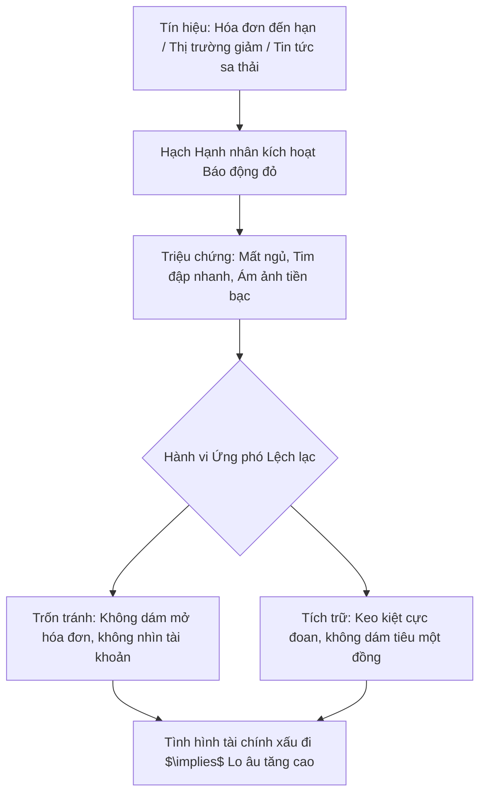
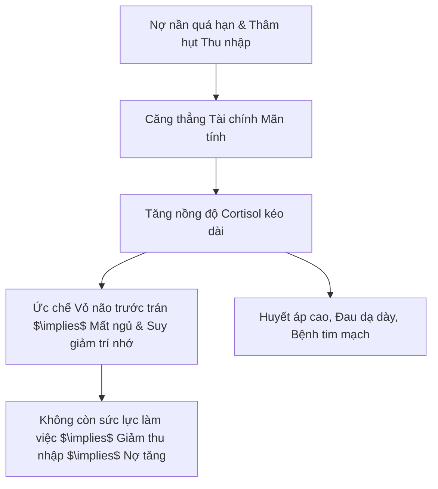
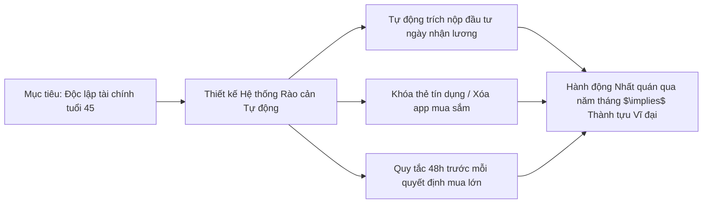
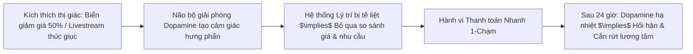
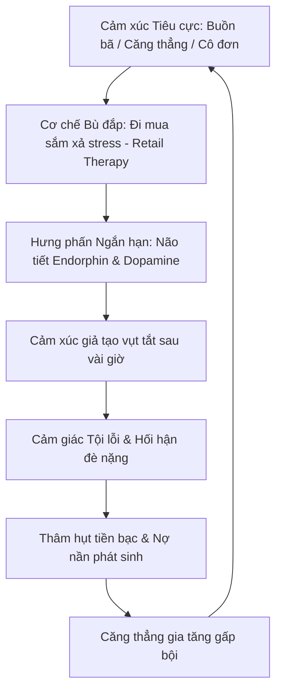

# Căng Thẳng Tài Chính, Lo Âu Tiền Bạc, Chi Tiêu Cảm Xúc Và Kỷ Luật Tài Chính

Căng thẳng tài chính là một trong những nguyên nhân hàng đầu dẫn đến suy nhược sức khỏe thể chất, trầm cảm và tan vỡ hôn nhân trong xã hội hiện đại. Khi đối mặt với áp lực tiền bạc, con người thường có xu hướng tìm đến các hành vi bù đắp cảm xúc tiêu cực như Chi tiêu bốc đồng (Impulse Spending) và Chi tiêu cảm xúc (Emotional Spending) – tạo thành một vòng xoáy tự hủy hoại tài chính tàn khốc. Tài liệu này mổ xẻ cơ chế sinh lý thần kinh của Căng thẳng và Lo âu tài chính, đồng thời cung cấp các giải pháp tâm lý hành vi để thiết lập Kỷ luật tài chính (Financial Discipline) bằng thép.

> **Các câu hỏi cốt lõi:**
> 1. Tại sao Căng thẳng tài chính mãn tính (Chronic Financial Stress) lại kích thích hormone Cortisol làm tê liệt vùng Vỏ não trước trán (Prefrontal Cortex), đẩy con người vào các quyết định chi tiêu bốc đồng?
> 2. Vòng lặp Chi tiêu Cảm xúc (Emotional Spending Loop: Tổn thương $\to$ Mua sắm $\to$ Hưng phấn tạm thời $\to$ Cảm giác tội lỗi $\to$ Nợ nần) được phá vỡ bằng cách nào?
> 3. Kỹ thuật "Thiết lập Ý định Thực thi" (Implementation Intentions) và "Gia tăng Ma sát Hành vi" (Friction Design) kiến tạo Kỷ luật tài chính tự động ra sao?

---

## 1. Financial Anxiety (Lo âu tài chính)

### 1. Là gì?
- **Định nghĩa hình thức:** Lo âu tài chính là một hội chứng tâm lý đặc trưng bởi sự lo lắng, bồn chồn, bất an và sợ hãi mãn tính, quá mức và dai dẳng liên quan đến tình hình tiền bạc, khả năng chi trả các nghĩa vụ tài chính và sự ổn định kinh tế trong tương lai, thường vượt quá mức độ nghiêm trọng của hoàn cảnh tài chính khách quan thực tế.
- **Giải thích đơn giản:** Lo âu tài chính là cảm giác lúc nào bạn cũng "bất an thắt ruột thắt gan về tiền": dù trong tài khoản vẫn còn tiền, bạn vẫn luôn ám ảnh rằng ngày mai mình sẽ mất việc, sẽ phá sản, sẽ không đủ tiền nuôi con hay chữa bệnh.
- **Nếu chỉ nhớ một điều:** Lo âu tài chính không phụ thuộc hoàn toàn vào số tiền bạn đang có trong tài khoản; nhiều triệu phú vẫn bị lo âu tài chính hành hạ dữ dội do những tổn thương tâm lý chưa được giải quyết.

### 2. Hoạt động thế nào?
- **Chủ thể ra quyết định:** Hệ thống cảm xúc trung tâm (Hạch hạnh nhân - Amygdala) bị kích hoạt liên tục trong trạng thái báo động đỏ (Fight-or-Flight).
- **Mục tiêu tối ưu hóa:** Tìm kiếm cảm giác an toàn và kiểm soát bằng các hành vi phòng thủ cực đoan (kiểm tra tài khoản liên tục, tích trữ tiền mặt, hoặc trốn tránh mở các thông báo nợ).
- **Ràng buộc:** Sự méo mó nhận thức (Cognitive Distortions: Trầm trọng hóa vấn đề, suy nghĩ đen trắng); sự lan truyền tâm lý tiêu cực từ truyền thông và mạng xã hội.
- **Cơ chế tác động:**

### 3. Công thức & Mô hình
Thang đo Lo âu Tài chính Khách quan (Financial Anxiety Scale - FAS):
Chỉ số Đo lường Mức độ Phản ứng Lo âu ($FAS \in [1, 7]$) dựa trên 4 chiều kích:
$$FAS = \frac{1}{4} \left( S_{\text{somatic}} + S_{\text{cognitive}} + S_{\text{emotional}} + S_{\text{behavioral}} \right)$$
Trong đó:
- $S_{\text{somatic}}$: Phản ứng cơ thể (mất ngủ, đau dạ dày, căng cơ khi nghĩ về tiền).
- $S_{\text{cognitive}}$: Suy nghĩ ám ảnh (luôn nghĩ về kịch bản tài chính tồi tệ nhất).
- $S_{\text{emotional}}$: Cảm xúc sợ hãi, xấu hổ, tội lỗi.
- $S_{\text{behavioral}}$: Hành vi né tránh hoặc kiểm tra tài khoản cưỡng chế.
Nếu $FAS > 5,5$: Cá nhân đang trong tình trạng Lo âu tài chính lâm sàng cần can thiệp trị liệu tâm lý tài chính (Financial Therapy).

### 4. Ví dụ
- **Ví dụ định lượng:** Một kỹ sư phần mềm có thu nhập 45.000.000 VND/tháng và tài khoản tiết kiệm 300 triệu VND (đủ sống 1 năm nếu mất việc), không nợ nần ai.
  - Tuy nhiên, người này mắc chứng Lo âu tài chính nặng do từng chứng kiến gia đình phá sản năm 10 tuổi.
  - Mỗi sáng thức dậy, việc đầu tiên là mở app ngân hàng kiểm tra số dư 5 lần. Mỗi khi phải chi trả một bữa ăn 100.000 VND cùng bạn bè, tim đập nhanh và cảm thấy cắn rứt tội lỗi suốt cả ngày.
  - Người này từ chối mọi hoạt động giao lưu xã hội, không dám hẹn hò kết hôn vì sợ "tốn tiền", sống trong sự dằn vặt khổ sở dù tài chính hoàn toàn khỏe mạnh.
- **Ví dụ thực tế:** Tại Việt Nam, sau giai đoạn biến động thị trường chứng khoán và bất động sản năm 2022 - 2023, tỷ lệ người trẻ tìm kiếm sự trợ giúp tâm lý về chứng "Ám ảnh tiền bạc và Trầm cảm tài chính" tăng vọt, phản ánh mức độ lo âu tài chính phổ quát trong xã hội.
- **Phản ví dụ (Counterfactual):** Một người đối diện với sự lo âu bằng cách lập "Bảng Kế hoạch Ứng phó Kịch bản Tồi tệ nhất" (Worst-case Scenario Action Plan): Nếu mất việc thì cắt giảm chi tiêu xuống 8 triệu/tháng, quỹ khẩn cấp đủ sống 18 tháng, làm nghề tự do kiếm thêm 5 triệu. Nhờ có phương án cụ thể bằng văn bản, não bộ nhận diện được sự kiểm soát và cảm giác lo âu lập tức tan biến.

### 5. Ứng dụng & Tranh luận
- **Ứng dụng thực tiễn:** Tách bạch rõ ràng giữa "Rủi ro thực tế" (Facts) và "Nỗi sợ tưởng tượng" (Feelings); áp dụng kỹ thuật chánh niệm tài chính (Financial Mindfulness) và viết nhật ký giải tỏa cảm xúc.
- **Ưu và nhược điểm:**
  - *Mặt tích cực của lo âu nhẹ:* Đóng vai trò là tín hiệu cảnh báo giúp con người cẩn trọng và chuẩn bị quỹ dự phòng.
  - *Mặt phá hoại của lo âu mãn tính:* Tàn phá sức khỏe tinh thần, gây tê liệt khả năng nắm bắt các cơ hội đầu tư tốt.
- **Sai lầm phổ biến:** Cố gắng giải tỏa nỗi lo âu tài chính bằng việc vùi đầu vào kiếm thêm tiền một cách điên cuồng, để rồi nhận ra càng kiếm được nhiều tiền thì nỗi sợ mất tiền lại càng tăng lên gấp bội.

### 6. Liên kết
- Cùng chủ đề: [02_Financial_Stress.md](file:///Users/ductri0981/Documents/Studying/Studying-Economic/04_Personal_Finance_and_Wealth_Management/10_Financial_Psychology/02_Financial_Stress.md)
- Liên kết chéo: [04_Saving_and_Emergency_Funds/04_Liquidity_and_Cash_Reserve_Management.md](file:///Users/ductri0981/Documents/Studying/Studying-Economic/04_Personal_Finance_and_Wealth_Management/04_Saving_and_Emergency_Funds/04_Liquidity_and_Cash_Reserve_Management.md)

---

## 2. Financial Stress (Căng thẳng tài chính)

### 1. Là gì?
- **Định nghĩa hình thức:** Căng thẳng tài chính là phản ứng sinh lý và tâm lý tiêu cực của cơ thể khi một cá nhân phải đối mặt với tình trạng thiếu hụt dòng tiền thực tế, áp lực nợ nần quá hạn, hoặc sự mất cân đối trầm trọng giữa các nghĩa vụ tài chính bắt buộc và nguồn thu nhập khả dụng hiện hữu.
- **Giải thích đơn giản:** Căng thẳng tài chính là khi bạn "bị tiền bạc đè bẹp trong đời thực": sắp đến ngày trả tiền nhà, trả nợ ngân hàng mà trong tài khoản không còn một đồng, điện thoại reo liên tục đòi nợ khiến đầu bạn đau như búa bổ.
- **Nếu chỉ nhớ một điều:** Căng thẳng tài chính không chỉ là vấn đề trong ví tiền; nó là chất độc tàn phá cơ thể sinh học: làm tăng huyết áp, suy giảm miễn dịch, đẩy nhanh lão hóa và trực tiếp rút ngắn tuổi thọ.

### 2. Hoạt động thế nào?
- **Chủ thể ra quyết định:** Trục dưới đồi - tuyến yên - tuyến thượng thận (Trục HPA) tiết ra liên tục các hormone căng thẳng (Cortisol và Adrenaline).
- **Mục tiêu tối ưu hóa:** Tìm kiếm giải phóng năng lượng ức chế và sinh tồn trước các chủ nợ.
- **Ràng buộc:** Dòng tiền thâm hụt thực tế; các chủ nợ siết chặt thời hạn thanh toán; lãi suất phạt quá hạn tăng lũy tiến.
- **Cơ chế tác động:**

### 3. Công thức & Mô hình
Mối quan hệ Tuyến tính giữa Tỷ lệ Trả nợ trên Thu nhập (DTI) và Mức độ Căng thẳng Tài chính:
$$\text{Financial Stress Index} = \alpha_0 + \alpha_1 (\text{DTI}) + \alpha_2 (\text{Emergency Buffer Ratio})^{-1}$$
Trong đó:
- $\text{DTI} = \frac{\text{Tổng tiền trả nợ hàng tháng}}{\text{Tổng thu nhập hàng tháng}}$.
- Ngưỡng bùng nổ căng thẳng: Khi $\text{DTI} > 45\%$, mức độ căng thẳng tài chính tăng theo hàm mũ lũy thừa, làm tăng nguy cơ ly hôn lên gấp đôi theo các nghiên cứu xã hội học.

### 4. Ví dụ
- **Ví dụ định lượng:** Một gia đình có thu nhập 30.000.000 VND/tháng nhưng vay mua nhà và mua xe với tổng số tiền phải trả nợ gốc và lãi ngân hàng là 22.000.000 VND/tháng ($\text{DTI} = 73,3\%$).
  - Số tiền còn lại cho 4 miệng ăn: $30 - 22 = 8.000.000$ VND/tháng (chỉ có 2 triệu/người/tháng).
  - Khi người con bị ốm cần 3 triệu tiền thuốc, gia đình hoàn toàn không có tiền chi trả.
  - Vợ chồng cãi vã triền miên mỗi ngày, người chồng mất ngủ kéo dài dẫn đến loét dạ dày phải nhập viện, khiến nguồn thu nhập duy nhất bị gián đoạn và đẩy gia đình vào thảm cảnh vỡ nợ.
- **Ví dụ thực tế:** Tại Mỹ, theo khảo sát của Hiệp hội Tâm lý học Hoa Kỳ (APA), tiền bạc luôn là nguyên nhân số 1 gây căng thẳng trong cuộc sống của hơn $70\%$ người dân trưởng thành, vượt qua cả các vấn đề về sức khỏe và công việc.
- **Phản ví dụ (Counterfactual):** Một gia đình duy trì tỷ lệ trả nợ an toàn $\text{DTI} = 25\%$ (thu nhập 40 triệu, nợ 10 triệu) và có quỹ khẩn cấp 6 tháng. Khi người vợ bị công ty cắt giảm lương $20\%$, gia đình nhẹ nhàng cắt bớt chi tiêu ăn ngoài và dùng một phần quỹ khẩn cấp bù đắp mà không hề có bất kỳ cãi vã hay căng thẳng nào.

### 5. Ứng dụng & Tranh luận
- **Ứng dụng thực tiễn:** Áp dụng phương pháp "Tuyết lăn" (Debt Snowball) để trả dứt điểm các món nợ nhỏ nhất trước nhằm tạo chiến thắng tâm lý, giải phóng tức thì áp lực căng thẳng cho não bộ.
- **Ưu và nhược điểm:**
  - *Ưu điểm của việc giải tỏa stress:* Hồi phục lại năng lượng thể chất và sự minh mẫn để tái cấu trúc lại sự nghiệp.
  - *Nhược điểm:* Việc trả nợ đòi hỏi quá trình thắt lưng buộc bụng kiên trì từ 1 đến 3 năm.
- **Sai lầm phổ biến:** Cố gắng né tránh căng thẳng bằng việc vay thêm khoản nợ mới (vay app này đập app kia) để trả khoản nợ cũ, biến một đám cháy nhỏ thành một cơn hỏa hoạn thiêu rụi toàn bộ tương lai.

### 6. Liên kết
- Cùng chủ đề: [01_Financial_Anxiety.md](file:///Users/ductri0981/Documents/Studying/Studying-Economic/04_Personal_Finance_and_Wealth_Management/10_Financial_Psychology/01_Financial_Anxiety.md)
- Liên kết chéo: [05_Debt_and_Credit_Management/02_Debt_Metrics_and_Leverage_Ratios.md](file:///Users/ductri0981/Documents/Studying/Studying-Economic/04_Personal_Finance_and_Wealth_Management/05_Debt_and_Credit_Management/02_Debt_Metrics_and_Leverage_Ratios.md)

---

## 3. Financial Discipline (Kỷ luật tài chính)

### 1. Là gì?
- **Định nghĩa hình thức:** Kỷ luật tài chính là năng lực tự điều chỉnh nhận thức và kiểm soát hành vi của một cá nhân nhằm kiên trì tuân thủ các nguyên tắc, kế hoạch ngân sách và chiến lược đầu tư đã đề ra trong dài hạn, bất chấp những cám dỗ tiêu dùng ngắn hạn, áp lực xã hội và những biến động hỗn loạn của cảm xúc hay thị trường tài chính.
- **Giải thích đơn giản:** Kỷ luật tài chính là việc bạn "nói KHÔNG với những thứ bạn muốn ngay bây giờ, để đổi lấy thứ bạn CẦN NHẤT trong tương lai": không mua chiếc túi hiệu lúc này để sau này có tự do tài chính.
- **Nếu chỉ nhớ một điều:** Động lực (Motivation) giúp bạn bắt đầu kế hoạch tài chính, nhưng chỉ có Kỷ luật (Discipline) mới đưa bạn cán đích thành công.

### 2. Hoạt động thế nào?
- **Chủ thể ra quyết định:** Vùng Vỏ não trước trán (Prefrontal Cortex) – trung tâm điều hành lý trí và ý chí kiểm soát xung động của con người.
- **Mục tiêu tối ưu hóa:** Triệt tiêu sự mâu thuẫn nội tâm giữa "Bản thể hiện tại" (Present Self) ham muốn hưởng thụ và "Bản thể tương lai" (Future Self) cần sự an toàn.
- **Ràng buộc:** Nguồn năng lượng ý chí (Ego Depletion) của con người là hữu hạn trong một ngày; do đó kỷ luật thông minh nhất là kỷ luật dựa trên hệ thống tự động thay vì dùng ý chí gượng ép.
- **Cơ chế tác động:**

### 3. Công thức & Mô hình
Mô hình "Ý định Thực thi" (Implementation Intentions) của Peter Gollwitzer:
Chuyển hóa mục tiêu trừu tượng thành các mệnh đề điều kiện phản xạ tự động:
$$\text{Nếu } [\text{Tình huống } X \text{ xảy ra}] \implies \text{Thì tôi sẽ } [\text{Thực hiện Hành vi } Y]$$
Ví dụ:
- *"NẾU nhận được tiền thưởng dự án, THÌ chuyển ngay $70\%$ vào tài khoản đầu tư ETF và chỉ dùng $30\%$ để tự thưởng"*.
- *"NẾU cảm thấy buồn chán muốn mở app Shopee, THÌ đứng dậy uống một ly nước và đi bộ 15 phút"*.

Định luật Tạo Ma sát Hành vi (Behavioral Friction Law):
$$\text{Xác suất Hành vi Chi tiêu} \propto \frac{1}{\text{Mức độ Ma sát cản trở (Friction)}}$$
Gia tăng ma sát cho hành vi tiêu tiền (hủy liên kết thẻ, xóa app) và giảm ma sát cho hành vi tiết kiệm (cài đặt tự động hóa).

### 4. Ví dụ
- **Ví dụ định lượng:** Một cá nhân đặt mục tiêu tiết kiệm 5.000.000 VND/tháng trong 10 năm:
  - Nếu chỉ dựa vào "kỷ luật ý chí": Tháng nào có tiệc tùng, đám cưới hoặc iPhone mới ra mắt là kế hoạch bị phá vỡ. Sau 10 năm chỉ tiết kiệm được bập bõm 150 triệu.
  - Nếu áp dụng "Kỷ luật hệ thống tự động": Cài đặt lệnh trích nợ tự động 5 triệu chuyển thẳng vào quỹ mở vào sáng ngày 5 hàng tháng. Chi tiêu chỉ được gói gọn trong số tiền còn lại.
  - Sau 10 năm với lãi suất $10\%$/năm: Tài khoản tích lũy được **1.032.000.000 VND**!
  - Kỷ luật hệ thống biến người này thành triệu phú tiền tỷ mà không cần phải đấu tranh tâm lý mỗi tháng.
- **Ví dụ thực tế:** Tỷ phú Charlie Munger (cộng sự của Warren Buffett) là biểu tượng vĩ đại của kỷ luật tài chính: Suốt 70 năm đầu tư, ông kiên nhẫn đọc sách mỗi ngày, sống trong một căn nhà bình dị suốt nửa thế kỷ và sẵn sàng ngồi im chờ đợi hàng năm trời không mua bán gì cho đến khi xuất hiện cơ hội đầu tư hoàn hảo.
- **Phản ví dụ (Counterfactual):** Một bác sĩ có tài năng xuất chúng kiếm được hàng trăm triệu mỗi tháng nhưng hoàn toàn vô kỷ luật về tài chính: Kiếm được bao nhiêu tiêu hết bấy nhiêu cho các cuộc ăn chơi xa xỉ và đầu tư theo lời đồn thổi trên mạng. Ở tuổi 55, khi sức khỏe giảm sút không thể mổ được nữa, người này bàng hoàng nhận ra mình không có nổi một đồng tiết kiệm hưu trí.

### 5. Ứng dụng & Tranh luận
- **Ứng dụng thực tiễn:** Áp dụng "Quy tắc 2 tài khoản": Tài khoản 1 chỉ nhận lương và trích tự động sang đầu tư; Tài khoản 2 chỉ chứa số tiền được phép tiêu trong tuần (hết tiền là ngừng tiêu).
- **Ưu và nhược điểm:**
  - *Ưu điểm:* Là chìa khóa vàng quyết định $99\%$ thành bại của mọi kế hoạch làm giàu; tạo sự tự do nội tâm đích thực.
  - *Nhược điểm:* Đòi hỏi phải từ bỏ cảm giác thỏa mãn bốc đồng ngắn hạn.
- **Sai lầm phổ biến:** Nhầm lẫn kỷ luật với "sự khổ hạnh bủn xỉn". Kỷ luật tài chính thực sự là chi tiêu cực kỳ hào phóng cho những gì bạn thực sự coi trọng, và cắt giảm không thương tiếc cho những thứ vô bổ.

### 6. Liên kết
- Cùng chủ đề: [04_Impulse_Spending.md](file:///Users/ductri0981/Documents/Studying/Studying-Economic/04_Personal_Finance_and_Wealth_Management/10_Financial_Psychology/04_Impulse_Spending.md)
- Liên kết chéo: [03_Budgeting_and_Expense_Management/07_Mindful_Spending_and_Consumption_Control.md](file:///Users/ductri0981/Documents/Studying/Studying-Economic/04_Personal_Finance_and_Wealth_Management/03_Budgeting_and_Expense_Management/07_Mindful_Spending_and_Consumption_Control.md)

---

## 4. Impulse Spending (Chi tiêu bốc đồng)

### 1. Là gì?
- **Định nghĩa hình thức:** Chi tiêu bốc đồng là hành vi mua sắm bất ngờ, không có kế hoạch từ trước, được kích hoạt tức thì bởi một kích thích thị giác hoặc cảm xúc ngoại cảnh ngay tại điểm bán (trực tiếp hoặc trực tuyến), trong đó cá nhân đưa ra quyết định thanh toán nhanh chóng mà bỏ qua việc cân nhắc lý trí về tính cần thiết, hậu quả tài chính hoặc ngân sách hiện có.
- **Giải thích đơn giản:** Chi tiêu bốc đồng là việc bạn "nhìn thấy thích là mua ngay không cần nghĩ": đi siêu thị định mua chai dầu gối nhưng lại xách về cả giỏ đồ ăn vặt và quần áo giảm giá, hay đang lướt mạng thấy quảng cáo hấp dẫn là bấm nút chốt đơn trong vài giây.
- **Nếu chỉ nhớ một điều:** Chi tiêu bốc đồng là chiến thắng hoàn toàn của Hệ thống 1 (Cảm xúc nhanh, bốc đồng) trước Hệ thống 2 (Lý trí chậm, logic) theo mô hình của Daniel Kahneman.

### 2. Hoạt động thế nào?
- **Chủ thể ra quyết định:** Vùng Não tưởng thưởng (Nucleus Accumbens) tiết ra hormone Dopamine kích thích khao khát chiếm hữu; Vỏ não trước trán bị qua mặt.
- **Mục tiêu tối ưu hóa:** Tìm kiếm cảm giác hưng phấn và thỏa mãn tức thì (Instant Gratification).
- **Ràng buộc:** Sự tinh vi của các thuật toán thương mại điện tử (đếm ngược thời gian Flash Sale, miễn phí vận chuyển ảo, thanh toán 1 chạm bằng khuôn mặt).
- **Cơ chế tác động:**

### 3. Công thức & Mô hình
Đo lường Mức độ Thiệt hại của Chi tiêu Bốc đồng đối với Lãi kép Tương lai:
Giá trị Cơ hội Tương lai bị tiêu hủy bởi một khoản chi tiêu bốc đồng $X$:
$$FV_{\text{loss}} = X \times (1 + r)^n$$
Trong đó $r$ là tỷ suất sinh lời danh mục đầu tư dài hạn và $n$ là số năm còn lại đến tuổi hưu.
Mỗi món đồ 2.000.000 VND mua bốc đồng ở tuổi 25, với $r = 10\%$ trong 35 năm:
$$FV_{\text{loss}} = 2.000.000 \times (1 + 0,10)^{35} = 2.000.000 \times 28,102 \approx \mathbf{56.200.000 \text{ VND}}$$
(Bạn không chỉ tiêu 2 triệu hôm nay, bạn đang thiêu rụi 56 triệu tiền dưỡng già của chính mình!).

Quy tắc 1 Phần trăm (The 1% Rule of Spending):
Đối với bất kỳ món đồ không thiết yếu nào có giá trị lớn hơn $1\%$ tổng thu nhập hàng năm của bạn:
$$\text{Bắt buộc phải trì hoãn quyết định mua tối thiểu } \mathbf{24 \text{ giờ đến } 72 \text{ giờ}}$$

### 4. Ví dụ
- **Ví dụ định lượng:** Bạn Minh lướt mạng xã hội lúc 11 giờ đêm, thấy livestream bán đôi giày thể thao phiên bản giới hạn giá 3.500.000 VND với đồng hồ đếm ngược "Chỉ còn 3 phút cuối cùng!".
  - Bị kích thích bốc đồng, Minh bấm chốt đơn thanh toán qua thẻ tín dụng.
  - Khi hàng giao đến nhà vào 2 ngày sau: Minh đã có 4 đôi giày tương tự trong tủ còn chưa đi hết; cảm giác hưng phấn hoàn toàn biến mất, chỉ còn lại cảm giác tiếc tiền và nỗi lo hóa đơn thẻ tín dụng sắp đến hạn. Đôi giày bị vứt vào góc tủ không dùng tới.
- **Ví dụ thực tế:** Các sàn thương mại điện tử (Shopee, Lazada, TikTok Shop) chi hàng tỷ USD để thiết kế giao diện triệt tiêu tối đa ma sát thanh toán: tính năng "Mua ngay", lưu sẵn thông tin thẻ ngân hàng, thanh toán qua Apple Pay/Google Pay chỉ bằng FaceID... Tất cả đều nhằm mục đích giúp khách hàng bấm mua trước khi não bộ kịp suy nghĩ logic.
- **Phản ví dụ (Counterfactual):** Một người áp dụng triệt để "Chiến thuật Tạo Ma sát": Xóa toàn bộ app thương mại điện tử trên điện thoại, hủy liên kết thẻ tín dụng khỏi các trang web mua sắm, cất thẻ vật lý vào ngăn kéo có khóa. Khi muốn mua gì, người này phải bật máy tính, nhập tay 16 số thẻ và mã OTP. Sự phiền phức này đã dập tắt hơn $80\%$ các cơn bốc đồng mua sắm vụn vặt.

### 5. Ứng dụng & Tranh luận
- **Ứng dụng thực tiễn:** Không bao giờ đi siêu thị khi đang đói; lập sẵn danh sách mua sắm trước khi ra khỏi nhà và chỉ mua đúng những món đồ ghi trong danh sách.
- **Ưu và nhược điểm:**
  - *Ưu điểm của việc kiểm soát chi tiêu bốc đồng:* Tiết kiệm ngay lập tức từ $15\% - 30\%$ ngân sách chi tiêu hàng tháng; giữ ngôi nhà gọn gàng, không bị ngập trong rác tiêu dùng.
  - *Nhược điểm:* Đòi hỏi phải chiến thắng các cạm bẫy tâm lý được giăng sẵn bởi các tập đoàn tiếp thị hàng đầu thế giới.
- **Sai lầm phổ biến:** Nghĩ rằng "mình mua vì nó đang được giảm giá hời", không nhận ra rằng: Tiết kiệm $50\%$ của một món đồ bạn không cần thực chất là bạn đang LÃNG PHÍ $100\%$ số tiền bỏ ra!

### 6. Liên kết
- Cùng chủ đề: [05_Emotional_Spending.md](file:///Users/ductri0981/Documents/Studying/Studying-Economic/04_Personal_Finance_and_Wealth_Management/10_Financial_Psychology/05_Emotional_Spending.md)
- Liên kết chéo: [03_Budgeting_and_Expense_Management/07_Mindful_Spending_and_Consumption_Control.md](file:///Users/ductri0981/Documents/Studying/Studying-Economic/04_Personal_Finance_and_Wealth_Management/03_Budgeting_and_Expense_Management/07_Mindful_Spending_and_Consumption_Control.md)

---

## 5. Emotional Spending (Chi tiêu theo cảm xúc)

### 1. Là gì?
- **Định nghĩa hình thức:** Chi tiêu theo cảm xúc (hoặc Tiêu dùng bù đắp - Compensatory Consumption / Retail Therapy) là hành vi mua sắm hàng hóa hoặc dịch vụ không xuất phát từ nhu cầu sử dụng thực tế, mà được cá nhân sử dụng như một cơ chế tự vệ tâm lý tạm thời nhằm xoa dịu, né tránh, đối phó hoặc bù đắp cho các trạng thái cảm xúc tiêu cực (căng thẳng, cô đơn, buồn chán, tức giận, thiếu tự tin) hoặc để tự thưởng phóng đại khi hưng cảm.
- **Giải thích đơn giản:** Chi tiêu cảm xúc là việc bạn "dùng tiền để mua thuốc giảm đau cho tâm hồn": khi bạn bị sếp mắng, bị người yêu chia tay hay cảm thấy cuộc sống bế tắc, bạn đi mua sắm quần áo, ăn uống linh đình để thấy mình dễ chịu hơn trong chốc lát.
- **Nếu chỉ nhớ một điều:** Tiền bạc chỉ có thể giải quyết được các vấn đề tài chính; tiền bạc hoàn toàn bất lực trong việc chữa lành các tổn thương tâm lý và sự trống rỗng trong tâm hồn.

### 2. Hoạt động thế nào?
- **Chủ thể ra quyết định:** Hệ thống phòng vệ tâm lý vô thức cố gắng điều hòa trạng thái cân bằng nội môi cảm xúc (Emotional Homeostasis).
- **Mục tiêu tối ưu hóa:** Tìm kiếm sự xoa dịu cảm xúc nhanh nhất có thể (Anodyne Effect).
- **Ràng buộc:** Cảm xúc thuyên giảm chỉ kéo dài vài giờ; sau đó cảm giác tội lỗi và nợ nần tài chính sẽ quay lại tấn công mạnh mẽ hơn ban đầu.
- **Cơ chế tác động:**

### 3. Công thức & Mô hình
Mô hình Tiêu dùng Bù đắp (Compensatory Consumption Model):
$$\text{Expenditure}_{\text{emotional}} = f(\Delta \text{Self-Esteem Deficiency}, \text{Loneliness}, \text{Work Stress})$$
Hành vi mua sắm được thực hiện nhằm mục đích khôi phục tạm thời khoảng trống lòng tự trọng bị suy giảm ($\Delta \text{Self-Esteem}$).

Hiệu ứng "Bánh xe Chuột Hamster Cảm xúc" (Emotional Hedonic Wheel):
Sau mỗi chu kỳ chi tiêu cảm xúc, "ngưỡng chịu đựng" cảm xúc của não bộ tăng lên:
$$\text{Cost to Achieve Same Relief}_{t+1} > \text{Cost to Achieve Relief}_t$$
(Người bệnh cần phải mua những món đồ đắt đỏ hơn ở các lần sau mới đạt được mức độ xoa dịu tương tự, dẫn đến nghiện mua sắm - Compulsive Buying Disorder).

### 4. Ví dụ
- **Ví dụ định lượng:** Chị Mai vừa trải qua một tuần làm việc cực kỳ căng thẳng và bị cấp trên khiển trách bất công.
  - Tối thứ Sáu, để "tự thưởng và bù đắp tổn thương cho bản thân", chị đi trung tâm thương mại: mua một chiếc túi xách 8.000.000 VND, một chai nước hoa 3.500.000 VND và ăn tối tại nhà hàng cao cấp hết 1.500.000 VND $\implies$ Tổng chi tiêu cảm xúc trong 3 giờ là **13.000.000 VND** (chiếm gần một nửa tháng lương 28 triệu).
  - Sáng thứ Bảy: Tỉnh dậy nhìn chiếc túi và hóa đơn quẹt thẻ tín dụng, chị Mai rơi vào trạng thái hoảng loạn và dằn vặt bản thân. Khoản tiền dự định để dành cho quỹ khẩn cấp đã bốc hơi, tuần làm việc mới của chị bắt đầu trong sự ức chế và lo lắng gấp bội.
- **Ví dụ thực tế:** Các chiến dịch quảng cáo ngày hội độc thân (11/11, Valentine đen) đánh thẳng vào tâm lý cô đơn của người độc thân bằng thông điệp: "Không có ai yêu thì hãy tự yêu lấy chính mình bằng cách mua sắm thả ga", kích thích hàng tỷ USD chi tiêu cảm xúc trên toàn cầu.
- **Phản ví dụ (Counterfactual):** Một người nhận diện được cảm xúc tiêu cực của mình, thay vì mở ví đi mua sắm, người này chọn cách thay đồ chạy bộ 5km ngoài công viên, tắm nước nóng và gọi điện tâm sự với bạn thân. Cảm xúc căng thẳng được giải tỏa hoàn toàn nhờ hormone tự nhiên của cơ thể mà không tốn một đồng nào, bảo vệ trọn vẹn tài sản cá nhân.

### 5. Ứng dụng & Tranh luận
- **Ứng dụng thực tiễn:** Lập danh sách "Các hành vi xoa dịu cảm xúc không tốn tiền" (Zero-cost Self-care Menu): Đi bộ trong thiên nhiên, đọc sách, tập yoga, dọn dẹp nhà cửa, ngủ đủ giấc, tắm nước ấm.
- **Ưu và nhược điểm:**
  - *Ưu điểm của việc nhận diện:* Chữa lành gốc rễ các vấn đề tâm lý cá nhân; chấm dứt tình trạng rò rỉ tài chính thâm căn cố đế.
  - *Nhược điểm:* Đòi hỏi sự dũng cảm đối diện với những cảm xúc đau buồn nội tâm thay vì dùng việc mua sắm để trốn chạy.
- **Sai lầm phổ biến:** Tự biện minh cho hành vi chi tiêu cảm xúc bằng khẩu hiệu "Yêu bản thân" (Self-love). Tự yêu bản thân thực sự là bảo vệ sự an toàn tài chính tương lai của chính mình, chứ không phải là nuông chiều những thôi thúc bốc đồng làm kiệt quệ tương lai.

### 6. Liên kết
- Cùng chủ đề: [04_Impulse_Spending.md](file:///Users/ductri0981/Documents/Studying/Studying-Economic/04_Personal_Finance_and_Wealth_Management/10_Financial_Psychology/04_Impulse_Spending.md)
- Liên kết chéo: [01_Financial_Anxiety.md](file:///Users/ductri0981/Documents/Studying/Studying-Economic/04_Personal_Finance_and_Wealth_Management/10_Financial_Psychology/01_Financial_Anxiety.md)

---

## Câu hỏi tự kiểm tra
1. Hãy phân tích cơ chế sinh lý thần kinh giải thích tại sao Căng thẳng tài chính mãn tính (Financial Stress) lại làm suy giảm năng lực tự chủ của Vỏ não trước trán, khiến con người dễ sa vào các quyết định tài chính sai lầm?
2. Mô tả các mắt xích trong "Vòng lặp Chi tiêu Cảm xúc" (Emotional Spending Loop) và đề xuất các biện pháp cụ thể để phá vỡ vòng lặp này.
3. Kỹ thuật "Thiết lập Ý định Thực thi" (Implementation Intentions) của Peter Gollwitzer và "Quy tắc Tạo Ma sát Hành vi" giúp xây dựng Kỷ luật tài chính (Financial Discipline) như thế nào?
4. Tại sao một khoản chi tiêu bốc đồng 2 triệu đồng ở tuổi 25 lại có sức tàn phá tương đương với việc làm mất hơn 50 triệu đồng tiền dưỡng già ở tuổi 60? Giải thích bằng công thức giá trị tương lai của tiền.

## Ghi chú nguồn
- Kahneman, D. - *Thinking, Fast and Slow*, Farrar, Straus and Giroux.
- Gollwitzer, P. M. (1999) - *Implementation Intentions: Strong Effects of Simple Plans*, American Psychologist.
- American Psychological Association (APA) - *Stress in America: Money and Financial Anxiety Annual Reports*.
- Housel, M. - *The Psychology of Money: Timeless Lessons on Wealth, Greed, and Happiness*, Harriman House.
