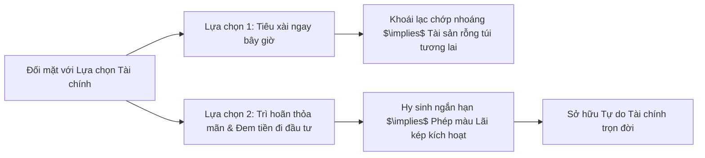
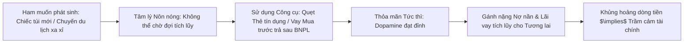
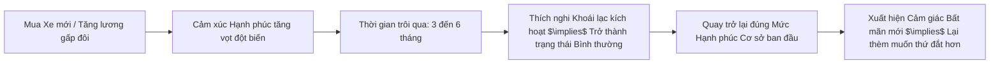
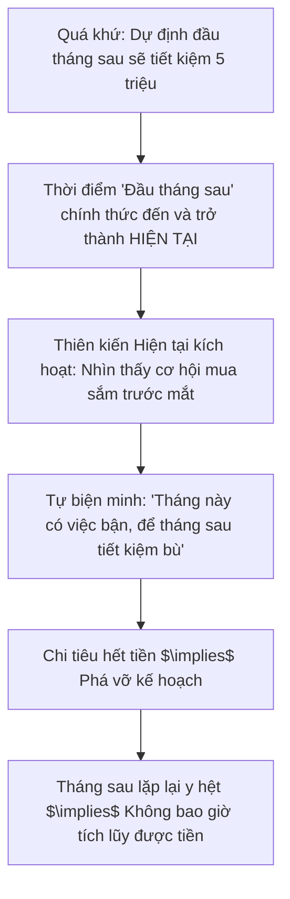
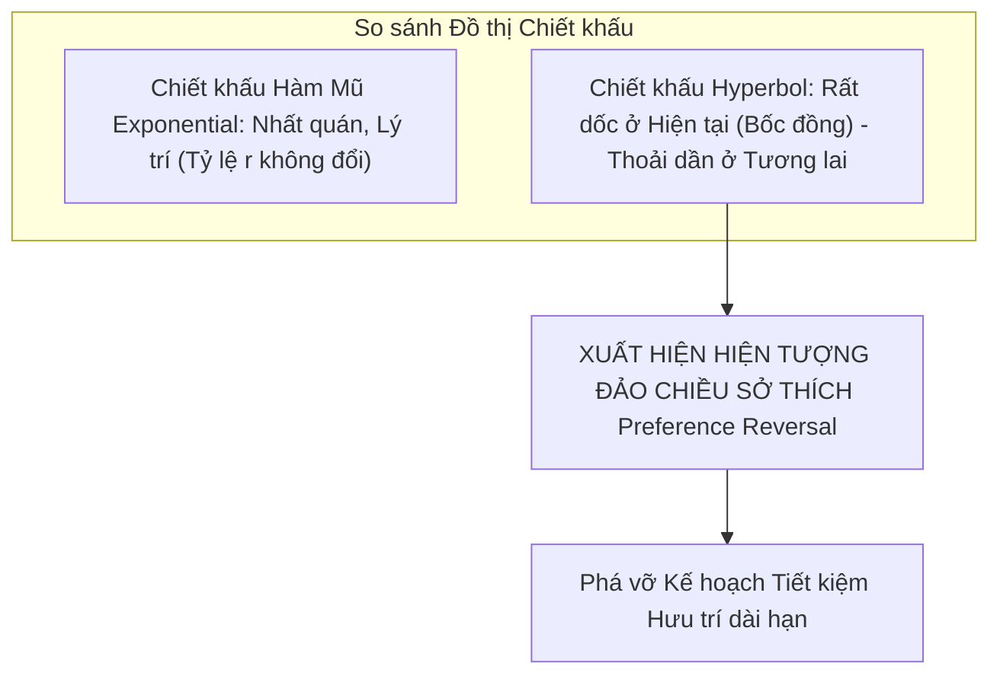

# Sở Thích Thời Gian, Sự Thỏa Mãn, Thích Nghi Khoái Lạc Và Chiết Khấu Hyperbol

Mọi quyết định tài chính cá nhân cốt lõi – từ việc tiết kiệm hưu trí, trả nợ vay, cho đến đầu tư chứng khoán – về bản chất đều là sự phân xử giữa "Bản thể hiện tại" (Present Self) và "Bản thể tương lai" (Future Self). Bộ não sinh học của con người tiến hóa để sinh tồn trong môi trường khan hiếm săn bắt hái lượm cổ đại, nơi thức ăn phải được tiêu thụ ngay lập tức, khiến chúng ta mang một Thiên kiến hiện tại (Present Bias) cực đoan và cơ chế Chiết khấu Hyperbol (Hyperbolic Discounting) phi lý trí. Tài liệu này mổ xẻ cơ sở khoa học hành vi của Sở thích thời gian và động lực giải phóng khỏi chiếc "Bánh xe khoái lạc" (Hedonic Treadmill).

> **Các câu hỏi cốt lõi:**
> 1. Mô hình chiết khấu Quasi-Hyperbolic ($\beta - \delta$) của David Laibson chứng minh sự bất nhất về thời gian (Dynamic Inconsistency) trong việc trì hoãn tiết kiệm của con người như thế nào?
> 2. Thí nghiệm "Kẹo dẻo" (Marshmallow Test) của Walter Mischel hé lộ điều gì về mối tương quan giữa Năng lực Trì hoãn sự thỏa mãn (Delayed Gratification) và sự thịnh vượng tài chính trọn đời?
> 3. Cơ chế "Thích nghi khoái lạc" (Hedonic Adaptation) biến mọi món đồ xa xỉ mới mua trở thành trạng thái bình thường sau vài tuần, và làm thế nào để phá vỡ bẫy tâm lý này?

---

## 1. Delayed Gratification (Trì hoãn sự thỏa mãn)

### 1. Là gì?
- **Định nghĩa hình thức:** Trì hoãn sự thỏa mãn là năng lực tâm lý của một cá nhân trong việc chủ động từ bỏ, khước từ hoặc trì hoãn một phần thưởng, sự hưởng thụ hay niềm vui khoái lạc nhỏ ngay trong hiện tại, nhằm đổi lấy một phần thưởng hoặc mục tiêu có giá trị lớn hơn, ý nghĩa hơn và bền vững hơn nhiều trong tương lai.
- **Giải thích đơn giản:** Trì hoãn sự thỏa mãn là việc bạn "nhịn ăn chiếc kẹo nhỏ hôm nay để ngày mai được nhận cả một hộp kẹo lớn": không mua sắm tiêu sản lúc còn trẻ để về sau có tài sản tự do tài chính.
- **Nếu chỉ nhớ một điều:** Năng lực trì hoãn sự thỏa mãn là chỉ số dự báo chính xác nhất cho sự thành công về tài chính, học vấn và sức khỏe trong suốt cuộc đời một con người.

### 2. Hoạt động thế nào?
- **Chủ thể ra quyết định:** Vỏ não trước trán (Prefrontal Cortex) ức chế hoạt động đòi hỏi hưởng thụ tức thì của Hệ viền (Limbic System).
- **Mục tiêu tối ưu hóa:** Cực đại hóa tổng độ thỏa dụng tích lũy trọn đời (Intertemporal Utility Maximization).
- **Ràng buộc:** Đòi hỏi niềm tin vào sự ổn định của tương lai (nếu môi trường sống quá bất ổn, não bộ sẽ tự động chọn tiêu thụ ngay vì sợ tương lai biến mất).
- **Cơ chế tác động:**

### 3. Công thức & Mô hình
Thí nghiệm Kẹo dẻo Stanford (The Stanford Marshmallow Experiment) của Walter Mischel (1972):
Trẻ em 4 tuổi được đặt trước một chiếc kẹo dẻo với cam kết: Nếu nhịn ăn trong 15 phút, sẽ được thưởng thêm chiếc kẹo thứ hai ($R_2 = 2 \times R_1$).
Nghiên cứu theo dõi dọc suốt 40 năm cho thấy: Những đứa trẻ có khả năng trì hoãn thỏa mãn sau này trưởng thành có:
- Điểm thi đại học (SAT) cao hơn trung bình **210 điểm**.
- Tỷ lệ ly hôn và tỷ lệ béo phì thấp hơn đáng kể.
- Giá trị tài sản ròng tích lũy (Net Worth) cao hơn gấp nhiều lần so với nhóm ăn kẹo ngay.

Phương trình Giá trị Tương lai của Sự Trì hoãn Thỏa mãn:
$$\Delta W = C_{\text{deferred}} \times \left[ (1 + r)^n - 1 \right]$$
Trong đó $C_{\text{deferred}}$ là số tiền từ chối tiêu dùng hôm nay và đem đầu tư với tỷ suất $r$ qua $n$ năm.

### 4. Ví dụ
- **Ví dụ định lượng:** Hai bạn trẻ 22 tuổi tốt nghiệp đại học, cùng nhận được số tiền thưởng tốt nghiệp 50.000.000 VND:
  - **Bạn A (Không thể trì hoãn):** Mua ngay một chiếc điện thoại iPhone mới nhất. Chiếc điện thoại mất giá $20\%$/năm, sau 5 năm giá trị chỉ còn khoảng 10 triệu đồng.
  - **Bạn B (Trì hoãn sự thỏa mãn):** Vẫn dùng chiếc điện thoại cũ, mang 50 triệu đầu tư vào quỹ chỉ số cổ phiếu sinh lời $10\%$/năm trong 30 năm (đến tuổi 52):
    $$FV = 50.000.000 \times (1 + 0,10)^{30} = 50.000.000 \times 17,45 \approx \mathbf{872.500.000 \text{ VND}}$$
  - Bằng việc trì hoãn một chiếc điện thoại thời trai trẻ, Bạn B đã đổi lấy gần 900 triệu đồng tiền mặt ở tuổi trung niên.
- **Ví dụ thực tế:** Tại Việt Nam, nhiều người sáng lập các doanh nghiệp lớn đã trải qua $5 - 10$ năm đầu khởi nghiệp với mức lương tối thiểu, tái đầu tư $100\%$ lợi nhuận vào nhà máy và công nghệ thay vì mua xe sang nhà đẹp; sự trì hoãn thỏa mãn phi thường đó đã tạo nên những tập đoàn trị giá hàng tỷ USD.
- **Phản ví dụ (Counterfactual):** Một người trúng hợp đồng làm ăn lớn kiếm được 2 tỷ đồng, lập tức mua ngay chiếc xe ô tô thể thao và tổ chức các bữa tiệc xa hoa để "hưởng thụ xứng đáng". Hai năm sau thị trường đóng băng, người này không còn vốn lưu động để duy trì kinh doanh và phá sản.

### 5. Ứng dụng & Tranh luận
- **Ứng dụng thực tiễn:** Áp dụng "Quy tắc Một đổi Hai": Mỗi khi muốn mua một món đồ xa xỉ không thiết yếu trị giá $X$, bạn bắt buộc phải chuyển một khoản tiền tương đương $X$ vào tài khoản đầu tư chứng khoán trước.
- **Ưu và nhược điểm:**
  - *Ưu điểm:* Là cội nguồn sinh ra mọi khối tài sản vĩ đại; rèn luyện bản lĩnh và sự tự chủ của nhân cách.
  - *Nhược điểm:* Nếu trì hoãn cực đoan (Hyper-saving) đến mức keo kiệt khắc khổ, người đó có thể chết đi với một đống tiền mà chưa từng một lần thực sự tận hưởng cuộc sống (cuốn sách *Die with Zero* của Bill Perkins cảnh báo điều này).
- **Sai lầm phổ biến:** Nghĩ rằng trì hoãn sự thỏa mãn là một phẩm chất bẩm sinh "ai có thì có, không thì chịu", quên rằng đây là một bó cơ tâm lý hoàn toàn có thể rèn luyện từng ngày từ những việc nhỏ nhất.

### 6. Liên kết
- Cùng chủ đề: [02_Instant_Gratification.md](file:///Users/ductri0981/Documents/Studying/Studying-Economic/04_Personal_Finance_and_Wealth_Management/10_Financial_Psychology/02_Instant_Gratification.md)
- Liên kết chéo: [06_Wealth_Building_and_Compounding/01_Mathematics_of_Compounding_and_Interest.md](file:///Users/ductri0981/Documents/Studying/Studying-Economic/04_Personal_Finance_and_Wealth_Management/06_Wealth_Building_and_Compounding/01_Mathematics_of_Compounding_and_Interest.md)

---

## 2. Instant Gratification (Thỏa mãn tức thì)

### 1. Là gì?
- **Định nghĩa hình thức:** Thỏa mãn tức thì là xu hướng tâm lý hành vi ưu tiên lựa chọn sự thỏa mãn, khoái lạc, phần thưởng hoặc cảm giác dễ chịu ngay lập tức trong thời gian thực tại, mà phớt lờ, coi nhẹ hoặc đánh đổi bằng những hậu quả tài chính, sức khỏe và cơ hội dài hạn tiêu cực trong tương lai.
- **Giải thích đơn giản:** Thỏa mãn tức thì là tâm lý "thích là phải có ngay bây giờ": đói là phải ăn ngon ngay, thích cái áo là phải quẹt thẻ mua ngay, không thể chờ đợi dù chỉ một ngày.
- **Nếu chỉ nhớ một điều:** Thỏa mãn tức thì là kẻ thù số một của Tự do tài chính; toàn bộ nền công nghiệp quảng cáo và dịch vụ "Mua trước trả sau" (BNPL) sinh ra để khai thác triệt để điểm yếu sinh học này của bạn.

### 2. Hoạt động thế nào?
- **Chủ thể ra quyết định:** Hệ viền cổ đại của não bộ phản ứng cực nhanh với các kích thích phần thưởng; nồng độ Dopamine tăng vọt thúc đẩy hành động thanh toán.
- **Mục tiêu tối ưu hóa:** Giải tỏa nhanh chóng cơn thèm muốn khoái lạc ngay trong hiện tại (Immediate Hedonic Utility).
- **Ràng buộc:** Nguồn thu nhập và hạn mức tín dụng cá nhân bị bào mòn nhanh chóng.
- **Cơ chế tác động:**

### 3. Công thức & Mô hình
Mô hình Khai thác của Dịch vụ "Mua trước Trả sau" (Buy Now Pay Later - BNPL):
BNPL tách rời "Nỗi đau thanh toán" (Pain of Paying) ra khỏi "Khoái lạc tiêu dùng" (Pleasure of Consumption):
$$\text{Friction of Spending} \to 0 \implies \text{Consumption Rate} \uparrow 30\% - 40\%$$
Khi thanh toán bằng tiền mặt vật lý, não bộ vùng Đảo vỏ não (Insula) – vùng cảm nhận nỗi đau thể xác – bị kích hoạt. Khi dùng thẻ tín dụng và BNPL, vùng đau đớn này hoàn toàn im lặng, khiến con người chi tiêu phóng túng vượt mức kiểm soát.

### 4. Ví dụ
- **Ví dụ định lượng:** Một nhân viên văn phòng có thu nhập 15.000.000 VND/tháng. Anh muốn sở hữu chiếc xe máy SH trị giá 90.000.000 VND.
  - Nếu kiên nhẫn tích lũy: Tiết kiệm 5 triệu/tháng trong 18 tháng $\implies$ Mua đứt bằng tiền mặt 90 triệu, không nợ ai.
  - Dưới tác động của Thỏa mãn tức thì: Anh chọn vay trả góp mua ngay lập tức với lãi suất $20\%$/năm trong 24 tháng.
  - Tổng số tiền cả gốc và lãi anh phải trả sau 2 năm: khoảng **110.000.000 VND**.
  - Anh đã tự nguyện trả thêm 20 triệu đồng tiền túi (tương đương hơn 1 tháng lương làm việc cật lực) chỉ để đổi lấy cảm giác được cưỡi chiếc xe sớm hơn 18 tháng!
- **Ví dụ thực tế:** Sự bùng nổ của các ứng dụng BNPL (Kredivo, MoMo trả sau, Home Credit) nhắm thẳng vào thế hệ Gen Z tại Việt Nam. Nghiên cứu cho thấy người sử dụng BNPL có xác suất mua sắm bốc đồng cao hơn $68\%$ và tỷ lệ nợ quá hạn cao gấp đôi so với người dùng thẻ ghi nợ truyền thống.
- **Phản ví dụ (Counterfactual):** Một người muốn nâng cấp điện thoại nhưng bắt bản thân phải đợi đúng 6 tháng sau ngày ra mắt để mua lại máy cũ lướt. Sau 6 tháng, giá máy đã hạ nhiệt $30\%$ (tiết kiệm được 10 triệu) và cơn sốt hưng phấn ban đầu đã tan biến, người này nhận ra chiếc máy hiện tại vẫn dùng rất tốt và quyết định không mua nữa, tiết kiệm trọn vẹn $100\%$ số tiền.

### 5. Ứng dụng & Tranh luận
- **Ứng dụng thực tiễn:** Xóa bỏ toàn bộ các tính năng "Mua trước trả sau" (BNPL), hủy kích hoạt thanh toán 1 chạm; luôn dùng thẻ ghi nợ (Debit Card) trừ thẳng tiền túi để cảm nhận trọn vẹn nỗi đau thanh toán.
- **Ưu và nhược điểm:**
  - *Mặt tích cực sinh học:* Giúp tổ tiên loài người ăn ngay khi săn được thú để không bị chết đói trong tự nhiên.
  - *Mặt phá hoại kinh tế:* Là chiếc bẫy đưa hàng triệu người hiện đại vào cảnh nô lệ của thẻ tín dụng và nợ nần tiêu dùng.
- **Sai lầm phổ biến:** Tự trấn an rằng "mình làm lụng vất vả thì mình xứng đáng được hưởng thụ ngay", nhầm lẫn giữa sự hưởng thụ xứng đáng trong ngân sách với sự nuông chiều cảm xúc vô tội vạ.

### 6. Liên kết
- Cùng chủ đề: [01_Delayed_Gratification.md](file:///Users/ductri0981/Documents/Studying/Studying-Economic/04_Personal_Finance_and_Wealth_Management/10_Financial_Psychology/01_Delayed_Gratification.md)
- Liên kết chéo: [05_Debt_and_Credit_Management/01_Debt_Classification_and_Nature.md](file:///Users/ductri0981/Documents/Studying/Studying-Economic/04_Personal_Finance_and_Wealth_Management/05_Debt_and_Credit_Management/01_Debt_Classification_and_Nature.md)

---

## 3. Hedonic Adaptation (Thích nghi khoái lạc / Bánh xe khoái lạc)

### 1. Là gì?
- **Định nghĩa hình thức:** Thích nghi khoái lạc (Hedonic Adaptation hoặc Hedonic Treadmill - khái niệm được đề xuất bởi Brickman và Campbell năm 1971) là xu hướng tâm lý phổ quát của con người nhanh chóng quay trở lại mức độ hạnh phúc cơ sở (Baseline Happiness) ổn định, bất chấp việc trải qua những biến cố tích cực (tăng lương, trúng số, mua nhà mới) hay tiêu cực lớn trong cuộc sống.
- **Giải thích đơn giản:** Thích nghi khoái lạc giống như việc bạn chạy trên một chiếc máy chạy bộ: bạn cố chạy thật nhanh để đuổi theo hạnh phúc, nhưng máy chạy kéo bạn đứng yên một chỗ. Bạn mua chiếc xe mới, bạn sướng được 2 tuần; sau đó chiếc xe trở thành điều bình thường, bạn lại thèm muốn chiếc xe đắt hơn nữa.
- **Nếu chỉ nhớ một điều:** Nâng cấp tài sản vật chất không bao giờ mang lại hạnh phúc dài hạn; bạn sẽ nhanh chóng quen với sự xa hoa đó và bắt đầu cảm thấy trống rỗng như cũ.

### 2. Hoạt động thế nào?
- **Chủ thể ra quyết định:** Hệ thần kinh Dopamine tự động thiết lập lại "ngưỡng nhạy cảm" (Tolerance Reset) trước các kích thích khoái lạc lặp lại.
- **Mục tiêu tối ưu hóa:** Giữ cho con người không bị chìm đắm mãi trong cảm xúc cũ, thúc đẩy động lực sinh học tiếp tục phấn đấu sinh tồn.
- **Ràng buộc:** Điểm hạnh phúc cơ sở (Hedonic Set-point) chịu chi phối $50\%$ bởi gen di truyền, $10\%$ bởi hoàn cảnh sống (tiền bạc, nhà cửa) và $40\%$ bởi các hoạt động có chủ đích (sự biết ơn, mối quan hệ sâu sắc).
- **Cơ chế tác động:**

### 3. Công thức & Mô hình
Mô hình Mức độ Hạnh phúc của Lyubomirsky, Sheldon và Schkade (2005):
$$\text{Hạnh phúc Tổng thể } (H) = S_{\text{set-point}} (50\%) + C_{\text{circumstances}} (10\%) + V_{\text{voluntary}} (40\%)$$
Trong đó:
- $C_{\text{circumstances}}$ (Hoàn cảnh vật chất, nhà cửa, xe cộ, thu nhập) chỉ đóng góp vỏn vẹn **$10\%$** vào mức độ hạnh phúc dài hạn!
- Đầu tư toàn bộ cuộc đời để chạy theo $10\%$ này là một chiến lược phân bổ nguồn lực thất bại.

Phương trình Thích nghi Khoái lạc theo thời gian $t$:
$$U_{\text{consumption}}(t) = U_0 + \Delta U \cdot e^{-\lambda t}$$
Trong đó:
- $\Delta U$: Niềm vui tăng vọt ban đầu khi mới mua tài sản.
- $\lambda$: Tốc độ thích nghi khoái lạc ($\lambda > 0$).
Khi $t \to \infty$, $U(t) \to U_0$ (Độ thỏa dụng luôn tụt dốc về lại điểm xuất phát).

### 4. Ví dụ
- **Ví dụ định lượng:** Một cá nhân đang đi chiếc xe máy trị giá 20 triệu.
  - Người này cố gắng làm việc và đổi lên chiếc xe ô tô 600 triệu. Trong tháng đầu tiên, chỉ số hạnh phúc tăng vọt từ điểm 6 lên điểm 9/10.
  - Đến tháng thứ 4: Việc bước lên ô tô trở thành điều hiển nhiên hàng ngày; người này bắt đầu bực bội vì tắc đường, tốn tiền gửi xe 3 triệu/tháng và tiền xăng. Chỉ số hạnh phúc tụt về đúng mức 6/10 ban đầu.
  - Nhìn thấy đồng nghiệp đi chiếc SUV 1,5 tỷ, người này lại cảm thấy tự ti và tiếp tục đặt mục tiêu cày cuốc đổi xe tiếp.
  - Tổng số tiền tiêu tốn cho vòng xoáy này: hàng trăm triệu đồng, trong khi mức độ hạnh phúc thực tế sau 1 năm là con số không đổi.
- **Ví dụ thực tế:** Nghiên cứu kinh điển của Brickman (1978) so sánh mức độ hạnh phúc của: Những người trúng xổ số hàng triệu USD và Những người bị tai nạn liệt nửa người. Kết quả đáng kinh ngạc: Chỉ sau 1 năm kể từ biến cố, mức độ hạnh phúc hàng ngày của hai nhóm này gần như hội tụ lại ngang nhau do cơ chế thích nghi khoái lạc của não bộ.
- **Phản ví dụ (Counterfactual):** Một người nhận diện được chiếc bánh xe khoái lạc, thay vì chi 50 triệu mua đồng hồ xa xỉ, người này chi 50 triệu cho một chuyến du lịch trải nghiệm cùng cả gia đình và làm từ thiện xây trường học. Các nghiên cứu chứng minh: "Chi tiêu cho Trải nghiệm và Ký ức" (Experiential Purchases) có tính chất chống thích nghi khoái lạc rất tốt – ký ức đẹp sẽ tăng dần giá trị cảm xúc theo thời gian thay vì bị mất giá như đồ vật.

### 5. Ứng dụng & Tranh luận
- **Ứng dụng thực tiễn:** Khóa chặt mức sống (Lifestyle Lock): Khi thu nhập tăng lên, kiên quyết giữ nguyên mức chi tiêu sinh hoạt cũ trong ít nhất 1 năm và mang toàn bộ phần thu nhập tăng thêm đi đầu tư.
- **Ưu và nhược điểm:**
  - *Mặt tích cực sinh học:* Giúp con người hồi phục thần kỳ sau những nỗi đau mất mát to lớn (chấn thương, phá sản).
  - *Mặt phá hoại tài chính:* Khiến con người rơi vào cái bẫy Lifestyle Inflation – kiếm được bao nhiêu tiền cũng thấy không đủ.
- **Sai lầm phổ biến:** Nghĩ rằng "nếu mình có được món đồ đó thì mình sẽ hạnh phúc mãi mãi", không lường trước được rằng não bộ sẽ thích nghi và chán nó chỉ sau vài tuần.

### 6. Liên kết
- Cùng chủ đề: [05_Social_Influences_Status_and_Comparison.md](file:///Users/ductri0981/Documents/Studying/Studying-Economic/04_Personal_Finance_and_Wealth_Management/10_Financial_Psychology/05_Social_Influences_Status_and_Comparison.md)
- Liên kết chéo: [03_Budgeting_and_Expense_Management/06_Lifestyle_Inflation_and_Opportunity_Cost.md](file:///Users/ductri0981/Documents/Studying/Studying-Economic/04_Personal_Finance_and_Wealth_Management/03_Budgeting_and_Expense_Management/06_Lifestyle_Inflation_and_Opportunity_Cost.md)

---

## 4. Present Bias (Thiên kiến hiện tại)

### 1. Là gì?
- **Định nghĩa hình thức:** Thiên kiến hiện tại là một khuynh hướng nhận thức phi lý trí trong kinh tế học hành vi, theo đó con người có xu hướng đánh giá quá cao (thổi phồng độ thỏa dụng) của những phần thưởng và khoái lạc diễn ra ngay trong thời điểm hiện tại, trong khi lại chiết khấu quá mức và coi nhẹ những phần thưởng hoặc cái giá phải trả diễn ra trong tương lai xa.
- **Giải thích đơn giản:** Thiên kiến hiện tại là việc bạn "yêu bản thân hôm nay hơn bản thân ngày mai": bạn sẵn sàng ăn chiếc bánh ngọt hôm nay (sướng mồm bây giờ) và để mặc bản thân ngày mai chịu béo phì; bạn sẵn sàng quẹt thẻ tiêu sạch tiền hôm nay và để mặc bản thân 60 tuổi chịu nghèo khổ.
- **Nếu chỉ nhớ một điều:** Thiên kiến hiện tại là nguồn gốc sâu xa của thói quen Trì hoãn (Procrastination): Ngày mai tôi sẽ bắt đầu tiết kiệm, ngày mai tôi sẽ bắt đầu ăn kiêng, ngày mai tôi sẽ trả nợ... nhưng "ngày mai" không bao giờ đến.

### 2. Hoạt động thế nào?
- **Chủ thể ra quyết định:** Cuộc chiến giữa hai bản thể nội tâm: "Bản thể Người lập kế hoạch" (Planner - lý trí dài hạn) và "Bản thể Người hành động" (Doer - bốc đồng ngắn hạn) theo mô hình của Richard Thaler.
- **Mục tiêu tối ưu hóa:** Tìm kiếm sự thỏa mãn tức thì của Bản thể Hiện tại, đẩy toàn bộ gánh nặng lao động và tiết kiệm sang cho Bản thể Tương lai gánh chịu.
- **Ràng buộc:** Sự bất nhất về thời gian (Dynamic Inconsistency: kế hoạch đặt ra cho tương lai luôn bị phá vỡ khi thời điểm tương lai đó trở thành hiện tại).
- **Cơ chế tác động:**

### 3. Công thức & Mô hình
Mô hình "Người lập kế hoạch và Người hành động" (Planner-Doer Model) của Thaler & Shefrin:
Hàm Thỏa dụng Đa thời kỳ có Thiên kiến Hiện tại:
$$U(u_0, u_1, \dots, u_T) = u_0 + \beta \sum_{t=1}^T \delta^t u_t$$
Trong đó:
- $u_0$: Độ thỏa dụng tại thời điểm hiện tại ($t = 0$).
- $u_t$: Độ thỏa dụng tại thời điểm tương lai ($t \ge 1$).
- $\delta \in (0, 1)$: Hệ số chiết khấu thời gian chuẩn mực của kinh tế học cổ điển.
- $\beta \in (0, 1)$: **Hệ số Thiên kiến Hiện tại (Present Bias Parameter)**.
Khi $\beta < 1$, mọi phần thưởng trong tương lai ($t \ge 1$) lập tức bị "đánh tụt giá trị" một cách thê thảm ngay khi bước qua ranh giới giữa "bây giờ" và "ngày mai".

### 4. Ví dụ
- **Ví dụ định lượng (Bằng chứng thực nghiệm về Thiên kiến Hiện tại):**
  - **Câu hỏi 1:** Bạn chọn nhận 1.000.000 VND NGAY BÂY GIỜ, hay nhận 1.100.000 VND vào NGÀY MAI?
    $\implies$ Đại đa số mọi người chọn: **Nhận 1.000.000 VND NGAY BÂY GIỜ** (Họ không thể kiên nhẫn đợi 1 ngày để lấy thêm 100k, tương đương mức lãi suất chiết khấu hàng ngàn phần trăm/năm!).
  - **Câu hỏi 2:** Bạn chọn nhận 1.000.000 VND sau 365 NGÀY, hay nhận 1.100.000 VND sau 366 NGÀY?
    $\implies$ Đại đa số mọi người lại chọn: **Nhận 1.100.000 VND sau 366 NGÀY!**
  - Nhận xét: Khoảng cách thời gian giữa hai lựa chọn ở cả hai câu hỏi đều đúng bằng **01 ngày**. Nếu là con người lý trí thuần túy, họ phải đưa ra cùng một câu trả lời. Nhưng vì có Thiên kiến hiện tại ($\beta < 1$), khi có mặt "BÂY GIỜ", não bộ lập tức phát điên vì phần thưởng trước mắt.
- **Ví dụ thực tế:** Đăng ký thẻ tập Gym theo năm: Hàng triệu người hào hứng quẹt thẻ 15 triệu mua gói tập 1 năm vào ngày 1/1 (Bản thể lập kế hoạch nghĩ rằng tương lai mình sẽ đi tập chăm chỉ). Nhưng vào 6 giờ sáng mỗi ngày thực tế (Bản thể hiện tại), họ tắt báo thức để ngủ tiếp. Phòng gym thu lợi nhuận khổng lồ dựa trên chính Thiên kiến hiện tại của khách hàng.
- **Phản ví dụ (Counterfactual):** Một người nhận diện được thiên kiến hiện tại, áp dụng cơ chế "Trói tay Odysseus" (Commitment Device): Đăng ký chương trình tiết kiệm gửi góp tích lũy ngân hàng có điều kiện: Tự động trích tiền từ tài khoản lương và nếu rút trước hạn 1 năm thì bị phạt mất toàn bộ tiền lãi. Nhờ chiếc khóa này, Bản thể hiện tại không thể phá vỡ được kế hoạch.

### 5. Ứng dụng & Tranh luận
- **Ứng dụng thực tiễn:** Khóa chặt bản thân vào các cam kết tài chính không thể đảo ngược (Commitment Devices); sử dụng ứng dụng công nghệ làm cho tương lai trở nên sống động (ví dụ: dùng phần mềm tạo ảnh khuôn mặt của chính mình ở tuổi 70 để kích hoạt sự thấu cảm với Bản thể tương lai).
- **Ưu và nhược điểm:**
  - *Mặt nguy hiểm của thiên kiến hiện tại:* Là nguyên nhân gốc rễ của việc nợ nần, không tiết kiệm hưu trí và trì hoãn mọi mục tiêu tài chính tốt đẹp.
  - *Giải pháp khắc phục:* Tự động hóa hoàn toàn các quyết định tài chính quan trọng.
- **Sai lầm phổ biến:** Tin tưởng vào "lời hứa của chính mình trong tương lai", không biết rằng khi tương lai đến, nó lại biến thành hiện tại và bạn sẽ lại tiếp tục nuông chiều bản thân như cũ.

### 6. Liên kết
- Cùng chủ đề: [05_Hyperbolic_Discounting.md](file:///Users/ductri0981/Documents/Studying/Studying-Economic/04_Personal_Finance_and_Wealth_Management/10_Financial_Psychology/05_Hyperbolic_Discounting.md)
- Liên kết chéo: [01_Delayed_Gratification.md](file:///Users/ductri0981/Documents/Studying/Studying-Economic/04_Personal_Finance_and_Wealth_Management/10_Financial_Psychology/01_Delayed_Gratification.md)

---

## 5. Hyperbolic Discounting (Chiết khấu hyperbol)

### 1. Là gì?
- **Định nghĩa hình thức:** Chiết khấu Hyperbol là một mô hình toán học trong kinh tế học hành vi miêu tả cách thức con người định giá các phần thưởng theo thời gian, theo đó tỷ lệ chiết khấu (tốc độ giảm giá trị của phần thưởng theo thời gian) rất cao trong các khoảng thời gian ngắn hạn gần hiện tại, nhưng lại giảm dần và trở nên rất thấp trong các khoảng thời gian dài hạn xa xôi trong tương lai (tạo thành một đường cong đồ thị hình hyperbol dốc đứng ở đầu và thoải dần về sau).
- **Giải thích đơn giản:** Chiết khấu Hyperbol là việc bạn "mất kiên nhẫn tột cùng trong hôm nay, nhưng lại cực kỳ kiên nhẫn trong tương lai xa": bạn không thể đợi 1 ngày để lấy thêm 100k hôm nay, nhưng bạn sẵn sàng đợi thêm 1 ngày sau 1 năm nữa mà không hề đắn đo.
- **Nếu chỉ nhớ một điều:** Kinh tế học cổ điển giả định con người chiết khấu theo hàm Mũ (Exponential Discounting - tỷ lệ chiết khấu cố định, lý trí); thực tế con người luôn chiết khấu theo hàm Hyperbol (bốc đồng gần, kiên nhẫn xa), dẫn đến hiện tượng Bất nhất về thời gian (Dynamic Inconsistency).

### 2. Hoạt động thế nào?
- **Chủ thể ra quyết định:** Hệ thần kinh tính toán giá trị chủ quan của dòng tiền theo thời gian (Subjective Time Discounting).
- **Mục tiêu tối ưu hóa:** Giải thích toán học lý do tại sao các kế hoạch tài chính dài hạn hoàn hảo lại liên tục bị đổ vỡ khi đối mặt với các lựa chọn ngắn hạn.
- **Ràng buộc:** Mô hình Quasi-hyperbolic Discounting ($\beta - \delta$ model) của David Laibson (1997) được ứng dụng làm nền tảng cho thiết kế chính sách tài chính hành vi hiện đại.
- **Cơ chế tác động:**

### 3. Công thức & Mô hình
So sánh Toán học giữa Chiết khấu Hàm Mũ và Chiết khấu Hyperbol:
1. **Chiết khấu Hàm Mũ Cổ điển (Exponential Discounting):**
$$D_{\text{exp}}(t) = \delta^t = \frac{1}{(1 + r)^t}$$
Tỷ lệ chiết khấu giữa hai thời điểm bất kỳ cách nhau một khoảng $\Delta t$ luôn là hằng số: $\frac{D(t+1)}{D(t)} = \delta = \text{const}$. Sở thích hoàn toàn nhất quán theo thời gian.

2. **Chiết khấu Hyperbol (Chung - Harvey, Mazur):**
$$D_{\text{hyp}}(t) = \frac{1}{1 + k t}$$
Tỷ lệ chiết khấu cận biên: $-\frac{D'(t)}{D(t)} = \frac{k}{1 + k t}$ (giảm dần khi $t$ tăng $\implies$ Càng xa hiện tại, con người càng kiên nhẫn).

3. **Mô hình Khả vi Quasi-Hyperbolic ($\beta - \delta$ Discounting của David Laibson):**
$$D(t) = \begin{cases} 
1 & \text{khi } t = 0 \\ 
\beta \delta^t & \text{khi } t = 1, 2, 3, \dots 
\end{cases}$$
Với $\beta < 1$ đo lường mức độ Thiên kiến Hiện tại và $\delta \le 1$ là hệ số kiên nhẫn dài hạn.
Khoảng sụt giảm giá trị đột ngột từ $1$ xuống $\beta$ tại $t = 1$ chính là nguyên nhân toán học gây ra mọi hành vi thất hứa tài chính với chính mình.

### 4. Ví dụ
- **Ví dụ định lượng (Hiện tượng Đảo chiều Sở thích - Preference Reversal):**
  Giả sử $\beta = 0,7$ và $\delta = 1$ (để đơn giản). Bạn đứng trước hai lựa chọn:
  - Lựa chọn S (Small/Soon): Nhận 10 triệu.
  - Lựa chọn L (Large/Later): Nhận 15 triệu sau đó 1 tuần.
  - **Tình huống 1: Đánh giá cho tương lai xa (sau 1 năm nữa - $t = 52$ tuần và $t = 53$ tuần):**
    - Giá trị hiện tại của S: $PV(S) = \beta \delta^{52} \times 10 = 0,7 \times 10 = 7$ triệu.
    - Giá trị hiện tại của L: $PV(L) = \beta \delta^{53} \times 15 = 0,7 \times 15 = 10,5$ triệu.
    - Vì $10,5 > 7 \implies$ **Bạn quyết định chọn L (Đợi thêm 1 tuần để lấy 15 triệu)**. Bạn cảm thấy mình rất lý trí và kiên nhẫn!
  - **Tình huống 2: 1 năm trôi qua, thời điểm nhận tiền đã đến NGAY HÔM NAY ($t = 0$ và $t = 1$ tuần sau):**
    - Giá trị hiện tại của S: $PV(S) = 1 \times 10 = 10$ triệu.
    - Giá trị hiện tại của L: $PV(L) = \beta \delta^1 \times 15 = 0,7 \times 15 = 10,5$ triệu.
    - Khoảng cách chênh lệch từ 3,5 triệu bị thu hẹp chỉ còn 0,5 triệu. Nếu $\beta = 0,6$ thì $PV(L) = 9 < 10 \implies$ Bạn LẬP TỨC ĐẢO CHIỀU: Hủy bỏ quyết định cũ và chọn lấy 10 triệu ngay lập tức!
- **Ví dụ thực tế:** Nghiên cứu của David Laibson chứng minh rằng các khoản nợ thẻ tín dụng lãi suất cao tồn tại dai dẳng tại Mỹ là do mô hình chiết khấu $\beta - \delta$: Mọi người luôn lập kế hoạch trả nợ vào tháng sau ($\beta$ chưa kích hoạt), nhưng khi tháng sau trở thành hiện tại, họ lại quẹt thẻ tiếp vì giá trị của tiêu dùng hiện tại bị thổi phồng lên gấp $1 / \beta$ lần.
- **Phản ví dụ (Counterfactual):** Chương trình cải cách tài chính nổi tiếng thế giới **"Save More Tomorrow" (SMarT)** của Richard Thaler và Shlomo Benartzi: Thay vì bắt nhân viên tăng tỷ lệ tiết kiệm hưu trí ngay hôm nay (khiến họ cảm thấy mất mát vì $\beta < 1$), chương trình yêu cầu nhân viên cam kết *tự động trích tiền tiết kiệm từ các đợt tăng lương trong tương lai*. Nhờ tận dụng cơ chế Chiết khấu Hyperbol (trong tương lai con người rất hào phóng và kiên nhẫn), chương trình đã giúp tỷ lệ tiết kiệm của người lao động tăng vọt từ $3,5\%$ lên $13,6\%$.

### 5. Ứng dụng & Tranh luận
- **Ứng dụng thực tiễn:** Ứng dụng mô hình "Save More Tomorrow" cho tài chính cá nhân: Cam kết trước việc tự động tăng tỷ lệ trích nộp đầu tư mỗi khi được tăng lương trong tương lai.
- **Ưu và nhược điểm:**
  - *Ưu điểm:* Cung cấp công cụ toán học chính xác nhất của kinh tế học hành vi để mô phỏng sự xung đột nội tâm của con người.
  - *Nhược điểm:* Đòi hỏi phải thiết lập các cơ chế khóa tài chính từ bên ngoài (External Nudges) mới có thể khắc chế được nó.
- **Sai lầm phổ biến:** Đổ lỗi cho sự thất bại tài chính là do "thiếu kiến thức toán học", mà không nhận ra rằng đây là trận chiến chống lại một hàm số chiết khấu Hyperbol đã được lập trình sẵn trong hệ thần kinh sinh học qua hàng triệu năm tiến hóa.

### 6. Liên kết
- Cùng chủ đề: [04_Present_Bias.md](file:///Users/ductri0981/Documents/Studying/Studying-Economic/04_Personal_Finance_and_Wealth_Management/10_Financial_Psychology/04_Present_Bias.md)
- Liên kết chéo: [01_Delayed_Gratification.md](file:///Users/ductri0981/Documents/Studying/Studying-Economic/04_Personal_Finance_and_Wealth_Management/10_Financial_Psychology/01_Delayed_Gratification.md)

---

## Câu hỏi tự kiểm tra
1. Hãy phân tích Thí nghiệm Kẹo dẻo Stanford (Marshmallow Test) của Walter Mischel và nêu rõ mối liên hệ giữa năng lực Trì hoãn sự thỏa mãn (Delayed Gratification) và thành công tài chính dài hạn.
2. Cơ chế Thích nghi khoái lạc (Hedonic Adaptation / Hedonic Treadmill) vận hành như thế nào? Tại sao việc chi tiêu cho "Trải nghiệm và Ký ức" lại mang lại mức độ thỏa dụng bền vững hơn chi tiêu cho "Tài sản vật chất"?
3. Dùng mô hình toán học Quasi-Hyperbolic Discounting ($\beta - \delta$ model) của David Laibson để giải thích hiện tượng Đảo chiều sở thích (Preference Reversal) và lý do con người hay trì hoãn việc tiết kiệm hưu trí.
4. Chương trình "Save More Tomorrow" (SMarT) của Giáo sư đoạt giải Nobel Richard Thaler đã ứng dụng các đặc tính của Chiết khấu Hyperbol như thế nào để giúp hàng triệu người lao động tăng gấp ba tỷ lệ tiết kiệm?

## Ghi chú nguồn
- Mischel, W. - *The Marshmallow Test: Mastering Self-Control*, Little, Brown and Company.
- Brickman, P., & Campbell, D. T. (1971) - *Hedonic relativism and planning the good society*, Academic Press.
- Laibson, D. (1997) - *Golden Eggs and Hyperbolic Discounting*, Quarterly Journal of Economics.
- Thaler, R. H., & Benartzi, S. (2004) - *Save More Tomorrow™: Using Behavioral Economics to Increase Employee Saving*, Journal of Political Economy.
