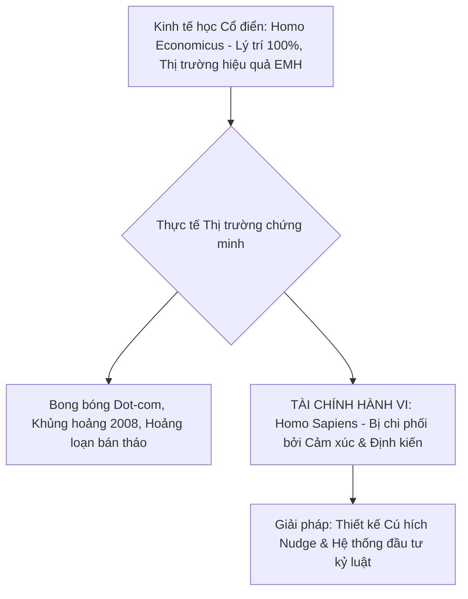
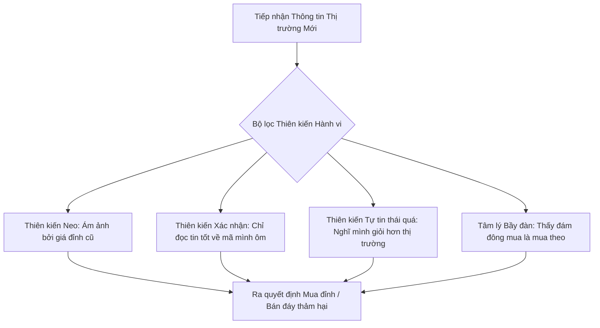
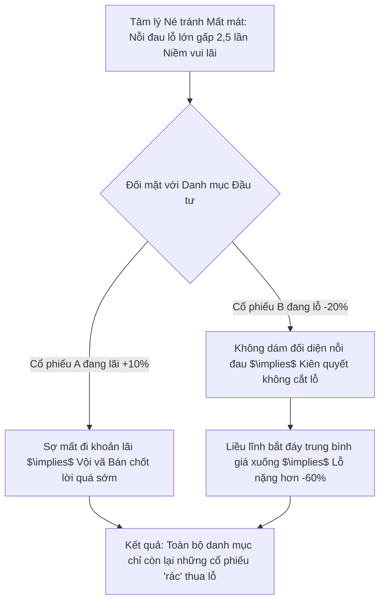
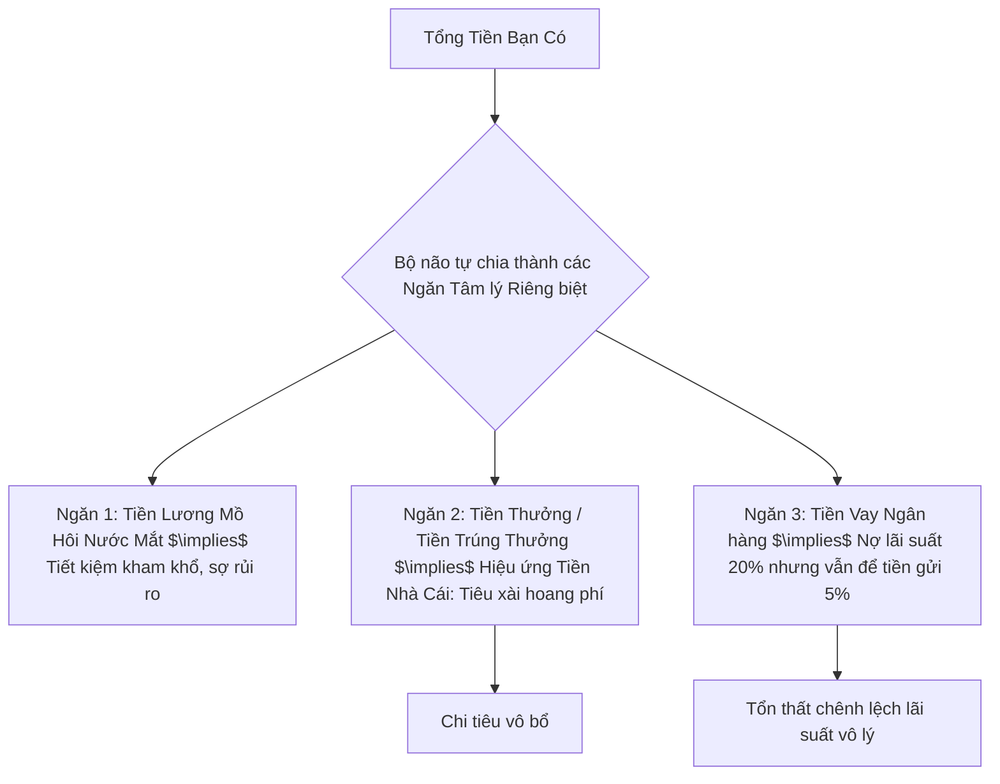

# Tài Chính Hành Vi, Thiên Kiến Nhận Thức, Tâm Lý Né Tránh Mất Mát Và Kế Toán Tâm Lý

Kinh tế học cổ điển xây dựng trên giả định giả tưởng về "Con người kinh tế thuần lý trí" (Homo Economicus) – những cá nhân luôn tính toán tối ưu hóa lợi ích một cách hoàn hảo, không có cảm xúc và không bao giờ phạm sai lầm. Tuy nhiên, thực tế chứng minh con người thực (Homo Sapiens) luôn bị chi phối bởi các Thiên kiến hành vi (Behavioral Biases) thâm căn cố đế. Tài chính hành vi (Behavioral Finance) ra đời để giải mã thế giới thực, mổ xẻ Lý thuyết Triển vọng (Prospect Theory) của Daniel Kahneman & Amos Tversky, sự bất đối xứng của Tâm lý Né tránh mất mát (Loss Aversion) và sự vi phạm tính khả hoán của tiền tệ trong Kế toán tâm lý (Mental Accounting).

> **Các câu hỏi cốt lõi:**
> 1. Tại sao hàm giá trị hình chữ S (S-shaped Value Function) trong Lý thuyết Triển vọng chứng minh rằng "Nỗi đau mất 10 triệu đồng lớn gấp hơn hai lần Niềm vui kiếm được 10 triệu đồng"?
> 2. Hiệu ứng Bố trí (Disposition Effect) trong đầu tư chứng khoán – bán sớm cổ phiếu đang lãi và ôm chặt cổ phiếu đang lỗ sâu – bắt nguồn từ thiên kiến tâm lý nào?
> 3. Kế toán tâm lý (Mental Accounting) của Richard Thaler phá vỡ Nguyên tắc Tính khả hoán của tiền tệ (Fungibility of Money) như thế nào, và làm sao để biến nó thành công cụ quản trị tài chính có lợi?

---

## 1. Behavioral Finance (Tài chính hành vi)

### 1. Là gì?
- **Định nghĩa hình thức:** Tài chính hành vi là một phân ngành liên ngành kết hợp giữa tâm lý học nhận thức, khoa học hành vi và kinh tế học tài chính, nhằm giải thích lý do tại sao các nhà đầu tư và cá nhân trên thị trường thường xuyên đưa ra các quyết định tài chính phi lý trí, có hệ thống và có thể dự báo được, đồng thời lý giải tại sao thị trường tài chính không hoàn hảo và xuất hiện các bong bóng hay sụp đổ giá tài sản.
- **Giải thích đơn giản:** Tài chính hành vi là khoa học nghiên cứu xem "con người bằng xương bằng thịt hành xử ngốc nghếch và cảm tính như thế nào với tiền bạc": tại sao chúng ta hoảng loạn bán tháo ở đáy, hưng phấn đu đỉnh, và tiêu xài những món tiền kỳ quặc.
- **Nếu chỉ nhớ một điều:** Thị trường tài chính không phải là một cỗ máy tính toán hoàn hảo; thị trường tài chính là một nhà thương điên nơi cảm xúc Tham lam (Greed) và Sợ hãi (Fear) của hàng triệu con người va đập vào nhau mỗi ngày.

### 2. Hoạt động thế nào?
- **Chủ thể ra quyết định:** Con người thực với hai hệ thống tư duy (Hệ thống 1: Nhanh, trực giác, cảm xúc; Hệ thống 2: Chậm, logic, tốn năng lượng).
- **Mục tiêu tối ưu hóa:** Thừa nhận các giới hạn nhận thức của con người để thiết kế các chính sách công, sản phẩm tài chính và danh mục đầu tư có khả năng "chống lỗi hành vi" (Debiasing / Choice Architecture).
- **Ràng buộc:** Giới hạn của cơ chế kinh doanh chênh lệch giá (Limits to Arbitrage: "Thị trường có thể phi lý trí lâu hơn khoảng thời gian bạn có thể duy trì khả năng thanh toán" - John Maynard Keynes).
- **Cơ chế tác động:**

### 3. Công thức & Mô hình
Thách thức Giả thuyết Thị trường Hiệu quả (Efficient Market Hypothesis - EMH):
Theo EMH của Eugene Fama:
$$P_t = E[P_t^* \mid \mathcal{I}_t]$$
(Giá tài sản luôn phản ánh tức thì và chính xác mọi thông tin có sẵn $\mathcal{I}_t$, không ai có thể đánh bại thị trường trừ khi có thông tin nội gián).

Mô hình Tài chính Hành vi của Robert Shiller & Richard Thaler:
$$P_t = \text{Fundamental Value} + \text{Noise Trader Sentiment} (\varepsilon_t)$$
Trong đó $\varepsilon_t$ là biến số tâm lý đám đông (bầy đàn, hưng cảm, sợ hãi). Do tồn tại Giới hạn trọng tài (Limits to Arbitrage), $\varepsilon_t$ có thể lệch khỏi giá trị nội tại trong nhiều năm, tạo ra các chu kỳ bong bóng và sụp đổ khốc liệt.

### 4. Ví dụ
- **Ví dụ định lượng:** Trong cơn sốt bong bóng hoa Tulip (Hà Lan thế kỷ 17) hay bong bóng cổ phiếu công nghệ Dot-com (năm 2000), cổ phiếu của các công ty không hề có lợi nhuận nhưng chỉ cần có đuôi ".com" trong tên là được định giá P/E lên tới hàng ngàn lần. Các nhà đầu tư lý trí cố gắng bán khống (short-selling) đều bị phá sản trước khi bong bóng vỡ vụn do thị trường bị thúc đẩy bởi "Sự hưng phấn phi lý trí" (Irrational Exuberance).
- **Ví dụ thực tế:** Tại thị trường chứng khoán Việt Nam (VN-Index), các đợt tăng nóng từ 1.000 lên 1.500 điểm (năm 2021) và sau đó rơi tự do về 900 điểm (năm 2022) phản ánh trọn vẹn các bài học của Tài chính hành vi: Hiện tượng nhà đầu tư F0 đổ xô mở tài khoản vì hiệu ứng FOMO bầy đàn, và sau đó hoảng loạn bán tháo sàn hàng loạt do áp lực giải chấp chéo Margin Call.
- **Phản ví dụ (Counterfactual):** Một nhà đầu tư cá nhân hiểu rõ các nguyên lý của tài chính hành vi, biết rằng bản thân luôn có xu hướng sợ hãi khi thị trường giảm, đã chọn chiến lược Đầu tư định kỳ bình quân chi phí (Dollar-Cost Averaging - DCA): Cứ đúng ngày 15 hàng tháng nộp 5 triệu mua chứng chỉ quỹ ETF bất kể thị trường xanh hay đỏ. Sau 10 năm, nhà đầu tư này đạt tỷ suất sinh lời vượt trội hơn $85\%$ các nhà đầu tư chủ động lướt sóng trên thị trường.

### 5. Ứng dụng & Tranh luận
- **Ứng dụng thực tiễn:** Xây dựng quy trình đầu tư dựa trên bộ quy tắc viết sẵn (Rules-based Investing) để tước bỏ hoàn toàn quyền can thiệp của cảm xúc nhất thời khi giao dịch.
- **Ưu và nhược điểm:**
  - *Ưu điểm:* Cung cấp cái nhìn chân thực, sâu sắc về cách thức thế giới tài chính thực tế vận hành; giúp nhà đầu tư tự nhận diện các điểm yếu chết người của bản thân.
  - *Nhược điểm:* Khó lượng hóa thành các mô hình định giá đóng khung như toán học tài chính cổ điển.
- **Sai lầm phổ biến:** Tự tin cho rằng "tôi đã đọc sách tài chính hành vi rồi nên tôi hoàn toàn lý trí và miễn nhiễm với cảm xúc", không nhận ra rằng thiên kiến hành vi là bản năng sinh học luôn chực chờ bùng phát khi tài sản bị đe dọa.

### 6. Liên kết
- Cùng chủ đề: [02_Behavioral_Biases.md](file:///Users/ductri0981/Documents/Studying/Studying-Economic/04_Personal_Finance_and_Wealth_Management/10_Financial_Psychology/02_Behavioral_Biases.md)
- Liên kết chéo: [06_Wealth_Building_and_Compounding/04_Asset_Classification_and_Allocation.md](file:///Users/ductri0981/Documents/Studying/Studying-Economic/04_Personal_Finance_and_Wealth_Management/06_Wealth_Building_and_Compounding/04_Asset_Classification_and_Allocation.md)

---

## 2. Behavioral Biases (Thiên kiến hành vi)

### 1. Là gì?
- **Định nghĩa hình thức:** Thiên kiến hành vi là các sai lệch mang tính hệ thống trong quá trình phán đoán, đánh giá xác suất và ra quyết định của con người, phát sinh từ việc bộ não sử dụng các lối tắt tư duy kinh nghiệm (Heuristics) để đơn giản hóa quá trình xử lý thông tin phức tạp, hoặc do sự can thiệp của các trạng thái cảm xúc chủ quan.
- **Giải thích đơn giản:** Thiên kiến hành vi là "những cái bẫy tư duy mà não bạn tự giăng ra và tự sập vào": như việc quá tự tin vào tài năng của mình, chỉ thích nghe những tin tức khen cổ phiếu mình đang giữ, hay bị ám ảnh bởi mức giá quá khứ.
- **Nếu chỉ nhớ một điều:** Thiên kiến hành vi được chia làm hai nhóm lớn: Thiên kiến nhận thức (Cognitive Biases - lỗi do xử lý thông tin sai, có thể sửa bằng kiến thức) và Thiên kiến cảm xúc (Emotional Biases - lỗi do xung động tâm lý, rất khó sửa và phải dùng hệ thống rào cản để phòng ngừa).

### 2. Hoạt động thế nào?
- **Chủ thể ra quyết định:** Nhà đầu tư cá nhân và tổ chức bị dẫn dắt bởi các phản xạ tâm lý vô thức.
- **Mục tiêu tối ưu hóa:** Nhận diện danh mục các thiên kiến phổ biến nhất để loại trừ chúng khỏi quá trình ra quyết định tài chính.
- **Ràng buộc:** Bản năng sinh học và cái tôi cá nhân (Ego) luôn tìm cách chống lại việc thừa nhận sai lầm.
- **Cơ chế tác động:**

### 3. Công thức & Mô hình
Phân loại Bốn Thiên Kiến Hành Vi Tàn Phá Tài Sản Nặng Nề Nhất:
1. **Thiên kiến Neo giá (Anchoring Bias):** Ra quyết định dựa quá mức vào một mốc thông tin ban đầu (thường là giá mua vào hoặc giá đỉnh lịch sử):
$$\text{Định giá chủ quan} = f(P_{\text{anchor}}) \quad (\text{dù giá trị nội tại doanh nghiệp đã thay đổi hoàn toàn})$$
2. **Thiên kiến Xác nhận (Confirmation Bias):** Chỉ chủ động tìm kiếm, ghi nhớ và đánh giá cao những thông tin củng cố cho niềm tin có sẵn của mình, đồng thời phớt lờ mọi thông tin cảnh báo trái chiều:
$$P(\text{Chấp nhận thông tin}) \propto \text{Độ tương đồng với quan điểm hiện tại}$$
3. **Thiên kiến Tự tin Thái quá (Overconfidence Bias):** Đánh giá quá cao độ chính xác của các dự đoán cá nhân và đánh giá thấp rủi ro thị trường. Nghiên cứu của Brad Barber & Terrance Odean (*Boys Will Be Boys*): Nhà đầu tư tự tin thái quá giao dịch nhiều hơn $45\%$, làm giảm lợi nhuận ròng hàng năm $2,65\%$ so với thị trường!
4. **Tâm lý Bầy đàn (Herding Behavior):** Bắt chước hành vi mua/bán của số đông vì cảm giác an toàn giả tạo trong tập thể:
$$\text{Decision}_i = g\left(\sum_{j \ne i} \text{Decision}_j\right)$$

### 4. Ví dụ
- **Ví dụ định lượng (Tác hại của Thiên kiến Neo):**
  - Nhà đầu tư mua cổ phiếu bất động sản ở vùng đỉnh lịch sử giá 100.000 VND/cổ phiếu.
  - Doanh nghiệp gặp khủng hoảng nợ trái phiếu, dự án bị đình trệ, giá trị hợp lý của cổ phiếu bị các chuyên gia định giá lại chỉ còn 20.000 VND. Giá thị trường rơi về 40.000 VND.
  - Do bị Neo tâm lý vào con số 100.000 VND, nhà đầu tư kiên quyết không bán cắt lỗ vì nghĩ: *"Bao giờ hồi về 100k hòa vốn mới bán!"*.
  - Giá cổ phiếu tiếp tục rơi từ 40k về 15k. Nhà đầu tư mất trắng $85\%$ tài sản chỉ vì bị neo vào con số quá khứ.
- **Ví dụ thực tế:** Trên các hội nhóm diễn đàn chứng khoán tại Việt Nam, Thiên kiến xác nhận (Confirmation Bias) biểu hiện cực kỳ rõ nét: Một người sau khi mua một mã cổ phiếu đầu cơ sẽ chỉ vào các nhóm Zalo/Telegram của nhóm "bìm bịp" để đọc các bài phân tích khen ngợi tâng bốc công ty, và lập tức chửi bới, chặn nick bất kỳ ai đưa ra phân tích cảnh báo rủi ro về báo cáo tài chính của doanh nghiệp đó.
- **Phản ví dụ (Counterfactual):** Một nhà đầu tư chuyên nghiệp áp dụng quy trình "Biện hộ của Quỷ" (Devil's Advocate): Trước khi mua bất kỳ cổ phiếu nào, nhà đầu tư này bắt buộc bản thân phải tìm ra bằng được 3 lý do phản biện sắc bén nhất tại sao khoản đầu tư này có thể thất bại. Nếu không thể bác bỏ được 3 lý do đó, họ sẽ kiên quyết không giải ngân.

### 5. Ứng dụng & Tranh luận
- **Ứng dụng thực tiễn:** Lập "Danh mục Kiểm tra trước Giao dịch" (Pre-flight Checklist) gồm các câu hỏi loại trừ thiên kiến: "Tôi mua vì số liệu kinh doanh hay vì thấy bạn bè rủ rê?", "Nếu tôi chưa sở hữu cổ phiếu này, hôm nay tôi có sẵn sàng mua nó ở mức giá này không?".
- **Ưu và nhược điểm:**
  - *Ưu điểm:* Cứu nhà đầu tư khỏi những cú sụp đổ tài khoản thảm khốc; bảo vệ kỷ luật danh mục.
  - *Nhược điểm:* Đòi hỏi sự hạ thấp cái tôi và tính khiêm tốn phi thường trước thị trường.
- **Sai lầm phổ biến:** Nghĩ rằng "thiên kiến là của người khác, còn tôi luôn đưa ra quyết định dựa trên lý trí và số liệu", chính sự tự phụ này là biểu hiện cao nhất của Thiên kiến Tự tin thái quá.

### 6. Liên kết
- Cùng chủ đề: [01_Behavioral_Finance.md](file:///Users/ductri0981/Documents/Studying/Studying-Economic/04_Personal_Finance_and_Wealth_Management/10_Financial_Psychology/01_Behavioral_Finance.md)
- Liên kết chéo: [03_Loss_Aversion.md](file:///Users/ductri0981/Documents/Studying/Studying-Economic/04_Personal_Finance_and_Wealth_Management/10_Financial_Psychology/03_Loss_Aversion.md)

---

## 3. Loss Aversion (Tâm lý e ngại thua lỗ / Né tránh mất mát)

### 1. Là gì?
- **Định nghĩa hình thức:** Tâm lý e ngại thua lỗ là một nguyên lý nền tảng trong Lý thuyết Triển vọng (Prospect Theory) của Daniel Kahneman và Amos Tversky (1979), khẳng định rằng nỗi đau tâm lý và sự mất mát thỏa dụng do một khoản lỗ mang lại luôn lớn hơn một cách bất đối xứng so với niềm vui sướng và sự gia tăng thỏa dụng từ một khoản lãi có cùng giá trị tiền tệ tuyệt đối.
- **Giải thích đơn giản:** Tâm lý e ngại thua lỗ nói rằng: "Cảm giác bị mất 10 triệu đồng đau đớn gấp hơn hai lần cảm giác sung sướng khi nhặt được 10 triệu đồng".
- **Nếu chỉ nhớ một điều:** Nỗi sợ mất tiền khiến con người hành xử hoàn toàn phi lý trí: Khi đứng trước nguy cơ bị mất mát, con người trở nên liều lĩnh một cách điên rồ (Risk-seeking) để gỡ gạc, thay vì chấp nhận cắt lỗ an toàn.

### 2. Hoạt động thế nào?
- **Chủ thể ra quyết định:** Bộ não tiến hóa với cơ chế phòng thủ sinh tồn (mất mát trong tự nhiên đồng nghĩa với cái chết).
- **Mục tiêu tối ưu hóa:** Tránh việc phải thừa nhận một khoản thua lỗ thực tế (vì chừng nào chưa bán tài sản thì trong tâm lý vẫn tự huyễn hoặc là "chưa lỗ").
- **Ràng buộc:** Dẫn trực tiếp đến **Hiệu ứng Bố trí (Disposition Effect)**: Nhà đầu tư có xu hướng bán quá sớm các cổ phiếu đang sinh lời (để khóa chặt niềm vui chiến thắng) và ôm giữ quá lâu các cổ phiếu đang thua lỗ sâu (để trốn tránh nỗi đau cắt lỗ).
- **Cơ chế tác động:**

### 3. Công thức & Mô hình
Hàm Giá Trị Hình Chữ S (S-shaped Value Function) của Kahneman & Tversky (Prospect Theory 1979):
$$v(x) = \begin{cases} 
x^\alpha & \text{nếu } x \ge 0 \quad (\text{Vùng Lãi - Hàm Lõm: E ngại rủi ro}) \\ 
-\lambda (-x)^\beta & \text{nếu } x < 0 \quad (\text{Vùng Lỗ - Hàm Lồi: Tìm kiếm rủi ro}) 
\end{cases}$$
Trong đó:
- $x$: Khoản lời hoặc lỗ so với Điểm tham chiếu (Reference Point).
- $\alpha, \beta \approx 0,88$: Độ cong của hàm giá trị phản ánh tính chất thỏa dụng biên giảm dần.
- $\lambda \approx 2,0 - 2,5$: **Hệ số Né tránh Mất mát (Loss Aversion Coefficient)**.
Độ dốc của đồ thị ở vùng lỗ dốc hơn gấp $2 - 2,5$ lần so với độ dốc ở vùng lãi:
$$|v(-x)| \approx 2,25 \times v(x)$$

### 4. Ví dụ
- **Ví dụ định lượng (Bài toán Cược Đồng xu):**
  Bạn được mời tham gia một trò chơi tung đồng xu sòng phẳng ($50\%$ ngửa, $50\%$ sấp):
  - Nếu ngửa: Bạn mất 10.000.000 VND.
  - Nếu sấp: Bạn nhận được $Y$ triệu VND.
  - Câu hỏi: Mức tiền thưởng $Y$ tối thiểu phải là bao nhiêu để bạn đồng ý tham gia trò chơi này?
  - Kinh tế học cổ điển: Vì xác suất 50/50, chỉ cần $Y > 10$ triệu (ví dụ 10,1 triệu) là Giá trị kỳ vọng $EV > 0$ và người lý trí sẽ chơi.
  - Thực nghiệm Tâm lý học: Đại đa số mọi người chỉ đồng ý chơi khi $Y \ge 22.500.000 - 25.000.000$ VND! Mức thưởng phải gấp 2,25 đến 2,5 lần mức mất thì mới bù đắp nổi nỗi đau tâm lý của việc bị mất 10 triệu đồng.
- **Ví dụ thực tế (Hiệu ứng Bố trí trên sàn chứng khoán):** Một nhà đầu tư mua 2 cổ phiếu X và Y với giá 50.000 VND:
  - Cổ phiếu X tăng lên 55.000 VND (+10%): Nhà đầu tư lập tức bấm bán chốt lời ngay vì sợ giá rơi trở lại. Sau khi bán, cổ phiếu X tiếp tục tăng lên 120.000 VND.
  - Cổ phiếu Y giảm xuống 40.000 VND (-20%): Nhà đầu tư kiên quyết không bán vì sợ nỗi đau "hiện thực hóa khoản lỗ", thậm chí còn nạp thêm tiền mua trung bình giá xuống. Cổ phiếu Y tiếp tục rơi về 15.000 VND và công ty đứng trước nguy cơ hủy niêm yết.
- **Phản ví dụ (Counterfactual):** Một nhà đầu tư áp dụng Lệnh Dừng Lỗ Tự Động (Stop-Loss Order) cứng ở mức $-7\%$: Cứ chạm ngưỡng $-7\%$ là hệ thống máy tính tự động bán sạch không cần hỏi ý kiến con người. Bằng cách cơ giới hóa quy trình, nhà đầu tư đã tước bỏ hoàn toàn quyền kiểm soát của Tâm lý né tránh mất mát, bảo toàn được $93\%$ số vốn để làm lại ở các cơ hội tốt hơn.

### 5. Ứng dụng & Tranh luận
- **Ứng dụng thực tiễn:** Cài đặt lệnh dừng lỗ tự động ngay tại thời điểm mở vị thế mua; ghi nhớ chân lý của George Soros: *"Đúng hay sai trong đầu tư không quan trọng; quan trọng là khi đúng bạn kiếm được bao nhiêu tiền và khi sai bạn mất bao nhiêu tiền"*.
- **Ưu và nhược điểm:**
  - *Mặt tích cực sinh học:* Giúp tổ tiên con người cảnh giác tuyệt đối trước các hiểm họa đe dọa mạng sống.
  - *Mặt phá hoại đầu tư:* Biến nhà đầu tư thành kẻ "nhặt tiền cắc trước đầu xe lu" – ăn lãi non vài phần trăm nhưng chịu lỗ thả nổi cháy tài khoản.
- **Sai lầm phổ biến:** Tự an ủi bản thân bằng câu thần chú: *"Chưa bán là chưa lỗ"*, không nhận ra rằng tài sản thực tế của bạn đã bị sụt giảm ngay trong tích tắc giá thị trường giảm xuống.

### 6. Liên kết
- Cùng chủ đề: [02_Behavioral_Biases.md](file:///Users/ductri0981/Documents/Studying/Studying-Economic/04_Personal_Finance_and_Wealth_Management/10_Financial_Psychology/02_Behavioral_Biases.md)
- Liên kết chéo: [04_Mental_Accounting.md](file:///Users/ductri0981/Documents/Studying/Studying-Economic/04_Personal_Finance_and_Wealth_Management/10_Financial_Psychology/04_Mental_Accounting.md)

---

## 4. Mental Accounting (Kế toán tâm lý)

### 1. Là gì?
- **Định nghĩa hình thức:** Kế toán tâm lý (Mental Accounting - lý thuyết do Giáo sư đoạt giải Nobel Richard Thaler phát triển năm 1985 và 1999) là xu hướng nhận thức của con người trong việc tự ý phân loại, gán nhãn, tổ chức và quản lý các nguồn tiền tệ vào các "ngăn tài khoản tâm lý" riêng biệt dựa trên nguồn gốc xuất xứ của tiền (tiền lương, tiền thưởng, tiền trúng số) hoặc mục đích sử dụng dự kiến của tiền (tiền ăn uống, tiền tiết kiệm, tiền chơi bời), dẫn đến việc đối xử với các đồng tiền một cách bất bình đẳng và vi phạm nguyên tắc cơ bản về Tính khả hoán của tiền tệ.
- **Giải thích đơn giản:** Kế toán tâm lý là việc bạn "coi đồng tiền này khác với đồng tiền kia": 1 triệu tiền lương mồ hôi nước mắt thì bạn chắt chiu từng đồng không dám tiêu; nhưng 1 triệu tiền trúng số hay tiền thưởng bất ngờ thì bạn sẵn sàng đem đi bao bạn bè ăn nhậu hết sạch trong một buổi tối vì coi đó là "tiền từ trên trời rơi xuống".
- **Nếu chỉ nhớ một điều:** TIỀN LÀ TIỀN (Money is Fungible); mọi đồng tiền bạn sở hữu đều có sức mua và giá trị kinh tế hoàn toàn như nhau, bất kể nó đến từ nguồn nào.

### 2. Hoạt động thế nào?
- **Chủ thể ra quyết định:** Hệ thống xử lý thông tin nhận thức tạo ra các ranh giới vô hình (Cognitive Budgets) để kiểm soát việc tiêu xài.
- **Mục tiêu tối ưu hóa:** Ban đầu nhằm mục đích tự quản lý chi tiêu (tự giới hạn ngân sách cho từng danh mục), nhưng sau đó lại trở thành nguồn cơn của các quyết định tài chính phi lý.
- **Ràng buộc:** Vi phạm Nguyên tắc Tính khả hoán của tiền tệ (Fungibility of Money) – nguyên lý cốt lõi của kinh tế học khẳng định 1 đồng tiền ở ngăn này hoàn toàn có thể thay thế cho 1 đồng tiền ở ngăn khác.
- **Cơ chế tác động:**

### 3. Công thức & Mô hình
Sự Vi Phạm Tính Khả Hoán của Tiền tệ (Fungibility Violation):
Theo Kinh tế học Cổ điển:
$$U(M) = u\left(\sum_{k=1}^m m_k\right)$$
(Độ thỏa dụng chỉ phụ thuộc vào tổng số tiền $M$, không phụ thuộc vào tiền nằm ở ngăn nào).

Theo Kế toán Tâm lý của Richard Thaler:
$$U_{\text{mental}}(m_1, m_2, \dots, m_m) = \sum_{k=1}^m v_k(m_k), \quad \text{với } v_i'(x) \ne v_j'(x)$$
Tỷ suất thỏa dụng biên của đồng tiền phụ thuộc hoàn toàn vào "nhãn mác tâm lý" gắn cho ngăn tài khoản đó.

Hiệu ứng "Tiền của Nhà cái" (House Money Effect):
Khi có được một khoản tiền lời hoặc tiền thưởng bất ngờ ($W_{\text{windfall}}$), con người có xu hướng chấp nhận rủi ro cực đoan vì coi đó là "tiền của nhà cái, mất cũng không sao":
$$\text{Risk Tolerance}(W_{\text{regular}} + W_{\text{windfall}}) \gg \text{Risk Tolerance}(W_{\text{regular}})$$

### 4. Ví dụ
- **Ví dụ định lượng (Nghịch lý Tài chính Kinh điển của Mental Accounting):**
  - Chị Lan có một sổ tiết kiệm 100.000.000 VND gửi tại ngân hàng hưởng lãi suất $5\%$/năm (nhận lãi 5 triệu/năm). Chị dán nhãn ngăn này là: "Tiền tiết kiệm hưu trí bất khả xâm phạm".
  - Cùng lúc đó, chị Lan quẹt thẻ tín dụng mua sắm nợ 40.000.000 VND với lãi suất thẻ tín dụng là $25\%$/năm (mỗi năm chị phải trả lãi nợ thẻ là $40 \text{ triệu} \times 25\% = 10.000.000$ VND).
  - Phân tích kinh tế: Chị Lan hoàn toàn có thể rút 40 triệu từ sổ tiết kiệm ra trả sạch nợ thẻ tín dụng.
    - Nếu làm vậy, chị mất 2 triệu tiền lãi tiết kiệm nhưng tiết kiệm được 10 triệu tiền lãi phạt thẻ $\implies$ Lãi ròng **8.000.000 VND/năm**!
    - Nhưng do Kế toán tâm lý, chị Lan nhất quyết không rút tiền tiết kiệm vì "sợ mất tiền hưu", và tiếp tục còng lưng trả lãi suất cắt cổ $25\%$ cho ngân hàng mỗi tháng. Chị Lan đang tự ném qua cửa sổ 8 triệu đồng mỗi năm!
- **Ví dụ thực tế:** Tại các sòng bạc casino hoặc sàn giao dịch tiền mã hóa (Crypto), việc quy đổi tiền thật thành các "phỉnh nhựa" (Chips) hoặc "đồng coin ảo" (Tokens) là ứng dụng bậc thầy của Kế toán tâm lý: Người chơi không còn cảm giác đó là tiền thật mồ hôi nước mắt của mình, từ đó dễ dàng đặt cược tất tay và thua sạch tài sản.
- **Phản ví dụ (Counterfactual):** Một người ứng dụng Kế toán tâm lý một cách có chủ đích (Positive Mental Accounting) qua Phương pháp 6 chiếc hũ (Jars System): Tách riêng thu nhập vào các tài khoản ngân hàng số riêng biệt (Hũ thiết yếu $55\%$, Hũ đầu tư $10\%$, Hũ học tập $10\%$, Hũ hưởng thụ $10\%$). Bằng cách này, người đó vừa bảo đảm đầu tư kỷ luật, vừa được tự do tiêu xài trọn vẹn $10\%$ hũ hưởng thụ mà không hề có cảm giác tội lỗi.

### 5. Ứng dụng & Tranh luận
- **Ứng dụng thực tiễn:** Coi toàn bộ tiền bạc là một khối thống nhất có tính khả hoán hoàn hảo; luôn ưu tiên lấy tiền ở nơi có chi phí cơ hội thấp (lãi suất tiền gửi thấp) để thanh toán dứt điểm các khoản nợ có chi phí cao (lãi suất vay cao).
- **Ưu và nhược điểm:**
  - *Ưu điểm khi áp dụng có kiểm soát:* Giúp phân bổ ngân sách chi tiêu ngăn nắp, kiểm soát các ham muốn bộc phát.
  - *Nhược điểm khi vô thức:* Gây ra những nghịch lý tài chính ngớ ngẩn (vừa gửi tiết kiệm lãi thấp vừa vay nợ lãi cao; tiêu hoang tiền thưởng).
- **Sai lầm phổ biến:** Đối xử với tiền thưởng Tết hoặc tiền được hoàn thuế như "tiền chùa" để mua sắm xa xỉ, quên mất rằng đó chính là những đồng tiền mồ hôi nước mắt của mình lẽ ra nên được đem đi đầu tư sinh lời.

### 6. Liên kết
- Cùng chủ đề: [03_Loss_Aversion.md](file:///Users/ductri0981/Documents/Studying/Studying-Economic/04_Personal_Finance_and_Wealth_Management/10_Financial_Psychology/03_Loss_Aversion.md)
- Liên kết chéo: [03_Budgeting_and_Expense_Management/01_Budgeting_Methodologies_and_Rules.md](file:///Users/ductri0981/Documents/Studying/Studying-Economic/04_Personal_Finance_and_Wealth_Management/03_Budgeting_and_Expense_Management/01_Budgeting_Methodologies_and_Rules.md)

---

## Câu hỏi tự kiểm tra
1. Hãy phân tích Hàm giá trị hình chữ S (S-shaped Value Function) trong Lý thuyết Triển vọng của Kahneman & Tversky. Tại sao con người lại e ngại rủi ro trong vùng lãi nhưng lại liều lĩnh tìm kiếm rủi ro trong vùng lỗ?
2. "Hiệu ứng Bố trí" (Disposition Effect) trong đầu tư chứng khoán là gì? Làm thế nào việc thiết lập Lệnh Dừng Lỗ tự động (Stop-Loss Order) có thể khắc phục được thiên kiến này?
3. Khái niệm "Tính khả hoán của tiền tệ" (Fungibility of Money) bị vi phạm như thế nào trong Kế toán tâm lý (Mental Accounting)? Nêu ví dụ về nghịch lý vừa duy trì sổ tiết kiệm lãi suất thấp vừa gánh nợ thẻ tín dụng lãi suất cao.
4. "Hiệu ứng Tiền của Nhà cái" (House Money Effect) giải thích lý do tại sao các nhà đầu tư cá nhân thường dễ dàng mất sạch lợi nhuận sau các đợt thắng lớn trên thị trường tài chính như thế nào?

## Ghi chú nguồn
- Kahneman, D., & Tversky, A. (1979) - *Prospect Theory: An Analysis of Decision under Risk*, Econometrica.
- Thaler, R. H. (1999) - *Mental Accounting Matters*, Journal of Behavioral Decision Making.
- Barber, B. M., & Odean, T. (2001) - *Boys Will Be Boys: Gender, Overconfidence, and Common Stock Investment*, Quarterly Journal of Economics.
- Shefrin, H. - *Beyond Greed and Fear: Understanding Behavioral Finance and the Psychology of Investing*, Oxford University Press.
