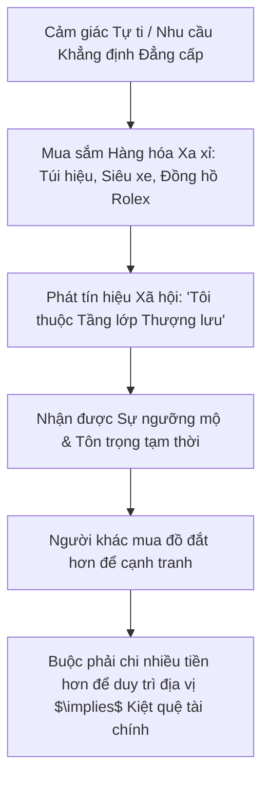
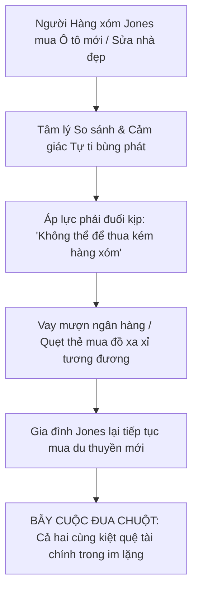
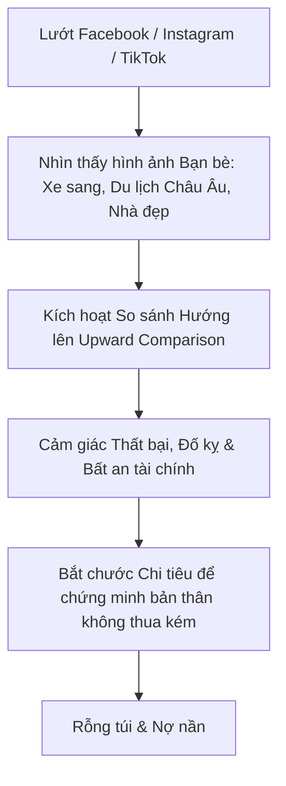
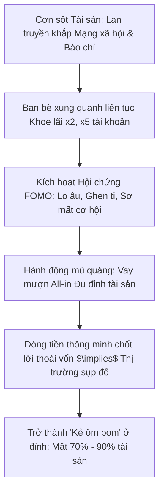
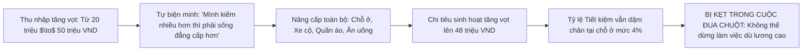

# Tiêu Dùng Địa Vị, Tâm Lý Đua Đòi, So Sánh Xã Hội, Hiệu Ứng FOMO Và Lạm Phát Lối Sống

Con người là sinh vật xã hội, và các quyết định tài chính cá nhân hiếm khi được đưa ra trong chân không. Trong kỷ nguyên của mạng xã hội, các thuật toán trực tuyến và văn hóa tiêu dùng phô trương, hành vi chi tiêu của chúng ta bị bóp méo dữ dội bởi nhu cầu phát tín hiệu địa vị (Status Signaling), hội chứng sợ bỏ lỡ (Financial FOMO), và cái bẫy so sánh xã hội độc hại "Chạy đua với gia đình Jones" (Keeping Up with the Joneses). Tài liệu này mổ xẻ cơ chế xã hội học và tâm lý học hành vi của việc tiêu xài để khẳng định đẳng cấp, đồng thời cung cấp giải pháp triệt để chặn đứng căn bệnh "Lạm phát lối sống" (Lifestyle Inflation).

> **Các câu hỏi cốt lõi:**
> 1. Lý thuyết "Tiêu dùng phô trương" (Conspicuous Consumption) của Thorstein Veblen và "Lý thuyết Phát tín hiệu" (Signaling Theory) giải thích tại sao con người lại sẵn sàng chi trả mức giá phi lý cho các món hàng xa xỉ như thế nào?
> 2. Sự khuếch đại của mạng xã hội (Instagram, TikTok) biến "Thuyết So sánh Xã hội" (Social Comparison Theory) của Leon Festinger thành cỗ máy sản xuất trầm cảm tài chính và hội chứng Financial FOMO ra sao?
> 3. Làm thế nào để áp dụng triết lý "Sống thầm lặng" (Stealth Wealth) và "Khóa chặt mức sống" để tích lũy tài sản ròng thực sự thay vì chỉ khoác lên mình tấm áo hào nhoáng giả tạo?

---

## 1. Status Consumption (Tiêu dùng phô trương địa vị)

### 1. Là gì?
- **Định nghĩa hình thức:** Tiêu dùng phô trương địa vị (hoặc Tiêu dùng hiển thị - Conspicuous Consumption, thuật ngữ do nhà kinh tế học Thorstein Veblen khởi xướng năm 1899 trong tác phẩm *The Theory of the Leisure Class*) là hành vi mua sắm và sử dụng các hàng hóa, dịch vụ xa xỉ, đắt tiền không nhằm mục đích thỏa mãn công năng sử dụng thực tế, mà nhằm mục đích chính là thị uy, phô diễn sự giàu có, quyền lực và vị thế xã hội vượt trội của chủ sở hữu trước cộng đồng xung quanh.
- **Giải thích đơn giản:** Tiêu dùng địa vị là việc bạn "mua đồ đắt tiền để cho người khác ngắm": bạn mua chiếc túi 200 triệu không phải vì nó đựng đồ tốt hơn chiếc túi 500k, mà để gửi một thông điệp tới cả thế giới rằng: "Tôi là người giàu có, hãy tôn trọng tôi!".
- **Nếu chỉ nhớ một điều:** Người giàu thực sự mua tài sản sinh lời để đạt được TỰ DO; người giả vờ giàu mua tiêu sản xa xỉ để mua lấy SỰ NGƯỠNG MỘ của người khác.

### 2. Hoạt động thế nào?
- **Chủ thể ra quyết định:** Cá nhân chịu áp lực khẳng định giá trị bản thân thông qua các biểu tượng địa vị vật chất bên ngoài.
- **Mục tiêu tối ưu hóa:** Tối đa hóa vị thế xã hội tương đối (Relative Social Status) và đạt được sự công nhận từ tầng lớp đồng đẳng.
- **Ràng buộc:** Giới hạn bởi ngân sách tài chính; hàng hóa địa vị (Positional Goods) có tính chất khan hiếm nhân tạo và mức giá cao phi lý.
- **Cơ chế tác động:**

### 3. Công thức & Mô hình
Lý thuyết Phát Tín hiệu Xã hội (Signaling Theory) của Michael Spence ứng dụng trong Tiêu dùng:
Để một tín hiệu (Signal - $S$) về sự giàu có có sức thuyết phục, nó bắt buộc phải **ĐẮT ĐỎ và TỐN KÉM ĐẾN MỨC NGƯỜI NGHÈO KHÔNG THỂ BẮT CHƯỚC ĐƯỢC**:
$$\text{Cost of Signal } (C_s) > \text{Budget of Low-Income Group}$$
Nếu ai cũng mua được chiếc túi hiệu đó, nó lập tức mất giá trị địa vị (Hiệu ứng Snob Effect).

Hàng hóa Veblen (Veblen Goods):
Trái ngược với Quy luật Cầu thông thường ($\frac{\partial Q}{\partial P} < 0$), Hàng hóa Veblen có đường cầu dốc lên trong một phân khúc:
$$\frac{\partial Q_D}{\partial P} > 0$$
(Giá bán càng tăng cao, sản phẩm càng trở nên quyến rũ và bán chạy hơn vì nó phát tín hiệu địa vị mạnh mẽ hơn!).

### 4. Ví dụ
- **Ví dụ định lượng:** Hai chiếc đồng hồ cùng thực hiện một công năng duy nhất: Xem giờ chính xác đến từng giây.
  - Chiếc đồng hồ Casio điện tử: Giá 500.000 VND (chính xác tuyệt đối nhờ tinh thể thạch anh).
  - Chiếc đồng hồ cơ Rolex Submariner: Giá 350.000.000 VND (chạy sai số $\pm 2$ giây/ngày, đắt gấp 700 lần chiếc Casio).
  - Khoản chênh lệch $349.500.000$ VND hoàn toàn KHÔNG PHẢI là chi phí mua công năng xem giờ; đó là $100\%$ "Chi phí mua tín hiệu địa vị xã hội" (Status Premium) để đeo trên cổ tay nhằm gây ấn tượng với đối tác kinh doanh.
- **Ví dụ thực tế:** Tại Việt Nam, nhiều người trẻ mới đi làm với mức lương 10-15 triệu/tháng sẵn sàng vay nợ trả góp mua chiếc điện thoại iPhone Pro Max giá 35 triệu đồng (tương đương gần 3 tháng lương) ngay trong ngày đầu mở bán để "không bị bạn bè coi thường".
- **Phản ví dụ (Counterfactual):** Cuốn sách nổi tiếng *The Millionaire Next Door* của Thomas J. Stanley và William D. Danko nghiên cứu hàng ngàn triệu phú tự thân tại Mỹ và phát hiện ra sự thật chấn động: Hầu hết các triệu phú thực sự không đi xe sang, không đeo đồng hồ Rolex, và mặc quần áo bình dân mua ở siêu thị. Họ giàu có vì họ KHÔNG tiêu tiền vào việc phô trương địa vị.

### 5. Ứng dụng & Tranh luận
- **Ứng dụng thực tiễn:** Áp dụng triết lý "Thịnh vượng Thầm lặng" (Stealth Wealth): Ăn mặc giản dị, sống trong ngôi nhà ấm cúng vừa đủ, đi xe bền bỉ, và tập trung toàn bộ nguồn lực tiền mặt vào việc sở hữu các tài sản sinh lời vô hình (cổ phần doanh nghiệp, chứng chỉ quỹ, bất động sản tạo dòng tiền).
- **Ưu và nhược điểm:**
  - *Lợi ích duy nhất:* Có thể tạo vỏ bọc bề ngoài thuận lợi trong một số ngành nghề đòi hỏi hình thức (như môi giới bất động sản cao cấp, huy động vốn đầu tư).
  - *Hậu quả tàn khốc:* Là chiếc cối xay gió nghiền nát tài sản ròng; biến người tiêu dùng thành nạn nhân của cuộc đua chuột không hồi kết.
- **Sai lầm phổ biến:** Nhầm tưởng rằng người khác nhìn vào chiếc xe sang của bạn sẽ ngưỡng mộ bạn. Sự thật tâm lý học (Man in the Car Paradox): Khi nhìn thấy một người lái siêu xe, không một ai ngưỡng mộ người lái xe cả; họ chỉ đang mơ tưởng rằng NẾU HỌ NGỒI VÀO CHIẾC XE ĐÓ THÌ MỌI NGƯỜI SẼ NGƯỠNG MỘ HỌ RA SAO.

### 6. Liên kết
- Cùng chủ đề: [02_Keeping_Up_with_the_Joneses.md](file:///Users/ductri0981/Documents/Studying/Studying-Economic/04_Personal_Finance_and_Wealth_Management/10_Financial_Psychology/02_Keeping_Up_with_the_Joneses.md)
- Liên kết chéo: [01_Personal_Finance_Foundations/02_Personal_Balance_Sheet_and_Net_Worth.md](file:///Users/ductri0981/Documents/Studying/Studying-Economic/04_Personal_Finance_and_Wealth_Management/01_Personal_Finance_Foundations/02_Personal_Balance_Sheet_and_Net_Worth.md)

---

## 2. Keeping Up with the Joneses (Chạy đua với người hàng xóm Jones / Đua đòi xã hội)

### 1. Là gì?
- **Định nghĩa hình thức:** "Keeping Up with the Joneses" là một thành ngữ xã hội học và văn hóa bắt nguồn từ bộ truyện tranh cùng tên của Arthur R. Momand năm 1913, dùng để chỉ một hội chứng tâm lý hành vi mà theo đó một cá nhân hoặc gia đình luôn cảm thấy áp lực nội tâm buộc phải chi tiêu, mua sắm và nâng cấp lối sống vật chất để theo kịp hoặc không bị thua kém so với mức sống và tài sản của những người hàng xóm, bạn bè hoặc nhóm tham chiếu xã hội xung quanh.
- **Giải thích đơn giản:** Là "thói đua đòi theo hàng xóm": thấy nhà hàng xóm mua ô tô mới thì mình cũng phải ráng vay tiền mua ô tô; thấy bạn bè đồng nghiệp cho con học trường quốc tế thì mình cũng cắn răng vay mượn cho con vào học để không bị bẽ mặt.
- **Nếu chỉ nhớ một điều:** Gia đình Jones mà bạn đang cố chạy đua theo thực ra cũng đang ngập trong nợ nần và cũng đang còng lưng chạy đua theo một gia đình khác; chạy đua với người khác là cuộc đua mà không một ai có thể giành chiến thắng.

### 2. Hoạt động thế nào?
- **Chủ thể ra quyết định:** Nhóm người tiêu dùng bị áp lực từ Nhóm tham chiếu xã hội (Reference Group Influence).
- **Mục tiêu tối ưu hóa:** Tránh cảm giác bị cô lập, lạc lõng hoặc bị gán nhãn là "kẻ thất bại" trong mắt cộng đồng bạn bè.
- **Ràng buộc:** Khả năng thu nhập thực tế có hạn; dẫn đến việc lạm dụng đòn bẩy nợ tiêu dùng để trang trải lối sống đua đòi.
- **Cơ chế tác động:**

### 3. Công thức & Mô hình
Mô hình Hàng hóa Vị thế (Positional Goods Model) của Fred Hirsch (1976):
Độ thỏa dụng của một cá nhân ($U_i$) phụ thuộc vào Mức tiêu dùng Tương đối so với mức trung bình của nhóm tham chiếu ($\bar{C}_{\text{reference}}$):
$$U_i = u(C_i - \bar{C}_{\text{reference}})$$
- Nếu $\bar{C}_{\text{reference}}$ tăng lên (do hàng xóm chi tiêu nhiều hơn), độ thỏa dụng $U_i$ của cá nhân tự động giảm sút dù mức chi tiêu tuyệt đối $C_i$ của chính họ không hề thay đổi!
- Điều này tạo ra một "Cuộc chạy đua vũ trang tiêu dùng" (Consumer Arms Race) tàn phá toàn bộ thặng dư kinh tế của xã hội.

### 4. Ví dụ
- **Ví dụ định lượng:** Trong một khu phố đô thị mới, anh An có thu nhập 35 triệu/tháng và đang đi chiếc xe máy Honda SH rất tốt.
  - Người hàng xóm đối diện nhà anh An vừa tậu chiếc xe ô tô Mazda CX-5 giá 800 triệu.
  - Mỗi buổi sáng bước ra cửa ngõ nhìn chiếc ô tô của hàng xóm, anh An cảm thấy tự ti và khó chịu.
  - Áp lực đua đòi: Anh An quyết định rút toàn bộ 200 triệu tiết kiệm dưỡng già và vay ngân hàng thêm 600 triệu (trả góp 12 triệu/tháng trong 5 năm) để mua chiếc xe Hyundai Tucson đắt tiền hơn xe hàng xóm.
  - Kết quả: Anh An phải thắt lưng buộc bụng, cắt giảm tiền ăn, không còn một đồng nào để đầu tư. Hai tháng sau, anh phát hiện ra người hàng xóm thực chất đang nợ nần ngập đầu và chiếc Mazda kia cũng là tiền vay ngân hàng $80\%$. Cả hai người hàng xóm cùng giam cầm nhau trong ngục tù nợ nần.
- **Ví dụ thực tế:** Văn hóa "Ăn cưới ở khách sạn 5 sao" hoặc "Tổ chức tiệc sinh nhật xa hoa cho con 1 tuổi" tại các thành phố lớn ở Việt Nam: Nhiều cặp vợ chồng trẻ phải gánh nợ hàng trăm triệu đồng sau đám cưới chỉ vì áp lực phải làm cỗ to, trang trí lộng lẫy để "bằng bạn bằng bè" và để người khác chụp ảnh đăng Facebook.
- **Phản ví dụ (Counterfactual):** Một gia đình áp dụng câu châm ngôn của Will Rogers: *"Chúng ta tiêu những đồng tiền mình không có, để mua những thứ mình không cần, nhằm gây ấn tượng với những người mình không thích"*. Họ dứt khoát không tham gia vào bất kỳ cuộc đua nào của hàng xóm, lái chiếc xe cũ bình dị và dùng tiền nhàn rỗi mua cổ phiếu doanh nghiệp; ở tuổi 45, họ tự do tài chính nghỉ hưu trong khi những người hàng xóm vẫn phải cày cuốc trả nợ ngân hàng.

### 5. Ứng dụng & Tranh luận
- **Ứng dụng thực tiễn:** Thay đổi nhóm tham chiếu: Chủ động kết giao với những người bạn khiêm tốn, coi trọng tri thức và phát triển bản thân thay vì những người thích khoe của; hủy theo dõi các tài khoản mạng xã hội chuyên khoe khoang lối sống xa hoa.
- **Ưu và nhược điểm:**
  - *Mặt nguy hiểm của cuộc đua:* Làm bốc hơi toàn bộ quỹ hưu trí và tương lai tài chính của gia đình.
  - *Giải pháp:* Nhận diện rõ bản chất giả tạo của cuộc đua và dũng cảm bước ra ngoài cuộc chơi.
- **Sai lầm phổ biến:** Nghĩ rằng "mình chi tiêu thế này là vì gia đình", không dám thành thật thừa nhận rằng mình đang chi tiêu để thỏa mãn sự phù phiếm của cái tôi xã hội.

### 6. Liên kết
- Cùng chủ đề: [01_Status_Consumption.md](file:///Users/ductri0981/Documents/Studying/Studying-Economic/04_Personal_Finance_and_Wealth_Management/10_Financial_Psychology/01_Status_Consumption.md)
- Liên kết chéo: [03_Social_Comparison.md](file:///Users/ductri0981/Documents/Studying/Studying-Economic/04_Personal_Finance_and_Wealth_Management/10_Financial_Psychology/03_Social_Comparison.md)

---

## 3. Social Comparison (So sánh xã hội)

### 1. Là gì?
- **Định nghĩa hình thức:** Thuyết So sánh Xã hội (Social Comparison Theory - do nhà tâm lý học xã hội Leon Festinger đề xuất năm 1954) khẳng định rằng con người có một thôi thúc tâm lý nội tại bẩm sinh trong việc tự đánh giá năng lực, giá trị, sự thành công và vị thế cá nhân của chính mình thông qua việc không ngừng so sánh đối chiếu bản thân với những người xung quanh.
- **Giải thích đơn giản:** So sánh xã hội là thói quen "liếc nhìn sang người khác để đo lường giá trị của mình": bạn không biết mình có hạnh phúc hay không cho đến khi nhìn xem bạn bè đồng trang lứa đang đi xe gì, ở nhà to hay nhỏ, lương cao hơn hay thấp hơn mình.
- **Nếu chỉ nhớ một điều:** So sánh là kẻ trộm đánh cắp niềm vui (Comparison is the thief of joy); khi bạn so sánh "hậu trường đời thực lộn xộn của mình" với "sân khấu hào nhoáng đã qua chỉnh sửa của người khác trên mạng xã hội", bạn luôn là người chuốc lấy thất bại và trầm cảm.

### 2. Hoạt động thế nào?
- **Chủ thể ra quyết định:** Hai cơ chế so sánh theo Festinger:
  1. **So sánh Hướng lên (Upward Social Comparison):** So sánh với những người giàu có hơn, thành công hơn $\implies$ Dễ sinh ra đố kỵ, tự ti, trầm cảm hoặc thôi thúc chi tiêu vượt khả năng để bắt kịp.
  2. **So sánh Hướng xuống (Downward Social Comparison):** So sánh với những người kém may mắn hơn $\implies$ Tạo cảm giác biết ơn, nhẹ nhõm và trân trọng những gì đang có.
- **Mục tiêu tối ưu hóa:** Tìm kiếm thước đo định danh giá trị cá nhân trong cộng đồng.
- **Ràng buộc:** Mạng xã hội hoạt động như một "kính phóng đại bất đối xứng", chỉ chọn lọc những khoảnh khắc rực rỡ nhất để phô diễn.
- **Cơ chế tác động:**

### 3. Công thức & Mô hình
Nghiên cứu Kinh tế học Hạnh phúc của Sara Solnick & David Hemenway (Harvard University):
Các sinh viên Harvard được yêu cầu chọn sống trong 1 trong 2 thế giới giả định (với mức giá cả hàng hóa ở 2 thế giới là y hệt nhau):
- **Thế giới A:** Bạn kiếm được **50.000 USD/năm**, và tất cả những người khác kiếm được **25.000 USD/năm** (Bạn giàu gấp đôi người khác).
- **Thế giới B:** Bạn kiếm được **100.000 USD/năm**, và tất cả những người khác kiếm được **200.000 USD/năm** (Bạn nghèo bằng một nửa người khác).
Kết quả: Có tới **hơn $50\%$ số người chọn Thế giới A**!
Họ sẵn sàng từ bỏ một nửa thu nhập thực tế (chỉ nhận 50k thay vì 100k) chỉ để có được cảm giác "đứng trên đầu người khác". Con người không quan tâm đến việc mình có bao nhiêu tiền, họ chỉ quan tâm mình có NHIỀU TIỀN HƠN NGƯỜI XUNG QUANH hay không!

### 4. Ví dụ
- **Ví dụ định lượng:** Một bạn trẻ đi làm có mức lương tăng từ 15 triệu lên 25 triệu/tháng.
  - Ban đầu, bạn cảm thấy vô cùng hạnh phúc và tự hào về bản thân.
  - Trong buổi họp lớp cấp 3 vào cuối tuần, bạn nghe tin người bạn cùng bàn vừa mua nhà biệt thự và có thu nhập 100 triệu/tháng.
  - Ngay lập tức, toàn bộ niềm vui về mức lương 25 triệu bốc hơi hoàn toàn, thay thế bằng cảm giác nhục nhã, thất bại và cay đắng.
  - Bạn trở về nhà trong trạng thái trầm cảm và bắt đầu tìm kiếm các kênh đầu tư tiền số rủi ro cao với hy vọng nhân 10 tài khoản nhanh chóng để không bị tụt lại phía sau.
- **Ví dụ thực tế:** Nghiên cứu của các nhà kinh tế học tại Cục Dự trữ Liên bang Mỹ (Fed) phát hiện ra rằng: Khi một người trong khu phố trúng xổ số độc đắc, tỷ lệ những người hàng xóm sống xung quanh người đó nộp đơn xin PHÁ SẢN trong vòng 3 năm tiếp theo tăng vọt một cách kỳ lạ. Lý do: Họ đã vay mượn quá mức để cố gắng nâng cấp xe cộ và nhà cửa theo người hàng xóm vừa giàu lên.
- **Phản ví dụ (Counterfactual):** Một người thực hành So sánh hướng xuống và Lòng biết ơn: Mỗi khi cảm thấy buồn vì chưa đổi được xe mới, người này tình nguyện đến thăm các bệnh nhi ung thư tại bệnh viện hoặc các mái ấm tình thương. Nhìn thấy hàng ngàn số phận đang chiến đấu giành giật từng hơi thở, người đó nhận ra mình đang có một cuộc sống vô cùng may mắn và giàu có, dập tắt hoàn toàn mọi ham muốn đua đòi phù phiếm.

### 5. Ứng dụng & Tranh luận
- **Ứng dụng thực tiễn:** Cai nghiện mạng xã hội (Digital Detox): Giảm thời gian lướt mạng xã hội xuống dưới 30 phút/ngày; định nghĩa thành công bằng "Tự do thời gian và sự bình an nội tâm" thay vì số lượng tài sản hữu hình.
- **Ưu và nhược điểm:**
  - *Ưu điểm của việc so sánh lành mạnh:* Tạo động lực học tập, nâng cao trình độ chuyên môn từ những người đi trước tài năng.
  - *Nhược điểm của việc so sánh vật chất:* Bào mòn lòng tự trọng, phá hủy sức khỏe tinh thần và túi tiền.
- **Sai lầm phổ biến:** Đem thước đo của người khác áp vào cuộc đời của mình; sống một cuộc đời sao chép chỉ để làm hài lòng ánh mắt của những người xa lạ.

### 6. Liên kết
- Cùng chủ đề: [02_Keeping_Up_with_the_Joneses.md](file:///Users/ductri0981/Documents/Studying/Studying-Economic/04_Personal_Finance_and_Wealth_Management/10_Financial_Psychology/02_Keeping_Up_with_the_Joneses.md)
- Liên kết chéo: [04_Financial_FOMO.md](file:///Users/ductri0981/Documents/Studying/Studying-Economic/04_Personal_Finance_and_Wealth_Management/10_Financial_Psychology/04_Financial_FOMO.md)

---

## 4. Financial FOMO (Hội chứng sợ bỏ lỡ tài chính)

### 1. Là gì?
- **Định nghĩa hình thức:** Financial FOMO (Fear Of Missing Out in Finance) là trạng thái tâm lý lo âu, bồn chồn và sợ hãi bị tụt hậu khi chứng kiến người khác (bạn bè, đồng nghiệp, cộng đồng mạng) dường như đang kiếm được những khoản lợi nhuận khổng lồ, nhanh chóng và dễ dàng từ một cơ hội đầu tư đang sốt nóng, thúc đẩy cá nhân vội vã lao vào thị trường mua tài sản ở vùng giá đỉnh mà bỏ qua mọi quy trình thẩm định rủi ro và phân tích cơ bản.
- **Giải thích đơn giản:** Financial FOMO là tâm lý "sợ mất phần ăn": thấy ai ai xung quanh cũng khoe mua đất lãi gấp đôi, mua cổ phiếu, tiền ảo ăn bằng lần, bạn sốt ruột không chịu nổi, sợ mình thành kẻ ngốc bị bỏ rơi, nên vơ vét hết tiền đổ vào mua theo đúng lúc giá đang ở đỉnh chót vót.
- **Nếu chỉ nhớ một điều:** Không có gì làm suy giảm lý trí của con người nhanh bằng việc nhìn thấy thằng bạn thân của mình bỗng nhiên trở nên giàu có nhanh chóng (Charles Kindleberger).

### 2. Hoạt động thế nào?
- **Chủ thể ra quyết định:** Nhà đầu tư cá nhân thiếu kinh nghiệm bị dẫn dắt bởi Cảm xúc bầy đàn và Bằng chứng xã hội (Social Proof).
- **Mục tiêu tối ưu hóa:** Tìm kiếm cơ hội làm giàu nhanh (Get-rich-quick) để không bị bỏ lại phía sau.
- **Ràng buộc:** Tính chất chu kỳ của thị trường tài chính: Khi một cơ hội được bàn tán rôm rả ở quán trà đá hay tiệm cắt tóc thì đó thường là giai đoạn phân phối đỉnh của các "tay to" (Smart Money).
- **Cơ chế tác động:**

### 3. Công thức & Mô hình
Mô hình Chu kỳ Tâm lý Thị trường của Jean-Paul Rodrigue:
Các giai đoạn biến đổi tâm lý của một nhà đầu tư dính bẫy FOMO:
$$\text{Lạc quan (Optimism)} \to \text{Hưng phấn (Excitement)} \to \text{Phấn khích tột độ (Thrill)} \to \text{Cực khoái - FOMO ĐỈNH (Euphoria)}$$
Tại điểm **Euphoria (Cực khoái / FOMO cực đại)**:
- Rủi ro tài chính đạt mức **CAO NHẤT lịch sử**.
- Khối lượng giao dịch của nhà đầu tư nhỏ lẻ F0 đạt đỉnh điểm.
- Ngay sau đó là giai đoạn Sụp đổ: $\text{Lo âu} \to \text{Phủ nhận} \to \text{Hoảng loạn} \to \text{Buông xuôi (Capitulation)}$.

### 4. Ví dụ
- **Ví dụ định lượng:** Trong cơn sốt đất nền vùng ven năm 2021 tại một huyện nông thôn Việt Nam:
  - Một mảnh đất nông nghiệp giá gốc 300 triệu đồng được các nhóm đầu cơ thổi giá qua tay liên tục lên 1,5 tỷ $\to$ 2,5 tỷ $\to$ 3,5 tỷ đồng.
  - Anh Bình ban đầu rất tỉnh táo đứng ngoài. Nhưng khi thấy người hàng xóm vừa lướt cọc kiếm được 500 triệu trong 3 ngày, anh Bình bị cơn sốt FOMO thiêu đốt tâm trí.
  - Sợ giá đất tăng lên 5 tỷ mất cơ hội làm giàu, anh Bình cắm sổ đỏ nhà vay ngân hàng 3 tỷ + 500 triệu tiền tiết kiệm để mua mảnh đất đó ở mức giá đỉnh 3,5 tỷ đồng.
  - Một tuần sau, cơn sốt hạ nhiệt, nhóm đầu cơ rút êm. Mảnh đất mất thanh khoản hoàn toàn, không có người mua dù giảm giá về 1 tỷ. Anh Bình ôm khoản nợ ngân hàng 3 tỷ với tiền lãi 30 triệu/tháng trong sự tuyệt vọng.
- **Ví dụ thực tế:** Cơn sốt tiền mã hóa Meme-coin (như Dogecoin, Shiba Inu) hoặc trào lưu cổ phiếu "GameStop" tại Mỹ: Hàng triệu bạn trẻ đổ xô mua vì sợ bỏ lỡ chuyến tàu làm giàu theo lời kêu gọi trên mạng xã hội Reddit và TikTok, để rồi đại đa số mất sạch tiền khi giá sụp đổ $90\%$.
- **Phản ví dụ (Counterfactual):** Tỷ phú Warren Buffett kiên quyết từ chối đầu tư vào các cổ phiếu công nghệ Dot-com vào năm 1999 bất chấp việc bị truyền thông chế giễu là "ông già hết thời" khi các quỹ đầu cơ công nghệ khoe lãi $100\%$/năm. Khi bong bóng Dot-com nổ tung năm 2000 quét sạch hàng loạt tỷ phú mới nổi, Berkshire Hathaway của Buffett vẫn đứng vững và mua lại các tài sản tuyệt vời với giá rẻ mạt.

### 5. Ứng dụng & Tranh luận
- **Ứng dụng thực tiễn:** Áp dụng câu châm ngôn kinh điển: *"Hãy tham lam khi người khác sợ hãi, và hãy sợ hãi khi người khác tham lam"*; thiết lập quy tắc bắt buộc: Tuyệt đối không bao giờ đầu tư vào bất kỳ thứ gì mà mình không hiểu rõ mô hình tạo ra dòng tiền của nó.
- **Ưu và nhược điểm:**
  - *Ưu điểm của việc triệt tiêu FOMO:* Bảo toàn nguyên vẹn vốn gốc qua mọi chu kỳ thăng trầm của thị trường; giữ tâm thế an nhiên tự tại.
  - *Nhược điểm:* Đòi hỏi bản lĩnh phi thường để đứng yên nhìn người khác kiếm tiền dễ dàng trong giai đoạn thị trường điên cuồng.
- **Sai lầm phổ biến:** Nghĩ rằng "mình chỉ vào lướt sóng một tí kiếm ít tiền rồi nhảy ra ngay trước khi sập", không nhận ra rằng trong cơn say chiến thắng, lòng tham sẽ ngăn bạn nhảy ra cho đến khi quá muộn.

### 6. Liên kết
- Cùng chủ đề: [03_Social_Comparison.md](file:///Users/ductri0981/Documents/Studying/Studying-Economic/04_Personal_Finance_and_Wealth_Management/10_Financial_Psychology/03_Social_Comparison.md)
- Liên kết chéo: [06_Wealth_Building_and_Compounding/04_Asset_Classification_and_Allocation.md](file:///Users/ductri0981/Documents/Studying/Studying-Economic/04_Personal_Finance_and_Wealth_Management/06_Wealth_Building_and_Compounding/04_Asset_Classification_and_Allocation.md)

---

## 5. Lifestyle Inflation (Lạm phát lối sống)

### 1. Là gì?
- **Định nghĩa hình thức:** Lạm phát lối sống (hoặc Lifestyle Creep) dưới lăng kính tâm lý học tài chính là xu hướng hành vi tự động nâng cấp mức chi tiêu cho các nhu cầu sinh hoạt, giải trí, ăn mặc và dịch vụ tiện nghi tương ứng một-một (hoặc thậm chí nhanh hơn) với mỗi bước gia tăng của mức thu nhập, biến các xa xỉ phẩm trước đây thành các nhu cầu thiết yếu mặc nhiên trong hiện tại.
- **Giải thích đơn giản:** Lạm phát lối sống là căn bệnh "kiếm được bao nhiêu tiêu sạch bấy nhiêu": ngày xưa lương 10 triệu vẫn sống vui vẻ; nay lương 50 triệu vẫn thấy thiếu thốn và cuối tháng không để dành được đồng nào vì chuyển sang ở chung cư cao cấp, đi ăn nhà hàng sang và mua sắm đồ hiệu.
- **Nếu chỉ nhớ một điều:** Sự giàu có thực sự không được đo bằng số tiền bạn kiếm được; nó được đo bằng KHOẢNG CÁCH giữa Thu nhập và Lối sống của bạn.

### 2. Hoạt động thế nào?
- **Chủ thể ra quyết định:** Cá nhân bị dẫn dắt bởi sự Thích nghi khoái lạc và áp lực Khẳng định địa vị xã hội mới.
- **Mục tiêu tối ưu hóa:** Hưởng thụ thành quả lao động tương xứng với vị trí chức vụ và mức thu nhập mới.
- **Ràng buộc:** Sự co giãn một chiều của mức sống (Rất dễ nâng cấp lên mức sống cao hơn, nhưng cực kỳ đau đớn nếu phải cắt giảm xuống mức sống thấp hơn).
- **Cơ chế tác động:**

### 3. Công thức & Mô hình
Đo lường Hệ số Co giãn Chi tiêu theo Thu nhập (Income Elasticity of Expenditures - $\varepsilon_{\text{lifestyle}}$):
$$\varepsilon_{\text{lifestyle}} = \frac{\% \Delta \text{Chi tiêu}}{\% \Delta \text{Thu nhập}} = \frac{\Delta E / E}{\Delta I / I}$$
- Nếu $\varepsilon_{\text{lifestyle}} \ge 1$: Toàn bộ phần thu nhập tăng thêm bị nuốt chửng bởi lối sống mới $\implies$ Lạm phát lối sống nghiêm trọng, tỷ lệ tiết kiệm không tăng.
- Nếu $\varepsilon_{\text{lifestyle}} \le 0,3$: **Miễn nhiễm với Lạm phát lối sống** $\implies$ Hơn $70\%$ phần thu nhập tăng thêm được chuyển hóa thành tài sản tích lũy đầu tư!

Chiến lược "Tự động Đóng băng Lối sống" (Lifestyle Freeze Rule):
Mỗi khi thu nhập tăng thêm một khoản $\Delta I$:
$$\text{Tỷ lệ Phân bổ Đầu tư} = \alpha_{\text{freeze}} \times \Delta I, \quad \text{với } \alpha_{\text{freeze}} \ge 70\%$$
Chỉ cho phép tối đa $30\%$ phần lương tăng thêm được sử dụng để nâng cấp tiện nghi cuộc sống.

### 4. Ví dụ
- **Ví dụ định lượng:** Hai người bạn cùng có mức lương ban đầu 15.000.000 VND/tháng và cùng được thăng chức tăng lương lên 40.000.000 VND/tháng (thu nhập tăng thêm $\Delta I = 25.000.000$ VND/tháng):
  - **Người A (Dính bẫy Lạm phát lối sống):** Chuyển sang thuê căn hộ cao cấp 15 triệu, mua xe trả góp 10 triệu/tháng, ăn nhà hàng sang trọng. Chi tiêu hàng tháng tăng vọt từ 12 triệu lên đúng 38 triệu. Sau 10 năm, dù kiếm được hàng tỷ đồng tiền lương, người A vẫn không có tài sản tích lũy đáng kể và luôn sống trong nỗi sợ bị mất việc.
  - **Người B (Áp dụng Lifestyle Freeze $\alpha = 80\%$):** Chỉ tăng chi tiêu thêm 5 triệu (từ 12 lên 17 triệu để ăn uống lành mạnh hơn), còn lại 20 triệu/tháng chuyển thẳng vào tài khoản đầu tư chứng chỉ quỹ ETF.
    - Với lãi suất $10\%$/năm, sau 10 năm người B tích lũy được khối tài sản:
      $$V_{10} \approx \mathbf{4.120.000.000 \text{ VND}}$$
    - Người B chính thức đạt tự do tài chính ở tuổi 35 nhờ kiểm soát được lạm phát lối sống.
- **Ví dụ thực tế:** Tại thung lũng Silicon (Mỹ), nhiều kỹ sư công nghệ nhận mức lương 300.000 - 500.000 USD/năm nhưng vẫn than thở là "sống chật vật từng tháng" (Living paycheck to paycheck) do chi phí thuê biệt thự xa hoa, cho con học trường tư thục siêu đắt đỏ và các kỳ nghỉ dưỡng tốn kém.
- **Phản ví dụ (Counterfactual):** Huyền thoại đầu tư Warren Buffett là tấm gương vĩ đại nhất về việc đánh bại Lạm phát lối sống: Sở hữu khối tài sản hơn 130 tỷ USD, nhưng ông vẫn sống trong căn nhà mua năm 1958 với giá 31.500 USD tại Omaha, tự lái chiếc xe bình dân và ăn bữa sáng tại McDonald's với giá chưa tới 4 USD. Lối sống độc lập với thu nhập đã giúp ông bảo toàn trọn vẹn cỗ máy tích lũy tài sản vĩ đại nhất lịch sử.

### 5. Ứng dụng & Tranh luận
- **Ứng dụng thực tiễn:** Tận hưởng thành quả một cách có ý thức (Conscious Spending): Cho phép bản thân tận hưởng những tiện nghi thực sự mang lại sức khỏe và thời gian (như thuê người dọn nhà, mua thực phẩm sạch), nhưng tuyệt đối kiên quyết cắt bỏ những nâng cấp chỉ nhằm mục đích phô trương địa vị.
- **Ưu và nhược điểm:**
  - *Ưu điểm:* Mở rộng khoảng cách tiết kiệm tối đa, rút ngắn thời gian đạt tới tự do tài chính từ 30 năm xuống chỉ còn 10 - 15 năm.
  - *Nhược điểm:* Đôi khi phải chịu đựng sự dòm ngó, tò mò hoặc đánh giá của những người xung quanh khi thấy mình có thu nhập cao mà sống quá giản dị.
- **Sai lầm phổ biến:** Nghĩ rằng "đến khi nào kiếm được nhiều tiền hơn thì mình mới bắt đầu tiết kiệm", không hiểu rằng nếu không rèn luyện kỹ năng kiểm soát mức sống từ khi còn nghèo thì khi giàu lên, căn bệnh lạm phát lối sống sẽ nuốt chửng toàn bộ số tiền bạn kiếm được.

### 6. Liên kết
- Cùng chủ đề: [01_Status_Consumption.md](file:///Users/ductri0981/Documents/Studying/Studying-Economic/04_Personal_Finance_and_Wealth_Management/10_Financial_Psychology/01_Status_Consumption.md)
- Liên kết chéo: [03_Budgeting_and_Expense_Management/06_Lifestyle_Inflation_and_Opportunity_Cost.md](file:///Users/ductri0981/Documents/Studying/Studying-Economic/04_Personal_Finance_and_Wealth_Management/03_Budgeting_and_Expense_Management/06_Lifestyle_Inflation_and_Opportunity_Cost.md)

---

## Câu hỏi tự kiểm tra
1. Hãy phân tích Lý thuyết "Tiêu dùng phô trương" (Conspicuous Consumption) của Thorstein Veblen. Tại sao đối với Hàng hóa Veblen, giá bán càng đắt đỏ thì lượng cầu của giới nhà giàu lại càng tăng lên?
2. Thành ngữ "Keeping Up with the Joneses" mô tả hiện tượng tâm lý xã hội nào? Tác hại tài chính của Cuộc chạy đua vũ trang tiêu dùng (Consumer Arms Race) trong các khu dân cư đô thị là gì?
3. Thí nghiệm của Solnick & Hemenway tại Đại học Harvard về việc lựa chọn mức lương tương đối hé lộ bản chất sâu xa nào của Thuyết So sánh Xã hội (Social Comparison Theory)?
4. Hội chứng Financial FOMO (Sợ bỏ lỡ cơ hội tài chính) thường bùng phát mạnh nhất tại giai đoạn nào của chu kỳ thị trường tài chính? Làm thế nào để một nhà đầu tư cá nhân có thể giữ vững tâm lý trước những cơn sốt đất nền hay tiền ảo của đám đông?
5. Trình bày Chiến lược "Khóa chặt Lối sống" (Lifestyle Freeze Rule) và giải thích tại sao Khoảng cách giữa Thu nhập và Mức sống mới là thước đo chân thực nhất của sự giàu có bền vững.

## Ghi chú nguồn
- Veblen, T. (1899) - *The Theory of the Leisure Class: An Economic Study of Institutions*, Macmillan.
- Festinger, L. (1954) - *A Theory of Social Comparison Processes*, Human Relations.
- Stanley, T. J., & Danko, W. D. - *The Millionaire Next Door: The Surprising Secrets of America's Wealthy*, Longstreet Press.
- Housel, M. - *The Psychology of Money: Timeless Lessons on Wealth, Greed, and Happiness*, Harriman House.
