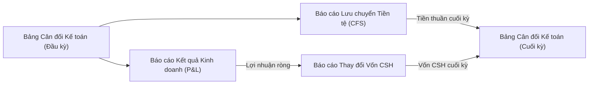

# Chuyên đề 8.1.2: Chu trình Kế toán, Kỹ thuật Ghi sổ kép và Hệ thống Sổ sách

Chuyên đề này đi sâu vào cơ chế vận hành cơ học của ngành kế toán: từ kỹ thuật ghi sổ kép phát minh bởi Luca Pacioli, cách tổ chức hệ thống tài khoản chuẩn hóa, quy trình luân chuyển chứng từ qua sổ nhật ký đến sổ cái, và bước kiểm tra đối chiếu bằng bảng cân đối thử trước khi phát hành báo cáo tài chính.

> Câu hỏi xuyên suốt: Bằng thuật toán đối ứng Nợ - Có nào mà kế toán viên có thể kiểm soát hàng triệu giao dịch tài chính phức tạp mà không để thất thoát một đồng xu nào?

---

## 1. Ghi sổ kép (Double-Entry Bookkeeping)

**1. Là gì?**
Ghi sổ kép là phương pháp kế toán ghi chép lại mọi giao dịch tài chính vào ít nhất hai tài khoản kế toán riêng biệt với số tiền ghi Nợ (Debit) và số tiền ghi Có (Credit) luôn luôn bằng nhau. Được nhà toán học người Ý Luca Pacioli hệ thống hóa vào năm 1494, ghi sổ kép là nền tảng toán học của toàn bộ nền kinh tế tư bản hiện đại. Nếu chỉ nhớ một điều: **Mọi sự tăng lên của một nguồn lực luôn bắt nguồn từ sự giảm đi của một nguồn lực khác hoặc sự gia tăng của một nghĩa vụ.**

**2. Hoạt động thế nào?**
- Hệ thống quy ước:
  - Tài sản (Assets) & Chi phí (Expenses): Tăng ghi bên Nợ (Debit), Giảm ghi bên Có (Credit).
  - Nguồn vốn (Liabilities, Equity) & Doanh thu (Revenue): Tăng ghi bên Có (Credit), Giảm ghi bên Nợ (Debit).
- Bất kỳ giao dịch nào xảy ra trong doanh nghiệp cũng tác động đến ít nhất 2 đối tượng kế toán theo quan hệ đối ứng.
- Đảm bảo tính tự kiểm soát: Tổng phát sinh Nợ luôn luôn bằng Tổng phát sinh Có trên toàn hệ thống.

**3. Công thức & mô hình**
Đẳng thức cân bằng toán học của phương pháp ghi sổ kép:

$$
\sum \text{Debit (Nợ)} = \sum \text{Credit (Có)}
$$

Mở rộng từ phương trình kế toán:

$$
\text{Tài sản} + \text{Chi phí} + \text{Cổ tức} = \text{Nợ phải trả} + \text{Vốn góp} + \text{Lợi nhuận giữ lại đầu kỳ} + \text{Doanh thu}
$$

Vế trái tăng ghi Nợ; Vế phải tăng ghi Có.

**4. Ví dụ**
- Doanh nghiệp vay ngân hàng Vietcombank $200$ triệu VND nhập về tài khoản tiền gửi:
  - Ghi Nợ TK 112 (Tiền gửi ngân hàng - Tài sản tăng): $200$ triệu VND.
  - Ghi Có TK 341 (Vay và nợ thuê tài chính - Nợ phải trả tăng): $200$ triệu VND.
  - Tổng Nợ = Tổng Có = $200$ triệu VND (số liệu minh họa).
- Counterfactual: Nếu kế toán chỉ ghi nhận tiền gửi ngân hàng tăng $200$ triệu mà quên ghi nhận khoản nợ vay, tổng tài sản sẽ vênh so với nguồn vốn và phương trình kế toán bị sụp đổ ngay lập tức.

**5. Ứng dụng & tranh luận**
- Ứng dụng: Chuẩn mực kế toán toàn cầu, tích hợp trong toàn bộ phần mềm ERP hiện đại như SAP, Oracle, MISA.
- Ưu/nhược điểm: Khả năng tự phát hiện lỗi sai toán học vượt trội; nhưng không phát hiện được nếu giao dịch bị bỏ sót hoàn toàn hoặc ghi nhầm tài khoản có cùng tính chất.
- Lỗi thường gặp: Hiểu lầm từ "Nợ" (Debit) là điều xấu và "Có" (Credit) là tiền vào theo ngôn ngữ thông thường của người gửi tiết kiệm ngân hàng.

**6. Liên kết**
- [Phương trình Kế toán](04_Accounting_Equation_and_Core_Elements.md) · [Bút toán Nhật ký](#4-bút-toán-nhật-ký-journal-entries) · [Bảng Cân đối Thử](#5-bảng-cân-đối-thử-trial-balance)

---

## 2. Hệ thống Tài khoản Kế toán (Chart of Accounts)

**1. Là gì?**
Hệ thống tài khoản kế toán là danh mục phân loại có hệ thống toàn bộ các tài khoản kế toán được một tổ chức sử dụng để ghi nhận các nghiệp vụ kinh tế tài chính, được mã hóa bằng các con số theo cấu trúc logic. Ở Việt Nam, hệ thống này được chuẩn hóa theo Thông tư 200/2014/TT-BTC hoặc Thông tư 133/2016/TT-BTC. Nếu chỉ nhớ một điều: **Hệ thống tài khoản là bộ khung xương mã hóa giúp chuyển đổi ngôn ngữ đời sống thành các ngăn kéo lưu trữ thông tin chuẩn xác.**

**2. Hoạt động thế nào?**
- Mỗi tài khoản đại diện cho một đối tượng kế toán cụ thể (tiền mặt, nguyên vật liệu, nợ vay, doanh thu bán hàng).
- Cấu trúc số hiệu tài khoản phản ánh tính chất phân cấp:
  - Loại 1 & 2: Tài sản ngắn hạn & dài hạn.
  - Loại 3: Nợ phải trả.
  - Loại 4: Vốn chủ sở hữu.
  - Loại 5 & 7: Doanh thu & Thu nhập khác.
  - Loại 6 & 8: Chi phí sản xuất kinh doanh & Chi phí khác.
  - Loại 9: Xác định kết quả kinh doanh.
- Chữ số đầu tiên chỉ loại tài khoản; các chữ số sau thể hiện chi tiết cấp con (ví dụ: TK 111 là Tiền mặt; TK 1111 là Tiền Việt Nam, TK 1112 là Ngoại tệ).

**3. Công thức & mô hình**
Cấu trúc cây danh mục tài khoản dạng mã số phân cấp:

$$
\text{Mã TK} = C_1 C_2 C_3 [C_4 \dots]
$$

Trong đó: $C_1$ là Loại tài khoản (1 đến 9), $C_1 C_2$ là Nhóm tài khoản, $C_1 C_2 C_3$ là Tài khoản cấp 1, $C_1 C_2 C_3 C_4$ là Tài khoản cấp 2.

**4. Ví dụ**
- Trong Thông tư 200 tại Việt Nam:
  - TK 156: Hàng hóa (Tài sản ngắn hạn - Loại 1).
  - TK 1561: Giá mua hàng hóa.
  - TK 1562: Chi phí thu mua hàng hóa.
  - TK 511: Doanh thu bán hàng và cung cấp dịch vụ (Loại 5).
  - TK 641: Chi phí bán hàng (Loại 6).
- Counterfactual: Nếu doanh nghiệp không có hệ thống tài khoản chuẩn hóa, mỗi nhân viên sẽ tự đặt tên (người ghi "tiền quỹ", người ghi "tiền mặt trong ví"), khiến phần mềm không thể kết xuất báo cáo tổng hợp.

**5. Ứng dụng & tranh luận**
- Ứng dụng: Thiết lập hệ thống cơ sở dữ liệu kế toán, ERP, tự động hóa quy trình hạch toán.
- Tranh luận: Chuẩn mực Việt Nam bắt buộc dùng danh mục số hiệu thống nhất của Bộ Tài chính, trong khi doanh nghiệp theo chuẩn quốc tế (IFRS/US GAAP) được tự do tùy biến hệ thống tài khoản theo đặc thù kinh doanh riêng.
- Lỗi thường gặp: Tạo quá nhiều tài khoản con chi tiết không cần thiết làm cồng kềnh hệ thống, hoặc gộp chung các chi phí có tính chất khác nhau vào cùng một mã tài khoản.

**6. Liên kết**
- [Sổ Cái](#3-sổ-cái-general-ledger) · [Ghi sổ kép](#1-ghi-sổ-kép-double-entry-bookkeeping) · [Bút toán Nhật ký](#4-bút-toán-nhật-ký-journal-entries)

---

## 3. Sổ Cái (General Ledger)

**1. Là gì?**
Sổ Cái là tập hợp toàn bộ các tài khoản kế toán của doanh nghiệp, dùng để theo dõi tổng thể số dư đầu kỳ, các biến động phát sinh Nợ - Có trong kỳ và số dư cuối kỳ của từng tài khoản riêng biệt. Nếu Bút toán nhật ký ghi chép theo dòng thời gian (chronological), thì Sổ Cái tổ chức theo từng ngăn kéo đối tượng (topical). Nếu chỉ nhớ một điều: **Sổ Cái là cơ sở dữ liệu gốc trung tâm, nơi hội tụ mọi luồng dữ liệu trước khi kết xuất ra Báo cáo Tài chính.**

**2. Hoạt động thế nào?**
- Sau khi kế toán lập bút toán nhật ký từ chứng từ gốc, số liệu sẽ được "chuyển sổ" (posting) vào Sổ Cái của các tài khoản liên quan.
- Mỗi trang Sổ Cái truyền thống thường được minh họa bằng tài khoản chữ T (T-account), với cột bên trái ghi Nợ và cột bên phải ghi Có.
- Cuối kỳ, kế toán "khóa sổ" (closing the books) bằng cách tính tổng phát sinh Nợ, tổng phát sinh Có và tính ra số dư cuối kỳ cho từng tài khoản.

**3. Công thức & mô hình**
Công thức tính số dư cuối kỳ trên Sổ Cái:

Đối với Tài sản và Chi phí (Dư Nợ):
$$
\text{Số dư cuối kỳ} = \text{Số dư đầu kỳ} + \sum \text{Phát sinh Nợ} - \sum \text{Phát sinh Có}
$$

Đối với Nguồn vốn và Doanh thu (Dư Có):
$$
\text{Số dư cuối kỳ} = \text{Số dư đầu kỳ} + \sum \text{Phát sinh Có} - \sum \text{Phát sinh Nợ}
$$

Lưu ý: Các tài khoản doanh thu (loại 5) và chi phí (loại 6, 8) cuối kỳ được kết chuyển sang TK 911 để xác định kết quả kinh doanh nên không có số dư cuối kỳ.

**4. Ví dụ**
- Tài khoản 111 (Tiền mặt): Số dư đầu tháng là $50$ triệu VND. Trong tháng, thu bán hàng bằng tiền mặt phát sinh Nợ $120$ triệu VND; chi tiền mua văn phòng phẩm và trả lương nhân viên phát sinh Có $90$ triệu VND. Số dư cuối tháng = $50 + 120 - 90 = 80$ triệu VND (số liệu minh họa).
- Tại các ngân hàng thương mại Việt Nam (như Techcombank, MB), hệ thống Sổ Cái tổng (Core Banking GL) xử lý hàng chục triệu giao dịch mỗi ngày và thực hiện quá trình quyết toán (end-of-day batch processing) vào nửa đêm để khóa sổ cái.
- Counterfactual: Nếu dữ liệu trên sổ nhật ký bị lỗi khi chuyển sang sổ cái, số dư các tài khoản sẽ sai lệch, dẫn tới bảng cân đối kế toán bị mất cân bằng.

**5. Ứng dụng & tranh luận**
- Ứng dụng: Kiểm toán nội bộ, tra soát gian lận, truy vết giao dịch, lập bảng cân đối thử.
- Ưu/nhược điểm: Là bằng chứng pháp lý cao nhất trong tố tụng thương mại; tuy nhiên nếu sổ cái bị can thiệp trái phép hoặc dữ liệu không đồng bộ, toàn bộ báo cáo tài chính sẽ vô giá trị.
- Lỗi thường gặp: Khóa sổ vội vàng khi chưa kết chuyển đầy đủ các bút toán phân bổ cuối kỳ.

**6. Liên kết**
- [Bút toán Nhật ký](#4-bút-toán-nhật-ký-journal-entries) · [Bảng Cân đối Thử](#5-bảng-cân-đối-thử-trial-balance) · [Hệ thống Tài khoản](#2-hệ-thống-tài-khoản-kế-toán-chart-of-accounts)

---

## 4. Bút toán Nhật ký (Journal Entries)

**1. Là gì?**
Bút toán nhật ký là sự ghi chép chính thức đầu tiên của một nghiệp vụ kinh tế tài chính vào sổ sách kế toán theo trình tự thời gian phát sinh, chỉ rõ tài khoản nào ghi Nợ, tài khoản nào ghi Có, số tiền cụ thể và giải trình tóm tắt nghiệp vụ. Mỗi bút toán bắt buộc phải được bảo chứng bằng chứng từ gốc hợp pháp (hóa đơn, phiếu chi, giấy báo có). Nếu chỉ nhớ một điều: **Bút toán nhật ký là viên gạch nền móng đầu tiên xây dựng nên toàn bộ hệ thống số liệu kế toán.**

**2. Hoạt động thế nào?**
- Quy trình: Nhận chứng từ gốc $\rightarrow$ Kiểm tra tính hợp lệ, hợp pháp $\rightarrow$ Định khoản kế toán (xác định Nợ/Có) $\rightarrow$ Nhập bút toán vào phần mềm hoặc sổ nhật ký chung (General Journal).
- Phân loại:
  - Bút toán đơn: Chỉ liên quan đến 1 tài khoản ghi Nợ và 1 tài khoản ghi Có.
  - Bút toán phức tạp: Liên quan đến nhiều tài khoản ghi Nợ đối ứng với một hoặc nhiều tài khoản ghi Có (nhưng tổng Nợ vẫn phải bằng tổng Có).
  - Bút toán điều chỉnh (Adjusting entries): Thực hiện cuối kỳ để phân bổ chi phí trả trước, trích trước chi phí hoặc ghi nhận doanh thu dồn tích.

**3. Công thức & mô hình**
Định dạng chuẩn của một bút toán nhật ký:

$$
\begin{array}{llll}
\text{Nợ (Debit)} & \text{Tên Tài khoản A} & X \text{ VND} & \\
\text{Có (Credit)} & \text{Tên Tài khoản B} & & X \text{ VND} \\
\multicolumn{4}{l}{\textit{(Diễn giải nội dung giao dịch kèm số chứng từ)}}
\end{array}
$$

Quy tắc bắt buộc: $\sum \text{Debit} = \sum \text{Credit}$.

**4. Ví dụ**
- Ngày 15/10, công ty xuất kho bán lô hàng hóa giá gốc $40$ triệu VND, giá bán chưa thuế $70$ triệu VND, thuế GTGT $10\%$, khách hàng thanh toán qua chuyển khoản:
  - Bút toán 1 (Giá vốn):
    - Nợ TK 632 (Giá vốn hàng bán): $40.000.000$ VND
    - Có TK 156 (Hàng hóa): $40.000.000$ VND
  - Bút toán 2 (Doanh thu):
    - Nợ TK 112 (Tiền gửi ngân hàng): $77.000.000$ VND
    - Có TK 511 (Doanh thu bán hàng): $70.000.000$ VND
    - Có TK 3331 (Thuế GTGT phải nộp): $7.000.000$ VND
- Counterfactual: Nếu kế toán chỉ ghi bút toán doanh thu mà quên ghi bút toán giá vốn, lợi nhuận gộp kỳ đó sẽ bị thổi phồng thêm $40$ triệu VND và hàng tồn kho trên sổ sách sẽ nhiều hơn thực tế trong kho.

**5. Ứng dụng & tranh luận**
- Ứng dụng: Ghi chép thường nhật trong mọi phần mềm kế toán; bằng chứng kiểm toán (audit trail) khi cơ quan thuế hoặc kiểm toán kiểm tra.
- Rủi ro: Bút toán khống (fictitious journal entries) do ban điều hành chỉ đạo là thủ thuật phổ biến nhất trong các vụ gian lận tài chính (như vụ bê bối Enron, WorldCom hay TTF tại Việt Nam).
- Lỗi thường gặp: Đảo ngược vị trí Nợ/Có hoặc nhập sai số tiền giữa các dòng.

**6. Liên kết**
- [Ghi sổ kép](#1-ghi-sổ-kép-double-entry-bookkeeping) · [Sổ Cái](#3-sổ-cái-general-ledger) · [Kế toán Dồn tích](01_Accounting_Branches_and_Bases.md)

---

## 5. Bảng Cân đối Thử (Trial Balance)

**1. Là gì?**
Bảng Cân đối Thử (bảng cân đối số phát sinh) là báo cáo kế toán nội bộ liệt kê toàn bộ các tài khoản trong Sổ Cái cùng với số dư Nợ hoặc số dư Có của chúng tại một thời điểm nhất định, nhằm kiểm tra xem tổng số dư Nợ có bằng tổng số dư Có hay không. Đây là chốt chặn kiểm soát then chốt trước khi kế toán tiến hành lập Báo cáo Tài chính chính thức. Nếu chỉ nhớ một điều: **Bảng cân đối thử là trạm kiểm soát toán học đảm bảo nguyên tắc ghi sổ kép đã được tuân thủ trọn vẹn.**

**2. Hoạt động thế nào?**
- Kế toán tập hợp số dư đầu kỳ, tổng phát sinh trong kỳ và số dư cuối kỳ của mọi tài khoản từ Sổ Cái đưa vào bảng.
- Bảng có các cột: Số hiệu TK, Tên TK, Số dư đầu kỳ (Nợ/Có), Số phát sinh trong kỳ (Nợ/Có), Số dư cuối kỳ (Nợ/Có).
- Nếu tổng cột Nợ không bằng tổng cột Có, chắc chắn đã xảy ra lỗi toán học (nhập sai số, ghi lệch Nợ/Có một phía).
- Nếu hai bên bằng nhau, hệ thống cân bằng về mặt toán học, nhưng chưa chắc chắn hoàn toàn không có sai sót nghiệp vụ.

**3. Công thức & mô hình**
Điều kiện cân bằng tuyệt đối trên Bảng Cân đối Thử:

$$
\sum \text{Số dư Nợ cuối kỳ} = \sum \text{Số dư Có cuối kỳ}
$$

$$
\sum \text{Số phát sinh Nợ trong kỳ} = \sum \text{Số phát sinh Có trong kỳ}
$$

**4. Ví dụ**
- Giả định một công ty có bảng cân đối thử rút gọn cuối tháng 12 (đơn vị: triệu VND):
  - TK 111 (Tiền mặt): Dư Nợ $100$
  - TK 156 (Hàng tồn kho): Dư Nợ $400$
  - TK 331 (Phải trả người bán): Dư Có $200$
  - TK 411 (Vốn đầu tư của CSH): Dư Có $300$
  - Tổng cộng: Bên Nợ = $100 + 400 = 500$; Bên Có = $200 + 300 = 500$. Bảng cân đối thử cân bằng (số liệu minh họa).
- Counterfactual: Nếu kế toán vô tình ghi nhầm nghiệp vụ chi tiền $50$ triệu trả nợ người bán thành: Nợ TK 331 $50$ triệu và Nợ TK 111 $50$ triệu (ghi hai lần bên Nợ), cột Nợ sẽ là $550$ triệu, cột Có là $450$ triệu $\rightarrow$ Lệch $100$ triệu VND, cảnh báo kế toán phải tìm lỗi ngay.

**5. Ứng dụng & tranh luận**
- Ứng dụng: Lập báo cáo tài chính, soát xét thuế cuối năm, chuẩn bị hồ sơ cho kiểm toán độc lập.
- Giới hạn cốt tử: Bảng cân đối thử cân bằng KHÔNG đồng nghĩa sổ sách hoàn toàn đúng. Nó KHÔNG thể phát hiện:
  - Một giao dịch bị bỏ sót hoàn toàn không ghi chép.
  - Ghi trùng một bút toán 2 lần.
  - Ghi nhầm tài khoản (ví dụ chi phí tiếp khách ghi nhầm vào chi phí văn phòng phẩm).
  - Sai số bù trừ (lỗi thừa bên này vô tình bù đúng bằng lỗi thiếu bên kia).

**6. Liên kết**
- [Sổ Cái](#3-sổ-cái-general-ledger) · [Ghi sổ kép](#1-ghi-sổ-kép-double-entry-bookkeeping) · [Báo cáo Tài chính](#6-báo-cáo-tài-chính-financial-reporting)

---

## 6. Báo cáo Tài chính (Financial Reporting)

**1. Là gì?**
Báo cáo tài chính là sản phẩm đầu ra cuối cùng của chu trình kế toán tài chính, bao gồm hệ thống các bảng biểu chuẩn mực nhằm truyền tải bức tranh tổng thể về tình hình tài sản, nợ phải trả, vốn chủ sở hữu, kết quả hoạt động kinh doanh và các dòng lưu chuyển tiền tệ của doanh nghiệp trong kỳ. Báo cáo tài chính phục vụ trực tiếp cho cổ đông, cơ quan quản lý nhà nước và công chúng đầu tư. Nếu chỉ nhớ một điều: **Báo cáo tài chính là tấm thẻ căn cước sức khỏe tài chính toàn diện của doanh nghiệp.**

**2. Hoạt động thế nào?**
- Được lập theo định kỳ (quý, bán niên, năm) dựa trên dữ liệu đã được khóa sổ từ Sổ Cái và Bảng Cân đối Thử.
- Bộ Báo cáo Tài chính hoàn chỉnh theo chuẩn mực quốc tế (IAS 1 / IFRS) và Việt Nam (VAS 21) bắt buộc gồm 4 biểu mẫu và 1 phần thuyết minh:
  1. Bảng Cân đối Kế toán (Balance Sheet / Statement of Financial Position).
  2. Báo cáo Kết quả Hoạt động Kinh doanh (Income Statement / P&L).
  3. Báo cáo Lưu chuyển Tiền tệ (Cash Flow Statement).
  4. Báo cáo Thay đổi Vốn Chủ sở hữu (Statement of Changes in Equity).
  5. Bản Thuyết minh Báo cáo Tài chính (Notes to the Financial Statements).
- Doanh nghiệp niêm yết trên thị trường chứng khoán (HOSE, HNX) bắt buộc phải qua kiểm toán độc lập từ các công ty kiểm toán uy tín (như Big 4).

**3. Công thức & mô hình**
Mối quan hệ liên thông hữu cơ giữa các báo cáo:

**4. Ví dụ**
- Báo cáo tài chính hợp nhất kiểm toán năm 2023 của Tập đoàn FPT (Mã: FPT) thể hiện Doanh thu đạt $52.618$ tỷ VND, Lợi nhuận trước thuế $9.203$ tỷ VND, Tổng tài sản đạt $60.284$ tỷ VND. Bản Thuyết minh chi tiết giải trình rõ doanh thu xuất khẩu phần mềm sang thị trường Nhật Bản, Mỹ và đóng góp của mảng viễn thông, giáo dục.
- Counterfactual: Nếu doanh nghiệp che giấu các khoản nợ vay ngoại bảng (Off-balance sheet financing) trong báo cáo tài chính như trường hợp tập đoàn năng lượng Enron (Mỹ, 2001), khi sự thật bị phơi bày doanh nghiệp sẽ sụp đổ phá sản và các bên liên quan chịu trách nhiệm hình sự.

**5. Ứng dụng & tranh luận**
- Ứng dụng: Phân tích cơ bản định giá cổ phiếu, chấm điểm tín dụng cấp vốn vay, tính thuế TNDN, đánh giá hiệu quả ban điều hành.
- Tranh luận: Xung đột giữa chi phí lịch sử (Historical cost) bảo thủ nhưng đáng tin cậy với giá trị hợp lý (Fair value) phản ánh thị trường nhưng dễ bị thao túng định giá.
- Lỗi thường gặp: Nhà đầu tư chỉ đọc Báo cáo Kết quả Kinh doanh (xem doanh thu, lợi nhuận) mà bỏ qua Thuyết minh Báo cáo Tài chính - nơi chứa đựng các cam kết bảo lãnh nợ, giao dịch với bên liên quan và rủi ro tiềm tàng.

**6. Liên kết**
- [Bảng Cân đối Thử](#5-bảng-cân-đối-thử-trial-balance) · [Báo cáo Tài chính Tổng quan](../02_Financial_Statements/01_Financial_Statements_Overview.md) · [Thuyết minh Báo cáo](../02_Financial_Statements/01_Financial_Statements_Overview.md)

---

## Câu hỏi tự kiểm tra

1. Tại sao nói nguyên tắc ghi sổ kép là một phát minh vĩ đại tạo tiền đề cho sự phát triển của hệ thống ngân hàng và thương mại quốc tế?
2. Hãy nêu sự khác biệt căn bản giữa chức năng của Sổ Nhật ký Chung và Sổ Cái. Dữ liệu luân chuyển giữa hai sổ này theo cơ chế nào?
3. Nếu một kế toán viên vô tình ghi nhầm chi phí sửa chữa tài sản cố định $50$ triệu VND thành nguyên giá tài sản cố định trên bảng cân đối thử, bảng này có cân bằng không? Lỗi này gây hậu quả gì đến lợi nhuận trong kỳ?
4. Cấu trúc số hiệu tài khoản theo Thông tư 200 tại Việt Nam được phân cấp logic như thế nào từ loại tài khoản đến tài khoản chi tiết?
5. Bộ Báo cáo Tài chính hoàn chỉnh gồm những báo cáo nào, và tại sao Bản Thuyết minh lại được coi là phần quan trọng nhất đối với các chuyên gia phân tích tài chính chuyên nghiệp?
